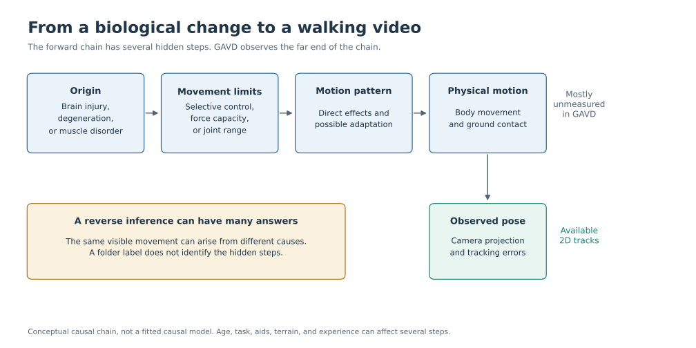
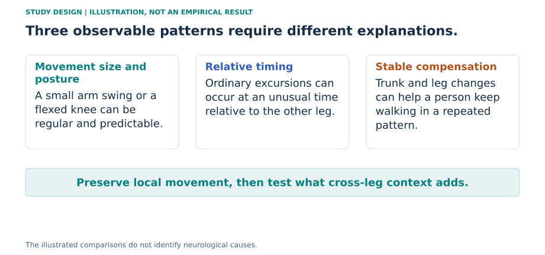
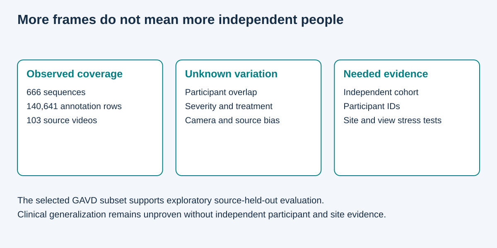
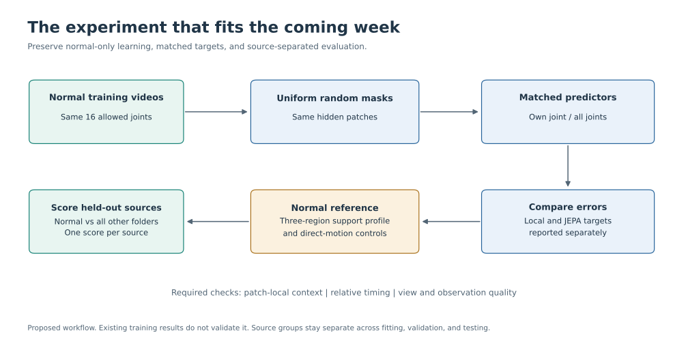
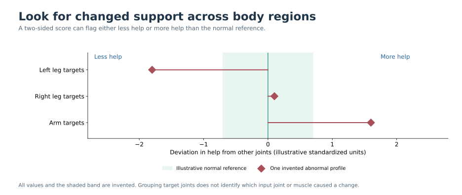
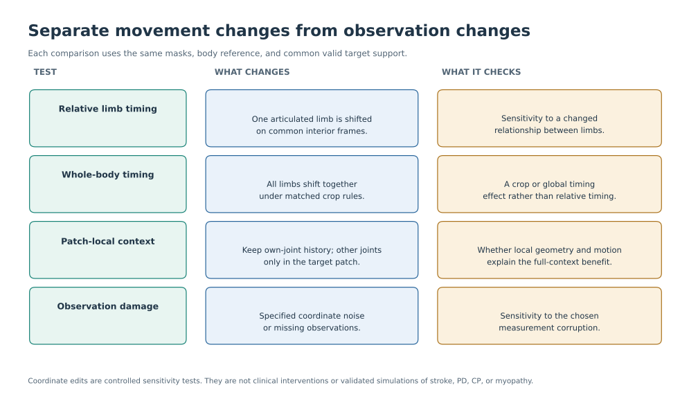

# Predictable walking can still be abnormal

This research package tests a specific question: **does the help supplied by other joints identify unusual gait better than prediction error alone?** An abnormal movement can be repeatable. We therefore predict the same hidden joint patch using that joint alone, nearby body context, and all available body context. A normal-only reference measures departures in either direction.

The completed primary study uses **all twelve current GAVD condition folders**. Only `normal` is normal; every other folder is positive for the binary endpoint. Parkinsons, stroke, cerebral palsy and myopathic gait remain focal examples and form a separate five-class supervised comparison with normal gait. Myopathic gait is muscle-related, so the biological motivation is neuromusculoskeletal rather than exclusively neurological.

Start with [Notebook 08](08_biology_cohort_and_source_folds.ipynb). Notebooks 00 through 07 remain foundations for pose processing, Skeleton S-JEPA, uniform masks, VICReg, progressive adaptation, forecasting and the exp5-style Random Forest comparison. Their earlier five-class experiment and [measured results](docs/results.md) are preserved. They are not results of the new context study.



## Implementation and evidence

The code implements normal-only JEPA pretraining, six matched predictor heads, a three-region normal-reference profile, four source folds, a ridge control, a random-backbone control, and separate supervised classifiers. It saves source roles, masks, exclusions, histories, reference parameters and source-level scores. Read the [implemented protocol](docs/context_study_protocol.md), [new-study results](docs/context_study_results.md) and [implementation review](docs/context_study_review.md) together. A runnable experiment, a synthetic demonstration and a completed real study are different forms of evidence. A fixed update budget does not establish convergence or a detection advantage.

The completed primary real study evaluates **251 source videos, including 23 normal sources**. The latent profile has AUROC 0.641 versus 0.541 for matched raw error; the paired difference has a conditional 95% interval of [-0.035, 0.224]. **No learned JEPA advantage is established.** The [longer-training sensitivity and development diagnostics](docs/context_study_sensitivity.md) retain that conclusion. [Motion and observation controls](artifacts/context_study/gavd/3044566091261819/source_controls/7407af320461a092/summary.json) provide additional comparisons, with supervised nuisance prediction kept separate. Read the [manuscript](docs/draft01/manuscript.md) for the bounded scientific interpretation.

This is a paper-based adaptation of [Skeleton S-JEPA](https://sjepa.github.io/). It changes the original motion-aware masking to the requested uniform masking, adds VICReg and uses a small sixteen-joint model. It is not an exact benchmark reproduction or the separately named stochastic-latent S-JEPA method.

The historical three-seed experiment retained 2,504 windows from 450 sequences and 91 sources. It did not establish a learned JEPA advantage over the Random Forest or untrained encoder. Those findings motivated stronger controls. They must not be relabeled as evidence for the new study, whose retained cohort follows fresh ingestion and an additional source-support rule.

The [ASTAD4 call](https://ismart.ece.mcgill.ca/astad4/) lists **November 20, 2026** as the deadline, permits seven content pages plus two reference-only pages, and requires double-blind AAAI-27 formatting. The official page was checked on November 15 and gives no cutoff timezone. The [paper plan](docs/paper_plan.md) connects possible claims to their required evidence.

## Next iteration: instructions and data feasibility

The [next-iteration instructions](../../notes/aaai/05-iterate-02-INSTR.md) specify the proposed research question, notebook design, technical comparisons and decision rules. The [data review](docs/iteration02/advice_data.md) and [reproducible availability probe](docs/iteration02/data_feasibility_probe.json) identify what the existing videos can support. These are next-step instructions and measured observation counts, not new model-performance results.

The strongest next experiment asks whether the opposite leg improves prediction beyond the target leg's own movement and extra fitting capacity. It first verifies that the predictor works, then tests its use of timing on fixed hidden answers, and finally checks added detection value beyond posture, amplitude and simple timing descriptors. Read the [plain-language research brief](docs/iteration02/README.md) and [revised planning slides](slides/tutorial.pdf). The six new notebooks are specified in the instructions but have not been implemented or executed.

The masking comparison now has three precise training policies: U selects scattered tokens uniformly, J starts with one whole-joint temporal tube, and A starts with a connected anatomical group over a short interval. J and A add uniformly selected tokens until all policies hide exactly 64 of 128 tokens. Their individual-token hiding probabilities are all 0.5. Evaluate every trained policy on the unchanged U bank, with a separately named distal-leg challenge as a diagnostic. This tests mask structure without changing masking rate or choosing a favorable test task. The [masking review](docs/iteration02/masking_method_review.md) explains the primary literature and the limits of the novelty claim.



A promising practical change is to score the eight lower-leg joints while retaining the same 16-joint input and uniform masking allowlist. All five normal sources rejected by the current profile rule fail arm support, while retaining enough lower-leg targets. Arm-leg analysis can remain a separate, explicitly supported secondary experiment.

| Observation population | Sources | Normal sources | Sequences | Windows | Focal five-class sources |
| --- | ---: | ---: | ---: | ---: | ---: |
| Completed twelve-readout-joint study | 251 | 23 | 1,303 | 8,950 | 81 |
| Candidate lower-limb readout | 304 | 28 | 1,381 | 9,442 | 90 |

The candidate population is calculated from current pose availability with at least four distinct eligible patches for each of joints 25–32. It has not been evaluated with a new model. It is a separately declared cohort and readout, not a replacement result for the completed primary study. All 28 candidate normal sources were previously explored. They are source videos, not 28 verified independent participants.

The next iteration explicitly proposes normal versus the four focal condition families as its primary endpoint and the all-folder binary endpoint as a required secondary analysis using the same frozen scores. This is an exploratory redesign after the completed results were seen; it does not replace the historical all-folder primary or create an independent confirmatory test. Only `normal` remains normal. The separate supervised task has five classes, with stroke included once. The candidate focal subset contains 28 normal, 10 Parkinsons, 15 stroke, 10 cerebral palsy and 27 myopathic sources.

Longer clips are not a free improvement. The following read-only probe uses the existing confidence and window-quality rules, before the joint-specific profile gate. Duration is the first-to-last sample span, `(frames - 1) / 15`, rather than the number of samples divided by FPS.

| Samples at 15 Hz | Sample span | Sources before profile gating | Normal sources before profile gating |
| --- | ---: | ---: | ---: |
| 32 | 2.07 seconds | 311 | 28 |
| 48 | 3.13 seconds | 303 | 27 |
| 64 | 4.20 seconds | 284 | 23 |
| 96 | 6.33 seconds | 231 | 12 |
| 128 | 8.47 seconds | 162 | 9 |

A six-to-eight-second primary would lose much of the already small normal population. A short-window method must represent uncertainty about gait phase rather than assume every clip contains complete cycles. Any phase alignment should retain a real-time comparison, because cadence and variable timing may themselves carry useful information. The [probe script](docs/iteration02/probe_data.py) reproduces these counts without training or modifying historical artifacts.

## Set up locally with uv

```bash
cd experiments/aaai
uv sync
uv run jupyter lab
```

Choose the Python environment created here. If a named kernel is useful:

```bash
uv run python -m ipykernel install --user --name aaai-gait --display-name "Python (AAAI gait)"
```

The single dependency specification is [pyproject.toml](pyproject.toml). It selects Python 3.12 and installs the local `alexpose` package in editable mode, making `ambient` available. `uv` creates its environment and lockfile locally. Every notebook repeats imports, configuration and data loading so it can run in a fresh kernel without another notebook's state.

CPU is the default. The context study uses 64-dimensional representations, two encoder layers, four attention heads and batch size 16. Pose extraction, four independent folds and repeated masked scoring can take substantial laptop time. Start with a small synthetic check. Notebook teaching runs use fewer updates than the research command.

### Use the repository-root .env

Keep settings and credentials in the root `.env`, not a second experiment file. Existing secrets are not copied or printed. JEPA and RF training need no API key.

```dotenv
AAAI_DEMO=1
AAAI_SEED=42
AAAI_TARGET_FPS=15
AAAI_FRAME_NUMBER_BASE=1
AAAI_EPOCHS=3
AAAI_BATCH_SIZE=16
AAAI_RUN_SPE_ABLATION=0
```

Every notebook uses the requested spelling through aliases for python-dotenv's actual functions:

```python
from dotenv import load_dotenv as load_env, find_dotenv as find_env
load_env(find_env())
```

Setup locates the repository root before this call. Shell variables take precedence. Restart kernels after changing settings. `AAAI_DEMO=1` selects invented teaching arrays in notebooks; `AAAI_DEMO=0` selects available real poses. The context command-line runner instead uses the explicit `--demo` flag and reads real data when that flag is absent. Its seed and update budgets are explicit arguments saved in the protocol. `AAAI_EPOCHS` controls the older foundation workflow, not the new fixed-update schedule. Keep the declared 15 Hz and one-based annotation-frame convention for a comparable study.

## Tutorial map

| Primary research notebook | What it teaches |
| --- | --- |
| [08. Biology, cohort and source folds](08_biology_cohort_and_source_folds.ipynb) | Form the biological question, count all folders, inspect video context and separate source roles. |
| [09. Matched context prediction](09_matched_context_prediction.ipynb) | Restrict information before attention, fit six normal-only heads and inspect common targets and diagnostics. |
| [10. Source profiles and classifier comparison](10_source_profiles_and_classifier_comparison.ipynb) | Build the reference profile, inspect paired source results and distinguish supervised recognition. |
| [11. Interventions and manuscript evidence](11_interventions_and_manuscript_evidence.ipynb) | Test timing and observation edits, inspect geometric damage and bound interpretation. |

| Foundation notebook | What it teaches |
| --- | --- |
| [00. Research and inventory](00_research_and_gavd_inventory.ipynb) | The original five-class inventory and tasks. |
| [01. Video, pose and quality](01_video_pose_and_quality.ipynb) | Downloads, annotated-person crops, ambient extraction, timing and missing poses. |
| [02. Joint tokens and uniform masks](02_joint_tokens_and_uniform_masks.ipynb) | The joint table, four-frame tokens and independent uniform masks. |
| [03. Normal-only JEPA and VICReg](03_normal_only_jepa_and_vicreg.ipynb) | Teacher targets, gradients and representation health. |
| [04. Progressive adaptation](04_progressive_condition_adaptation.ipynb) | Adding the four focal conditions with normal replay while preserving the normal reference. |
| [05. Forecasts and anomalies](05_forecast_anomalies_and_explanations.ipynb) | A fully hidden future, latent discrepancy and calibration limits. |
| [06. RF versus JEPA capstone](06_capstone_rf_vs_jepa.ipynb) | The detailed exp5-style classifier comparison and annotated-video prediction. |
| [07. Ablations and evidence](07_ablation_and_paper_evidence.ipynb) | Positional-noise exploration, controls and the historical evidence ledger. |

The [archived foundation guide](docs/foundation_tutorials_README.md) preserves the earlier workflow. Its progressive abnormal-data adaptation is a classification experiment. The primary anomaly model in Notebooks 08 through 11 does not train on abnormal sources.

Each notebook supplies real walking-video context when media exists, or a source link otherwise. That video remains separate from synthetic examples. Annotated previews stay in `data/videos-gavd/<source_id>/previews/`; authored notebooks do not contain large video blobs. Inspect the person, box alignment and walking interval before interpreting scores.

## Fresh annotations and generalizability

Each study reads `data/gavd/<condition>/*.csv`, hashes the annotations, and excludes the `source/` distribution directory from counting. The inventory authority is [data/gavd/README.md](../../data/gavd/README.md). Old feature caches and exp5 result tables are not model inputs.

The November 15, 2026 scan contains:

| Folder | Sequences | Annotation rows | Source IDs |
| --- | ---: | ---: | ---: |
| abnormal | 767 | 216,492 | 117 |
| antalgic | 35 | 6,556 | 10 |
| cerebral palsy | 64 | 20,346 | 11 |
| exercise | 234 | 54,941 | 98 |
| inebriated | 23 | 7,007 | 8 |
| myopathic | 188 | 34,595 | 30 |
| normal | 291 | 41,340 | 32 |
| parkinsons | 47 | 10,426 | 11 |
| pregnant | 6 | 909 | 2 |
| prosthetic | 39 | 17,999 | 8 |
| stroke | 76 | 33,934 | 19 |
| style | 104 | 13,571 | 3 |
| Unique union | 1,874 | 458,116 | 348 |

There are **32 normal and 316 abnormal source IDs** under the folder rule. Sources can occur in several abnormal folders, so folder counts do not sum to the unique union. These are annotation counts before availability, pose quality and profile filtering, not accepted-window or patient counts. Stroke occurs once.

The binary endpoint includes exercise, style and pregnancy because those folders are outside `normal`. It does not assert that every such movement is pathological. A source mixing normal and abnormal folder labels raises an error and needs annotation review.

**GAVD supports exploratory evaluation on held-out source videos within this collection. It does not establish clinical or population generalizability.** More frames do not create more people. Source IDs do not establish participant independence across reposts or uploads. The available metadata do not establish balanced sites, demographics, severity or treatment.

Viewpoint, age, walking aids, compression, uploader style and pose visibility can correlate with labels. Missing media and quality filtering select the population again. The profile rule can exclude a source because one joint lacks enough observations. Report attrition by condition and view. More abnormal categories broaden the challenge without enlarging the normal reference population. Independent participant-identified and site-separated data are needed for stronger claims.

The next-iteration lower-limb candidate improves observation coverage from 23 to 28 normal sources, but every one was previously explored. It does not provide an independent normal test population. GAVD is sufficient for a bounded exploratory study of observable movement under recording variation. It is insufficient by itself for a generalizable clinical classifier or a validated neurological world model. A larger number of windows, a new split, or a recovered body-region readout cannot remove those limits.

The current annotations also contain 751 initial-contact events across 80 sequences from 11 sources, with none in the normal folder. These can check a fixed phase estimator in a separately identified auxiliary study. They cannot be silently used to tune the same outer-test detector, and unlabeled frames are not automatically negative contacts. Eleven annotation sequences contain multiple camera-view labels. A future view-specific model must join frame-level labels to the actual window, rather than treating the existing sequence-level view list as an exact window viewpoint. The [data review](docs/iteration02/advice_data.md) gives the event counts, source roles and proposed checks.



## Ingest and reproduce the completed context study

Inspect the inventory and available media:

```bash
uv run python scripts/ingest_study.py --inventory-only
```

Attempt bounded downloads and extract available annotated sequences:

```bash
uv run python scripts/ingest_study.py --download-missing --download-budget-seconds 900 --source-timeout 45 --download-workers 4 --workers 4
```

Normal sources get the first acquisition opportunity, followed by stable source-ID order. Existing decodable media are reused. Failures, timeouts and budget-limited attempts remain in the ledger. Repeat ingestion to continue acquisition. Without `--download-missing`, only available media are extracted. No model score selects downloads or exclusions.

Check the software with an explicitly small artificial run:

```bash
uv run python scripts/run_context_study.py --demo --pretrain-updates 2 --predictor-updates 2 --masks 16 --ridge-draws 256
```

Synthetic scores have no medical meaning. The declared real-data recipe is:

```bash
uv run python scripts/run_context_study.py --pretrain-updates 512 --predictor-updates 512 --masks 16 --ridge-draws 256
```

The runner prints its artifact directory. All four folds run by default. `--folds 0` is a partial development run, and `--without-untrained` omits a required learning control. The scoring bank is fixed at 16 masks. Data, code and settings enter the run identity. Compatible checkpoints and score caches are reused after provenance checks.

Stop ingestion before training so the pose corpus stays fixed. Stale annotations or pose settings require explicit reconciliation. A nonfinite loss on a valid target raises an error rather than silently removing an inconvenient observation.

```text
data/videos-gavd/
  <source_id>/<source_id>.mp4
  <source_id>/previews/
  acquisition_logs/
experiments/aaai/artifacts/
  poses/<sequence_id>.npz
  context_study/ingestion/
  context_study/synthetic/<run_id>/
  context_study/gavd/<run_id>/
```

Ingestion saves the fresh manifest, media ledger, extraction report and exclusions. Study runs add `profile_eligibility.csv`, `source_folds.csv`, per-fold checkpoints and references, classifier artifacts, `source_scores.csv`, `ranking_metrics.json`, `primary_paired_bootstrap.json` and `summary.json`. A completed subset of folds remains partial evidence.

## Follow the model and comparison



The pipeline uses `ambient` through its annotated-person adapter and retains raw XY, confidence, frame indices and provenance. `data.extract_sequence` decodes each one-based annotated frame, rescales its GAVD box to the downloaded resolution, and calls `ambient.pose.keypoint_extractor.SequenceKeypointExtractor` on that crop. This is image-based pose extraction, not a validated temporal identity tracker. The next iteration should inspect first, middle and last annotated frames and their actual source intervals. Valid pose caches may be reused after their annotation, video, model and configuration hashes agree; a changed extraction rule needs a new cache version. It resamples to 15 Hz only when source FPS is at least 15, without bridging missing frames. Coordinates are pelvis-centered and scaled using observed torso measurements from the window's first half. This measures relative image-plane motion, not physical speed or depth.

Use exactly the [16 deduplicated joints](docs/joint_table.md): shoulders, elbows, wrists, hips, knees, ankles, heels and foot indices. Four frames of one joint form a token, giving 128 tokens per 32-frame window. Uniform masks hide half the positions without reading motion, velocity, confidence or labels. Invalid tokens are separately excluded from attention and targets. A window needs at least 75% valid tokens overall and 50% in each half.

Before folds, the fixed scoring masks establish whether a source has four distinct eligible time patches for every readout joint. A target also needs two visible valid patches of its own joint. This decision uses observation validity and time identity, not scores. Repeated masks and overlapping windows do not create more distinct support.

In each outer fold, five non-test normal sources provide development diagnostics and the reference profile. Remaining normal sources fit the encoder, heads and ridge models. Other non-test abnormal sources are excluded from the anomaly models and used only by the separate supervised classifiers.

Skeleton S-JEPA pretraining uses a context encoder, a detached EMA teacher, centered latent targets and VICReg. The encoder, teacher and target center are then frozen. Within each target type, three identically initialized heads use separate optimizers, shared draws and equal update budgets:

| Branch | Information available before attention |
| --- | --- |
| Own joint | Visible valid patches of the target joint. |
| Patch-local context | Own-joint context plus other visible joints in the target four-frame interval. |
| Full context | All visible valid patches of the sixteen approved joints. |

Coordinate heads predict eight normalized XY values. Latent heads predict the frozen full-input teacher's distribution. Coordinate MSE and latent KL have different units. The coordinate target checks whether apparent benefit depends on the teacher already embedding other joints. Every branch shares pelvis centering and torso scale, so the own-joint condition is conditional on that common reference.

This is **masked completion**, because visible patches may precede or follow a hidden patch. It is not suffix forecasting. VICReg discourages collapse and redundancy; it does not promise disease-class separation. The primary study uses deterministic positions and no learned stochastic latent variable. The earlier positional-noise exploration remains separate.

### Build a two-sided normal-reference profile

For each joint, benefit is own-joint error minus full-context error. Average common targets within windows, windows within sequences, and sequences within sources. Give the four joints in each region equal weight: left leg, right leg and arms. Hips and shoulders remain in masking and training but are excluded from the primary score because the shared body reference creates geometric shortcuts.



The five inner normal sources estimate a mean and shrunk diagonal variance for each region. The score is the mean squared standardized departure across regions. Both unusually small and unusually large benefit can increase it. This is a distance, not a probability or diagnosis.

The primary comparison is the latent profile against raw full-context KL with identical twelve-joint targets, support and aggregation. Controls include constituent own/full distances, patch-local context, coordinate targets, source-balanced ridge predictors, and a random-backbone control whose prediction heads are still trained on normals. The runner also uses exactly four distinct patches per joint and leaves one reference source out at a time. These sensitivities are not additional independent observations.

### Evaluate sources and separate supervision

Each source has one outer-test fold. Calculate AUROC within each fitted fold and combine it using eligible normal test-source counts as weights. The paired bootstrap resamples the same source IDs for both methods within fold and binary label. It conditions on fitted models, references and folds, excluding retraining uncertainty and unknown repeated-person dependence. Raw score scales from different fitted folds are not pooled into one ROC curve.

The five-class classifier uses the same outer folds and accepted poses but receives focal normal and abnormal training labels. It excludes the five inner normal reference sources. RF uses 36 measured angle and motion descriptors, including an exp5-style core. The JEPA probe uses a frozen normal-trained encoder and a linear classifier. Hyperparameters are fixed. If a recording has multiple focal labels, its source-label rows share one total source weight. Report their macro-F1 and balanced accuracy in a separate supervised table.

The [published-baseline feasibility review](docs/published_baseline_feasibility.md) explains why SeeKer and STG-NF remain relevant prior art but are not validated comparators here. Ridge or RF scores cannot establish superiority over those methods.

## Challenge interpretations and inspect the outputs

After a completed real study, use its printed directory:

```bash
uv run python scripts/run_study_controls.py --run-dir artifacts/context_study/gavd/<run_id> --fold 0
```

This command uses normal fitting sources, selects one eligible longer window per source in a fixed order, and compares a relative limb shift, whole-body shift, coordinate noise and observation dropout. It keeps the original crop's normalization fixed, pairs valid target identities, and records limb, pelvis and torso changes. An edited leg is not a virtual stroke or a simulation of muscle weakness.



An optional implemented diagnostic separates predictor-context changes from contextual teacher-target changes:

```bash
uv run python scripts/run_study_controls.py --run-dir artifacts/context_study/gavd/<run_id> --fold 0 --teacher-decomposition
```

It compares original and relatively shifted left-leg inputs while keeping all local measurements of eight arm and right-leg joints unchanged. Four matched losses combine original/edited predictions with original/edited frozen teacher targets. Their signed changes separate predictor, teacher and interaction terms in raw latent KL units. These eight joints do not define the full three-region profile, so the command does not form that profile from them. The teacher, center and normalization remain fixed. This diagnoses a contextual model-target effect, not a disease mechanism. The completed [development diagnostics](docs/context_study_sensitivity.md) distinguish five sources with scorable paired full profiles from twelve sources contributing partial raw teacher diagnostics. These are fitting-source checks, not held-out mechanism validation.

Notebook 08 supplies a blank blinded movement-annotation template. It does not establish completed independent annotation. Neither the coordinate control nor this teacher diagnostic proves a biological cause.

## Slides, checks and supporting documents

Use the [offline HTML deck](slides/index.html), [editable Markdown](slides/tutorial.md), [current vector PDF](slides/tutorial.pdf) and [visual review](slides/visual_review.md). The [detailed neuromechanics figures](docs/draft00/images/index.html) have editable SVG sources for presentations and papers. The [archived 40-slide completed-study deck](slides/archive/draft01_completed/tutorial.pdf) preserves the presentation associated with draft01. The current deck distinguishes those measured findings from the proposed next iteration.

```bash
uv run python -m pytest tests -q
uv run python scripts/validate_notebooks.py
uv run python scripts/validate_notebooks.py --real
```

The notebook validator starts a fresh kernel for each notebook and saves executed copies under `artifacts/notebook_checks/` or `artifacts/real_notebook_checks/`. All twelve notebooks passed in fresh kernels. The [current execution record](docs/current_execution_validation.md) links the real-data notebook copies, durations and artifact verification. Passing software checks does not establish scientific benefit.

Read the [literature review](docs/literature_review.md), [biological direction](docs/draft00/neurological_research_direction.md), [implemented protocol](docs/context_study_protocol.md), [new results](docs/context_study_results.md), [research review](docs/context_study_review.md), [paper plan](docs/paper_plan.md) and [draft manuscript workspace](docs/draft01/README.md). The longer-term world model would distinguish control, muscle and body mechanics, contact and observation. This completion study measures predictive relationships. Additional measurements are needed to identify their biological causes.
