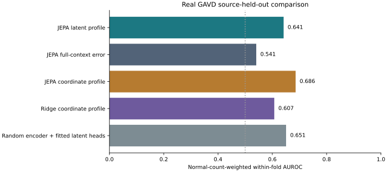
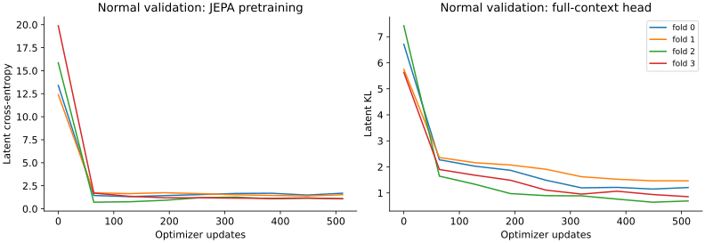

<!-- iteration02-navigation -->
> Historical study or planning record. Its scientific results and run identities remain unchanged. The executed [iteration02 study and draft02](draft02/README.md) contain the active results, six new notebooks and independent participant replication.

# Real GAVD results for the revised context study

This report was generated from a completed real-data artifact. It is separate from the earlier five-condition exploratory results in [results.md](results.md). No synthetic score enters the tables below.

## Cohort and acquisition

The current annotations contain 1,874 sequences and 348 source IDs. The acquisition ledger records 332 locally decodable videos. Pose-window quality checks retain 9,474 windows from 1,389 sequences and 311 sources. The fixed twelve-joint profile-support check leaves **8,950 windows, 1,303 sequences, and 251 sources**, including **23 normal sources**.

The profile check is based on observation validity and the fixed uniform masks before any fit or test score. Every retained source supplies at least four distinct physical patches for every readout joint. Category source memberships may overlap. These counts are source videos, not verified independent people.

| label | annotated_sequences | annotated_sources | pose_sequences | pose_sources | pose_windows | profile_sources | profile_windows |
| --- | --- | --- | --- | --- | --- | --- | --- |
| abnormal | 767 | 117 | 613 | 103 | 5143 | 92 | 5098 |
| antalgic | 35 | 10 | 29 | 9 | 116 | 8 | 102 |
| cerebral palsy | 64 | 11 | 56 | 10 | 390 | 10 | 390 |
| exercise | 234 | 98 | 203 | 92 | 1092 | 59 | 781 |
| inebriated | 23 | 8 | 9 | 6 | 41 | 2 | 21 |
| myopathic | 188 | 30 | 164 | 28 | 669 | 25 | 631 |
| normal | 291 | 32 | 135 | 28 | 482 | 23 | 404 |
| parkinsons | 47 | 11 | 35 | 10 | 184 | 9 | 179 |
| pregnant | 6 | 2 | 6 | 2 | 20 | 2 | 20 |
| prosthetic | 39 | 8 | 28 | 7 | 445 | 6 | 438 |
| stroke | 76 | 19 | 60 | 15 | 779 | 14 | 773 |
| style | 104 | 3 | 51 | 2 | 113 | 2 | 113 |

## Previous use of these recordings

| binary_label | prior_use | sources |
| --- | --- | --- |
| 0 | previous_study | 23 |
| 1 | not_in_previous_study | 170 |
| 1 | previous_study | 58 |

The new protocol was specified before its new score evaluation, but the dataset was previously used for exploratory work. All retained normal sources appeared in that earlier study. The outer folds provide source separation for each fitted model; they are not a newly sequestered clinical test cohort.

## Prespecified anomaly comparison

All normal-only models use the same outer source folds. Five normal reference sources per fold are excluded from encoder and predictor fitting. The primary statistic averages within-fold AUROC using normal-source counts. AP is averaged with the same weights and must be interpreted with each fold's abnormal prevalence, available in the machine-readable metrics.

| Method | AUROC | AP |
| --- | --- | --- |
| JEPA latent profile | 0.641 | 0.949 |
| JEPA full-context error | 0.541 | 0.930 |
| JEPA coordinate profile | 0.686 | 0.957 |
| Ridge coordinate profile | 0.607 | 0.948 |
| Random encoder with fitted heads | 0.651 | 0.951 |
| Own-error profile distance | 0.657 | 0.953 |
| Full-error profile distance | 0.673 | 0.953 |
| Patch-error profile distance | 0.648 | 0.952 |
| JEPA profile, four patches | 0.542 | 0.932 |
| Reference-free full-minus-own contrast | 0.527 | 0.926 |

The primary paired difference, latent profile minus full-context error, is **0.101 AUROC**, with a conditional 95% bootstrap interval **[-0.035, 0.224]**. The bootstrap resamples sources within fold and binary label, carrying both methods together. It conditions on fitted models, chosen references, and folds. It does not include retraining uncertainty, reference-selection uncertainty, or unknown repeated participants.

The conditional interval includes zero. The experiment does not establish an advantage of the proposed profile over raw full-context error.

*Bars are point estimates on the common cohort. The interval above refers to the paired primary difference, not to each bar separately.*

## Matched alternative explanations

| Comparator | Difference | CI_low | CI_high |
| --- | --- | --- | --- |
| Full-error profile distance | -0.031 | -0.152 | 0.096 |
| Own-error profile distance | -0.015 | -0.128 | 0.101 |
| Random encoder with fitted heads | -0.009 | -0.127 | 0.108 |
| Ridge coordinate profile | 0.034 | -0.087 | 0.155 |

These additional paired intervals use the same fixed-fit bootstrap. The own- and full-error distances receive the same two-sided reference calibration as the proposed profile. An advantage over raw error alone cannot establish that subtracting errors adds information. These are exploratory control comparisons without a multiple-comparison correction.

## Reference sensitivity and newly used abnormal sources

| target_type | minimum | maximum |
| --- | --- | --- |
| coordinate | 0.635 | 0.748 |
| latent | 0.585 | 0.673 |

These are the smallest and largest aggregate AUROCs attainable by omitting one inner reference source in each fold while holding the models fixed. They are perturbation ranges, not confidence intervals. The reference-free contrast above remains a secondary comparison and is not promoted to a new primary endpoint.

A descriptive restriction retains all normal test sources and only the 170 abnormal sources absent from the previous study. Its full metrics are saved in `new_abnormal_descriptive_metrics.json`. Because the normal sources remain previously explored, this restriction is not external validation.

## Category descriptions

| Category | Sources | Folds | AUROC | AP |
| --- | --- | --- | --- | --- |
| abnormal | 92 | 4 | 0.579 | 0.851 |
| antalgic | 8 | 4 | 0.522 | 0.481 |
| cerebral palsy | 10 | 4 | 0.486 | 0.431 |
| exercise | 59 | 4 | 0.815 | 0.930 |
| inebriated | 2 | 2 | 0.667 | 0.375 |
| myopathic | 25 | 4 | 0.604 | 0.671 |
| parkinsons | 9 | 4 | 0.565 | 0.485 |
| pregnant | 2 | 2 | 0.500 | 0.250 |
| prosthetic | 6 | 4 | 0.543 | 0.418 |
| stroke | 14 | 4 | 0.681 | 0.640 |
| style | 2 | 2 | 0.455 | 0.250 |

Category summaries reuse normal sources and may reuse mixed-category abnormal sources. They are dependent. A category can lack abnormal support in a fold; its descriptive average uses supported folds only. Two- and three-source categories cannot support stable population estimates. Folder labels are not verified diagnoses.

## Separate supervised condition recognition

Both classifiers receive focal-condition training labels and exclude outer test sources and the inner normal reference sources. The JEPA encoder remains frozen after normal-only pretraining. Predictions average windows within sequences and sequences within source-label pairs; a mixed-label source has total metric weight one. These supervised macro-F1 scores are not comparable numerically with normal-only AUROC.

| Fold | Method | Macro_F1 | Balanced_accuracy | Sources |
| --- | --- | --- | --- | --- |
| fold_0 | random_forest | 0.521 | 0.483 | 21 |
| fold_0 | normal_jepa_probe | 0.483 | 0.483 | 21 |
| fold_1 | random_forest | 0.532 | 0.629 | 21 |
| fold_1 | normal_jepa_probe | 0.189 | 0.219 | 21 |
| fold_2 | random_forest | 0.412 | 0.433 | 20 |
| fold_2 | normal_jepa_probe | 0.262 | 0.300 | 20 |
| fold_3 | random_forest | 0.621 | 0.630 | 19 |
| fold_3 | normal_jepa_probe | 0.423 | 0.580 | 19 |

## Training and robustness

The run uses 512 JEPA pretraining updates and 512 updates for each independent context head. Every window uses the same sixteen-mask scoring bank, independent of motion intensity and pose validity. Ridge uses 256 source-balanced training draws. These are fixed budgets and do not establish convergence by themselves.

*Validation sources influence neither weights nor target centers. The curves describe this budget, not an optimized stopping rule.*

The run also saves the four-patch observation-budget sensitivity and leave-one-normal-reference-out scores. No score direction, fold assignment, or category selection is changed after test inspection. The development timing/observation controls are reported separately when completed. Their edits are not disease simulations. A published SeeKer or STG-NF comparison remains unvalidated for this partially observed sixteen-joint corpus; see the [feasibility report](published_baseline_feasibility.md).

## Reproducibility and claim boundary

The run directory is `artifacts/context_study/gavd/3044566091261819/`. Its protocol, source roles, fresh manifest, acquisition and eligibility ledgers, checkpoints, cache hashes, frozen references, source scores, and training histories support the reported tables. `scripts/summarize_context_study.py` regenerates this report and the vector plots. The [implemented protocol](context_study_protocol.md) explains the estimand and controls.

A result on this cohort cannot identify neural causes or establish clinical screening performance. The normal sample is small, diagnoses and participant identities are unverified, and pose exclusions select for visible joints. GAVD supports a bounded observational comparison. The [draft01 manuscript and readiness assessment](draft01/README.md) state which conclusions survive those limitations.
