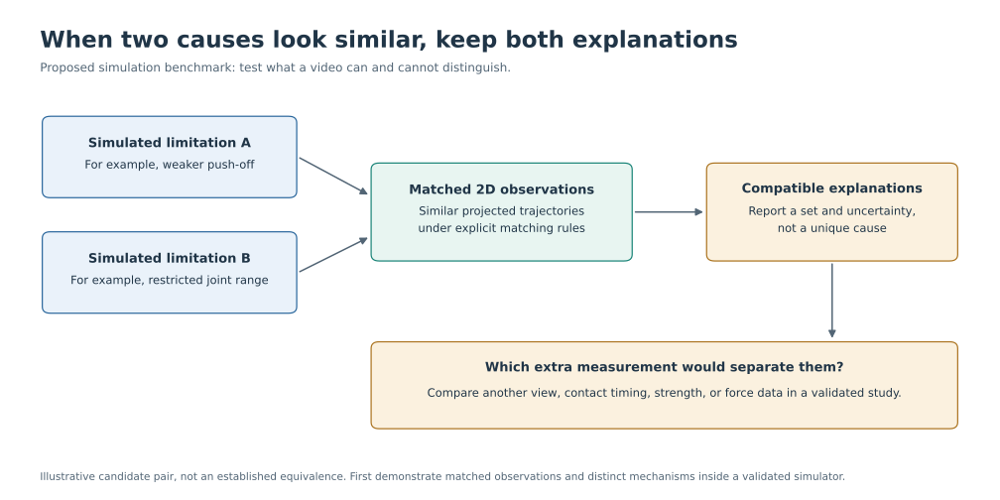

<!-- iteration02-navigation -->
> Historical study or planning record. Its scientific results and run identities remain unchanged. The executed [iteration02 study and draft02](draft02/README.md) contain the active results, six new notebooks and independent participant replication.

# Critical review of the revised study

The revised study makes the proposed comparison executable. Its question is whether a normal-reference profile of predictive help adds information beyond ordinary prediction error. Neurological and muscle mechanisms motivate that question, but the measured variables remain two-dimensional motion and model losses.

## Issues found and corrected

| Finding | Why it mattered | Correction |
|---|---|---|
| Excluded joints could be contextualized before an own-joint head received its input. | The information comparison would be invalid. | Each branch restricts measurements before attention. Perturbation tests check hidden and excluded coordinates. |
| A target could lack enough own-joint history. | Branches could use different or impossible requests. | Shared eligibility requires an observed hidden target and two visible own-joint patches. Masks are never redrawn based on validity or motion. |
| Overlapping windows and repeated masks could exaggerate support. | Repeated observations could appear independent. | Support uses sequence identity and physical patch intervals; every readout joint needs four distinct patches. |
| Profile support could be assessed after folds. | A failed reference could tempt an outcome-dependent replacement. | A mask-and-validity-only check freezes eligibility before folds. No loss enters the decision. |
| Ridge could silently omit an unfitted head. | Methods could use different targets. | Inadequate ridge training fails before scoring. Exact target eligibility is verified across methods. |
| Fixed observation budgets could differ between predictors. | Four-patch sensitivity would not control exposure. | Deterministic physical-patch selections are verified equal across methods. |
| Cached loss tables could be incomplete or stale. | Resume could mix models or masks. | Provenance and cache hashes are checked; incomplete pairs are rebuilt. |
| Raw scores from fitted folds could be pooled. | Different score scales could distort ranking. | Main AUROC is computed within folds and weighted by normal-source counts. |
| Mixed-label sources could receive extra classification weight. | Annotated videos could count several times. | Counts distinguish source-label rows from unique sources; each source has total weight one. |
| Timing edits could wrap or change normalization. | Artifacts could explain score changes. | Edits use interior samples, fixed original-crop normalization, and geometry checks. |
| Empty paired support could disappear. | Missing data could look harmless. | Requested targets remain in a scaffold and unsupported profiles are unscorable. |
| A teaching diagram called a visible ankle patch hidden. | The example contradicted the mask. | It selects an actually hidden ankle patch from the existing random draw. |
| Parallel notebook checks reused IPC names. | Independent kernels collided. | Each validator uses a separate short temporary socket directory. |

## Claims that remain limited

The own-joint branch uses body-centered and body-scaled coordinates. Preprocessing already contains hip and shoulder information. It is a reduced-input predictor in a shared coordinate frame, not a joint observed in complete physical isolation.

The frozen encoder was pretrained with broadly visible context. Re-encoding one joint changes its input distribution. Coordinate targets, ridge regression, and an untrained-encoder control probe this alternative explanation without proving its absence.

A latent teacher target contains whole-body context. The optional four-factor diagnostic separates predictor-input and teacher-target changes. When a target joint is unchanged, a teacher-side effect demonstrates contextualization of the model target. It does not measure a neural connection. Nonlinear profile distances must be recomputed for all four complete profiles before interpreting their decomposition.

The complete three-region profile selects videos with visible arms and feet. Report both ordinary pose quality and profile-support exclusions. A missingness-aware extension requires separate validation rather than a score-dependent relaxation of the rule.

Only five normal sources estimate each reference. Shrinkage and leave-one-reference-out analysis expose instability but do not create population-level normal variation. Paired source bootstrap intervals condition on fitted models and references. They omit training variability, reference selection, and unknown repeated participants across videos.

Published-baseline inspection found substantive execution and missing-observation issues. A finite forward pass does not validate an adapted anomaly score. The manuscript cannot claim superiority over SeeKer or STG-NF without a reliable comparison.

## Submission evidence

The manuscript needs completed real-data runs, source counts at every exclusion stage, training and variance diagnostics, matched controls, uncertainty, and an account of what did not improve. Fresh-kernel checks must confirm the declared models run on real poses. Slides and text must use the same evidence artifact.

The submission judgment is in [draft01](draft01/README.md), following real results and independent manuscript reviews. This implementation review is not an acceptance prediction.
