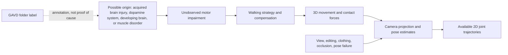
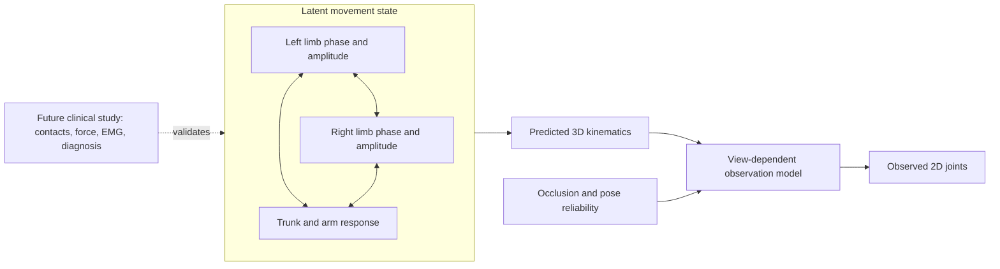

# Neuromechanics advisory for a GAVD world-model study

**Model:** gpt-6-sol. **Date:** November 14, 2026. This is a research proposal, not a new result. I reviewed the current draft, GAVD CSV schema, pose pipeline, feature code, and primary clinical and gait literature. I did not edit the main documents, process new videos, or train a model.

## Begin with the causal distinction

Stroke, Parkinson's disease, and cerebral palsy can alter walking through different disorders of the nervous system. Stroke is an acquired brain injury whose motor effects depend on lesion location and may include weakness on one side ([NINDS](https://www.ninds.nih.gov/sites/default/files/2025-05/post-stroke-rehabilitation.pdf)). Parkinson's disease commonly involves loss of dopamine-producing neurons in the substantia nigra and can change movement amplitude and timing ([NINDS](https://www.ninds.nih.gov/health-information/disorders/parkinsons-disease?topics=36&types=BSC.Blog)). Cerebral palsy reflects damage or abnormal development of the developing brain and has varied motor presentations ([CDC](https://www.cdc.gov/cerebral-palsy/about/index.html)). “Myopathic” is different: it denotes muscle-related dysfunction, not a single central neurological origin. Muscle disorders vary substantially in the distribution of weakness ([NINDS](https://www.ninds.nih.gov/health-information/disorders/muscular-dystrophy)).

These origins suggest *families of possible movement effects*, not deterministic video signatures. Post-stroke walking can show side-to-side differences and hip hiking or circumduction, but even these visible strategies do not identify which impairment caused them ([stroke interlimb study](https://pmc.ncbi.nlm.nih.gov/articles/PMC8904653/)). Parkinsonian gait may show reduced or asymmetric arm swing, while some early cases in a measured cohort had no group difference in stride length or cadence ([arm-swing study](https://pmc.ncbi.nlm.nih.gov/articles/PMC10121495/)). Cerebral palsy includes unilateral and bilateral patterns such as equinus and crouch, along a continuum rather than four clean signatures ([CP gait analysis](https://pmc.ncbi.nlm.nih.gov/articles/PMC5489760/)). A study of myopathic children reported reduced motion range and lateral displacement, while a Duchenne cohort linked proximal weakness to posture; neither result defines every GAVD “myopathic” sequence ([myopathic gait study](https://pubmed.ncbi.nlm.nih.gov/20870548/), [Duchenne study](https://pmc.ncbi.nlm.nih.gov/articles/PMC8721072/)).

GAVD's folders provide **gait-pattern annotations**, not verified diagnoses, affected side, lesion site, medication state, muscle testing, or patient identity for the local sources. Do not write “stroke causes left hip hiking in this clip” from its folder label. The proposed binary task follows the user's rule: `normal` is the only normal folder and all eleven other folders, including `exercise`, `style`, and `pregnant`, are abnormal gait. Abnormal gait is not synonymous with neurological disease. The original five-class cohort has 450 pose-qualified sequences from 91 sources; the full annotation inventory has 1,874 sequences from 348 sources, including only 32 normal source IDs. No extra folder adds normal sources. A source ID is a recording, not necessarily a person.

**Suggested graphic 1:** Render this as a horizontal causal ladder. Shade the last node as measured, the middle nodes as latent, and the label as an annotation. A visible pattern cannot be traced backward uniquely to an origin.

## What the current pipeline can and cannot see

The CSVs contain `seq`, `frame_num`, `cam_view`, `gait_event`, `dataset`, `gait_pat`, `bbox`, `vid_info`, `id`, and `url`. They do not contain patient IDs, laterality, clinician-verified diagnoses, forces, or EMG. Only 758 frame rows have any gait-event annotation, and none are in `normal`. Camera-view labels describe annotations, not synchronized same-person recordings. The cached pose retains 33 BlazePose landmarks for audit, but the **model** uses only 16: shoulders 11/12, elbows 13/14, wrists 15/16, hips 23/24, knees 25/26, ankles 27/28, heels 29/30, and foot indices 31/32. Inputs are 2D XY, resampled to 15 Hz, with 32 frames per window, four frames per token, and uniform random masking. A window spans about 2.1 seconds. It is pelvis-centered, scaled by torso length from the first half, and loses absolute forward travel. The existing 36 RF features include projected hip/knee/ankle angles, bilateral differences, wrist/ankle excursion, ankle separation, and torso orientation. They are **not** clinical stride length, gait speed, or 3D joint angles.

| Candidate observable | What 16-joint 2D pose can support now | What it cannot establish |
| --- | --- | --- |
| Left-right asymmetry | Within-view, high-coverage differences in projected joint excursion, relative ankle/wrist motion, and rough joint-angle ranges. Use unsigned differences unless anatomical side and mirroring are audited. | Paretic side, lesion laterality, force asymmetry, or a disease-specific sign. |
| Relative timing | Coarse leg-leg and arm-leg lag or phase proxies from sufficiently long, quality-checked sequences. Report frame-rate and cycle-detection uncertainty. | Exact stance/swing timing from the existing sparse event labels. A 32-frame window need not contain enough clean cycles. |
| Step amplitude | Projected ankle/foot excursion in torso units within a consistent view. | Metric step or stride length, walking speed, and true foot clearance. Pelvis centering removes travel and no floor calibration exists. |
| Proximal compensation | Projected shoulder-to-pelvis lean, bilateral hip/shoulder displacement, and arm-swing range under view restrictions. | True pelvic obliquity, lumbar lordosis, hip abductor weakness, or whether a posture is compensation rather than primary impairment. |
| Foot posture | A cautious projected shank-foot angle using ankles, heels, and foot indices in side views, after landmark review. | Clinical ankle dorsiflexion, equinus, foot drop, contact force, or toe-off timing without validation. |
| Motor output | None directly. | Muscle strength, spasticity, rigidity, joint torque, ground-reaction forces, EMG activation, and neural lesion mechanism. |

Single-view markerless gait estimates change with viewing geometry and out-of-plane movement; a primary validation study found lower-limb angle error increased in such conditions ([camera and IMU validation](https://www.nature.com/articles/s41598-022-22246-5)). Treat every proxy as a projected image measurement, and stratify by front, back, and side views rather than pooling incompatible angle meanings. The local pose-quality gate excludes many sequences, so exclusions may change which movement phenotypes remain. Wrist motion, especially, can reflect walking aids, camera angle, or an edited video. A normal-looking proxy in two seconds does not negate the source label.

Predeclare four **exploratory, nonexclusive** pattern checks before viewing model scores. For `stroke`, examine unsigned left-right ankle and wrist excursion differences and projected trunk lean, without naming an affected side. For `parkinsons`, examine torso-scaled bilateral ankle and wrist excursion and coarse arm-leg timing, without equating a small projection with bradykinesia. For `myopathic`, examine projected proximal lean and hip motion alongside distal excursion, without inferring weakness. For `cerebral palsy`, show the *distribution* of projected knee/ankle posture and asymmetry rather than one expected signature. Use one dot per source, view-stratified panels, and uncertainty or “unscorable” marks. These are checks of whether the proposed coupling score corresponds to visible movement families, not four disease-specific classification targets. The scarce Parkinsonian and cerebral-palsy sources particularly rule out stable subtype conclusions.

## A reproducible study for the November 20 deadline

**Question.** Does cross-joint predictive information add abnormal-gait detection beyond each joint's own motion, and is its gain related to independently annotated movement proxies rather than source or view? This preserves the current roadmap's strongest world-model mechanism. Train on normal sources only. For each uniformly masked target patch, compare a predictor restricted to the target joint's visible history with a matched predictor that also sees the other allowed joints. Score the same target under the same mask and normalization. Require enough visible own-joint history on common support. Use a patch-local coordinate target as the primary interpretation check; a contextual JEPA teacher target can carry other-joint information into the answer. Report each loss and `loss_full - loss_own`, not just the difference. Fit a simple ridge own-versus-full predictor on the same inputs so a transformer is not credited for an ordinary linear relationship. Compare raw normal-only JEPA discrepancy, normal embedding distance, and one validated published normal-only skeleton method if feasible.

**Independent motion annotations.** Before looking at new model scores, have two reviewers inspect a small source-stratified set of already available clips with folder names and model outputs hidden. Use a written rubric: gait visible and person identity stable; anatomical left/right and mirroring confidence; repeated steps visible; coarse side-to-side motion asymmetry; arm-swing reduction/asymmetry; apparent trunk lean; uncertain or unscorable. Record view, occlusion, walking aid, and confidence separately. Sample normal plus the four original condition folders and some available extra abnormal folders. Resolve disagreements without forcing uncertain clips into a positive mechanism class. Report agreement and source counts. This is **observable movement annotation**, not diagnosis, affected-side adjudication, or clinical ground truth. If there is no time for blinded review, use only automatically defined proxies and label their validity unverified.

**Mechanism tests.** On high-coverage, view-compatible development sequences, change relative limb timing while preserving articulated limb geometry and common interior frames; compare with a whole-body time shift, framewise static predictor, and bounded observation noise. Keep normalization, target support, and masks fixed across each pair. Check that phase edits do not create obvious discontinuities or impossible posture. Such an edit tests model sensitivity, not disease simulation. For real held-out clips, ask whether the contrast associates with *blindly annotated* asymmetry or timing, and whether that association persists after reporting view and pose coverage. Association is not a causal attribution. Do not select the mechanism proxy because it correlates best with folder labels or model scores, which would make the explanation circular.

**Evaluation.** Use four source-grouped outer folds over the about 28 currently pose-qualified normal sources. Each source receives one out-of-fold score; normal training and inner validation exclude that fold. Assign new abnormal sources before scoring. All eleven nonnormal folders are positive for overall binary ranking, but tiny folders receive descriptive category results. The primary metric is the normal-source-count-weighted mean of within-fold, source-level AUROCs, with a paired bootstrap of source IDs within fold and binary label, recomputing the metric and carrying both methods' scores together. This interval is conditional on the fixed fitted models and fold assignment; it does not measure retraining or repeated-person uncertainty. Do not pool raw scores across folds without train-only scale calibration. The prior three inspected test splits remain historical and the cross-fit result is exploratory, not fresh confirmation. Predeclare a useful gain, for example 0.05 AUROC over raw JEPA, and distinguish a wide inconclusive interval from an upper bound excluding that gain. The five-class RF classifier remains a separate supervised task.

**Minimum result worth writing.** Show (1) held-out normal benefit from other joints with a local target, (2) selective sensitivity to a valid relative-timing edit over global phase and observation edits, (3) a paired source-level gain over raw discrepancy and a simple own/full baseline on real abnormal-gait labels, and (4) category, view, and exclusion support. If the local target removes the gain, report a contextual-teacher explanation rather than a neuromechanical claim. If the normal model remains poorly optimized, this experiment cannot decide whether cross-joint information is useful. All three outcomes are more precise than a diagnosis narrative.

| Date | Decision |
| --- | --- |
| November 15 | Freeze folder-to-binary mapping, source folds, clip annotation rubric, proxy definitions, and media/QC cutoff. Audit a blinded clip sample and time one training run. |
| November 16 | Run normal-only update diagnostics and own/full predictors with a local target. Stop the mechanism claim if full context brings no normal benefit. |
| November 17 | Finish paired relative-timing, global-time, static, and observation controls. Reject edits that break geometry or support. |
| November 18 | Freeze scores, evaluate new abnormal sources once, and compute source-level paired intervals and category/view tables. |
| November 19 | Write only claims supported by completed controls; present uncertainty and attrition. |
| November 20 | Check numbers, citations, anonymity, and submission cutoff; submit within the official deadline. |

## Longer-term world model

The more ambitious model would represent **movement state, coordination, and observation uncertainty separately**. A latent state could include each limb's cyclic phase and amplitude, bilateral coupling, trunk/arm compensation, and an observation channel for view, occlusion, and detector error. A conditional prior predicts future movement states; a target-informed posterior is used only in training. An anatomical decoder can generate joint trajectories, while an observation model maps them to each camera's keypoints. Intervene on a latent coupling variable to test whether the model changes bilateral timing without changing within-limb trajectories or pose quality. Compare those counterfactual predictions with measured repeated walks, not with synthetic pathology labels alone. This is a *design hypothesis*, not a trained component of the current code.

Identifying its biological interpretation requires a new cohort with verified participant IDs, synchronized repeated views, known affected side and clinical phenotype, calibrated 3D motion, contact events or force plates, and muscle strength or EMG where relevant. Some abnormalities could arise through many combinations of latent impairment and compensation, so even those measurements will need explicit identifiability checks. The GAVD study can motivate and stress-test the architecture; it cannot infer brain lesions, dopamine state, muscle forces, or treatment targets from YouTube pose tracks.

**Suggested graphic 2:** Show motion and observation as different colored paths. Add a small side panel with normal, relative-limb timing edit, and pose-noise edit. Label those curves “illustration” until data generate them. The figure should make clear that the current GAVD experiment measures 2D projected motion, while the proposed biological model needs additional observations.
