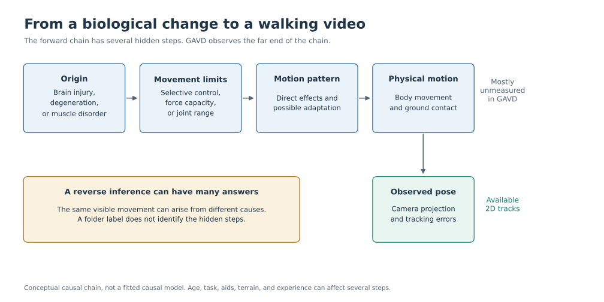
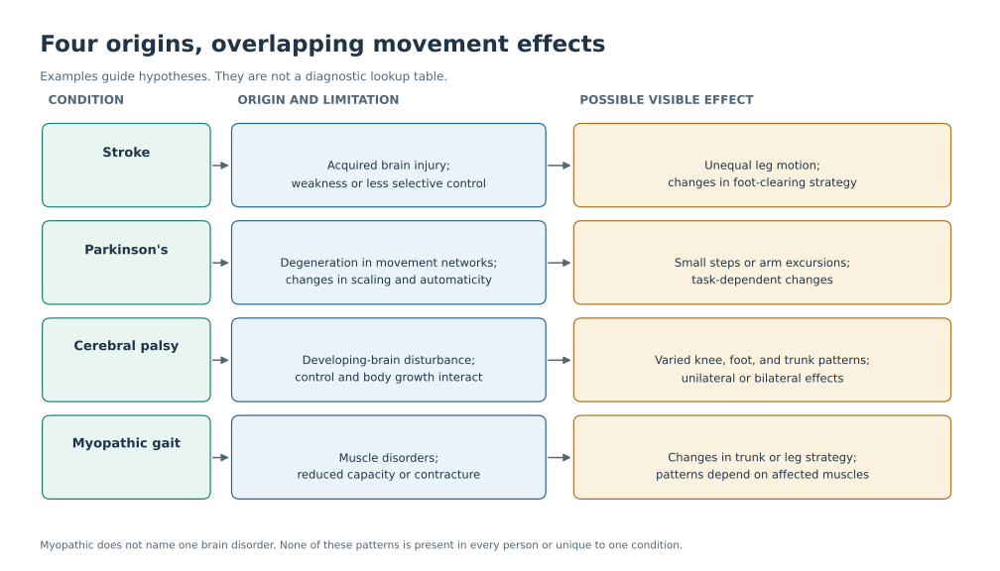
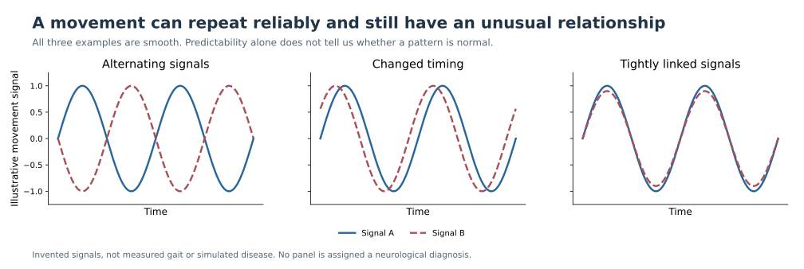
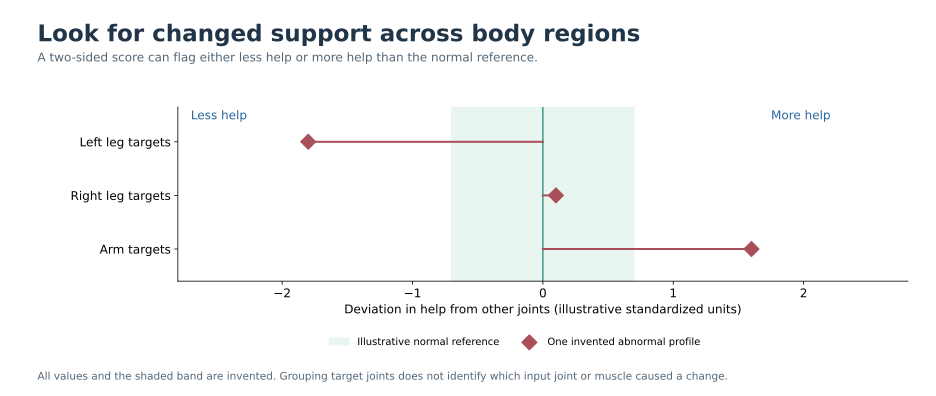
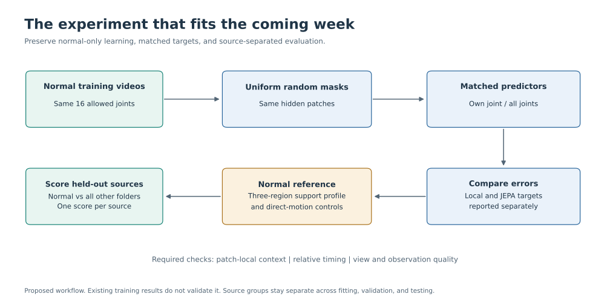
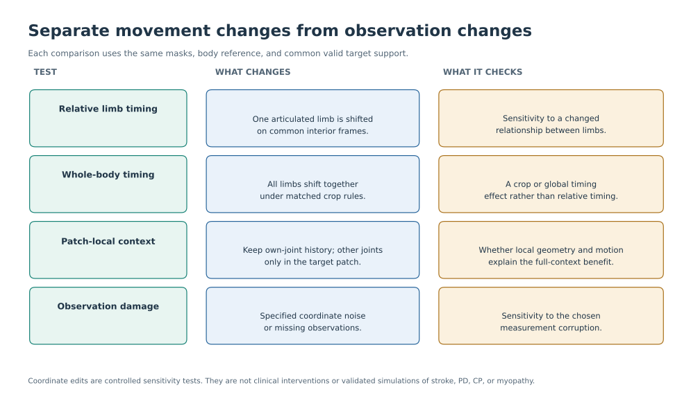
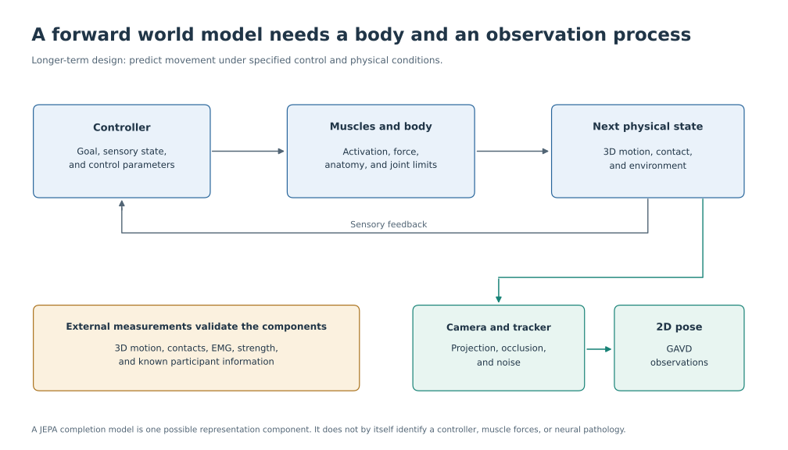
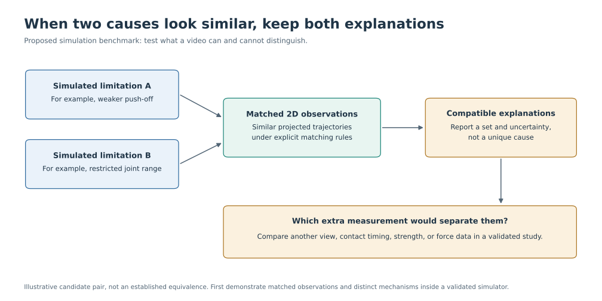

# A world-model research direction grounded in how walking works

**Research proposal, November 14, 2026. No new model results are reported here.** This document extends the [plain-language explanation](README.md) and [experimental roadmap](research_roadmap.md). It draws on primary clinical and simulation studies, a new Claude Opus consultation, and GPT advisors. The [clinical evidence ledger](advisory/neuromechanics_clinical_evidence.md) records study populations, measurements, and limitations. The [visual guide](images/index.html) collects the illustrations as SVGs and vector PDFs.

**My recommendation is to study abnormal walking as a potentially organized adaptation to a movement limitation.** For the workshop, test whether a model can detect changes in how body parts help predict each other, including abnormalities that remain repetitive and predictable. For the longer research program, build a physical forward model that represents several compatible explanations for a movement and tests what extra measurement would distinguish them.

These are different levels of ambition. The first can use the current GAVD pipeline. The second needs simulation and clinical measurements beyond GAVD. The scientific connection is that both ask how a body can produce a walking pattern under constraints, rather than assuming that abnormal walking must look random.

## 1. Begin with the forward chain

Walking requires the nervous system to select and time muscle activity, the muscles to generate force, and the body to maintain support and move against gravity. A change at any of these stages can alter movement. The person may also adapt by changing posture, timing, or the contribution of another limb. A camera then projects the resulting three-dimensional motion into an image, and the pose estimator adds its own errors.



*Figure 1. This is a conceptual account of how motion is generated. It is not an estimated causal graph for GAVD. Several hidden processes can produce similar visible motion.*

For example, a knee that bends little during swing does not identify a single cause. The leg may have entered swing with inadequate push-off, or other activity may resist knee flexion. A clinical study of 52 people selected for post-stroke stiff-knee gait examined precisely this distinction. Its result depended on additional kinematic measurements and a reference relationship, rather than the appearance of the knee alone. [Campanini et al., 2013](https://pubmed.ncbi.nlm.nih.gov/23755883/).

This forward chain is the useful “world model” idea. It explains which processes should be represented and which measurements would constrain them. Naming an unobserved latent variable “weakness” does not establish that it measures weakness.

## 2. What the four condition families actually suggest



*Figure 2. These are examples supported by the studies below, not rules for diagnosing a video. A condition can have several movement presentations, and one presentation can occur under several conditions.*

### Stroke: altered control and uneven contributions

A stroke damages brain tissue when blood supply is interrupted or a vessel ruptures. Its movement consequences depend on the injured networks and subsequent recovery. It can affect voluntary drive, selective activation, sensation, and balance. “Spastic gait” is therefore an incomplete explanation of all post-stroke walking. [NINDS stroke overview](https://www.ninds.nih.gov/health-information/stroke/stroke-overview).

Two primary studies sharpen the modeling question. Clark and colleagues studied muscle activity in 55 people with post-stroke hemiparesis and found that fewer independently varying muscle modules often described their walking. Awad and colleagues used instrumented walking, strength testing, and stimulation in 40 people after stroke. Some participants with reduced paretic drive walked relatively fast and showed greater nonparetic propulsion, consistent with compensation. This was an observational association. [Clark et al., 2010](https://pubmed.ncbi.nlm.nih.gov/20007501/), [Awad et al., 2020](https://pubmed.ncbi.nlm.nih.gov/31834220/).

The example to keep in mind is a person who still walks rhythmically while the legs contribute differently. A pose model may find one leg unusually dependent on the rest of the body, or find a different left-right pattern of prediction errors. That is a hypothesis about motion relationships. GAVD cannot tell us which leg is clinically paretic, how much force it produces, or whether a specific neural pathway caused the pattern.

### Parkinson's disease: amplitude, automaticity, and coordination can separate

Parkinson's disease involves degeneration of movement-related neural systems, prominently dopamine-producing neurons in the substantia nigra. Its initiating causes are incompletely understood, and walking involves more than the dopamine system alone. A study combining brain imaging and walking measurements in 125 people with PD found that cholinergic measures also related to gait speed. [NIH overview](https://www.nia.nih.gov/health/parkinsons-disease/parkinsons-disease-causes-symptoms-and-treatments), [Bohnen et al., 2013](https://pubmed.ncbi.nlm.nih.gov/24078735/).

The distinction between movement size and timing matters. Morris and colleagues experimentally separated stride length, cadence, and speed, supporting an amplitude-regulation account of gait hypokinesia in their cohort. Sterling and colleagues studied arm motion in 16 people with PD and 17 controls. Medication increased the slower arm's angular-velocity amplitude and reduced asymmetry, without a statistically significant improvement in bilateral cross-correlation. That does not prove that coordination was unchanged. These are separate outcomes. [Morris et al., 1994](https://pubmed.ncbi.nlm.nih.gov/7953597/), [Sterling et al., 2015](https://pubmed.ncbi.nlm.nih.gov/25502948/).

Imagine regular, small steps accompanied by little arm motion. Each trajectory may be easy to predict. A model must examine movement size and relationships separately to explain what it detects. In GAVD, projected wrist excursion is measurable when visible, but it is not dopamine level, true stride length, or medication response. A walking aid or camera angle can also reduce the apparent excursion.

### Myopathic gait: the muscles can be the starting point

“Myopathic” refers to muscle-related disease or dysfunction. It is not one brain disorder and does not specify one diagnosis. Inflammatory myopathies, for example, are a family involving muscle inflammation and weakness. This is why the research should use **neuromusculoskeletal** when discussing all four families: nerves, muscles, and body mechanics all matter. [NINDS inflammatory myopathies](https://www.ninds.nih.gov/health-information/disorders/inflammatory-myopathies).

Duchenne muscular dystrophy provides a concrete, disease-specific example. In a longitudinal study of 31 boys with 152 visits, reduced hip-extension strength was associated with changes in posterior trunk angle and pelvic tilt. Hip-abduction weakness related to wider steps; the expected link to lateral trunk range was not supported in the same way. This cautions against interpreting every visible sway as proof of one weak muscle. [Vandekerckhove et al., 2025](https://link.springer.com/article/10.1186/s12984-025-01718-5).

A useful modeling example is a person changing upper-body posture while continuing to advance the legs regularly. The observable question is whether projected trunk and leg motion have a different relationship. It is not whether the model has measured hip strength. The generic GAVD `myopathic` folder must not be relabeled as Duchenne disease.

### Cerebral palsy: early brain disturbance interacts with a changing body

Cerebral palsy describes varied movement and posture disorders arising from a disturbance of the developing brain. The originating disturbance is nonprogressive, but movement and musculoskeletal problems can change with growth and age. CP is not synonymous with oxygen deprivation at birth, and it is not one gait subtype. [NIH CP overview](https://health.nih.gov/health-topics-a-z/cerebral-palsy), [NICHD causes](https://www.nichd.nih.gov/health/topics/cerebral-palsy/conditioninfo/causes).

Clinical EMG analysis in 549 people with CP and 84 unimpaired participants found reduced muscle-activity complexity associated with functional impairment. A separate ultrasound study found smaller age-related increases in gastrocnemius muscle volume in young children with CP; this compared children at different ages rather than following every child's growth. These studies motivate a model with both control and body parameters, rather than a single “brain abnormality” switch. [Steele et al., 2015](https://pubmed.ncbi.nlm.nih.gov/26084733/), [Herskind et al., 2016](https://pubmed.ncbi.nlm.nih.gov/26510820/).

Consider crouched walking, where the hips and knees remain more flexed during support. Simulations show that this posture changes which muscles must support and advance the body. It can require more knee-extensor capacity while reducing some other demands. That is a tradeoff, not a uniform deterioration of every component. Crouch is one possible presentation, not the definition of CP. [Steele et al., 2010](https://pubmed.ncbi.nlm.nih.gov/20493489/), [Steele et al., 2012](https://pubmed.ncbi.nlm.nih.gov/22959837/).

### What these studies change in our hypothesis

These studies support asking about **altered organization**, rather than assuming that abnormal movement is always less coordinated or harder to predict. They do not establish the sign of a GAVD prediction score. EMG modules are estimated from muscle electrical activity, whereas our inputs are projected joint positions. Even low-dimensional EMG has biomechanical explanations that do not uniquely establish neural modules. [Kutch and Valero-Cuevas, 2012](https://pubmed.ncbi.nlm.nih.gov/22570602/).



*Figure 3. These are invented signals, not physiological simulations. They explain why a regular movement can have an unfamiliar relationship to another movement.*

## 3. The strongest feasible question for GAVD

**Can we detect abnormal walking that remains predictable by measuring where the normal pattern of helpful joint information changes?**

Return to the hidden ankle example in the [README](README.md). One predictor sees the ankle's other visible positions; the other also sees the remaining allowed joints. Their difference in error measures the predictive benefit of the extra context. Both use the same shared body reference.

The earlier proposal looked only for a loss of benefit. The biological review motivates an additional, prospectively specified test that can detect a departure in either direction. Some movements might become less related; others might become more tightly constrained; effects might differ across body regions. Preserve the original one-sided score as a comparator. Do not change its sign after looking at abnormal results.

Use a three-number profile at first: benefit for left-leg targets, right-leg targets, and arm targets. The leg groups contain knees, ankles, heels, and foot indices. The arm group contains elbows and wrists. Hips and shoulders remain visible or masked according to the same 16-joint sampler and are still training targets; their scores are reported separately because the shared body reference creates especially direct geometry shortcuts. This is a declared readout choice, not a change to which joints are uniformly masked.



*Figure 4. All values are illustrative. The profile tells us where target prediction benefits from extra context. It does not tell us which input joint supplied that benefit, or which muscle or lesion caused it.*

The detailed [score specification in the roadmap](research_roadmap.md#the-new-two-sided-profile) uses a small diagonal normal reference and source-level aggregation. A three-dimensional profile is more credible with the available normal sources than a large learned graph. Directed joint-to-joint effects would require additional matched context restrictions during training. Attention maps or removing an input only at test time would not establish those effects.

We also need a direct-motion baseline. A profile can be ordinary while posture or movement amplitude is unusual, and an abnormal compensation can preserve both prediction errors. Compare the profile with normal distances based on projected posture, excursion, and the individual predictor losses. Keep the supervised Random Forest recognition study separate from these normal-only anomaly detectors.

## 4. What GAVD contributes, and what it leaves unknown

The current annotation inventory contains 348 source-video IDs: 32 normal and 316 abnormal under the user's folder rule. The four named abnormal folders contain 47 Parkinsonian, 76 stroke, 64 CP, and 188 myopathic sequences. These counts describe annotated sequences, not verified patients or usable pose tracks. The existing processed cohort retains 28 normal sources. Full counts and media availability are in the [README](README.md#what-gavd-can-support).

GAVD is valuable because it gives heterogeneous examples outside a single laboratory recording setup. The additional folders also challenge a mechanism-specific explanation: `exercise`, `style`, `pregnant`, and all other non-normal folders remain abnormal for the binary endpoint. Their inclusion lets us ask whether a score detects broader movement departures or merely separates the four named folders. It does not turn them into a healthy control group.

| Observable question | Usable evidence | Interpretation limit |
| --- | --- | --- |
| Do the two legs move differently? | Projected knee/ankle trajectories and unsigned excursion differences in an appropriate view. | These do not establish affected side, propulsion, or a brain lesion. |
| Do the arms and legs show a different relationship? | Visible wrist/elbow trajectories and sufficiently long repeated motion. | A two-second crop may be inadequate for reliable cycle timing. Aids and occlusion matter. |
| Does the upper body move differently with the legs? | Shoulder-to-pelvis orientation and projected relative motion. | These are not calibrated pelvic mechanics or measured muscle strength. |
| Is the foot trajectory or posture different? | Reviewed ankle, heel, and foot-index landmarks. | Ground clearance, contact force, and clinical ankle angle need more validation. |

Current model windows contain 32 frames at 15 Hz, spanning about 2.1 seconds. Keep the primary profile independent of estimated gait phase. Coarse phase analysis is optional and requires longer, uninterrupted, quality-checked segments. Do not declare heel strikes from sparse labels or silently invent phase ground truth. Pelvis centering also removes absolute travel, so these windows do not supply metric walking speed.

Before examining new scores, obtain blinded annotations of a fixed source sample if suitable reviewers are available. Hide folder names and model results. Ask about visible asymmetry, reduced arm excursion, sustained knee flexion, trunk motion, view, walking aids, and uncertainty. Include “unscorable.” Two reviewers should use the same written definitions and report agreement. These are movement descriptions, not retrospective clinical diagnoses. If independent reviewers are unavailable, report proxy analysis without claiming independent physiological validation.

## 5. The decisive experiment and its failure conditions



*Figure 5. The matched own-joint and full-context branches are proposed additions. They are not already implemented by the existing training runs.*

First demonstrate adequate normal training and a real held-out benefit of extra context. Use uniform masks over the original allowlist and common targets for both predictors. Repeat the comparison with a local coordinate target and with the contextual JEPA teacher target. Use the same source folds and compute budget. Require the attention restrictions and teacher controls in the roadmap.

Then test the interpretation with paired sequence edits and a predictor limited to local context. That control sees the target joint's visible history, plus other joints only within the target's four-frame patch. It checks whether nearby geometry and motion already explain the full-context advantage. A relative limb timing change should also be distinguished from a matched whole-body timing change. Observation damage is a separate test; it need not produce zero response, but a detector responding mainly to that damage does not support a movement-organization claim.



*Figure 6. Each intervention has a limited interpretation. A time-shifted limb is not a synthetic stroke, and a noisy keypoint is not a validated model of every pose-estimation error.*

Evaluate held-out source scores against all usable abnormal folders. The main endpoint remains binary abnormal-gait ranking, using the within-fold source-level AUROC and paired intervals specified in the roadmap. Report categories, views, missingness, and exclusions. Folder separation or association with a movement annotation is secondary evidence, not a substitute for the main detection test.

The learned-representation claim weakens if matched ridge predictors or an untrained encoder with identically trained prediction heads perform as well. A claim about longer temporal relationships fails if the patch-local predictor explains the effect. A four-frame patch is not purely static; a separate framewise analysis is needed for a static-geometry claim. The physiological interpretation remains unsupported if the profile merely reproduces view, tracking failure, or its own automatically derived proxy. A wide interval is inconclusive. A well-controlled negative result can be informative, but it does not automatically make a strong workshop paper.

## 6. The more ambitious and creative world-model program

**Long-term question: when different physical limitations produce similar-looking walking, can the model preserve the ambiguity and predict which additional measurement would resolve it?**

A plausible forward model has four parts. A controller selects activity from its current state and task. Muscles and body geometry turn that activity into movement under contact and environmental constraints. The next state feeds back to the controller. A separate camera and observation model generates the measured keypoints.



*Figure 7. This is a longer-term architecture. GAVD supplies projected observations; clinical and instrumented data would constrain the other components.*

One mathematical sketch makes the distinction precise:

```text
control_t       = policy(state_t, task; control_parameters)
state_(t+1)     = dynamics(state_t, control_t; body_parameters, environment)
observed_pose_t = camera_projection(body_landmarks(state_t)) + observation_error
```

The state could contain joint positions, velocities, and muscle activation. Body parameters could include force capacity and joint range. Controller parameters could describe activation constraints. These are proposed simulator variables, not measurements recovered from the GAVD labels. A single neural scalar for “stroke severity” would hide the very ambiguity we need to study.

Predictive musculoskeletal simulation is established research. Ong and colleagues generated different adaptations by changing plantarflexor weakness or contracture in a specified model. Waterval and colleagues compared predictions of bilateral plantarflexor weakness with instrumented data from 16 participants and found imperfect, joint-dependent agreement. These examples show both the promise and the validation burden. [Ong et al., 2019](https://journals.plos.org/ploscompbiol/article?id=10.1371/journal.pcbi.1006993), [Waterval et al., 2021](https://pubmed.ncbi.nlm.nih.gov/33882437/).

### A benchmark for ambiguity under a specified observation process

Start with a published, validated simulator and a small set of explicit perturbations, such as unilateral activation limits, bilateral force-capacity changes, and range restrictions. Never name a single perturbation “stroke” or “Parkinson's.” Vary body size, task, and camera independently so that labels cannot be recovered from rendering shortcuts. Generate movement by solving the physical dynamics, rather than only editing joint trajectories.

Next, search for pairs with different stipulated mechanisms but similar projected observations under a declared matching tolerance. Define similarity relative to the available signals and an explicit observation-noise model. Similar clean trajectories alone do not prove indistinguishability. Establish that such pairs actually exist; the figure below is only a candidate example. Hold out mechanism combinations, camera conditions, and subjects or body models. Measure how well a model's set of proposed explanations contains the generating simulator setting, how large that set is, and when the model wrongly expresses certainty. A very large set can have high coverage while being useless, so coverage and specificity must be reported together.



*Figure 8. The proposed contribution is to quantify ambiguity and useful additional information. Similar projected motion is a condition to demonstrate, not a conclusion assumed from the illustration.*

Then compare possible extra observations, such as a second camera or measured foot-contact timing, against a fixed or random measurement choice. The selection rule may see only the initial observation and fitted model, never the generating parameters or the candidate measurement outcomes. Reveal only the selected noisy measurement, and test whether it reduces ambiguity at equal measurement cost. Strength, force, and EMG require an appropriate clinical study and consent; they are not actions a deployed video classifier can obtain automatically. Any simulated causal effect is conditional on the simulator. External data must test whether the explanation set contains measured physical information and whether the selected measurement actually helps.

GAVD's role is to expose the observation problem: view changes, occlusion, unusual movement, and source variation. Use it to stress-test the observation component and ask which proposed explanations remain compatible with visible motion. It cannot score the correctness of a muscle-force or neural-cause estimate because those reference measurements are absent.

### Where stochastic variables belong

In the immediate experiment, keep the predictor deterministic and repeat a fixed bank of uniformly sampled masks. That isolates the context comparison. Stochastic positional embeddings remain an optional representation ablation, not a source of neurological labels.

In the later forward model, stochastic latent variables could represent multiple compatible hidden states and plausible future trajectories. Use a context-only prior at inference; a posterior that reads the missing target belongs only in training. Validate coverage, calibration, diversity, and error correlation on held-out simulated conditions and external measurements. Latent sampling variation, variation across trained models, and pose-observation noise answer different uncertainty questions. Neither a wide sample spread nor a low prediction error establishes correct clinical uncertainty.

## 7. Where novelty would actually come from

| Existing work | What it already covers | The additional result needed here |
| --- | --- | --- |
| [Skeleton S-JEPA](https://www.ecva.net/papers/eccv_2024/papers_ECCV/papers/04755.pdf), [FSGait](https://openaccess.thecvf.com/content/ACCV2024/html/Duan_FSGait_Fine_Grained_Self-Supervised_Gait_Abnormality_Detection_ACCV_2024_paper.html), [SeeKer](https://arxiv.org/abs/2506.18368) | Skeleton prediction and prediction-based anomaly methods. | A controlled dissociation between raw predictability and changed predictive context, with a useful real-data consequence. |
| [Clinical motor-module studies](https://pubmed.ncbi.nlm.nih.gov/26084733/) | Relations between measured muscle activity and impairment. | An explicitly kinematic result, validated against independent movement observations without claiming to recover EMG. |
| [OpenSim Moco](https://journals.plos.org/ploscompbiol/article?id=10.1371/journal.pcbi.1008493) and [MyoSuite](https://proceedings.mlr.press/v168/caggiano22a.html) | Physical movement optimization and musculoskeletal control environments. | A demonstrated inference or evaluation advance, beyond adding physics terminology. |
| [Generative GaitNet](https://arxiv.org/abs/2201.12044) and [Bidirectional GaitNet](https://arxiv.org/abs/2306.04161) | Anatomy-conditioned gait generation and inverse anatomical estimation, including patient comparisons in Bidirectional GaitNet. | A matched-observation ambiguity benchmark, validated explanation sets, and useful measurement selection. |
| [Probabilistic musculoskeletal modeling](https://pubmed.ncbi.nlm.nih.gov/25404535/), [inverse-analysis uncertainty](https://pmc.ncbi.nlm.nih.gov/articles/PMC9174465/), and [gait-model identifiability](https://arxiv.org/abs/2307.11332) | Uncertainty propagation, sensitivity to measurement/model errors, and parameters that cannot be recovered from gait observations. | Distinguishing specific competing impairment mechanisms under a markerless observation model, rather than rediscovering that inverse problems are uncertain. |
| [Bayesian gait-state estimation with different sensor configurations](https://pmc.ncbi.nlm.nih.gov/articles/PMC9246062/) | Comparing which gait states can be estimated from available sensor combinations. | A validated, observation-dependent choice of additional measurement that separates competing mechanisms at matched cost. |
| [Muscle Synergy Priors](https://arxiv.org/abs/2603.10474) and [learned state priors](https://arxiv.org/abs/2610.08506), 2026 preprints | Physiological structure and learned priors in predictive simulation. | Evidence that our contribution handles unidentified causes or observation uncertainty beyond these priors. |

This is a targeted literature review, not an exhaustive priority search. The uncertainty and sensor-selection papers narrow the claim further: neither uncertainty estimation nor asking for more information is new by itself. The candidate contribution is the complete, validated comparison of competing impairment mechanisms under realistic video observations, coupled to a measurement choice that demonstrably resolves those particular ambiguities. Broader experimental-design literature still needs comparison before a priority claim. Do not claim to be the first to infer mechanics from gait or the first to use a physiological simulator.

My editorial assessment is **6/10 for the immediate idea's novelty, 3/10 for its current evidence readiness, and 7/10 for six-day feasibility if the scope stays small**. The longer-term ambiguity-and-measurement direction has **8/10 potential scientific value**, but only **2/10 feasibility for this deadline**. These are judgments, not acceptance probabilities. The existing overall readiness score remains 45/100 because a better hypothesis does not create new experimental evidence.

For this week, use the working title **“Predictable but Abnormal: Testing Joint Relationships in Gait Anomaly Detection.”** Treat “predictable but abnormal” as the question until the experiments demonstrate the dissociation. A later, validated study could use **“What Can Walking Video Reveal About Movement Impairments?”** The [executive summary](EXECUTIVE_SUMMARY.md) turns the immediate recommendation into a bounded schedule.
