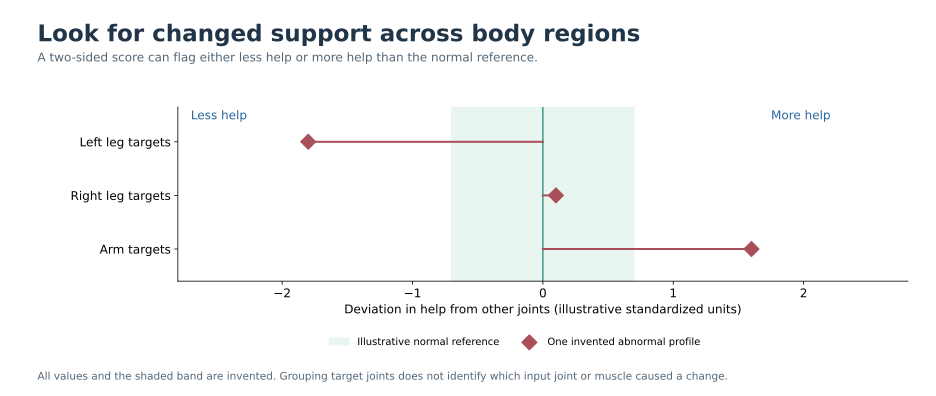

# Research roadmap: a decisive study of predictive relationships

> **Stage note.** This document records the proposal and its review before the expanded real-data study. The [current executive summary](EXECUTIVE_SUMMARY.md) and [draft01](../draft01/README.md) describe the completed experiments and revised conclusions.

This is the proposed study following the [multi-model review](advisory_summary.md). It has not been implemented or measured. The existing results are preserved in [evidence.json](evidence.json). The aim is one supported contribution for ASTAD, with implementation and interpretation checks that can change or reject the hypothesis.

## 1. Freeze the question and labels

The binary endpoint is normal-folder gait versus every other GAVD folder. All eleven non-normal folders are positive abnormal examples. Keep the original five-class condition classifier as a secondary analysis. Abnormal gait and verified medical diagnosis are different claims.

The main hypothesis is: **The predictive benefit of other joints changes for abnormal gait, and this change can improve detection beyond raw prediction error.** The [neurological review](neurological_research_direction.md) motivates testing departures in either direction: altered movement can be strongly constrained as well as less predictable. The primary proposed score is the three-region normal-reference distance defined below. Preserve the earlier one-sided loss-of-benefit score as a comparator, with its direction unchanged. This is a prospective design revision before new experiments, not a result-driven sign reversal. Neither score has yet been evaluated under this new protocol.

A normal-only model has seen no abnormal category during fitting. All eleven abnormal categories are therefore unseen during its representation and predictor training. The seven additional folders are specifically unseen categories for a supervised or adapted comparator trained on the original four abnormal conditions. State which meaning is intended in every transfer result.

All model experiments retain the original 16-joint allowlist and uniform random masking independent of motion, label, and confidence. Changing which context a comparison branch may read is an information restriction, not a motion-aware target sampler.

## 2. Use the available data without manufacturing independence

Freeze a manifest containing source ID, sequence ID, folder label, binary label, camera view, prior use, media status, pose status, and exclusion reason. Build it from the current condition CSVs. Exclude the duplicate source cache. The expanded annotation inventory has 348 sources, including 32 normal sources. The 245 sources outside the original selection are all abnormal under the requested endpoint.

Attempt missing media acquisition in a reproducible order, under a declared time budget. Prefer source coverage over taking more windows from sources already represented. Keep each downloaded source once under `data/videos-gavd`, with sequence windows referring to it. Apply the same pose and window rules across folders and methods. Record download failures, low frame rates, short sequences, and inadequate observations separately. Do not change quality thresholds after seeing method scores.

The existing processed normal cohort has 28 source IDs. Recount after any declared preprocessing revision. Inspect timing and person assignment on a stratified set of development clips. The `dataset` field may identify a parent collection: normal-folder rows assigned to the Abnormal Gait collection should not be silently relabeled. The folder rule defines this experiment.

No source has both normal and abnormal folder labels. Multi-view metadata do not prove same-person pairs. Sparse gait-event rows cannot support a normal-phase ground-truth study. Use these facts to avoid spending the week on an unavailable paired dataset.

## 3. Make training adequacy a prerequisite

The old normal models received only 45 to 66 optimizer updates. Start with the existing small architecture and measure runtime. Examine fixed checkpoints at 64, 256, and 1,024 updates, extending to 4,096 only if the normal-validation curves and runtime justify it. These numbers are diagnostic budgets, not guarantees of convergence.

Track normal training and validation prediction loss, encoder variance and effective rank, projector variance, teacher-to-online drift, and the effect of replacing correct context with mismatched context. VICReg remains part of encoder pretraining. Its presence does not prove useful representations or separation between gait categories.

Use a prespecified teacher warm-up comparison if the long EMA memory remains a plausible explanation. Keep initialization, data draws, masks, and update budget paired. Compare online and teacher readouts as a bounded diagnostic. Select schedules using normal training and validation data, not abnormal-category performance.

The main study should not expand into a large hyperparameter search. Use two initialization seeds for the key comparison if the timed budget permits. If adequate optimization cannot be demonstrated, report that limitation and stop claiming a validated relationship-sensitive detector. More methods cannot compensate for an uninformative model.

## 4. Implement a matched information comparison

For a hidden patch of joint j, train two predictors:

- The own-joint predictor reads the visible patches of joint j.
- The full predictor also reads the visible patches of the other allowed joints.

Both predict the same target patch. Match parameter capacity where practical, initialization policy, training sources, update counts, target positions, and loss normalization. The restriction must apply before contextual encoding and throughout every attention layer. Feeding an own-joint head features already computed from all joints would invalidate the comparison. Test that changing excluded joint coordinates cannot change the own-joint output.

Use the same normal-pretrained initialization for the JEPA comparisons. Freezing the encoder after adequate pretraining can reduce the cost of the predictor experiment, provided each branch re-encodes only its permitted context. Record this as frozen-encoder prediction. If the encoder is updated, use a separate matched experiment and retain its anti-collapse objective.

Draw targets uniformly over the original joint-time grid. Some draws may leave too little own-joint context. Declare a common scoring rule, such as requiring at least two valid visible patches of the target joint. Apply that rule to both branches after sampling. Do not redraw masks to favor easy targets. Report how many targets and windows remain, by source and category. Compare all anomaly baselines on the resulting common cohort, with any broader-cohort results shown separately.

Pelvis centering and body scaling already use information from other joints. Give both branches the same body-reference convention and describe the comparison as conditional on that convention. Attention isolation does not make the entire preprocessing pipeline independent of other joints. Fix the reference for controlled edits so that a normalization change does not become the intervention.

Pelvis centering also makes the two centered hip coordinates exact negatives. Predicting one hip from the other can therefore succeed without learning movement timing. Require the contemporaneous-patch control defined below and report joint-level contributions before interpreting a benefit as evidence about longer temporal relationships. Without those checks, describe the finding as predictive benefit that may be explained by local geometry and motion.

### Use two target types

The first target is the normalized coordinate patch, or a frozen embedding computed from that patch alone. It cannot read neighboring tokens. Fit any additional scaling using normal training data. A local linear embedding changes the coordinate metric; it is not evidence of a new representation-learning contribution.

The second target is the existing contextual JEPA teacher output. Freeze teacher weights, centering statistics, and temperatures when comparing predictors. This target can include surrounding joints even when the target joint's coordinates are unchanged.

This creates four core arms: local target with own or full context, and contextual JEPA target with own or full context. Compare full versus own within each target type. **Do not compare the numerical size of coordinate MSE with latent KL discrepancy or require one to exceed the other.** The local-target experiment checks whether the substantive effect survives without transformer-based contextualization of the target, conditional on the shared body reference.

For a chosen target type, define:

```text
benefit = mean_common_targets(loss_own - loss_full)
anomaly_contrast = -benefit = mean_common_targets(loss_full - loss_own)
```

Positive benefit means other joints helped. A larger anomaly contrast means less help. Report both constituent losses and their difference so that cancellation cannot hide two failing predictors. The latent contrast is not a normalized likelihood ratio over skeleton sequences and is not a causal neurological measure.

The main uniform-mask experiment is completion: context can include observations before and after a target. Keep suffix forecasting separate. Do not describe this comparison as predicting disease onset or future clinical events.

### The new two-sided profile

Predeclare three target groups: left knee/ankle/heel/foot index (25, 27, 29, 31); right knee/ankle/heel/foot index (26, 28, 30, 32); and both elbows/wrists (13, 14, 15, 16). The original 16 joints remain eligible for uniform masking and prediction during training. Hips and shoulders are not removed from the input; their benefit is reported separately because the body reference gives them strong geometry shortcuts. This three-group readout is an explicit design choice, not a clinically validated partition.

For each source and target joint, average the common-target `loss_own - loss_full` values within windows, then within sequences, then across that source's sequences. Give each of the four joints equal weight within its group. Use a fixed bank of 16 uniform masks per window. Require at least four distinct valid target patches per included joint at the source level, in addition to the earlier per-target visible-context requirement. Repeated masks or overlapping windows containing the same sequence/time patch do not create distinct support. This minimum is a prespecified feasibility rule, not proof of reliable clinical measurement. Audit support counts before model scoring. If the rule proves infeasible, document a protocol revision before fitting or evaluating scores.

A source missing support for any group is unscorable for this analysis. Do not fill its missing group with a normal value. Report scoring coverage and compare methods on the same eligible source cohort. Freeze the mask bank and these rules before scoring.

Add a fixed-observation-budget sensitivity analysis: select four distinct eligible patches per included joint per source with a fixed source-keyed seed, independently of loss or label, and use the same selections for every method and paired edit. Report their time span and number of sequences as well as their count. Refit the inner normal reference using that same budget. This separates a change in movement from a difference in averaging precision; it cannot remove all effects of recording duration or visibility. The main conclusion should not depend entirely on unequal support. Do not count these reduced-budget scores as new independent observations.

Call the resulting source profile `b_s`, with three entries. Within each outer fold, fit its reference only on the inner normal validation sources, after choosing the normal-only model schedule. Those sources remain outside predictor fitting and outside outer testing. Compute the mean `mu_g` and sample variance `v_g` across reference sources. Use the fixed diagonal shrinkage rule below to reduce instability:

```text
reference_variance_g = 0.5 * v_g + 0.5 * mean(v_1, v_2, v_3)
profile_score_s = mean_g((b_sg - mu_g)^2 / max(reference_variance_g, 1e-8))
```

The one-half shrinkage and numerical floor are prespecified heuristics. Compute them separately for coordinate and latent losses; do not mix their units. With so few normal reference sources, the resulting distance is an exploratory ranking score, not a calibrated probability or a clinically normal interval. Report reference support and a leave-one-reference-source-out sensitivity analysis with predictor weights fixed. This diagnoses reference instability rather than adding independent replications. If fewer than four reference sources remain for the main reference, report that this planned profile analysis lacks support; do not rescue it by using outer-test normals.

The score grows for unusually small or unusually large benefit. Report the signed three-number profile, the original one-sided contrast, and both constituent losses alongside it. The primary comparison is the latent profile against the full-context branch's raw KL discrepancy, using exactly the same eligible targets, 12 readout joints, equal joint/group weights, and source aggregation. Keep the historical 16-joint raw score as a secondary comparator. This isolates the profile from merely dropping hips and shoulders or changing weights. The local-coordinate profile is an interpretation control; neither target type replaces the other post hoc.

Also form a three-group own-loss vector and a three-group full-loss vector on that identical support. Fit their normal-reference distances with the same diagonal rule and reference sources. Compare both distances separately with the benefit-profile distance. This checks whether taking a difference adds anything beyond an ordinary two-sided distance from prediction errors.

This profile names target regions, not the input joints providing information. No directed causal map follows. An optional future map requires separately trained and capacity-matched context restrictions. Uniform target masking must stay independent of motion intensity, condition label, and confidence.

More benefit can also mean that the own-joint predictor failed more severely while the full predictor remained poor. It is not proof of stronger biological coupling. Inspect both losses on the same support and require the initial held-out normal information check.



*Illustrative values only. The actual reference must be estimated from eligible inner normal sources in each fold.*

## 5. Test the interpretation with paired interventions

Use paired edits of the same eligible sequence. Choose transformations and strengths on development data, then freeze them. Repeat the same masks and common scoring support across each pair.

| Intervention | Purpose | Required control |
| --- | --- | --- |
| Shift a complete limb trajectory relative to the other limbs. | Test sensitivity to relative timing. | Use longer clips and common interior support, avoid wraparound boundaries, and check articulation and missingness. |
| Shift all joint trajectories together by the same amount. | Check whether an ordinary crop or global phase change explains the response. | Match crop length, boundaries, and observation support to the relative shift. |
| Add bounded coordinate noise or delete selected observations. | Measure sensitivity to specified observation changes. | Report loss of coverage and apply the same target support to both predictors. |
| Use a contemporaneous-patch predictor. | Check whether target-local geometry and motion explain the full-context advantage. | Keep own-joint visible history, but allow other joints only in the target's four-frame patch. |
| Change eligible non-target context while keeping the target patch fixed. | Measure contextual-teacher sensitivity. | Repeat with a local target that cannot read the changed context. |

Shift articulated limb trajectories, not isolated joints that create disconnected limbs. Relative shifts can still create implausible whole-body geometry. Check bone lengths, continuity, boundaries, and empirical per-joint distributions. Do not claim that finite-crop marginals are exactly preserved unless verified. These edits are diagnostics, not validated pathological counterfactuals.

The contemporaneous-patch control has nested information access: own-joint history; own-joint history plus other joints in the target patch; then the full branch's cross-time context. Enforce the restriction throughout its encoder and train its predictor under that restriction. A four-frame patch contains short-term motion, so this is not a purely static model. If a genuinely framewise geometry claim is needed, add a one-frame target/control analysis. Do not credit the full branch with long-range temporal relationships if the patch-local control explains the benefit.

Paired coordinate degradation identifies response to that edit, not all failures of a visual pose estimator. On a small fixed subset, an image-level degradation followed by pose extraction would test the full pipeline if time permits. Keep such analysis clearly separate from coordinate-only experiments.

Quality matching and score residualization are observational analyses. Real movement can affect tracking quality, so adjusting for quality may remove genuine movement information. A lower AUROC after adjustment does not prove that the original signal was caused by tracking error. Fit any adjustment on training data only.

### A specific alternative: inspect how the teacher changes the target

Let p0 and y0 denote the prediction and contextual teacher target for an original window. Let p1 and y1 denote their counterparts after a context edit that leaves the local target patch unchanged. Evaluate all four combinations:

```text
L00 = loss(p0, y0)    L10 = loss(p1, y0)
L01 = loss(p0, y1)    L11 = loss(p1, y1)
```

Prediction change with the original target is L10 minus L00. Target change with the original prediction is L01 minus L00. The remaining interaction is L11 minus L10 minus L01 plus L00. These terms sum to the total score change L11 minus L00.

Compute this decomposition separately for the full and own-context branches, then subtract the own-context terms from the full-context terms to decompose the reported anomaly contrast. Use the implemented KL discrepancy consistently for the latent score. Substituting cross-entropy would introduce changes in teacher entropy into the individual loss decomposition.

This additive decomposition describes signed loss contrasts, not the new nonlinear profile distance. For a decomposition of that distance, construct the four complete source profiles under the paired combinations, apply the same frozen normal-reference parameters to each, and perform the four-value decomposition on those distances. Do not present per-target linear terms as additive contributions to the squared source score.

This is a descriptive decomposition of model loss, not a causal decomposition of disease. Holding the original-window target fixed is a paired analysis tool, not access to independently validated truth. It requires the original window, which is unavailable for an independently arriving edited observation. A strong alternative paper would show that this target effect reproducibly changes an anomaly conclusion, rather than merely demonstrating the expected fact that transformer targets use context.

## 6. Keep the comparison set small and serious

| Method | Role |
| --- | --- |
| Adequately trained raw JEPA discrepancy | Establish whether the proposed contrast improves on the existing score. |
| Own-joint and full-joint losses separately | Show whether subtraction adds anything. |
| Local-target prediction contrast | Test the relationship hypothesis without contextual target content. |
| Contextual JEPA prediction contrast | Test whether the JEPA representation helps the same comparison. |
| Matched ridge predictors with and without other joints | Determine whether a simple linear relationship explains the gain. |
| Normal embedding distance | Retain a simple normal-only distribution baseline. |
| Normal distance from projected posture/excursion and from separate predictor losses | Check whether the profile adds information beyond simple motion or error magnitudes. |
| Untrained frozen encoder with identically fitted prediction heads | Test the contribution of representation learning under the same normal-only information comparison. |
| One validated published normal-only skeleton method | Place the result against relevant prior methodology. |

Start with [SeeKer](https://github.com/adelic99/seeker) as the published comparison because conditional keypoint prediction is especially relevant. Use [STG-NF](https://github.com/orhir/STG-NF) if its adaptation can be validated more reliably within the budget. Document changes to the 16-joint topology, observation handling, and aggregation. A rough inspired baseline must not be labeled an exact reproduction. If neither comparison is reliable, narrow the superiority claim; do not silently replace it with RF.

The supervised RF and frozen probes remain a separate secondary table. A normal-only detector does not have their abnormal training labels. Progressive condition adaptation, learned stochastic latents, and additional positional-noise grids are outside the critical path this week. They become useful follow-up experiments only after the central mechanism is established.

## 7. Use scarce normal sources efficiently

Use four-fold source cross-fitting as the primary **exploratory internal** analysis. Each source is assigned to one outer test fold. Every model trains only on normal sources outside its test fold, with an inner normal validation subset also excluded from fitting. Keep all sequences and windows from a source together. Audit known duplicate people or reposts and merge their groups where justified.

Each normal source then receives one out-of-fold score. Additional abnormal sources can be assigned to outer folds prospectively. Their labels or scores do not select model settings. All sources meet the same predeclared quality rules. Keep the earlier three split results as historical sensitivity evidence rather than treating them as independent replications.

Assign folds after score-independent quality filtering, using a fixed seed and source groups. Balance normal-source counts first, then distribute abnormal sources to balance binary counts and the larger folder categories as closely as group membership permits. A mixed-label abnormal source remains one group. Freeze the assignment before any new scoring. If later filtering leaves a fold without either binary label, do not assign a default AUROC or silently drop it. Record the failure and rebuild all folds under the same prespecified rule before retraining and scoring; if four valid folds are impossible, reduce the fold count and disclose the protocol change before evaluation.

Cross-fitting does not make the study untouched: the original cohort and scores were already examined. Record the date when the new design was fixed and distinguish new abnormal-source scoring from reuse of the normal population. Audit earlier use of additional sources where possible. No participant-level or external-clinic generalization claim follows automatically.

### Define the primary metric before scoring

For scalar discrepancy baselines, aggregate window scores within each sequence, then sequence scores within each source, using means at both stages. For the profile, first aggregate joint benefits to a source profile as specified above, then apply its nonlinear distance once. These operations are not interchangeable. Count a source once in the overall binary result, including the source with two abnormal folder labels. Preserve its sequence labels for category summaries; the source-level profile is shared across its labels and does not create independent category observations.

Use the normal-source-count-weighted mean of within-fold AUROCs as the primary binary ranking metric:

```text
primary_AUROC = sum_over_folds(n_normal_test * fold_AUROC)
               / sum_over_folds(n_normal_test)
```

This estimates a within-fold abnormal-versus-normal ranking probability, giving each scarce normal test source equal weight. Report every fold's support. Do not pool raw scores across different fitted models unless a train-only calibration establishes comparable scales.

For the paired interval, resample source IDs within each fold and binary label, carry all paired method scores together, and recompute the same weighted metric difference. Keep fold membership, fitted models, and fitted normal references fixed. This estimates uncertainty conditional on those fits, references, and assignments; it does not include retraining variability, reference estimation uncertainty, or unknown repeated-person dependence. Report the separate reference-removal and fixed-observation-budget sensitivities alongside it. A claimed gain should survive those checks. Do not run a t-test on four folds or treat windows as independent.

Report fold-level AP with its abnormal prevalence and an explicitly weighted summary, plus category-specific AUROCs against the same normal reference in folds where that category has support. Reuse of normals makes category estimates dependent. Treat categories with two or three source IDs as descriptive. Do not average eleven tiny and large categories into a precise-looking claim without showing their support.

Five-class recognition retains source-weighted macro-F1 as a separate endpoint. Its paired interval must estimate the same source weighting, unlike the existing sequence-weighted interval. Ranking and multiclass accuracy answer different questions.

The finite-sample threshold rule requires at least 19 normal calibration units merely to produce a finite 5% threshold. That is not a recommendation for sufficient precision, and the source exchangeability assumptions remain uncertain. Four-fold evaluation does not create additional independent calibration people. Keep the 5% operational claim out of the main result unless new evidence actually supports it.

## 8. Decide what result would change the paper

Record a minimum useful improvement before the expanded scoring. A working research target is a 0.05 increase in the primary AUROC over the matched full-context raw-KL comparator defined above. This is a practical study target, not a clinical utility threshold. Pair this with the simple linear and published baselines so that outperforming a weak reference alone does not become the headline.

A strong method result should show normal predictive benefit, interpretable intervention responses, a gain over relevant baselines, and support across more than one well-represented abnormal category. A positive paired interval with a point estimate of at least 0.05 supports a positive gain whose estimate meets the target; it does not prove the gain is at least 0.05 unless the lower bound also exceeds that value.

If the upper bound is below 0.05, the experiment excludes that improvement magnitude under its assumptions. If the interval includes meaningful harm and benefit, the result is inconclusive. A failed significance test is not proof of no relationship. Apply the same distinction to the normal-information and intervention checks.

If the local target removes an apparent latent effect, investigate the target-sensitivity decomposition. Do not claim that coordinate and latent loss magnitudes must be equal. If the decomposition explains and replicates a substantive scoring failure, it may support a mechanism paper. If optimization is unresolved or the intervals are uninformative, do not advertise a validated detector or a strong negative result.

## 9. Execute a bounded week of work

| Date | Deliverable | Decision |
| --- | --- | --- |
| November 15 | Frozen manifest and folds, media/QC ledger, timing checks, one runtime profile, written hypothesis and metrics. | Fix data problems before interpreting models. Set an acquisition cutoff that leaves time for experiments. |
| November 16 | Adequacy diagnostics, matched local/contextual prediction arms, and the prespecified three-region profile. | Establish whether other joints add held-out normal information. Investigate failure or uncertainty before expanding. |
| November 17 | Paired timing and observation controls; teacher-target decomposition if needed. | Keep one supported mechanism as the paper's focus. |
| November 18 | Locked method, category evaluation, paired intervals, baseline comparison, and final coverage table. | Freeze results. State what remains incomplete. |
| November 19 | Seven-page manuscript, figures, reproducible result table, and claim review. | Every contribution sentence must point to completed evidence. |
| November 20 | Final numerical, citation, format, and anonymity checks, followed by submission. | Verify the exact cutoff timezone in the submission system. |
| November 21 | Reproducibility package and follow-up notes. | Preserve the submitted experiment version. |

Budget the core four predictor arms per outer fold plus one teacher, a simple linear comparison, and one published baseline. Use the initial runtime measurement to decide whether a second initialization is affordable. Preserve normal-only fitting and essential controls if time runs short; cut optional noise and latent-variable experiments first. Do not promise that every source will download or every model will converge in the available time.

A compact manuscript should spend roughly one page on the question and closest prior art, one on GAVD and evaluation, one on the prediction comparison, two on controlled results, and two on interpretation and limitations. Three useful figures are the comparison diagram, the normal predictive benefit and paired intervention responses, and the category-level detection results with support and uncertainty. An attrition table should accompany them.

Freeze a blinded visible-movement annotation rubric on November 15 if two suitable reviewers are available. Complete their assessment without access to new scores. Treat agreement with those descriptions as a secondary interpretation analysis. Without independent review, report automatic proxies as unvalidated explanations. The physical simulator, mechanism ambiguity benchmark, stochastic causal-state inference, and measurement-selection study belong to the [longer-term program](neurological_research_direction.md), not this week's required implementation.

The goal is a specific result that changes how readers understand skeleton prediction for anomaly detection. The plan provides a route to that result, not a guarantee that the hypothesis will survive.
