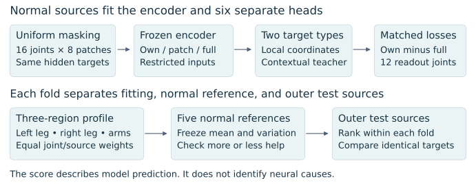
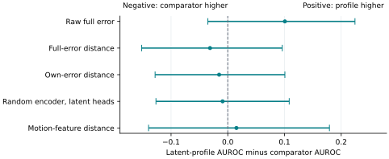

<!-- iteration02-navigation -->
> Historical study or planning record. Its scientific results and run identities remain unchanged. The executed [iteration02 study and draft02](../draft02/README.md) contain the active results, six new notebooks and independent participant replication.

# A manuscript grounded in the completed GAVD study

The [next-iteration instructions for Astra](../../../../notes/aaai/05-iterate-02-INSTR.md) now specify retained-baseline prediction, matched U/J/A masking experiments and systematic documentation updates. The [research brief](../iteration02/README.md) and [planning slides](../../slides/tutorial.pdf) describe that proposed work. The results reported below remain historical evidence; the new experiments have not been run.

The [anonymous manuscript PDF](manuscript.pdf) and [editable Markdown](manuscript.md) report completed real-video experiments. The paper is titled **Auditing Predictive Context for Gait Anomaly Detection**. Its central finding is that a favorable point estimate against raw prediction error does not establish an advantage of learned movement relationships after matched calibration, random-feature and learning-adequacy checks.

The manuscript has been revised after independent Claude and GPT reviews. It is a defensible exploratory workshop draft, but it is not evidence of a stronger disease detector or a validated neurological world model. Read the [submission-readiness assessment](submission_readiness.md) before deciding what to submit. No paper has been submitted.



## What was measured

The refreshed catalog contains 348 source videos. Acquisition yielded 332 decodable videos, including 184 newly downloaded files. The fixed observation and profile-support rules retained 8,950 windows from 1,303 sequences and 251 sources: 23 normal and 228 non-normal. Only the `normal` folder is normal. All other categories enter the primary binary endpoint; the normal-plus-four-condition classifier is separate.

| Result | Primary estimate |
| --- | ---: |
| Learned latent benefit profile AUROC | 0.641 |
| Raw full latent error AUROC | 0.541 |
| Calibrated full-error distance AUROC | 0.673 |
| Random encoder with fitted latent heads AUROC | 0.651 |
| Learned coordinate profile AUROC | 0.686 |
| Random encoder with fitted coordinate heads AUROC | 0.701 |
| Simple motion-feature distance AUROC | 0.626 |

The fixed primary difference against raw error is 0.101, with a conditional 95% interval from -0.035 to 0.224. The result remains inconclusive. The 4,096-head-update sensitivity reaches latent AUROC 0.667, while its random-encoder control reaches 0.714. It does not replace the original 512-update primary analysis. The full [results report](../context_study_results.md) and [sensitivity report](../context_study_sensitivity.md) give the comparisons and their limits.



All 23 normal sources overlap earlier project development. The outer folds prevent direct fitting/test overlap, but they do not make the study independent of prior analyst choices. Source videos are not verified independent participants. Five reference normals per fold and incomplete published-method comparison further limit the claims.

## Where to start

| File | Purpose |
| --- | --- |
| [manuscript.pdf](manuscript.pdf) | Anonymous paper in the unmodified official AAAI-27 style. |
| [manuscript.md](manuscript.md) | Current text, equations, tables and figure captions. |
| [submission_readiness.md](submission_readiness.md) | Honest scores, completed checks, unresolved gaps and remaining priorities. |
| [response_to_reviews.md](response_to_reviews.md) | Each important critique, its verification and the resulting revision. |
| [reviews/](reviews/) | Actual Claude invocations and responses, GPT review and implementation audit. These are advice, not evidence of clinical validity. |
| [revisions/01_initial/](revisions/01_initial/) | The first compiled real-results draft, preserved before final critique. |
| [evidence.json](evidence.json) | Derived numeric evidence and hashes of its source artifacts. |
| [budget_comparison.csv](budget_comparison.csv) | Both completed head-training budgets. |
| [references.bib](references.bib) | Verified primary references. |
| [primary_source_claim_map.md](primary_source_claim_map.md) | What each reference supports and what it does not. |
| [figures/](figures/) | Editable vector graphics and their generating scripts. |
| [build_record.json](build_record.json) | Compiler commands, unchanged official-style check and PDF hash. |
| [visual_review.md](visual_review.md) | Rendered-page, font, bounds and citation checks. |

The [execution report](../current_execution_validation.md) links the 12 notebooks executed with real data, both verified experiment runs and the 105-test pass. The [40-slide deck](../../slides/archive/draft01_completed/tutorial.pdf) provides the illustrated explanation of the study and results. The [current executive summary](../draft00/EXECUTIVE_SUMMARY.md) explains what to do during the remaining week.

## Reproduce the evidence locally

Run commands from `experiments/aaai`. Python dependencies are declared in its `pyproject.toml`. Use the existing repository-root `.env`; do not put credentials in the manuscript or a second environment file. The code uses `load_dotenv as load_env` and `find_dotenv as find_env`, followed by `load_env(find_env())` after locating the root.

```bash
uv sync
uv run python scripts/verify_context_artifacts.py artifacts/context_study/gavd/3044566091261819 --expect-real
uv run python scripts/verify_context_artifacts.py artifacts/context_study/gavd/eba2bd5a6e05efa1 --expect-real
uv run python scripts/validate_notebooks.py --real
uv run python docs/draft01/collect_evidence.py
uv run python docs/draft01/figures/build_results.py
```

The two verified artifact directories contain the actual fitted checkpoints and out-of-fold source scores. `collect_evidence.py` derives tables and bootstrap summaries from those results; it does not retrain a model. The primary run identifier remains fixed, rather than choosing the latest or best score. Re-running ingestion after the catalog or downloaded media changes creates a new study and should not overwrite the interpretation of these results. The [main README](../../README.md) documents ingestion and training, including all downloads under `data/videos-gavd`.

## Build the manuscript

The manuscript uses Pandoc, pdfLaTeX and BibTeX as system tools. A full TeX Live installation is the simplest route. On macOS, the build also checks `/Library/TeX/texbin/pdflatex`. The official style is based on pdfTeX; Tectonic and XeTeX are not substitutes for this verified build.

```bash
uv run python docs/draft01/figures/build_figures.py
uv run python docs/draft01/build_manuscript.py
uv run python docs/draft01/check_manuscript.py
```

The script generates `manuscript.tex` and `manuscript.pdf`, then saves compiler output under `build_logs`. It copies the official `aaai2027.sty` and `aaai2027.bst` without modification and refuses to overwrite a locally altered copy. The [author-kit provenance](author_kit/download_provenance.json) records the official download and checksum. The template uses submission mode, anonymous authors and US Letter paper.

The local BasicTeX build used an isolated TeX package tree with NewTX/TeX Gyre fonts, natbib, caption, booktabs and their dependencies. If using such a tree, `AAAI_TEXMF_HOME`, `AAAI_TEXMF_VAR` and `AAAI_TEXMF_CONFIG` can identify it. A full TeX Live installation should not need these settings. Compilation is separate from Python dependency installation. The optional verification command uses Poppler tools (`pdftotext`, `pdffonts` and `pdfimages`) to check bounds, font embedding and vector graphics.

The workshop's [official instructions](https://ismart.ece.mcgill.ca/astad4/) list November 20, 2026, double-blind review, and up to seven content pages plus two reference pages in AAAI-27 format. Its public page does not state a cutoff timezone. The compiled paper stays within these limits. The local evidence directory is not an anonymous submission package: review logs and artifact records include machine paths. Submit only deliberately checked anonymous material.
