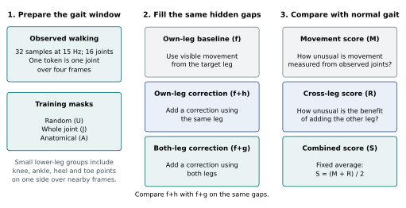
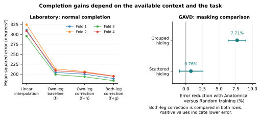

# Controlled Cross-Leg Prediction for Gait Anomaly Detection

This paper asks whether seeing the other leg helps a model predict hidden walking movement, and whether that help provides useful evidence for detecting unusual gait. It is written for AI/ML researchers who do not specialize in gait analysis or self-supervised learning.

Read the [paper as a PDF](manuscript.pdf) or [as Markdown](manuscript.md). The [technical notes](technical_details.md) give exact settings and two additional result plots. The [claim summary](claims_and_boundaries.md) and [readiness assessment](submission_readiness.md) explain what the experiments support.

## The comparison

Imagine hiding a short part of the left ankle's movement. A model first predicts it from the visible left leg. We keep that prediction fixed and fit two corrections. One uses more features from the left leg, while the other uses features from both legs. Comparing these corrections helps establish what the other leg adds beyond a stronger model of the target leg.



All predictions are scored against the same held-out answer. Their input restrictions are applied before derived features are constructed. We also compare training masks on fixed evaluation tasks: scattered hiding removes individual joint-time blocks, while grouped hiding removes neighboring lower-leg observations together. Each joint-time block contains one joint over four consecutive samples.

The movement score measures unusual posture and movement size. The cross-leg score measures how unusual the benefit from the other leg is relative to normal reference recordings. The combined score is their fixed average. A large prediction benefit and a large anomaly score have different meanings.

## What the experiments show

The video experiment uses 304 GAVD recordings, including 28 labeled normal. On grouped hiding, the both-leg correction reduces normal prediction error by 19.5% compared with the own-leg correction. A separate laboratory experiment includes 128 healthy and 50 stroke participants. There, the reduction is 5.2%, with a conditional interval of [3.6%, 6.7%], and 109 of 128 healthy participants improve.

Anatomical masking during training reduces grouped-task error by 7.7% compared with random masking. The corresponding advantage on scattered hiding is uncertain, so the result depends on the task being tested.



The left panel compares predictors in the laboratory data. The right panel compares two training masks in GAVD. These are different comparisons, and their units should not be pooled.

Prediction gains do not automatically improve anomaly ranking. In the main GAVD comparison, movement alone and the combined score reach AUROCs of 0.694 and 0.576. Their laboratory AUROCs are 0.958 and 0.892. The timing experiment also shows why prediction must be checked on the inputs actually available: after matching visible observations across shifted and unshifted inputs, the both-leg model no longer meets the prediction requirement.

The contribution is a reproducible way to examine these relationships. It helps distinguish a useful predictor from a useful anomaly score while keeping posture and movement size available to the detector.

## Evidence and limits

The study is exploratory. The normal GAVD recordings informed method development, although training, reference estimation and testing use separate roles within the reported experiment. GAVD upload IDs are not verified independent people. The additional paired completion intervals were calculated after inspecting results and keep fitted models fixed. They do not include uncertainty from retraining or choosing the analysis.

The [evidence record](evidence.json), [paired completion checks](advisory/completion_audit_v1/README.md) and [figure manifest](figures/manifest.json) link the reported values to saved measurements. The [reader review](advisory/accessibility_review.md), [review responses](response_to_reviews.md) and [validation report](final_validation.json) record the proofreading and artifact checks.

## Rebuilding the paper

From the repository root, run:

```bash
uv run --project experiments/aaai python experiments/aaai/docs/draft03/build_draft.py
uv run --project experiments/aaai python experiments/aaai/docs/draft03/build_manuscript.py
uv run --project experiments/aaai python experiments/aaai/scripts/validate_iteration02_outputs.py
```

The first command reads the [manuscript template](manuscript_template.md), verifies saved evidence and regenerates all six figures. The second uses Pandoc and the existing TeX environment to create the anonymous AAAI-format PDF. The final command checks the saved inputs, document links and PDF. These commands rebuild the presentation without fitting new models.
