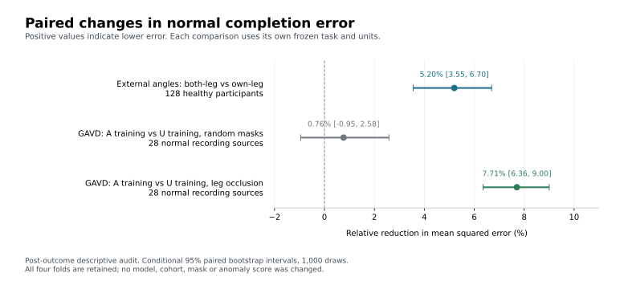

# Positive completion evidence from the frozen runs

Two useful positive results are present in the completed experiments. Both-leg context reduces normal-gait completion error in the independent laboratory dataset. Anatomical masking reduces error on the structured leg-occlusion task in GAVD. The ordinary random-mask comparison is uncertain. These findings can support a focused manuscript about the conditions under which prediction improves, provided that the negative anomaly-fusion result remains visible.

This audit was conducted after the original outcomes and manuscript critiques. It does not refit predictors, change cohorts or masks, select a favorable fold, or create a new prespecified primary endpoint. It reports all four folds and both fixed GAVD evaluation banks. The [manifest](audit_manifest.json) records input and producer hashes, the estimator, and these limits.

## Independent laboratory completion

The external comparison uses 128 healthy participants, each scored once in its original outer-test fold. It compares the retained baseline with its own-leg augmentation, f+h, against the same baseline with both-leg augmentation, f+g. The six sagittal angle channels share the original time axis. Errors are squared degrees.

| Fold | Normal participants | Own augmentation MSE | Both-leg augmentation MSE | Absolute reduction | Relative reduction |
| --- | ---: | ---: | ---: | ---: | ---: |
| 0 | 32 | 199.995 | 188.950 | 11.045 | 5.52% |
| 1 | 32 | 206.398 | 195.217 | 11.181 | 5.42% |
| 2 | 32 | 193.485 | 183.650 | 9.835 | 5.08% |
| 3 | 32 | 204.273 | 194.517 | 9.755 | 4.78% |
| All folds | 128 | **201.038** | **190.584** | **10.454** | **5.20%** |

The conditional paired-bootstrap 95% interval is **7.154 to 13.387 squared degrees** for the absolute reduction and **3.55% to 6.70%** for the relative reduction. All four fold means improve, and 109 of 128 participants have lower error with the both-leg augmentation. The improvement is therefore not carried by a single favorable fold or a minority of participants, although individual effect sizes vary.

The separate post-outcome [interpolation audit](../../../../artifacts/iteration02/external_fb9d0d23b56ce29fd846/derivatives/interpolation_audit_v1/README.md) reports mean direct-interpolation error of 309.838 squared degrees, compared with 206.262 for the retained baseline. The learned both-leg predictor's error is 38.49% lower than direct interpolation. This is useful context for the baseline, but that benchmark was also added after outcomes and is not an interpolation-based anomaly experiment.

The positive claim must remain specific: **under the declared fitted predictor families, access to both legs improves held-out normal completion.** Equal residual input width does not establish equal effective capacity. The own-leg residual design has rank 44 and the both-leg residual design has rank 62 in every fold, despite both having 72 input columns. The result does not isolate intrinsic cross-leg information from differences in feature directions, regularization geometry or inductive bias. It is not evidence of a recovered neurological mechanism or of better disease detection. The original external anomaly AUROC remains 0.9581 for M and 0.8919 for the fixed fusion S.

## GAVD masking comparison

This comparison holds the both-leg branch fixed as the readout and compares training policies U and A. U hides 64 of 128 tokens uniformly. A hides an anatomical eight-token core plus 56 other randomly chosen tokens. Both policies are independent of observed movement intensity. The evaluation banks are the original U bank and the original E_leg bank, whose scored targets lie in short, jointly hidden portions of one leg. Scores use the same normalized image-plane coordinates, not degrees.

| Evaluation bank | Fold | Normal recording sources | U-trained MSE | A-trained MSE | Relative reduction |
| --- | ---: | ---: | ---: | ---: | ---: |
| Random U | 0 | 7 | 0.033942 | 0.033514 | 1.26% |
| Random U | 1 | 7 | 0.035675 | 0.035323 | 0.99% |
| Random U | 2 | 7 | 0.027563 | 0.026080 | 5.38% |
| Random U | 3 | 7 | 0.046580 | 0.047747 | −2.50% |
| Random U | All | 28 | **0.035940** | **0.035666** | **0.76%** |
| Leg occlusion E_leg | 0 | 7 | 0.065955 | 0.062817 | 4.76% |
| Leg occlusion E_leg | 1 | 7 | 0.061687 | 0.056783 | 7.95% |
| Leg occlusion E_leg | 2 | 7 | 0.051375 | 0.045373 | 11.68% |
| Leg occlusion E_leg | 3 | 7 | 0.081064 | 0.075065 | 7.40% |
| Leg occlusion E_leg | All | 28 | **0.065020** | **0.060009** | **7.71%** |

For E_leg, the absolute MSE reduction is 0.005011, with a conditional 95% interval of 0.003593 to 0.006509. Its relative interval is **6.36% to 9.00%**. Twenty-seven of 28 normal sources improve. For U, the relative interval is **−0.95% to 2.58%**, and 16 of 28 improve. Thus the evidence supports a benefit on the structured leg-occlusion task, without establishing broad superiority across masking tasks. E_leg resembles part of A's training design, so this is also evidence of task alignment rather than a surprising universal generalization result.

The [target-identity audit](gavd_target_identity_audit.csv) checks the same normal sources, source/joint coverage, window/joint/patch identities, number of repeated mask draws, and evaluation-mask hashes across U and A. No source is removed to improve the comparison. GAVD sources are recording units, not verified independent people, and all 28 normal sources had already been explored in this project. These intervals cannot repair those generalizability limits.

## Estimation and interpretation

The audit uses 1,000 paired bootstrap draws with seed 42. Each draw resamples participants within each external fold, or recording sources within each GAVD fold, carrying both method errors together. The original normal-count fold weights remain fixed at one quarter per fold. The relative reduction is the difference between weighted mean errors divided by the weighted comparator mean. It is not the average of individual percentage changes.

The original target aggregation remains unchanged. Repeated masks are averaged within identical targets. External targets then aggregate through windows, participant and angle, with six angles weighted equally. GAVD targets aggregate through windows, sequences, source and joint, with eight readout joints weighted equally. The resampling unit is never a mask, target, window or joint.

The intervals condition on the fitted models, folds, masks and retained evaluation units. They do not include uncertainty from retraining, protocol selection or reuse of previously explored data. They are descriptive intervals for comparisons examined after outcomes, without multiplicity adjustment. They should not be presented as new confirmatory evidence.

A precise manuscript direction is to study **when context and masking improve completion, and why that improvement does not automatically improve anomaly discrimination**. The completed results support the first part as a bounded empirical finding and show the failure of the tested fixed fusion. They do not demonstrate the causal reason for that failure. The separate [calibration audit](../../../draft02/reviews/calibration_audit/README.md) describes score-distribution differences without attributing the fusion loss to them.

The [summary](completion_summary.csv) retains every fold, absolute and relative interval, and number of improving units. The participant/source tables and bootstrap draws allow direct inspection. The producer is [audit_normal_completion.py](../../../../scripts/audit_normal_completion.py); its executed hash is stored in the manifest.
