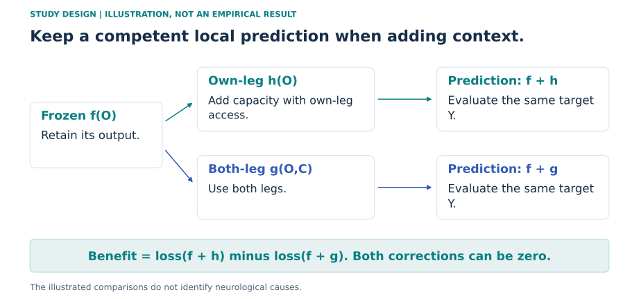
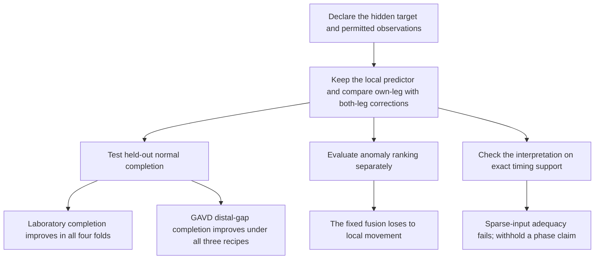
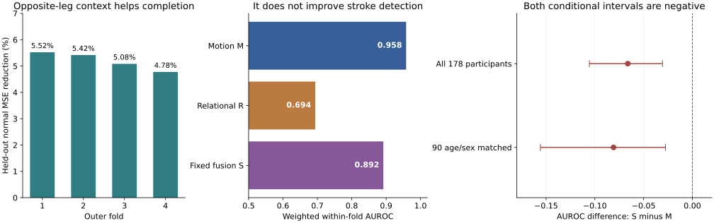

# A positive paper about useful cross-leg prediction

The strongest defensible positive framing is **a controlled measurement of when cross-leg context helps complete gait observations**. The completed experiments support that capability. They do not support a better anomaly detector, a new neurological world model, or a generally superior masking policy.

Draft03 can lead with a successful capability and explain its limits. It should not turn the same negative detection result into a positive detection claim. The useful contribution is a protocol that asks three separate questions: does the predictor complete missing movement well, what additional observations help it, and does its calibrated output improve anomaly ranking? The first question has a clear positive answer in the independent laboratory data. The second has useful, task-dependent evidence in GAVD. The third has an unfavorable answer for the frozen score combination.

This review reads the verified GAVD run `d66e1b126c9d9a9adf1b` and the separately fitted laboratory run `external_fb9d0d23b56ce29fd846`. It does not fit a new model, select a fusion weight, alter a cohort or tune a mask. Any change in manuscript emphasis after viewing these outcomes must remain explicitly exploratory.

This diagram explains the model comparison. It is not a measured outcome or a claim that the two correction branches have equal effective capacity.

## 1. Lead with the most secure positive finding

The laboratory result is the strongest opening. Across 128 held-out healthy participants, the specified both-leg predictor lowers mean participant-level squared error from **201.038 to 190.584 degree squared** relative to the selected own-leg correction. The reduction in the ratio of these means is **5.20%**. The four held-out fold reductions are **5.52%, 5.42%, 5.08% and 4.78%**. Each fold contains 32 test controls. These are held-out errors, not training losses or internal selection scores. [Held-out prediction errors](../../../artifacts/iteration02/external_fb9d0d23b56ce29fd846/heldout_prediction_error.csv).

The useful sentence is:

> The specified predictor with bilateral context achieved lower held-out normal completion error than the own-leg comparator in every laboratory test fold.

The words “specified predictor” matter. Its observed advantage is not an estimate of an intrinsic amount of neurological information. The residual branches have the same nominal feature width, but their design-matrix ranks and feature constructions differ.

The later interpolation audit strengthens a narrower part of this argument. On the identical frozen normal targets, the mean errors are 309.838 for permitted target-angle interpolation, 206.262 for the retained local predictor, 201.038 for the own-leg correction and 190.584 for the both-leg correction. Their ordering holds in all four fold aggregates. This shows that the local learned comparator is doing more than the declared simple interpolation rule. It does not prove optimal prediction. Because this audit followed the outcomes, label it a **post-outcome baseline audit**, not a preregistered finding. [Interpolation audit](../../../artifacts/iteration02/external_fb9d0d23b56ce29fd846/derivatives/interpolation_audit_v1/summary.json).

Do not headline the 38.5% improvement over interpolation. Most of that difference is already obtained by the own-leg model. The approximately 5% increment over the stronger own-leg comparator is the relevant and more credible positive result.

Four folds with overlapping training pools are not four independent replications. The laboratory dataset is independent of GAVD, but the measurements, participants and fitted models differ. Say “a separately fitted participant-level replication of the measurement procedure.” Do not say that a video encoder transferred to laboratory patients. The underlying dataset and its participant identities are documented in the [original Scientific Data article](https://www.nature.com/articles/s41597-023-02767-y).

## 2. Use GAVD to show that the observation task matters

Imagine hiding one left-ankle patch while leaving the left knee and foot visible. Local geometry may almost determine the answer. Now hide the left knee, ankle, heel and foot over a short common interval. That removes several immediate geometric clues. The opposite leg may become more useful, provided enough own-leg history and permitted context remain.

This is an illustration of two observation tasks, not a claim about a particular patient. It gives the reader a clear reason to examine the fixed distal-leg challenge bank, `E_leg`.

On this bank, all three training families show positive held-out normal benefit estimates, with conditional source-bootstrap intervals above zero. The benefit is the own-leg correction error minus the both-leg correction error. The same 28 normal source recordings enter each estimate. [Normal benefit estimates](../../../artifacts/iteration02/d66e1b126c9d9a9adf1b/normal_test_benefit.json).

| Training mask | Mean own-leg error | Mean both-leg error | Relative reduction in the ratio of means | Mean benefit and conditional 95% interval |
| --- | ---: | ---: | ---: | --- |
| U, uniform | 0.080769 | 0.065020 | 19.50% | 0.015748 [0.010721, 0.021300] |
| J, one-joint tube | 0.080057 | 0.069567 | 13.10% | 0.010490 [0.007229, 0.014019] |
| A, anatomical tube | 0.078371 | 0.060009 | 23.43% | 0.018362 [0.012688, 0.024636] |

The error units are squared body-normalized projected coordinates. They are not laboratory angle units. The percentages above are arithmetic summaries of the saved errors, calculated as `1 - mean(both_error) / mean(own_error)`. They are not means of individual percentage changes and are not additional fitted experiments. The source table contains every fold and bank. [Normal error table](../../../artifacts/iteration02/d66e1b126c9d9a9adf1b/normal_error_table.csv).

A cautious positive conclusion is:

> With the declared distal-leg gap, the chosen bilateral predictors achieved better normal completion than their own-leg comparators under all three training masks.

Retain the complete matrix. On the original uniform evaluation bank, the U and A normal-benefit intervals include zero. J has a small positive estimate, approximately 0.000697, with interval [0.000175, 0.001229]. Promoting J after observing this favorable slice would be a new outcome-based choice. The primary comparison and all other cells must remain visible.

It is tempting to call the much larger `E_leg` benefit proof that anatomical masking discovers coordination. That is too strong. `E_leg` changes available geometry, the distribution of target requests and available prediction headroom. It does not hold the entire task difficulty constant. The justified result is **task-dependent completion benefit**, not a direct measurement of a neural coordination variable.

## 3. Describe the anatomical-mask advantage at its actual evidential level

Within the same `E_leg` evaluation bank, the A-trained both-leg model has lower normal error than U in all four fold aggregates. Their mean both-leg errors are 0.060009 and 0.065020. This is a **7.71% reduction in the ratio of means** for this diagnostic task. A also improves its own-leg comparator, so the complete own/both table is necessary.

The A-minus-U increments in mean own-minus-both benefit are 0.001351, 0.003880, 0.002845 and 0.002379 across the four folds. These descriptive calculations use the already saved [normal error table](../../../artifacts/iteration02/d66e1b126c9d9a9adf1b/normal_error_table.csv). No model was refitted for this review.

This supports reporting a consistent **descriptive advantage on the distal-leg completion task**. At the time of this review, the named normal-benefit artifact supplies each policy's benefit interval, not an A-versus-U paired completion interval. Do not obtain a confidence interval for the difference by subtracting endpoints of two separate intervals. If a separate paired audit is completed, cite its exact artifact and label a newly introduced completion contrast as post-outcome analysis. It does not retroactively become the primary detection endpoint.

The frozen primary detection contrast is different. A minus U on the original uniform task has focal S difference 0.055 with conditional interval approximately [−0.018, 0.127]. That does not establish a detection advantage. [Paired detection comparisons](../../../artifacts/iteration02/d66e1b126c9d9a9adf1b/paired_intervals.json).

## 4. Preserve local movement as an independent source of evidence

Keeping local movement separate is a useful research design choice. A motion can be repeatable while departing from ordinary posture or excursion. Predictability alone therefore does not establish normality. Conversely, an unusual statistical relationship does not identify its physiological cause.

The existing M channel retains measured posture, excursion, velocity variation and bilateral differences. In GAVD it reaches focal AUROC 0.694 and broad AUROC 0.707. In the laboratory study it reaches 0.958. Those values support retaining a strong movement comparator, rather than discarding amplitude and posture to make a relational story look cleaner. [GAVD results](../../iteration02/results.md), [laboratory results](../../iteration02/external_replication_results.md).

There are two different preservation claims, and the paper should distinguish them:

| What is preserved | What is actually guaranteed | What is not guaranteed |
| --- | --- | --- |
| Frozen local predictor f | A zero residual reproduces its saved prediction. | The selected residual cannot worsen unseen prediction. |
| Separately reported local score M | Its feature definition and result remain available independently of R. | The average of M and R preserves M's anomaly ranking. |

The current method **does not implement a proven safe anomaly-fusion rule**. All core adequacy gates pass, yet the fixed average reduces detection performance. Its negative outcome must appear in the abstract or main results, not only in limitations. Preserving the local channel as a separately evaluated baseline is different from protecting it inside a combined detector.

The appropriate positive contribution is a transparent decomposition of evidence. It is not an experimentally demonstrated improvement in multimodal or multi-score fusion.

## 5. What novelty survives the strongest objections

The strongest novelty is a controlled evaluation procedure and its empirical lesson, not a new masking family or architecture.

| Candidate contribution | What survives | What prevents a stronger claim |
| --- | --- | --- |
| Measuring the usefulness of permitted opposite-leg observations | A retained local predictor, an own-leg correction, identical targets and explicit support expose a useful measurable comparison. | Different ranks, feature bases and regularization prevent an intrinsic information or equal-capacity interpretation. |
| Testing masking structure without motion-based selection | U/J/A match 64 hidden tokens and one-half per-token masking probability; all arms answer the same bank. | Anatomical tubes already exist, and equal marginal probabilities do not equal equal task difficulty or usable training-target exposure. |
| Demonstrating useful completion in two settings | Positive distal-gap GAVD results and consistent laboratory normal completion provide complementary evidence. | Different representations and separately fitted models are not transferred weights or generalization to every condition. |
| Separating successful prediction from successful detection | The same evidence package contains positive completion and unfavorable fixed-fusion results. | Calibration or score-tail mismatch may explain the fusion loss; this is not a theorem about relational anomaly detection. |
| Revealing a failed interpretation gate | The timing experiment passes software invariance checks but fails prediction adequacy on its sparse paired support. | It cannot support a positive claim about physiological phase or neurological coordination. |

The closest literature makes several headline ideas unavailable as novelty claims:

- [GenGait](https://arxiv.org/abs/2604.01997v2) already trains a normal-only masked gait model and uses withheld joints for anomaly assessment and normative reconstruction. Our advantage cannot be simply “learn normal gait and predict missing joints.” Its published abstract describes normative training and simulated abnormal patterns; that is a different evaluation population, not a basis for claiming superior clinical performance here.
- [SLiM](https://arxiv.org/html/2603.10648v4) already uses semantic anatomical tubes to reduce local interpolation shortcuts in skeleton representation learning. Its missing/noisy-joint analysis also limits a broad claim to have invented robust structured skeleton masking. The narrower opportunity is the matched gait-specific measurement and complete comparison matrix.
- [Beyond Marginals](https://arxiv.org/abs/2509.15033) already separates marginal, temporal and dependency modeling for anomaly detection. Keeping a local and a relational channel is not new by itself. The useful addition here is the controlled examination of whether a successful conditional completion quantity becomes useful after the specified anomaly calibration.

These are verified primary-source links. None demonstrates that this study is state of the art. A complete manuscript should retain the broader prior-art discussion from draft02 rather than limiting comparisons to these three convenient examples.

My assessment is that the measurement protocol and cross-dataset distinction have **moderate workshop novelty**. The model-component novelty is **low**. Reframing can make the scientific contribution clearer; it cannot create an architectural innovation that the experiments did not test.

## 6. Address rank and calibration before a reviewer has to ask

The laboratory residual feature width is 72 in both branches, but the saved rank audit reports rank 44 for the own-leg features and 62 for the both-leg features in every fold. Regularization and selected multipliers also differ. Design-matrix rank is not identical to ridge effective degrees of freedom, but this discrepancy is already enough to reject the phrase “equal effective capacity.” [Saved-model rank check](../../../artifacts/iteration02/external_fb9d0d23b56ce29fd846/derivatives/interpolation_audit_v1/saved_model_rank_check.json), [audit summary](../../../artifacts/iteration02/external_fb9d0d23b56ce29fd846/derivatives/interpolation_audit_v1/summary.json).

Use “a matched-width own-leg comparator” and “the specified both-leg configuration.” State that the comparison constrains some simple alternatives without isolating every representational advantage. The claim can still be positive: this particular, independently evaluated predictor performs better on the declared completion task. It cannot establish conditional mutual information, causal inter-limb influence or a learned neural controller.

The shared GAVD body reference also contains body measurements. Restricting the learned input to one leg is conditional on that reference. Laboratory joint angles similarly inherit a body-model convention. Neither representation creates physiological isolation between limbs.

M and R are dimension-normalized distances, not equally calibrated disease probabilities. Equal arithmetic weights can give disproportionate influence to a heavy-tailed or noisy channel. Therefore, the fixed-fusion result does not refute the possibility of better calibration, another reference model or another combination rule. It rejects the claimed advantage of this specific frozen recipe. Do not tune a replacement mixture and present it as the original result.

A new study could use an independently frozen normal-only calibration procedure and an own-context feature basis that better controls effective flexibility. Those are concrete follow-up directions. They are not completed safeguards of the present study.

## 7. Recommended framing and title

**Recommended title:**

> Measuring Cross-Leg Context for Gait Completion and Anomaly Analysis

This title names the measured capability and keeps the anomaly relevance visible without promising improved diagnosis.

Two defensible alternatives are:

1. **Testing When the Other Leg Helps Gait Prediction.** This is accessible and centers the positive capability, but needs an abstract that makes the workshop's anomaly connection clear.
2. **Preserving Local Movement While Evaluating Cross-Leg Gait Prediction.** This highlights the two sources of evidence, but must not imply that the failed combined score preserves baseline ranking.

Avoid “Neurological World Models for Gait Diagnosis,” “A New S-JEPA Detector,” and “Anatomical Masking Improves Gait Anomaly Detection.” The successful core completion experiments use retained ridge predictors. The bounded JEPA probe does not establish a learned-representation advantage, and the encoder-mask experiment was not run.

### Suggested abstract outline

1. State the unresolved measurement question: useful predictions can depend strongly on which observations remain visible, so reconstruction error alone is difficult to interpret as anomaly evidence.
2. Describe the retained local predictor, declared own/both context, common targets, matched mask budgets and source-separated fitting/reference/test roles.
3. Lead with the independent laboratory normal-completion result: 5.20% mean error reduction relative to the specified own-leg comparator, with positive reductions in all four held-out folds.
4. Report GAVD's positive distal-gap results alongside the weak or uncertain uniform-bank results. Describe masking specialization only at its measured level.
5. State that fixed fusion reduces anomaly ranking on both datasets, and that sparse timing support fails adequacy. End with the contribution: a reproducible way to test predictive usefulness before making anomaly or physiological claims.

### A draft abstract that remains faithful to the evidence

Masked gait models can exploit nearby joints without learning a useful relation between the legs. We evaluate an exploratory protocol that retains a local predictor and compares own-leg and both-leg corrections on identical hidden targets. Three motion-independent masking recipes have matched token budgets and are evaluated on fixed uniform and distal-leg tasks. In a separately fitted laboratory study, bilateral context reduces mean completion error by 5.20% relative to the specified own-leg comparator across 128 held-out healthy participants, with improvements in every test fold. In GAVD, all three recipes show positive normal completion benefits under the distal-leg challenge, while the uniform reference gives weaker evidence. The anatomy-based recipe has the lowest descriptive distal-task error. These successful predictions do not establish improved anomaly detection: the frozen local-plus-relational score reduces focal GAVD AUROC from 0.694 to 0.576 and laboratory AUROC from 0.958 to 0.892. A timing interpretation is further limited by failed adequacy on sparse paired inputs. The results support a controlled test of task-dependent gait completion while identifying the additional validation needed for anomaly scoring. Feature-basis differences and acquisition confounds restrict physiological interpretation.

The abstract deliberately does not claim that four folds are independent studies, that anatomical masks are new, that the saved design matches effective capacity, or that an abnormal video has been clinically diagnosed.

## 8. A clear visual argument

The manuscript can be more positive by explaining the successful capability first, rather than hiding the unfavorable results.

This workflow is a claim map, not a causal model of gait. The first empirical figure should show held-out normal error and its strong local comparators. The second should show the complete U/J/A by evaluation-bank matrix. The third should show the fixed anomaly-ranking comparison. Keeping all three in the main paper makes the positive emphasis credible.

Do not illustrate measured disease mechanisms with invented phase curves, healthy reconstructions of real patients or selective examples that imply treatment. Use the existing deterministic observed examples and label their selection rule.

## 9. Positive claims to reject explicitly

| Tempting claim | Why it is not supported | Accurate replacement |
| --- | --- | --- |
| We discovered neurological coordination abnormalities. | No forces, EMG, clinical examination or adequate isolated timing test identifies a neural mechanism. | We measured prediction differences under declared observation tasks. |
| Cross-leg context improves clinical detection. | The fixed fusion loses to M on both datasets. | It improves the specified normal completion task. |
| A is the best gait mask. | Primary detection intervals include zero; task-specific descriptive gains do not establish a universal ordering. | A has the lowest observed both-leg error on the declared distal task. |
| The comparison controls all model capacity. | Equal feature width coexists with different rank, basis and regularization. | It includes a matched-width own-leg comparator with disclosed limitations. |
| Useful normal prediction proves a world model of motor control. | Statistical completion need not represent neural control or physical causation. | It is a partial predictive model of observed movement. |
| The local score is protected by fusion. | Keeping M separately does not protect its ranking after averaging with R. | M remains an independently evaluated source of movement evidence. |
| Artificially masked completion validates real occlusion repair. | The target is an available measurement that is deliberately withheld; naturally missing joints have no equivalent verified target. | The study measures completion of artificially withheld observed patches. |
| The independent study validates all disease families. | It contains controls and stroke participants, with a distinct laboratory representation. | It replicates a prediction measurement in a separate participant setting. |

## 10. Final recommendation

Write draft03 around **a successful but bounded predictive capability and the protocol needed to interpret it**. Put the laboratory completion gain first. Use GAVD's fixed distal-gap task to explain why observation design changes the value of context. Keep local movement as an independently visible source of evidence. Show the unfavorable detection and timing results prominently enough that a reviewer cannot reasonably regard the positive framing as selective reporting.

The strongest practical lesson is that a gait model should earn three different claims separately: it predicts missing movement, its extra context helps under a specified observation task, and its resulting score improves the intended anomaly decision. The completed work earns parts of the first two claims. It does not earn the third for the frozen fusion. That is a coherent, useful paper direction with moderate methodological novelty, provided draft03 stays within this boundary.
