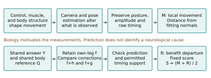
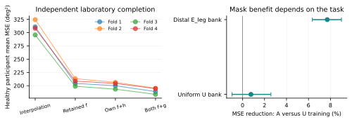

# Controlled Cross-Leg Prediction for Gait Anomaly Detection

This paper presents a controlled method for measuring what the opposite leg adds to gait prediction and for assessing whether that relationship provides useful anomaly evidence. Its central contribution is to make three questions separately testable: whether the other leg improves prediction, whether the predictor remains adequate under incomplete observations, and whether the resulting score helps distinguish unusual movement.

Read the [manuscript PDF](manuscript.pdf) or [manuscript text](manuscript.md). The [claim boundaries](claims_and_boundaries.md), [readiness assessment](submission_readiness.md) and [review responses](response_to_reviews.md) explain the evidence and its limits.

## The idea in plain language

Imagine hiding a short interval of the left ankle's movement. A model first predicts it from the visible left leg. The study retains that prediction and fits two corrections. One uses more information from the same leg; the other uses the opposite leg. Both predict the same hidden answer under explicit input restrictions.

This comparison matters because a knee and heel may reconstruct an ankle through local geometry. A more flexible model may also improve without using the other leg. The retained baseline and own-leg correction provide concrete controls for evaluating the bilateral predictor. Equal input width does not remove every difference in modeling flexibility, so the paper also reports numerical feature ranks.



## What the experiments establish

| Question | Measured finding | Interpretation |
| --- | --- | --- |
| Can bilateral prediction improve completion of video pose? | On the fixed distal-leg diagnostic, normal-recording mean error falls from 0.080769 to 0.065020, a 19.5% reduction relative to the own-leg correction. | The fitted bilateral model helps when neighboring distal observations are hidden together. |
| Does the prediction result extend to independent participants? | On laboratory angles, mean healthy-participant error falls from 201.038 to 190.584 squared degrees, a 5.2% reduction. The conditional interval is [3.6%, 6.7%], and 109 of 128 participants improve. | Separately fitted models recover a completion benefit in simultaneous bilateral measurements from another observation system. |
| Does anatomical masking help? | Anatomical training lowers distal-task error by 7.7% relative to uniform training, with interval [6.4%, 9.0%]. All four fold means and 27 of 28 normal recordings improve. | Training-mask structure can help a specified missing-observation task. The uniform-task improvement is uncertain. |
| Does completion benefit translate into better anomaly ranking? | Local and combined scores reach AUROCs of 0.694 and 0.576 on focal GAVD, and 0.958 and 0.892 in the laboratory data. | Useful completion does not establish a useful fusion weight or incremental detection value. |
| Is a response to a timing edit sufficient? | The timing diagnostic retains 27 normal recordings, but all 24 outer fold/policy/offset combinations fail adequacy on their exact paired inputs. | Adequacy must be checked on the observations actually supplied to the predictor. |



The GAVD cohort contains 304 recordings, including 28 normal recordings. Its focal endpoint contains 90 recordings from normal, Parkinsons, stroke, cerebral palsy and myopathic folders. The independent laboratory study contains 128 healthy and 50 stroke participants. The laboratory models are refitted on angle measurements; they do not transfer video-trained weights or relabel laboratory signals as pose keypoints.

## Why this contributes to anomaly detection

A reconstruction error can reflect unusual movement, missing evidence or a model that has not learned its task. The method makes these alternatives easier to examine by retaining a competent local prediction, comparing identical targets, controlling observation access and checking adequacy after input changes. It also preserves posture, movement size and raw timing, because a repeatable compensation can still be unusual.

The practical result is an auditable procedure for evaluating relational gait evidence. Its positive completion findings show where the fitted model uses additional context productively. Its anomaly comparisons establish the behavior of the tested score construction. The study does not claim a new anatomical-mask family, a clinical diagnosis or a state-of-the-art detector.

## Evidence and reproducibility

The [evidence record](evidence.json) identifies the saved study outputs and hashes. The [completion audit](advisory/completion_audit_v1/README.md) checks target matching, source aggregation and paired uncertainty. The [validation report](final_validation.json) records manuscript, numerical-source and link checks.

The analysis is exploratory. The 28 normal GAVD recordings informed protocol development, although fitting, reference and test roles are separated within the reported experiment. The paired completion intervals are descriptive summaries computed after outcome inspection. Conditional intervals hold the models, roles and selected analysis fixed; they do not include retraining uncertainty. GAVD upload IDs are not verified independent people.

The manuscript has its own [source template](manuscript_template.md), [study evidence snapshot](study_evidence.json), [builder](build_draft.py), bibliography and figure assets. From the repository root, rebuild it with:

```bash
uv run --project experiments/aaai python experiments/aaai/docs/draft03/build_draft.py
uv run --project experiments/aaai python experiments/aaai/docs/draft03/build_manuscript.py
uv run --project experiments/aaai python experiments/aaai/scripts/validate_iteration02_outputs.py
```

The PDF build requires Pandoc and the TeX tools used by the existing experiment environment. It verifies and reuses saved measurements; it does not refit models. The highest-value next experiment is a closer match of own-leg and bilateral flexibility, followed by normal-only reliability calibration evaluated on untouched participants or trials.
