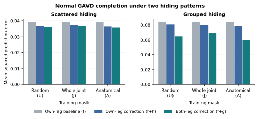
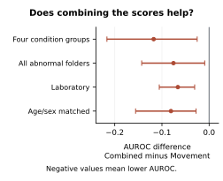

# Technical details and supporting figures

These notes give exact settings for the [manuscript](manuscript.md). They describe the same saved experiments and add no new model runs. The main text explains the comparison in ordinary language; this document provides the details needed to reproduce its masks, weighting and scores.

## Names used in the paper and artifacts

| Paper name | Artifact identifier | Meaning |
| --- | --- | --- |
| Random training | U | Select half of all joint-time tokens uniformly. |
| Whole-joint training | J | Hide one joint throughout the window, then fill the remaining budget randomly. |
| Anatomical training | A | Hide a small body region across consecutive times, then fill randomly. |
| Scattered hiding | U evaluation bank | Use the same 16 stored random masks for every training method. |
| Grouped hiding | E_leg evaluation bank | Hide neighboring knee-to-foot observations and score the forced group. |
| Own-leg baseline | f | Fit the initial prediction using the target leg, then keep it fixed. |
| Own-leg correction | f+h | Correct the baseline using additional features from the target leg. |
| Both-leg correction | f+g | Correct the same baseline using features from both legs. |
| Movement score | M | Measure unusual posture and movement relative to fitting-normal recordings. |
| Cross-leg score | R | Measure an unusual prediction benefit relative to reserved normal recordings. |
| Combined score | S | Average M and R with fixed equal weights. |

A joint-time token contains four samples of one joint. Artificial hiding removes a valid observation from a predictor. Naturally missing measurements remain invalid and never become scoring targets. These two kinds of missingness have separate flags.

## Observations and masks

The joint allowlist is BlazePose indices 11–16 and 23–32. It covers paired shoulders, elbows, wrists, hips, knees, ankles, heels and foot indices. The scored joints are indices 25–32. A leg's input membership is its hip, knee, ankle, heel and foot index. The 32-sample windows are drawn at stride 16 after 15 Hz resampling. Each token needs four valid samples, and the overall quality checks include all 16 joints.

Anatomical masking first selects one of the following disjoint groups with probability equal to its width divided by 16. It then selects a listed start uniformly. Times refer to four-sample patches, not individual video frames.

| Group | Joint indices | Width | Patch length | Starts |
| --- | --- | ---: | ---: | --- |
| Torso | 11, 12, 23, 24 | 4 | 2 | 0, 2, 4, 6 |
| Left arm | 13, 15 | 2 | 4 | 0, 4 |
| Right arm | 14, 16 | 2 | 4 | 0, 4 |
| Left lower leg | 25, 27, 29, 31 | 4 | 2 | 0, 2, 4, 6 |
| Right lower leg | 26, 28, 30, 32 | 4 | 2 | 0, 2, 4, 6 |

Every initial block contains eight tokens, and each token has probability 1/16 of entering it. Filling 56 of the remaining 120 tokens gives total hiding probability `1/16 + (15/16)*(56/120) = 1/2`. Matching that probability does not match task difficulty or usable supervision.

The scattered evaluation bank contains 16 masks with seed 17. The grouped bank enumerates the two lower-leg sides and starts 0, 2, 4 and 6 twice, then fills each mask to 64 with seed 117. Only the forced group supplies its scored targets. Correction training and grouped evaluation require at least two valid visible tokens at different times on each leg. Scattered evaluation instead requires two visible valid patches of the target joint. A source must supply four distinct target patches for each scored joint; repeated mask draws cannot satisfy this count.

## Fitting and weighting

Each fit uses 512 source-balanced window/mask presentations. Loss weights give equal importance to sources and readout joints. Internal validation chooses a ridge penalty from `{0.1, 1, 10}` and correction multiplier from `{0, 0.5, 1}`. The own-leg baseline has 77 features. Both correction models have 154 features, eight outputs and 1,240 coefficients including intercepts.

Internal selection averages weighted prediction requests. Final evaluation additionally merges repeated requests for the same physical target before averaging windows, sequences and sources. The two stages therefore use slightly different weighting. This is a property of the executed study, not an assertion that repeated masks are independent examples.

The body reference uses each frame's pelvis and the valid torso length in the first half of the window. Both branches share it. Input-invariance checks hold that reference fixed; they do not establish independence from the body measurements used to construct it.

## Exact score definitions

The 16 movement features include six per leg: knee-angle median and interquartile range, ankle X/Y interquartile ranges, and X/Y velocity median absolute deviations. The remaining four are trunk-inclination median and interquartile range, left-minus-right knee-angle median, and left-minus-right ankle-X excursion. Features are aggregated to one row per source before normal-only imputation, scaling and covariance fitting. M is the squared Mahalanobis distance divided by 16.

For each hidden target, benefit is own-leg-correction squared error minus both-leg-correction squared error. Repeated masks average within a target, then targets within windows, windows within sequences and sequences within sources. Joint identity is retained until the four readout joints on each side are averaged equally.

Let `b_k` be the source benefit on side k. The five reference sources provide mean `mu_k` and sample variance `s_k²`, using denominator n−1. We set `v_k = 0.5*s_k² + 0.5*mean(s²) + 1e-8`. R is the mean of `(b_k-mu_k)²/v_k` over the two sides, and S is `(M+R)/2`. This diagonal distance does not account for correlation between left and right benefits.

The own-leg-improvement control replaces benefit with baseline error minus own-leg-correction error. The correction-error control is `0.5*M + 0.25*(own_error_distance + both_error_distance)`. The baseline-error control averages M with the baseline-error distance. These distances use the declared normal references; the raw losses are not simply added to M.

## Timing and uncertainty

The timing experiment takes frames 8:40 of each valid 48-frame parent interval and compares offsets −4 and +4. Sixteen uniform parent masks hide 96 of 192 tokens using seed 217. Original and donor joint/hip visibility are intersected before constructing the edit. Donor vectors are attached to the original permitted opposite hip using the unchanged scale. The comparison cannot reveal a hidden donor value or cross an annotation boundary.

The primary detection intervals use 1,000 paired source resamples within fold and binary-label stratum, with fixed fold weights. The GAVD random-trained grouped-task benefit interval uses 5,000 resamples. Additional paired completion intervals use 1,000 within-fold recording or participant resamples and are post-outcome descriptive. All intervals keep fitted models fixed.

The laboratory signals are the first flexion components of the processed Plug-in Gait joint angles, in degrees and on a shared clock. They are not global-axis rotations or BlazePose coordinates. One selected trial per person supplies 433 windows across 178 eligible participants. The laboratory corrections each have 72 features, with recorded numerical ranks 44 and 62.

## The complete prediction comparison

Each of the 28 normal recordings is evaluated by the model from its held-out fold. Lower error means more accurate completion. Within a panel, the hidden targets remain fixed as training patterns and predictors change. The grouped task removes neighboring leg observations together, so absolute errors across panels do not isolate a training effect. Values are mean squared errors in torso-scaled image coordinates.

## The paired anomaly-score comparisons

Each point is combined-score AUROC minus movement-score AUROC. Negative values mean that the combination ranks abnormal recordings less accurately. The bars show conditional 95% intervals. Resampling uses GAVD recording groups, laboratory participants or matched participant pairs as appropriate. The two GAVD rows overlap, as do the two laboratory rows, so these are not four independent studies.

The [evidence record](evidence.json), [completion verification](advisory/completion_audit_v1/README.md) and [figure manifest](figures/manifest.json) identify the saved numerical inputs. All six diagrams and plots are available as SVG, PDF and PNG in the figures directory.
