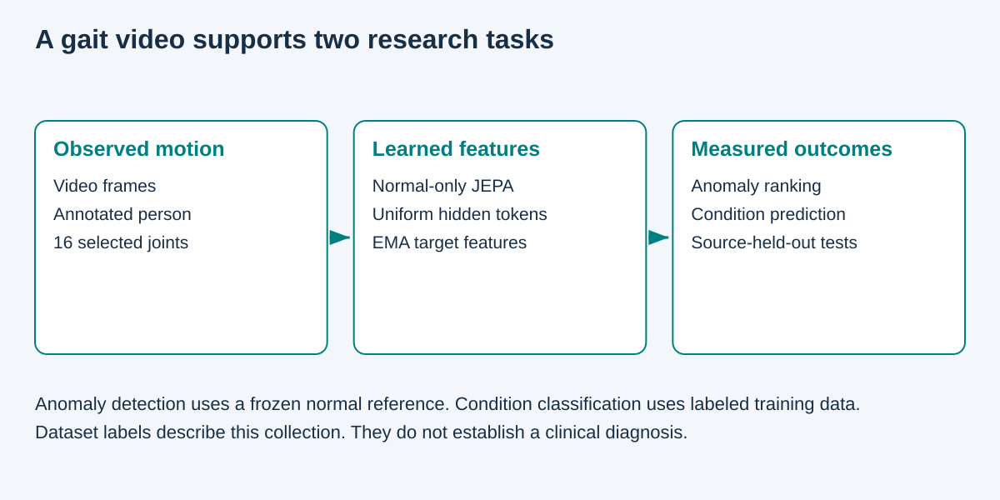
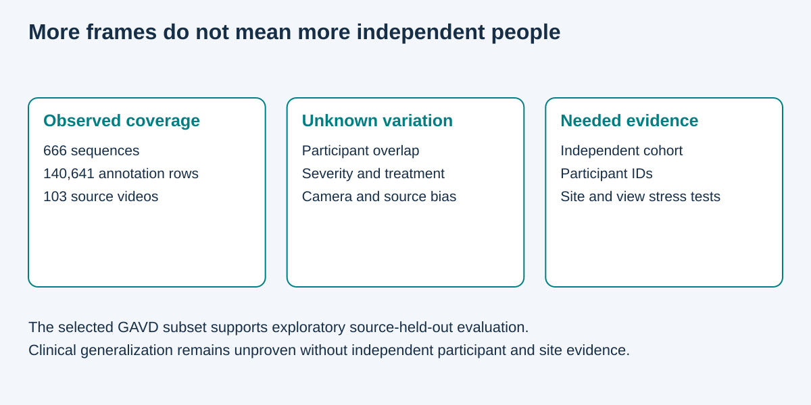
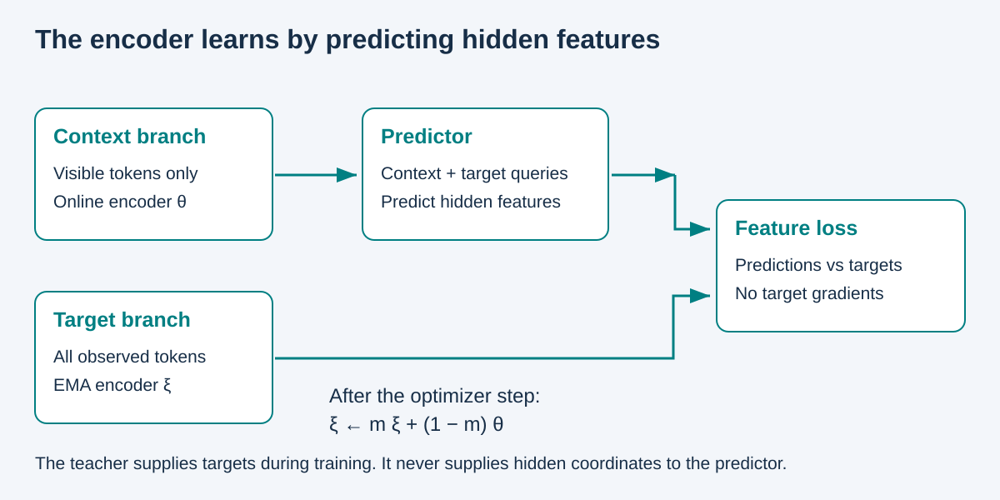

# Archived guide to the foundation tutorials

This is the earlier guide to Notebooks 00 through 07 and the completed five-class exploratory study. It was preserved on November 15, 2026 when the main [README](../README.md) changed to the twelve-folder context study. Historical scope statements, results, and commands below describe that earlier study. Run its commands from `experiments/aaai`; relative document links have been adjusted for this archive location. The current slide deck has since been replaced; the old presentation is available in [the slide archive](../slides/archive/pre_neuromechanics/index.html).

---

# Skeleton JEPA for gait anomaly detection

These eight tutorials learn a normal gait reference, add selected abnormal conditions for representation learning, and compare JEPA features with a Random Forest on the same source-held-out data. The [ASTAD4 workshop](https://ismart.ece.mcgill.ca/astad4/) lists **November 20, 2026** as its deadline. It permits seven content pages plus two reference-only pages and requires double-blind AAAI-27 formatting. No deadline timezone is stated. Verify the submission portal before submission.

The implementation is a paper-based adaptation of **Skeleton S-JEPA, ECCV 2024**. It retains the visible-context encoder, complete-input EMA teacher, and centered latent cross-entropy. It adds VICReg, uses a small transformer, selects 16 explicitly listed joints, and applies **uniform random masking independent of motion intensity**. It is not an exact benchmark reproduction. The similarly named 2026 stochastic-latent S-JEPA is a separate method.



## Evidence and current limits

The notebooks, local package, command-line workflow, diagrams, and slides are implemented. They cover normal-only learning, suffix forecasting, progressive normal replay, optional StoP-inspired positional noise, classification controls, and normal-reference anomaly scores. Tests check masking, gradient flow, source separation, cache identity, missing-token handling, and evaluation behavior.

**Full extraction retained 2,504 windows from 450 sequences and 91 sources.** Real benchmark runs use this fixed cohort; their measured results are reported separately from synthetic software checks. Synthetic scores have no clinical interpretation. Actual video extraction pilots exposed substantial missing-pose and semantic-quality problems. An initial complete-case rule rejected every pilot window. The revised protocol preserves missing observations, excludes invalid tokens from attention and prediction targets, and requires at least 75% valid tokens plus adequate past/future coverage. This change was motivated by extraction feasibility before any real model scores were examined. The full retained-cohort audit is complete, and the comparison includes a missingness-plus-camera-view control. Some partitions remain fragile, including one Parkinson's test source and one stroke validation source for seed 42. See [data audit](../docs/data_audit.md), [validation](../docs/validation.md), and [adversarial review](../docs/adversarial_review.md).

## Measured exploratory results

Three real runs used seeds 42, 43, and 44 with three epochs per stage. RF source-weighted macro-F1 ranged from **0.267 to 0.482**; the validation-selected JEPA ranged from **0.244 to 0.331**. The untrained encoder also had higher point estimates than the trained JEPA on each split. These results do not demonstrate a learned-representation advantage or a robust clinical detector. The short schedule has not established convergence.

The [complete results](../docs/results.md) report retained cohorts, per-class recall, paired intervals, normal-only anomaly rankings, a normal-embedding-distance baseline, and the seed-42 positional-noise ablation. No score direction or split was changed after test inspection. The [result chart](../images/real_comparison.svg) shows the prespecified first split.

## Run locally with uv

```bash
cd experiments/aaai
uv sync
uv run jupyter lab
```

Choose the Python kernel from this environment. If necessary, register it:

```bash
uv run python -m ipykernel install --user --name aaai-gait --display-name "Python (AAAI gait)"
```

`pyproject.toml` selects Python 3.12 and installs the repository's `alexpose` package in editable mode, making `ambient` available. Only `pyproject.toml` is supplied as a dependency specification. `uv` creates a local lockfile and environment when run. Every notebook repeats setup and data loading. The experiment settings were added to the root `.env` without changing existing secrets. After successful ingestion and validation, this prepared workspace uses `AAAI_DEMO=0` so notebooks open on the real corpus. Use `AAAI_DEMO=1` for the fast synthetic walkthrough. Later notebooks obtain compatible prerequisite checkpoints themselves. No previous notebook's kernel state is needed. Real-data notebooks require completed ingestion and sufficient retained class coverage.

CPU is the tested default. The walkthrough uses 64-dimensional embeddings, two encoder layers, one predictor layer, and batch size 16. Full media extraction and repeated training can take hours on a laptop. The three-epoch default demonstrates the workflow and is not a validated convergence schedule.

## Configuration in the root .env

The final configuration instruction in the request specifies the repository-root `.env`, so that file is the single source of settings and credentials. Existing secrets are neither copied nor printed. There is no second experiment `.env`. JEPA and Random Forest training require no API keys.

Add or adjust these values in the repository root `.env`:

```dotenv
AAAI_DEMO=0
AAAI_SEED=42
AAAI_EPOCHS=3
AAAI_BATCH_SIZE=16
AAAI_TARGET_FPS=15
AAAI_FRAME_NUMBER_BASE=1
AAAI_RUN_SPE_ABLATION=0
AAAI_DOWNLOAD_LIMIT=3
```

Every notebook uses the requested spelling through aliases:

```python
from dotenv import load_dotenv as load_env, find_dotenv as find_env
load_env(find_env())
```

The setup cell changes to the repository root before this call, then returns to the experiment directory. `python-dotenv` itself exports `load_dotenv` and `find_dotenv`, not `load_env` and `find_env`. Shell environment variables take precedence. Restart kernels after changing configuration.

`AAAI_DEMO=1` creates a small, explicitly synthetic cohort under `artifacts/synthetic_demo/`. Its condition-specific parameters are invented. `AAAI_DEMO=0` reads the real pose corpus and writes under `artifacts/gavd/`. Neither mode reads the old multiple-sclerosis feature caches or exp5 result tables.

## Tutorial sequence

|Notebook|What you learn and execute|
|---|---|
|[00. Research and inventory](../00_research_and_gavd_inventory.ipynb)|Define tasks; scan current CSVs; count sources, sequences, and rows; view an annotated video.|
|[01. Video, pose, and quality](../01_video_pose_and_quality.ipynb)|Download by source; inspect annotated boxes; use ambient extraction; understand timing, confidence, and exclusions.|
|[02. Joint tokens and masks](../02_joint_tokens_and_uniform_masks.ipynb)|Inspect the sorted joint table; create temporal patches; visualize uniform masks and positional noise.|
|[03. Normal-only JEPA](../03_normal_only_jepa_and_vicreg.ipynb)|Follow teacher distributions and gradients; train only normal training sources; inspect VICReg and encoder collapse diagnostics.|
|[04. Progressive adaptation](../04_progressive_condition_adaptation.ipynb)|Preserve the normal anchor; add conditions cumulatively with normal replay; fit separate frozen probes.|
|[05. Forecasts and anomalies](../05_forecast_anomalies_and_explanations.ipynb)|Hide the entire future; calculate latent surprise; calibrate from normal validation sources; inspect error maps.|
|[06. RF versus JEPA capstone](../06_capstone_rf_vs_jepa.ipynb)|Fit Random Forest and JEPA probes; compare controls; aggregate sequences; report paired uncertainty; predict a held-out gait.|
|[07. Ablations and evidence](../07_ablation_and_paper_evidence.ipynb)|Fit visualization on training data; inspect development perturbations; enable optional positional noise; assemble the paper ledger.|

Each notebook includes an inline annotated video preview when media exists, or a source link otherwise. Previews are explicitly distinguished from synthetic software checks. Generated H.264 previews stay under `data/videos-gavd/<source_id>/previews/`.

## The refreshed GAVD cohort

Each run rebuilds the manifest directly from the five current `data/gavd/<label>/*.csv` folders. It excludes `source/` to avoid duplicate counts and hashes every CSV. The dataset authority remains [data/gavd/README.md](../../../data/gavd/README.md).

|Label|Sequence CSVs|Annotation rows|Source videos|
|---|---:|---:|---:|
|normal|291|41,340|32|
|parkinsons|47|10,426|11|
|stroke|76|33,934|19|
|cerebral palsy|64|20,346|11|
|myopathic|188|34,595|30|
|Selected union|666|140,641|103|

These are annotation counts before media retrieval and pose exclusions, not successfully extracted examples or independent people. The broader local inventory contains 1,874 sequences, 458,116 rows, 12 labels, and 348 source IDs. Stroke was requested twice and is one class.

Restricting the primary cohort gives a more focused question than pooling exercise, intoxication, prosthetic gait, and broadly labeled abnormalities. Parkinson's disease, stroke, and cerebral palsy have distinct nervous-system mechanisms. Myopathic gait generally reflects muscle disease, so **neurological and neuromuscular gait patterns** is the accurate scope. These source labels do not verify diagnosis, severity, or treatment. Excluded categories could support a separately registered out-of-scope stress test.

### Does GAVD establish generalizability?

**No. It supports exploratory source-held-out evaluation within this collection.** Recovering all current annotations improves coverage over older local caches, but only 103 source videos support the selected cohort. Parkinson's and cerebral palsy each have 11 sources. More frames and overlapping windows do not create independent participants.

Source IDs are not patient identifiers. Reposts or repeated participants may cross IDs. Labels can correlate with viewpoint, clinic, compression, assistive devices, age, background, or pose quality. Public-video availability and pose filtering add selection bias. The metadata do not establish demographic, severity, or treatment balance. Some clips require semantic review to confirm that their annotated person and interval support the walking analysis.

Report retained source counts and exclusions by class and split, source-weighted metrics, per-class recall, and uncertainty. Audit view and missingness shortcuts. Independent participant-identified and site-separated data are needed for stronger clinical or population claims. Historical dataset subject counts cannot be substituted for verified participants in this derivative.



## Ingestion and real-data execution

```bash
uv run python scripts/run_pipeline.py manifest
uv run python scripts/run_pipeline.py ingest --workers 4
uv run python scripts/run_pipeline.py audit
# Set AAAI_DEMO=0 in the root .env before training.
uv run python scripts/run_pipeline.py train --seeds 42 43 44
uv run python scripts/run_ablation.py
uv run python scripts/summarize_results.py
```

`ingest` downloads each selected source once and extracts its current annotated sequences. Use `ingest --limit 3` for a small pilot. Failures remain in reports. Newly downloaded media always goes under `data/videos-gavd/<source_id>/`; valid pre-existing flat files are reused.

```text
data/videos-gavd/
  <source_id>/<source_id>.mp4
  <source_id>/previews/<sequence_id>_base1_5s.mp4
  download_report.csv
experiments/aaai/artifacts/
  poses/<sequence_id>.npz
  pose_extraction_report.csv
  pose_exclusions.csv
  synthetic_demo/<run_identity>/
  gavd/<run_identity>/
```

Inspect frame origins and person boxes before a full run. Cache provenance includes annotation bytes, video bytes, model weights, visibility threshold, and extraction settings. Stale pose caches raise errors. Archive them explicitly before regeneration. The model run identity binds actual retained windows, pose provenance, source assignments, settings, and code hashes.

Windows preserve source timing and resample to 15 Hz without bridging missing source frames. Sources below the requested sample rate are excluded instead of upsampled, preventing interpolation from crossing the forecast boundary. Frame coordinates are pelvis-centered. Scale comes only from the observed first half, preventing future torso measurements from altering past inputs. This is relative image-plane motion, not physical walking speed or depth. Missing observations remain missing. Invalid joint patches cannot supervise the predictor. Report the retained and invalid fractions, and verify that condition predictions are not driven mainly by missingness.

If `audit` reports lost class coverage, review media availability, annotations, and pose quality. Do not reshuffle sources or lower thresholds based on test scores. All methods must share the same revised protocol and retained cohort.

## Model and training design

Inputs have shape `[batch, 32 frames, 16 joints, 2 coordinates]`. Four frames of one joint form a token, producing 128 tokens. Uniform sampling hides half the token positions without consulting coordinates or labels. The permitted BlazePose indices are:

```python
(11, 12, 13, 14, 15, 16, 23, 24, 25, 26, 27, 28, 29, 30, 31, 32)
```

The [sorted joint table](../docs/joint_table.md) maps every point to its feature use. No face or hand-tip point enters the model or mask sampler. Invalid-token filtering is separate from the uniform stochastic mask. With at least 96 valid tokens out of 128 and exactly 64 hidden positions, every mask retains at least 32 valid context tokens and 32 valid targets. This gives a concrete computational reason for the 75% gate, while its selection bias still needs measurement.



Teacher targets use `softmax((teacher_feature - center) / 0.06)`. Predictor temperature is 0.1. Cross-entropy applies only to valid hidden targets. The teacher has no gradients and updates after optimization with EMA momentum 0.996. VICReg uses two online views and an unnormalized projector. The total is `latent_cross_entropy + 0.1 * VICReg`, with 25/25/1 invariance, variance, and covariance weights inside VICReg.

VICReg discourages collapse and redundancy. It does not maximize disease-class separation or guarantee informative features. Inspect actual encoder variance, effective rank, and frozen probes. The probe learns supervised class boundaries. Our downstream readout pools the online encoder, whereas the original skeleton paper uses its target encoder. This is a disclosed adaptation.

Normal-only pretraining uses normal training sources exclusively. An immutable checkpoint preserves that reference. A copy learns from normal plus Parkinson's, then stroke, cerebral palsy, and myopathic data, retaining earlier classes and normal replay. The final and normal encoders are compared through validation-selected probes. Extra training introduces more compute and data, so curriculum-order benefits require a compute-matched pooled-training control.

**Positional noise:** `ModelConfig(spe=True)` adds StoP-inspired noise to hidden predictor queries through the same learned projection as context. It preserves joint identities and clean teacher inputs. Evaluation disables positional noise. Any improvement remains to be measured.

**Stochastic latent variables:** the 2026 learned prior/posterior, KL term, and diverse completions are reviewed but not implemented. Independent noise is not that method. A proper extension needs uncertainty calibration and error-correlation measurements as well as representation quality.

**Future motion:** a separate model observes the first half and predicts latent features for the suffix. Random masked completion can use later context and is not forecasting. Admission checks future observation coverage, so this is retrospective forecasting on evaluable futures rather than a streaming admission policy. Neither model decodes future joint coordinates. A visible skeleton forecast needs an additional trained and evaluated coordinate readout.

## Fair evaluation and exp5 comparison

Sources receive approximately 60%/20%/20% training, validation, and test assignments before windowing. Splits balance counts rather than model scores. Each repeated run retrains the encoder within its training partition. Test coordinates never enter encoder pretraining, even without labels.

The RF uses 36 measured gait descriptors, including 15 exp5-style hip/knee/ankle summaries. An optional exact ambient adapter verifies that core subset. The RF and JEPA use the same QC, joints, windows, and labels. Training-only preprocessing precedes classification. Validation chooses RF depth, probe regularization, and the normal or final JEPA stage. Untrained encoder, mean-pose, missingness plus camera-view, and class-prior controls test alternative explanations. This is a fresh method comparison, not a numerical reproduction of exp5's historical results.

Average window probabilities within each sequence. Report sequence-weighted and equal-source-weighted macro-F1, balanced accuracy, per-class recall, confusion, and binary abnormal ranking metrics. Classification uses a paired bootstrap over entire sources and reports sequence-weighted differences. Anomaly ranking also receives source-cluster intervals. Replicates missing a class are counted and omitted. Repeated seeds are dependent because sources recur, so they are not independent samples for a naive t-test.

Normal-only surprise averages hidden-token `KL(target || prediction)` over a deterministic mask bank. Normal validation sources set its threshold. A finite-sample 5% false-alarm threshold needs at least 19 exchangeable calibration observations; the default split has six normal validation sources and therefore returns infinity. Report this limit and ranking metrics. An empirical percentile is only an exploratory operating point. Error heatmaps localize model mismatch, not a medical cause.

## Slides, documentation, and verification

The [offline slide deck](../slides/index.html) has 16 slides with SVG diagrams and speaker notes. The [Markdown deck](../slides/tutorial.md) is editable, and a [PDF export](../slides/tutorial.pdf) is included. Print the HTML in landscape for PDF. The 14 teaching diagrams and the measured-result chart are SVG files in `images/`. The [literature review](../docs/literature_review.md) explains each source method. The [paper plan](../docs/paper_plan.md) maps claims to evidence and submission requirements.

```bash
uv run python -m pytest tests -q
uv run python scripts/run_pipeline.py smoke
uv run python scripts/validate_notebooks.py
# With complete local poses, also exercise the real-data notebooks:
uv run python scripts/validate_notebooks.py --real
uv run python scripts/build_notebooks.py
uv run python scripts/make_visuals.py
```

The notebook validator starts a fresh kernel for each notebook, forces synthetic mode, and saves executed copies under `artifacts/notebook_checks/`. Authored notebooks stay free of large video blobs and potentially misleading demonstration scores. The [verification record](../docs/validation.md) distinguishes completed checks from pending research.

The requested background was found at `/Users/pmui/dev/worldmodels/gait/skeleton-jepa/background/s-jepa-mamp-literature-review.md`; the supplied vault path was absent. Primary-source citations and inspected implementation links are in the literature review.

## Predict an annotated video sequence

The capstone saves a fitted RF, the selected linear readout, and its encoder. After a real training run:

```bash
uv run python scripts/predict_sequence.py --run-dir artifacts/gavd/<run_identity> --sequence-id <GAVD_sequence_id>
```

The command reads current annotations, extracts the specified video's person if needed, applies the same QC and window settings, and averages condition probabilities across retained windows. It reports whether the sequence was in training. Load only model bundles you generated locally. An arbitrary video without GAVD annotations requires a reviewed person crop and interval or a separately evaluated tracking pipeline. These are dataset-condition scores, not diagnostic probabilities.
