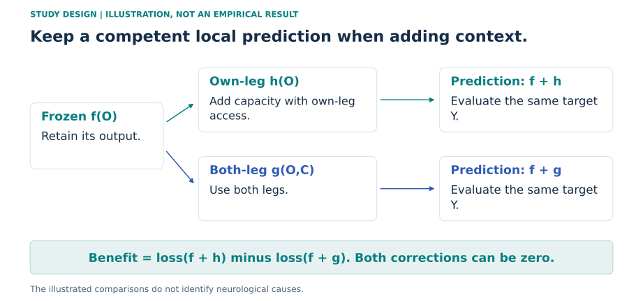
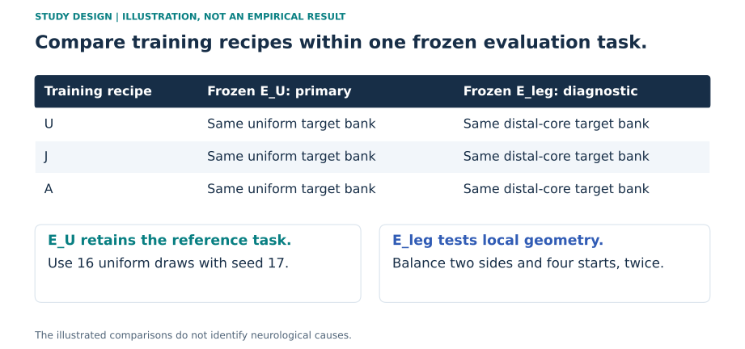

# Executed cross-leg prediction study

The new experiments are complete. Opposite-leg information can improve normal completion, but the frozen equal-weight anomaly score performs worse than local movement alone. A separate participant-level laboratory study supports that distinction. The GAVD timing diagnostic fails adequacy on its exact paired inputs, so it does not support reliable coordination measurement.

Start with [verified results](results.md), the [implemented protocol](protocol.md), [limitations](limitations.md), [draft02](../draft02/README.md), and the [active slides](../../slides/tutorial.pdf). The six new notebooks are linked from the [experiment README](../../README.md). The earlier [planning snapshot](README.planning_snapshot.md) is preserved as a record of proposed work, not a statement of current execution status.

## What ran

The GAVD cohort contains 304 source recordings, including 28 normal recordings, with 1,381 sequences and 9,442 windows. All U/J/A correction-training policies ran on both frozen U and E_leg banks. All 12 internal prediction gates passed, while outer-normal gains on U remain uncertain for U and A. The focal S-minus-M AUROC difference is −0.118, conditional interval [−0.217, −0.025].

The [independent laboratory study](external_replication_results.md) retains 178 participants after applying fixed observation support to 188 selected trials. Normal completion improves in every outer fold, while the fixed fusion again reduces anomaly ranking. These results are not transfer of video weights or clinical validation of the four GAVD condition families.

## Historical design and primary sources

The [canonical instructions](../../../../notes/aaai/05-iterate-02-INSTR.md), [data advice](advice_data.md), [method advice](advice_method.md), [neurological advice](advice_neuro.md), and three [skeleton](masking_method_review.md), [video](masking_transfer_review.md), and [neurological masking](masking_neuro_review.md) reviews preserve the reasoning before implementation. Their proposed experiments must be read beside the completed protocol and results. The [external feasibility review](external_replication_feasibility.md) records what was known before files were downloaded; the executed external report supersedes its availability status.

The [draft02 review record](../draft02/response_to_reviews.md) distinguishes accepted corrections, checked objections and unresolved limitations. The [readiness report](../draft02/submission_readiness.md) separates reproducibility and format from scientific strength. Historical draft01 results are unchanged.
