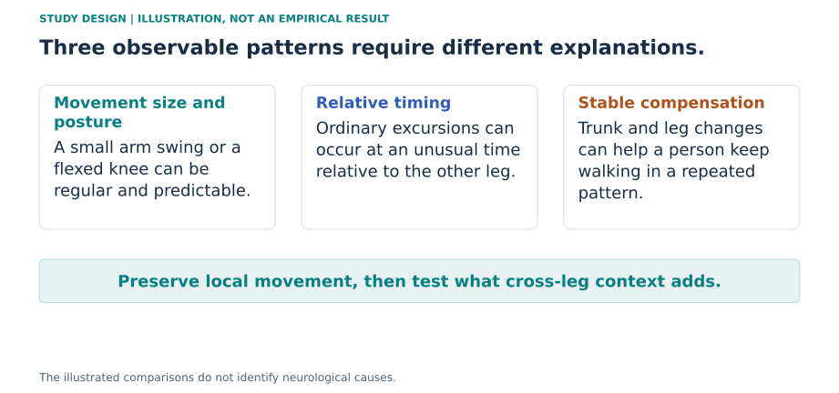
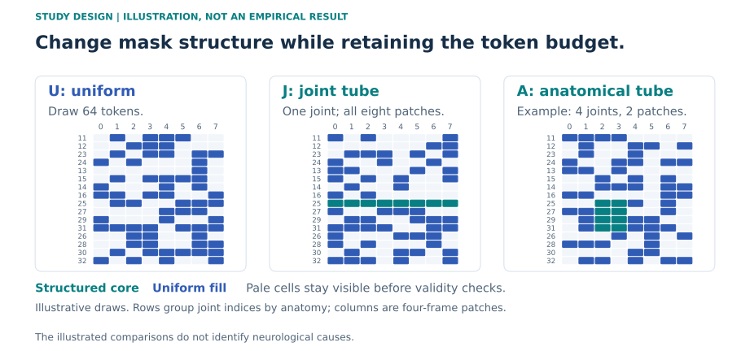
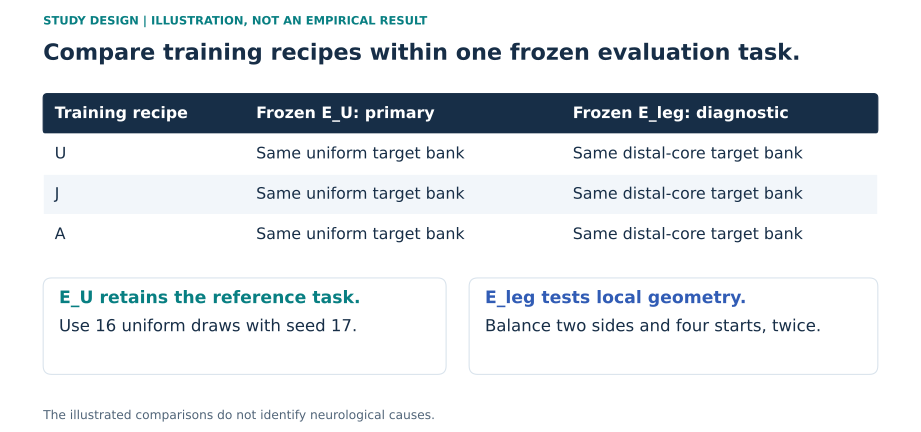
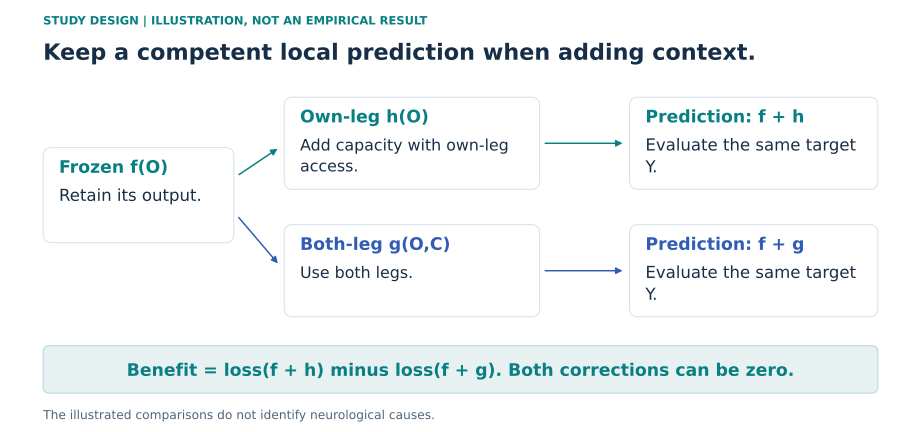
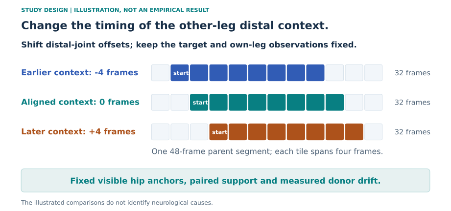
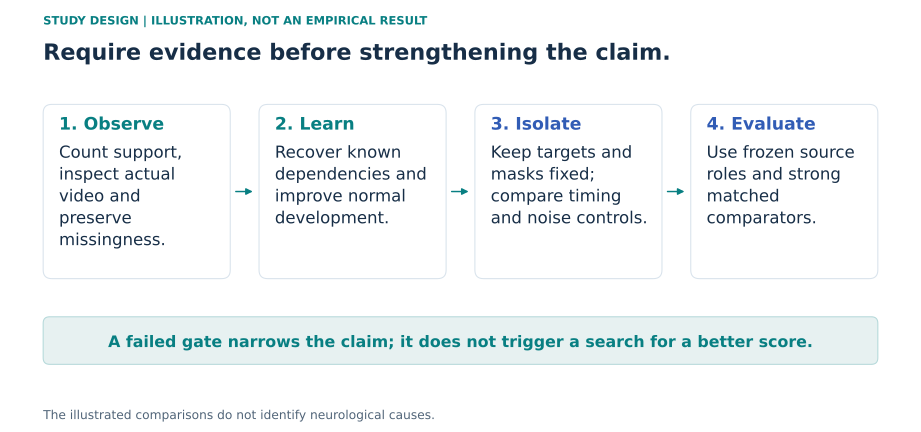

# The next experiments should test useful information between the legs

The best next step is to build a small predictor that can show whether the opposite leg contributes useful information beyond a leg's own movement. Keep posture, movement size and raw timing as separate evidence. Stroke, Parkinsons, cerebral palsy and myopathic gait can all produce repeatable movement, so an unusual gait need not be unpredictable.

For example, hide a short left-ankle segment. Predict it from visible left-leg observations, then give a matched predictor the right-leg observations as well. Give the own-leg predictor an equally sized correction so extra fitting capacity cannot explain the difference. Finally, keep the answer and left leg fixed while supplying permitted right-leg distal movements from slightly earlier or later. This tests whether the predictor uses alignment. It does not simulate a disease or identify a neurological cause.

Read the [complete instructions](../../../../notes/aaai/05-iterate-02-INSTR.md) for the exact input restrictions, scoring formulas, source roles and implementation sequence. The [research slide deck](../../slides/tutorial.pdf) and [offline viewer](../../slides/index.html) explain the plan visually.

## The masking comparison

Compare three training policies with the same 64-of-128 budget and the same 0.5 marginal probability for every token. U samples tokens uniformly. J starts with one eight-token joint tube. A starts with an eight-token anatomical tube, chosen with width-balanced group probabilities. Both structured policies fill their remaining 56 slots uniformly. This controls a confound in a leg-only design, which would hide leg targets more frequently.

Keep the test bank fixed across models and report the full training-policy by evaluation-bank matrix. Use the original uniform bank for the primary comparison and a named distal-leg bank for the local-geometry diagnostic. Anatomical masking is established prior art, including SLiM; the possible contribution is the controlled test of useful added information on real gait.

Read the [skeleton masking review](masking_method_review.md), [video and JEPA review](masking_transfer_review.md) and [neurological masking review](masking_neuro_review.md). These are literature and design reviews, not new model results.

## What would make this a stronger paper

| Priority | Experiment | Why it matters |
| --- | --- | --- |
| First | Verify known-dependency recovery and normal-development prediction, with a retained own-leg baseline and own-capacity control. | The completed full-context predictor often performed worse on normal data. Its errors cannot yet be interpreted as a useful relation. |
| Second | Test finite distal-leg timing offsets with fixed answers, permitted inputs and matched observation support. | A context score is more interpretable if the model demonstrably uses alignment rather than extra geometry or missingness. |
| Third | Compare the frozen relational score plus local motion against strong motion, timing, calibrated-error and sham controls. | A higher score than one weak baseline is insufficient evidence of added information. |
| Optional | Run a bounded participant-separated laboratory replication after signal semantics are verified. | Independent participants can test the algorithmic idea, while GAVD alone remains an internal web-video study. |

Masked gait prediction, normative reconstruction and interlimb coordination measures already exist. The potential contribution is the tested combination of a competent retained predictor, a controlled information comparison and demonstrated value under incomplete video observations. That contribution has not yet been established. A negative result should narrow the manuscript rather than trigger a search for a favorable endpoint.

## What can be done in the coming week

Implement and verify the small coordinate predictor first. Freeze the source registry, primary endpoint and comparisons before new outcome scores. Then run the matched timing tests and four-fold study, inspect failures, and write only claims supported by saved results. The instructions specify six new notebooks, numbered 12–17, that teach and verify this sequence. These notebooks have not been created or executed.

A read-only support check found a useful improvement in coverage. Using eight lower-limb readouts with the same 16-joint input/masking allowlist could retain **304 sources, including 28 normal**, compared with the completed study's 251 sources and 23 normal. The additional normals failed only the arm-readout gate. All 28 have appeared in earlier exploration, so none should be described as fresh independent validation.

The proposed primary endpoint is normal versus the four requested condition families, with 90 candidate sources. The required broad secondary uses all 12 folders and the same frozen scores. This is an explicit exploratory redesign after earlier outcomes were seen. The original all-folder primary remains preserved. Source recordings are not verified independent people, and GAVD cannot by itself establish clinical or neurological generalization.

## Evidence and advice

| Material | Status |
| --- | --- |
| [Completed manuscript and evidence](../draft01/README.md) | Real results preserved. No learned JEPA advantage established. |
| [Data and ingestion advice](advice_data.md), [availability probe](data_feasibility_probe.json) | Read-only measurements, not new detection results. |
| [Method advice](advice_method.md), [neurological advice](advice_neuro.md) | Independent research recommendations and primary-source reasoning. |
| [External replication feasibility](external_replication_feasibility.md) | Public metadata and documentation inspected; no scientific files downloaded. |
| [Canonical instructions](../../../../notes/aaai/05-iterate-02-INSTR.md) | Proposed implementation, exact comparisons, scientific gates and notebook design. |
| [Independent method review](adversarial_review.md), [Claude critique](reviews/claude_review.md), [responses](response_to_reviews.md) | Criticism checked against evidence; model advice is not ground truth. |
| [Mask-design verification](mask_design_verification.md) | Exact enumeration and 6,144 sampled masks passed; no gait model was fitted. |
| [Slide visual review](../../slides/visual_review.md) | Vector pages rendered and checked; this verifies presentation, not efficacy. |

The laboratory option has 138 able-bodied participants and 50 people after stroke. A two-hour parsing pilot and one-day maximum keep it bounded. It would be a separate method replication with different measurements, not automatic transfer of video-trained weights or validation of the other condition families. See the feasibility report before allocating implementation time.

The instruction package is ready for critical implementation review. The proposed scientific contribution remains untested. Preserve that distinction in every notebook, figure, slide and eventual manuscript.
