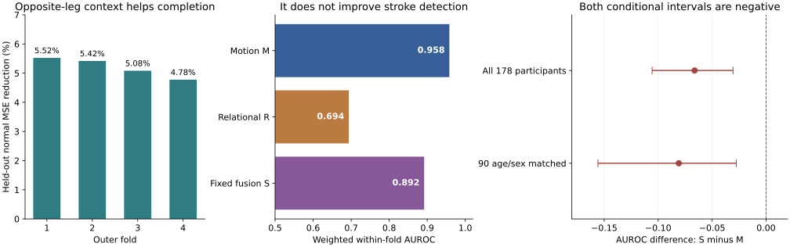
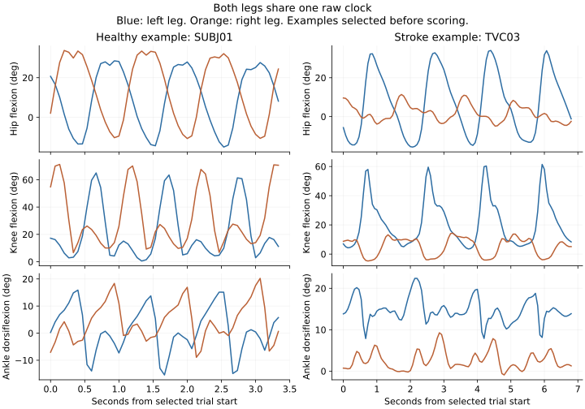

# Independent participant replication: useful prediction did not improve detection

The completed external study supports a precise negative result. Opposite-leg information helped reconstruct hidden normal movement, including genuinely held-out normal participants. Its anomaly score nevertheless reduced stroke detection performance when combined with a strong movement baseline using the fixed formula. The age and sex balanced sensitivity reached the same conclusion. The method was not retuned after observing these results.

The immutable run is [external_fb9d0d23b56ce29fd846](../../artifacts/iteration02/external_fb9d0d23b56ce29fd846/protocol.json). Its [completion record](../../artifacts/iteration02/external_fb9d0d23b56ce29fd846/completion.json), [participant scores](../../artifacts/iteration02/external_fb9d0d23b56ce29fd846/scores.csv), and [independent verification](../../artifacts/iteration02/external_fb9d0d23b56ce29fd846/adversarial_verification.json) are available locally. This is a separate method replication in a different representation. It is not transfer of the GAVD encoder, a JEPA experiment, or pooled evidence from common participants.



The left panel reports outer-test normal reconstruction improvement, not training error. The center uses weighted within-fold AUROC. The right shows conditional 95% intervals from the frozen participant and matched-pair bootstraps. Models, folds, selection rules and feature definitions remain fixed during resampling.

## Data and pre-outcome choices

The source is the [Van Criekinge et al. laboratory dataset](https://www.nature.com/articles/s41597-023-02767-y), distributed in the [versioned Figshare collection](https://doi.org/10.6084/m9.figshare.c.6503791.v1). The original supplement supplies participant ages and reported sex. The data include 138 healthy adults and 50 stroke survivors. These are dataset participant identities, unlike the recording IDs in GAVD.

The complete archive directory was inspected before selecting one walking trial per participant. Selection used the lexically first positive-number dynamic `SUBJ(number)` or `BWA` trial, allowing the documented naming separators and leading zeros. Static calibration, zero-number and unnumbered files were excluded from selection. All 188 selected identities and exact archive members were frozen before downloads or prediction outcomes. No failed or short trial was replaced with a more favorable trial.

| Stage | Healthy participants | Stroke participants | Total |
| --- | ---: | ---: | ---: |
| Frozen trial selections | 138 | 50 | 188 |
| Successfully downloaded and parsed | 138 | 50 | 188 |
| Eligible for the fixed window and support rules | 128 | 50 | 178 |
| Age and sex matched outer-test sensitivity | 45 | 45 | 90 |

The final cohort contains 433 windows. Ten healthy participants had no eligible 32-sample window. The selection list, download ledger, exclusions, window index, roles and file hashes are in [external preparation](../../artifacts/iteration02/preparation/external_replication/). One selected trial limits within-participant coverage. Healthy participants contributed fewer windows than stroke participants, so longer recordings must not be treated as additional independent people. Training weights and final metrics give participants equal roles within the declared aggregation.

C3D members were fetched using bounded byte ranges, with ZIP CRC validation and SHA-256 for each extracted file. The original full archive MD5 values were recorded but not claimed as locally verified because complete archives were not downloaded. An initial truncated full-archive attempt was rejected. All selected trial downloads subsequently succeeded.

## A separate six-angle representation

The [primary Vicon specification](https://vicon-help.atlassian.net/wiki/spaces/Nexus215/pages/11377505/Plug-in+Gait+output+specification) identifies the first stored hip, knee and ankle angle components as flexion-related outputs. The actual files declare `POINT:ANGLE_UNITS = deg`, and all six channels occur in `POINT:ANGLES`. The first component is not rotation about the global camera X axis. The recorded ankle output already includes the model convention; the pipeline does not add a second offset.

| Channel | Meaning of component 0 | Side |
| --- | --- | --- |
| `LHipAngles` | Hip flexion | Left |
| `RHipAngles` | Hip flexion | Right |
| `LKneeAngles` | Knee flexion | Left |
| `RKneeAngles` | Knee flexion | Right |
| `LAnkleAngles` | Ankle dorsiflexion | Left |
| `RAnkleAngles` | Ankle dorsiflexion | Right |

These processed joint angles are not BlazePose image coordinates or interchangeable skin markers. The GAVD 16-joint allowlist still applies to the GAVD experiment. This independent six-channel study has its own declared input representation and masks. The angles also share the laboratory body-model conventions, so restricting learned inputs to one leg does not establish physiological isolation from the rest of the body.



The examples illustrate data interpretation rather than a group-level finding. Both legs retain one common raw clock. No limb is independently aligned to its own gait cycle. Event labels are available, but event phase and clinical scores were not inputs to the prediction model.

The parser rejects unsupported angle units, missing channel identities, invalid sample clocks and nonadjacent raw frames. Negative C3D residuals or nonfinite angle coordinates remain missing. Valid adjacent observations are resampled from 100 Hz to 15 Hz on a relative trial clock. Windows contain 32 samples with stride 16, spanning 31/15 seconds. At least 75% of four-sample tokens and 50% in each temporal half must be complete. Each participant needs at least four distinct eligible physical target patches for every angle. No prediction loss affects eligibility.

## Frozen models and scores

Each of four outer folds has 76 normal fitting participants, 20 separate normal reference participants, and 32 normal test participants, plus 12 or 13 stroke test participants. The fitting participants form three internal folds. No reference or outer-test participant enters predictor selection. Each participant appears exactly once in outer testing.

A uniform mask hides exactly 24 of the 48 angle-time tokens. The evaluation uses 16 fixed masks with seed 17. Targets need a complete four-sample angle patch, at least two allowed own-leg context tokens at distinct times, and equivalent opposite-leg support. The training schedule contains 512 participant-balanced mask presentations. Masks are not redrawn to rescue difficult targets.

The retained own-leg ridge baseline has 36 visible-context features and four outputs. It combines permitted interpolation, visibility and time indicators, and angle identity. An own-capacity residual uses the original 36 features plus 36 own-leg temporal-moment features. The both-leg residual uses the same original 36 features plus 36 opposite-leg interpolation features. Their input widths match, but this does not guarantee identical effective rank or inductive bias. Exact zero correction returns the saved baseline output.

Regularization values `{0.1, 1, 10}` and multipliers `{0, 0.5, 1}` are selected on internal normal participants. A nonzero both-leg correction must improve over both the retained baseline and the selected own-capacity control in at least two of three internal folds and in the overall participant-balanced mean. All four outer models passed in all three internal folds.

Movement score **M** uses 12 descriptors: each angle's window median and interquartile range, averaged to one participant vector. Robust scaling and a Ledoit-Wolf covariance are fitted on normal fitting participants only. M is the squared distance divided by 12.

Relational score **R** compares the squared error of the own-capacity predictor with the both-leg predictor on identical targets. Mask draws are averaged within targets, targets within windows, and windows within participants, retaining each angle. Three angles are then averaged equally per side. Twenty separate normal references define a two-dimensional mean and shrunk component variances. R is a two-sided standardized departure, so it is not a disease probability or a ranking of neurological impairment.

The combined score is fixed as **S = 0.5 × (M + R)**. The protocol also retains fusions with base error, own-capacity error, both-leg error and the base-to-own-capacity sham benefit. No fusion weight was selected from stroke labels or test AUROC.

## Measured results

| Score | Weighted within-fold AUROC |
| --- | ---: |
| Movement M | 0.9581 |
| Relational R | 0.6938 |
| Fixed combined S | 0.8919 |
| M with calibrated base error | 0.9356 |
| M with calibrated own-capacity error | 0.9313 |
| M with calibrated both-leg error | 0.9244 |
| M with calibrated sham benefit | 0.9306 |

The primary difference, S minus M, is **−0.0663**, with a conditional 95% interval of **[−0.1056, −0.0306]** from 1,000 participant bootstrap draws stratified by outer fold and label. Original within-fold normal–stroke pair weights remain fixed. The interval conditions on the fitted models and this protocol; it does not include model-refitting or study-design uncertainty. The [complete comparison artifact](../../artifacts/iteration02/external_fb9d0d23b56ce29fd846/paired_effects.json) preserves the additional control contrasts.

On outer-test normal participants, both-leg context reduced reconstruction MSE by **5.52%, 5.42%, 5.08% and 4.78%** across folds compared with the own-capacity control. This shows that the normal relationship was learned beyond the internal selection checks. It does not make the resulting anomaly channel useful for this detector. The [held-out error table](../../artifacts/iteration02/external_fb9d0d23b56ce29fd846/heldout_prediction_error.csv) also shows that mean absolute completion errors were generally lower for stroke than normal participants. Movement amplitude and predictability affect error, so larger reconstruction error cannot automatically be interpreted as greater abnormality.

The eligible healthy group has mean age 52.48 years, with 62 men and 66 women; the stroke group has mean age 64.20 years, with 34 men and 16 women. Before outcomes, the study fixed same-sex matching within each outer-test fold, with an age difference no greater than five years, no reuse, maximum match count, then minimum total age difference. This produced 45 pairs with mean age difference 2.02 years. Each matched group has 29 men and 16 women; mean ages are 63.84 years for controls and 63.96 years for stroke participants. Five stroke participants could not be included in this frozen matching, and the unmatched ledger records why. The matched sensitivity gives **M = 0.9546**, **S = 0.8738**, and **S minus M = −0.0809**, with a matched-pair conditional interval of **[−0.1558, −0.0276]**. Models were not refitted and the caliper was not changed. This is age and sex balanced sensitivity, not causal adjustment. Walking speed was not matched because it may mediate impairment.

## What the manuscript can responsibly claim

A useful normal predictor and a useful anomaly detector are different requirements. Here the first requirement passes, while the fixed fusion fails the second. The independent participant setting and demographic sensitivity make that distinction stronger than a result based only on heterogeneous internet recordings. It supports a careful methodological paper about testing context use and anomaly value separately.

It does not support claiming improved stroke diagnosis, superiority to state-of-the-art gait models, neurological causation, pretrained transfer, or generalization to Parkinson's disease, cerebral palsy or myopathy. This dataset contains selected stroke survivors in one laboratory. The linear representation, short windows, single chosen trial, fixed fusion, and selected study population limit generalization. Age and sex matching does not remove all clinical or acquisition confounding.

The next prospective study could test whether normal-only calibration can prevent a redundant or unstable relational channel from overwhelming an already strong movement detector. A second direction is a fixed observation-budget comparison using multiple independent trials per participant. Those are new studies with new frozen protocols. They must not be used to replace this negative result after searching for a favorable fusion.

## Verification and reproduction

Four structural tests passed. They check fixed masking, forbidden-input invariance, exact zero correction, normal-only fitting, role separation, and matched positive/negative dependency fixtures. The independent audit reconstructed every target loss from **216,439 saved raw predictions in 320 files**, checked the numerical agreement, confirmed disjoint fitting/reference/test roles, verified all 178 participants were tested once, checked the degree-unit declarations and demographic group joins, and verified the zero-correction training-risk comparison. The figures were rendered and reviewed; crowded ticks and overlapping legends were corrected.

From the repository root, the code entry points are:

```bash
uv run --project experiments/aaai --with c3d==0.6.0 python -m aaai_gait.external_iteration02 prepare
uv run --project experiments/aaai --with c3d==0.6.0 python -m aaai_gait.external_iteration02 run
```

The frozen preparation already exists. Preserve it and the scored run. A run with an existing score file refuses to overwrite that result. [Model code](../../aaai_gait/external_iteration02.py), [tests](../../tests/test_external_iteration02.py), and the [figure rebuild script](../../scripts/build_external_replication_figures.py) remain available. The run records source snapshots and exact code/data hashes. Demographic matching was frozen separately before the scored run. A post-execution replay guard now makes the prepare command freeze that matching automatically and makes the run command reject missing matching hashes. It does not change the fitted method or reported results. The exact executed producer remains in the run’s source snapshot, and the small guard change is recorded separately.
