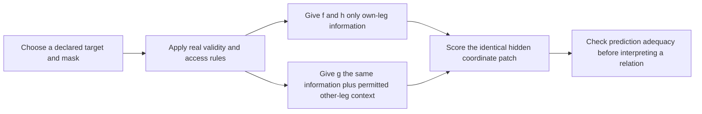

# Masking choices that can test gait relationships without inventing a mechanism

This review proposes alternatives to the current uniform masking protocol. It does not report new GAVD results. The best first addition is a short gap covering the target leg's distal joints, with a retained segment of its own visible history. This removes an easy same-frame geometric solution while leaving a plausible prediction problem. A strict short-horizon forecast is a valuable second task, but it requires different preprocessing and must be reported separately from completion.

Keep the original uniform-mask experiment as the reference. Structured training masks would be a declared protocol change, not a faithful reproduction of the original experiment. Changing a mask can improve an experiment's ability to test a hypothesis without improving the encoder. Those are different claims.

## What the primary papers actually establish

The strongest relevant evidence comes from motion modeling and skeleton action recognition. None of these studies establishes an optimal mask for pathological gait in short, projected GAVD sequences. Report their benchmark claims in their original setting rather than calling any method state of the art for this proposed gait task.

| Primary study | Verified masking or prediction design | Consequence for this project |
| --- | --- | --- |
| [MAMP, ICCV 2023](https://arxiv.org/pdf/2308.07092) | Predicts temporal motion and uses motion intensity to bias which tokens are masked. Uniform random numbers enter the sampling algorithm, but the resulting mask distribution is not uniform. | Our motion-independent masking is an intentional adaptation. Do not describe it as the published MAMP mask. |
| [S-JEPA, ECCV 2024](https://www.ecva.net/papers/eccv_2024/papers_ECCV/papers/04755.pdf) | Uses MAMP's motion-aware mask, a 90% mask ratio and four-frame patches on temporally resized 120-frame sequences. The teacher sees the complete sequence before target features are selected. | Neither its high ratio nor its contextual latent target establishes that 90% masking is appropriate for 32 GAVD samples. A latent target can encode more than the named joint. |
| [SkeletonMAE, Wu and colleagues](https://arxiv.org/pdf/2209.02399) | Combines random whole-frame removal with joint masking, and compares changing versus fixed joint identities across time. Random joint identities were better in its action-recognition experiments. | A tube is not automatically superior. Keep a properly matched random-mask comparator. This is the Wu paper, which should not be confused with another paper using the SkeletonMAE name. |
| [MotionBERT, ICCV 2023](https://arxiv.org/pdf/2210.06551) | Reconstructs 3D motion from corrupted 2D input, using frame and joint masks plus noise. Its supplement uses 10% frame and 5% joint masking and reports degraded benefits at high masking ratios. | Missingness and noise deserve separate controls. There is no universal mask ratio that transfers from images or action recognition to gait. |
| [UNIMASK-M, AAAI 2024](https://arxiv.org/abs/2308.07301) | Uses body-part patches and task-specific masks for forecasting, completion and inbetweening. It distinguishes a completely hidden future from a partly observed future. | The mask defines the task. Completion with future observations is not forecasting, even if the architecture is identical. |
| [Skeleton2vec, 2024 author preprint](https://arxiv.org/abs/2401.00921) | Predicts contextual teacher features and uses motion-aware persistent tube masks. | Persistent masking and latent skeleton prediction are prior art. The motion-dependent selection is unsuitable as an unmodified test of our motion-independent hypothesis. |
| [SLiM, revised November 2026 manuscript](https://arxiv.org/html/2603.10648v4) | Uses contiguous anatomical groups over temporal intervals, with a constant-volume strategy intended to block easy spatial interpolation. It explicitly discusses the same local-coordinate shortcut that concerns this project. | This is especially close masking prior art. We cannot claim that masking a leg to remove geometric shortcuts is a new idea. Our possible contribution is the controlled added-information measurement and its gait evaluation. |
| [ASMa, TMLR 2026](https://23wm13.github.io/ASMa/) | Selects complementary joint-degree and motion-intensity patterns. | It broadens the masking literature, but its motion-dependent selection should not enter the main proposed test. |

The [UNIMASK-M author project](https://evm7.github.io/UNIMASKM-page/) also explains its interpolation and reference-motion strategy. Copying that preprocessing into a causal forecast without checking which observations it uses would be unsafe. The downloaded primary PDF was inspected for the distinction between full future masking and partly observed completion. S-JEPA and SLiM are representation-learning precedents, not validations of a disease-specific world model. The latest SLiM author record lists NeurIPS 2026. These reported improvements were not reproduced in this review.

## Why neurological reasoning favors several measurements

A mask should ask an observable question. It should not encode the assumption that every abnormal gait is less coordinated or harder to predict.

| Biological evidence | Example that motivates a mask | Counterexample the study must permit |
| --- | --- | --- |
| Post-stroke EMG work found fewer independently timed motor modules in many participants, with associations with walking performance. [Clark and colleagues](https://pmc.ncbi.nlm.nih.gov/articles/PMC2822696/) | An entire distal-leg gap can ask whether opposite-leg observations help after the knee and foot no longer reveal the answer in the same instant. | More constrained or repeatedly compensated motion can be easier to predict. A video relation does not identify an EMG module or a neural lesion. |
| A large CP study related reduced muscle-synergy complexity to functional impairment and clinical motor measures. [Steele and colleagues](https://pubmed.ncbi.nlm.nih.gov/26084733/) | Removing the own-leg instantaneous configuration can separate visible geometric coupling from information in movement history and the opposite leg. | Flexed posture or a constrained movement pattern may remain regular. Greater error is not a necessary CP signature. |
| Experimental PD work separated stride-size regulation from cadence modulation. [Morris and colleagues](https://pubmed.ncbi.nlm.nih.gov/7953597/) | Preserve amplitude and raw time while testing short temporal gaps or forecasts. | Small, regular steps may predict well. Unit-variance scaling or independent phase normalization can remove the relevant difference. |
| Longitudinal DMD research linked particular muscle impairments with particular gait features and compensation. [Vandekerckhove and colleagues](https://link.springer.com/article/10.1186/s12984-025-01718-5) | A missing distal-leg segment may be predictable from stable compensation elsewhere. | A useful compensation can increase predictive dependence. The broad GAVD myopathic label does not establish DMD or one common muscle deficit. |

These examples motivate a two-sided departure from a normal reference and a separate local-motion channel. They do not establish that the proposed masks measure motor control. Projected coordinates mix body motion, viewpoint, camera motion, occlusion and pose-estimation error.

## Constraints that should govern every candidate

The 32 samples at 15 Hz span 31/15, or about 2.07 seconds, between the first and last sample. Some clips may contain roughly one or two cycles, while slow, interrupted or turning clips can contain fewer. Do not assume a complete gait cycle or estimate stride-to-stride variability from this duration. The existing support probe shows that longer windows sharply reduce normal-source coverage. A useful short task is preferable to an unsupported cycle analysis.

The allowed joint indices remain `11, 12, 13, 14, 15, 16, 23, 24, 25, 26, 27, 28, 29, 30, 31, 32`. The main scored targets remain `25–32`. Left distal-leg membership is `{25, 27, 29, 31}`; right membership is `{26, 28, 30, 32}`. Hip context is `{23, 24}`. No mask family should add targets outside this allowlist. The four-frame tokenization yields eight time patches and 128 joint-time tokens in a 32-sample window.

The current baseline masks 64 of those 128 tokens uniformly. Its fixed evaluation bank uses 16 draws with seed 17. Retain that bank and its original interpretation. New structured banks must have separate names, configuration hashes and coverage reports. A mask drawn uniformly over body parts is not uniformly distributed over every joint-time token. Write that distinction explicitly.

Mask selection must be independent of disease label, prediction error, motion magnitude, velocity and target-derived gait phase. Natural validity is applied after the declared artificial-mask draw. Do not redraw until a favorable or sufficiently complete example appears. A record may be unsupported; it must not silently disappear from one method's denominator.



This is a proposed information-flow diagram, not an empirical result.

## Candidate 1: A short gap covering the distal target leg

**Recommendation: first structured diagnostic and the leading candidate for a small training ablation.**

Consider predicting left-ankle samples `12:16`. Instead of hiding only that ankle token, hide the left knee, ankle, heel and foot index throughout `12:20`. The own-leg observations before the gap remain available; observations after it may remain available because this version is explicitly completion. The right leg retains its permitted observations. A separately declared harder sensitivity can expand the gap to `8:20`, leaving the same target `12:16` unchanged.

| Four-frame time patch | 0:4 | 4:8 | 8:12 | 12:16 | 16:20 | 20:24 | 24:28 | 28:32 |
| --- | --- | --- | --- | --- | --- | --- | --- | --- |
| Left distal joints, basic gap | Eligible | Eligible | Eligible | Hidden target interval | Hidden | Eligible | Eligible | Eligible |
| Right distal joints | Eligible | Eligible | Eligible | Eligible | Eligible | Eligible | Eligible | Eligible |

“Eligible” means subject to real validity and any separately declared background mask. It does not imply that a missing observation is restored. This table is an illustrative mask, not a GAVD measurement.

A visible knee and foot can often constrain an ankle through instantaneous geometry. Removing the distal chain over a short interval prevents that particular solution. Keeping local history avoids asking the model to invent the entire limb's identity, amplitude and phase from the opposite side alone. Keep the own hip and shared body reference explicitly declared. This is a **distal-leg gap**, not a claim to remove every same-frame own-leg cue.

For a fair 50% mask-budget comparison, the basic structured core occupies eight tokens: four joints across two time patches. Complete the remaining 56 masked positions by motion-independent sampling from the allowed pool. If a short visible history is reserved by construction, reserve the same history in a separate target-matched random control and identify that control as conditional random masking. It is not the original unconstrained uniform bank. The main loss should score the same named target patch rather than every token that happens to be hidden.

Freeze gap length and placement before evaluation. Do not claim an improvement because the structured family selects easier target times. A valid comparison needs the same source, target joint, target samples, loss weights and eligible target keys. Retain enough distinct target patches for the source score; repeated masks do not create new target observations.

**Falsification:** the both-leg correction must improve over a capacity-matched own-leg correction on held-out normal sources under this mask. It must also recover known dependence in synthetic controls with matched noise. If both branches fail badly, the gap is an unidentifiable or poorly learned task, not a discovered gait abnormality. If own-leg interpolation nearly solves it, report low remaining headroom instead of increasing the gap until a favorable disease AUROC appears.

## Candidate 2: A genuinely causal short-horizon forecast

**Recommendation: one bounded secondary task, if its preprocessing audit passes.**

Use samples `0:28` as observed history and hide samples `28:32` for all 16 allowed joints. Predict one of the usual distal-joint coordinate patches. The own-leg baseline and capacity control see only their permitted histories. The both-leg correction can add the opposite leg's history, but cannot see any future knee, hip, foot or arm. A separate eight-sample suffix can test a longer horizon; it is a second task, not a replacement selected after seeing the results.

The first four predicted samples occur approximately 67 to 267 milliseconds after the last observed sample at index 27. This is a short projected-motion forecast. It is not a prediction of a future fall, disease onset or neurological event. The horizon is an engineering choice, not a demonstrated physiological boundary.

The attraction is clear: same-time future geometry is unavailable, so any added information must come from permitted history. The risk is also clear: a smooth walking segment may be almost completely predicted by persistence or constant velocity. Conversely, a turn, stop, camera movement or unobserved external event can make the future ambiguous without indicating disease. Include those simple baselines and report both residual error and ambiguity.

A causal attention mask is insufficient on its own. Token boundaries, smoothing, resampling, imputation, normalization and derived features must also respect the cutoff. Do not use future pelvis locations to center an observed input, future shoulders to estimate scale, a full-clip phase estimate, or interpolation that reads beyond the available time. A defensible alternative is a common origin and scale computed from the observed prefix and frozen for the forecast. This changes the target coordinate convention, so apply it to every comparator and report it as a separate experiment. Audit the physical source timestamps used by the final resampled input.

**Falsification:** altering an inaccessible future value while holding permitted history fixed must leave every predictor input and output unchanged. The learned method must beat persistence and constant velocity on normal development data. A gain from a future-aware scaler or an acausal feature is leakage, even if every neural attention layer is causal.

## Candidate 3: Temporally correlated observation dropout

**Recommendation: a required robustness axis, not the proposed neurological signal.**

A real video often loses a heel and ankle for several consecutive frames together. Independent token deletion does not reproduce that pattern. Add a declared short burst that removes a connected distal group, or a short frame-level dropout across the allowlist, while preserving the original target values solely for scoring. Use a small fixed set of burst durations in samples. Mask locations and durations should be independent of the target label and movement intensity.

Construct artificial dropouts only where the underlying target is valid under the existing pose-quality policy. A naturally missing joint has no trustworthy observed target to score. Never fill it with a model prediction and then treat that prediction as ground truth. Confidence is not a calibrated probability of coordinate accuracy.

Compare burst dropout with independent deletion at the same artificial missing-token count and on identical target keys. Keep an uncorrupted-reference evaluation and record natural support separately. If using empirically observed missingness templates, estimate them only from fitting-normal sources; do not learn disease-specific camera patterns from evaluation clips. The resulting stress test approximates an observation process, not muscle weakness or impaired coordination.

**Falsification:** if the relational score responds more strongly to a modest observation dropout than to the proposed same-target timing challenge, a neurological interpretation is not supported without a convincing separation of those effects. If its apparent condition discrimination vanishes after matching source quality, say so. Robustness training must not simply teach the model to reconstruct a common stereotyped normal gait over a person's valid unusual movement.

## Candidate 4: A fixed mixture of uniform and structured training masks

**Recommendation: a small secondary training ablation after the first diagnostic works.**

Compare the original uniform training recipe with one prespecified mixture, such as equal proportions of uniform draws and the distal-leg gap from Candidate 1. Keep the same total updates, normal sources, target-loss budget and model capacity. Sample side and permitted placement without motion weighting. A mixture proportion of one half is a transparent engineering starting point, not an empirically optimal choice.

Evaluate both trained models on the same frozen uniform bank and the same frozen gap bank. Report the complete two-by-two matrix. This separates learning under a structured objective from changing evaluation difficulty. Do not evaluate each model only on the mask family on which it was trained and compare those losses as if they measured the same task.

A full semantic-body-part mixture is defensible prior art, but lower priority here. Arm availability already limits normal-source support, and masking a complete leg across the entire clip removes too much local information. Broad anatomy-based masking can be explored later while maintaining the same 16-joint allowlist. Do not copy 25-joint Kinect groups into BlazePose indices. A large curriculum over mask ratios, phase-specific masks and multiple anatomical scales is too easy to tune against a small reused dataset.

**Falsification:** if the mixture only improves on its matching gap bank while worsening the unchanged uniform bank, describe task specialization. If its apparent gain disappears at matched update and target counts, the evidence supports extra training exposure rather than a superior mask.

## Fair access is more important than the mask's name

For each declared task, retain a shared coordinate target and the same nested comparison:

```text
local prediction:          f(O)
extra-capacity control:    f(O) + h(O)
other-leg prediction:      f(O) + g(O, C)
relational benefit:        squared_error(f + h, Y) - squared_error(f + g, Y)
```

The correction branches need matched capacity and optimization. The frozen baseline must be fitted for the same information restriction. Testing a uniform-trained predictor on a structured gap first measures a distribution shift; it does not by itself measure the value of a newly trained structured method. Recheck adequacy on the actual input support used for every interpretation.

The current protocol explicitly conditions both branches on a shared body reference. That reference already contains body information. Under it, “own leg” describes a learned input restriction conditional on that reference, not total statistical independence from the other leg. For the proposed distal readout, retaining a declared hip reference is more defensible than secretly recovering a hidden hip to normalize the target. A stronger claim about removal of all opposite-leg information would require an independently audited reference construction.

Apply masking before angles, velocities and learned features are formed. A knee angle reveals its hip, knee and ankle constituents. A full-skeleton cached embedding can reveal masked context even when a downstream head receives only selected feature positions. For a JEPA feature candidate, restrict the student branch before attention. A full-sequence teacher can create a training label, as in the published method, but its contextual target is not equivalent to predicting one isolated coordinate. Keep the coordinate loss as the primary interpretable comparison.

Phase-dependent masks are not recommended for the first study. A phase estimator that sees the hidden target can choose the mask using information the predictor is meant to lack. Independently aligning left and right cycles can remove the timing difference being studied. A near-static foot or irregular sequence may not support phase at all. Preserve raw time, movement size and side-specific trajectories; an unavailable phase estimate should remain unavailable.

## Keep prediction masking and timing perturbation as separate factors

The selected mask determines what is visible. The existing timing challenge then changes only permitted distal context within that visibility policy. It still uses a 48-frame parent, target interval `8:40`, and donor intervals `4:36` or `12:44`. Move each donor coordinate with its original visibility flag. Form hip-relative offsets only when both the donor hip and original attachment hip are permitted and valid.

Use each aligned-versus-shifted pair's own common support. Recheck adequacy on that exact sparse aligned input. A null result with almost no opposite-leg context is uninformative. The primary timing quantity remains frozen both-leg squared error with shifted context minus aligned-context error. Changes in calibrated relational or combined anomaly scores are secondary. Do not require all dropout variants and both timing offsets to share one tiny global intersection.

A strict forecast introduces an additional constraint: later-context perturbations must not fetch observations beyond the forecast cutoff. Reusing the completion timing probe without that restriction would turn the forecast into an acausal task. Defer the forecast timing ablation if no adequately supported, causally valid comparison exists.

## A small, falsifiable experiment is the strongest next step

1. Preserve the current uniform bank and measured historical findings. Register the exact new mask families and target catalog before inspecting condition scores.
2. Run Candidate 1 as a normal-development diagnostic with a target-matched random control, constant mask budget and visible-history audit. Report local error, added-capacity error, both-leg error and target coverage.
3. If the task is informative, compare uniform training with the single fixed mixture. Fit separate normal references for each declared evaluation task. Do not pool incompatible loss scales or select the best mask by outer AUROC.
4. Run correlated-dropout stress tests on the same target catalog. Add the short causal forecast only if its preprocessing and support checks pass within a bounded implementation effort.
5. Evaluate the frozen method under the existing source roles, focal primary and broad secondary endpoints. Preserve the within-fold AUROC aggregation, stratified paired source bootstrap and documented fallback when a relational gate fails.

The possible novelty is a controlled demonstration that a particular mask removes local geometric shortcuts while preserving enough information to measure useful cross-leg prediction, and that the resulting measurement adds value beyond motion descriptions and observation-quality effects. The mask family itself is already well represented in prior work. A null outcome can still teach something precise: insufficient history, insufficient estimator competence, negligible added information, or sensitivity to observation error. Those explanations must be separated before writing a neurological conclusion.

## Source and review notes

The primary papers above were checked directly through author manuscripts, official proceedings, journal pages or indexed primary-study records. The UNIMASK-M PDF was also downloaded to a temporary review directory and inspected as text because the browser's PDF fetch exceeded its size limit. No scientific dataset was downloaded, no model was trained, and no existing result was changed for this review. Exact mask sizes and mixture proportions in the candidate sections are proposed engineering choices. They are not findings from the cited clinical studies.

## Final selected masking comparison

The canonical instructions select U, J and A with matched 64-token budgets and one-half marginal hiding probability for every token, using the width-balanced anatomical groups derived in the method review. This replaces the preliminary leg-only mixture as the primary training experiment. The focal distal-leg omission remains a separately named evaluation diagnostic. Preserve the shared-reference, history-support, missingness and clinical-interpretation safeguards above.
