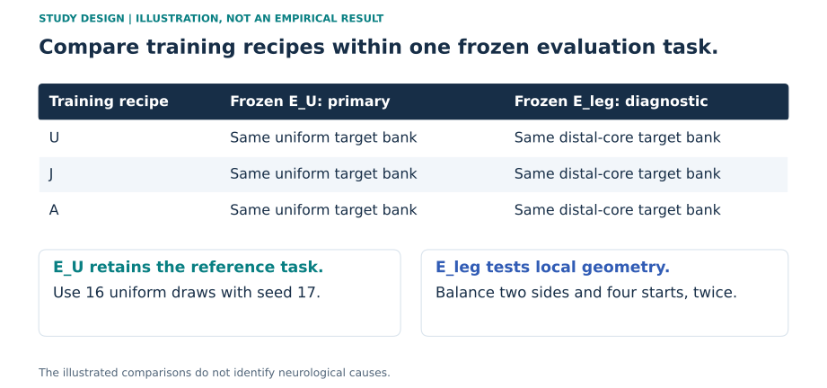

# Implemented iteration02 protocol

The scientific identity is `d66e1b126c9d9a9adf1b`. The [machine-readable freeze](../../artifacts/iteration02/d66e1b126c9d9a9adf1b/protocol.json) records configuration, fresh cohort, source roles, code hashes, both evaluation banks and the freeze time before fitting. This is an exploratory redesign after the completed draft01 results were seen. The historical study remains unchanged.

## Observation and roles

The current GAVD CSVs produced 1,874 sequences and 348 source IDs. Hash-compatible poses, decoded observations and fixed lower-limb support retain 304 sources, 28 normal, 1,381 sequences and 9,442 windows. Every 32-sample window is resampled at 15 Hz. It spans 31/15 seconds and contains eight four-frame patches. Confidence below 0.5 is missing; interpolation uses adjacent valid source observations only. A fixed per-frame pelvis reference and first-half torso scale are shared by all branches. Masked hip/shoulder information already used by that reference is an explicitly disclosed conditioning variable Q.

Each of four outer folds reserves seven normal test sources and five normal reference sources. The other 16 normal sources fit models. Three grouped internal folds select residual regularization and correction multipliers. Normal references never choose models, masks, stopping, signs or fusion. All overlapping windows from a recording stay in one role. Upload IDs are not verified participant identities. The confirmed duplicate pair in the inventory was already outside the eligible cohort.

The primary endpoint is normal versus Parkinsons, stroke, cerebral palsy and myopathic. The secondary endpoint uses all non-normal folders with unchanged scores. A source with two abnormal memberships counts once. The separately supervised five-class comparison excludes every multi-membership source according to the frozen rule, leaving 89 sources. This is conservative label handling, not evidence that the folder label is clinically verified.

## Allowed inputs and targets

Training masks use only BlazePose indices 11,12,13,14,15,16,23,24,25,26,27,28,29,30,31,32. The new source readout uses 25–32. Own-leg learned inputs are 23/25/27/29/31 or 24/26/28/30/32. All derived prediction features are constructed after restrictions. Coordinate targets have four XY samples; loss is their mean squared error. Completion can use visible observations before and after the answer. It is not causal forecasting.

The U evaluation keeps the historical target rule: a valid hidden target and at least two visible valid patches of that target joint. New correction training and E_leg use a separate paired-leg rule: a valid target plus at least two permitted valid tokens at distinct temporal positions on each leg. Masks are drawn before validity checks, with no redrawing. A source needs four distinct original temporal target patches for each of the eight readouts. Repeated masks do not increase that count.

## Matched mask policies

| Policy | Construction | Hidden tokens |
| --- | --- | ---: |
| U | Uniform sampling without replacement. |64 of 128|
| J | Uniformly choose one joint, hide its eight temporal tokens, then fill 56 from the other 120. |64 of 128|
| A | Choose one of 16 equiprobable anatomical cores, hide its eight tokens, then fill 56 from the other 120. |64 of 128|

The A partition contains torso reference joints 11/12/23/24, left arm 13/15, right arm 14/16, left distal leg 25/27/29/31, and right distal leg 26/28/30/32. Four-joint groups use two consecutive patches starting at 0,2,4 or 6. Two-joint groups use four patches starting at 0 or 4. Group probability is its width divided by 16. Every core has eight tokens and each token belongs to one core, so every token's final hiding probability is `1/16 + (15/16)*(56/120) = 1/2`.



Mask structure changes higher-order dependencies and usable context. Matching marginal probabilities does not equalize difficulty. U/J/A correction training shares the exact same U-trained baseline weights in every internal and outer fit. The common U evaluation bank has 16 draws, seed 17, and the original Torch mask bytes. E_leg enumerates both distal sides and starts 0/2/4/6 twice, fills to 64 with seed 117, and scores only the forced core. It is a distinct task. A versus U on the unchanged U bank is the primary mask contrast; A versus J and J versus U are explanatory contrasts.

## Estimator and operational gates

The baseline f has 77 permitted-input features. Each residual has 154 features and eight outputs. The own-capacity correction adds own-leg temporal moments; the both-leg correction adds opposite-leg observations. The parameter counts match, but effective rank and inductive bias can differ. Shared ridge also outperforms direct own-joint interpolation on every outer aggregate of normal internal predictions.

```text
base = f(O; Q)
own_capacity = f(O; Q) + alpha_own * h(O; Q)
both_legs = f(O; Q) + alpha_both * g(O, C; Q)
benefit = MSE(own_capacity, Y) - MSE(both_legs, Y)
```

Each fit uses 512 source-balanced window/mask presentations and equal source/readout-joint loss weights. Residual ridge penalties are 0.1,1 and 10; multipliers are 0,0.5 and 1. The internal selection requires both-leg improvement over f and f+h in at least two of three folds, plus improved mean source risk. It is an operational selection rule, not a significance test. All 12 GAVD outer-policy fits pass. Outer-test benefits are reported separately; the same selection data are not mislabeled as an independent confirmation.

The feature-level positive and negative dependency fixtures preserve matching marginal laws and use separate generated training/test samples. They are software checks, not gait simulations. Hidden-input invariance, exact zero correction, source disjointness, fixed target keys and exposure checks also pass.

## Scores and aggregation

M has 16 full-observation descriptors. Each leg contributes projected knee-angle median/IQR, ankle X/Y IQR and X/Y velocity MAD. Four additional values capture trunk-inclination median/IQR, left-minus-right knee median and ankle-X excursion. They retain posture, amplitude and raw timing. Descriptor vectors are averaged within sequences and then within sources before fitting normal-only imputation, RobustScaler and Ledoit-Wolf covariance. M is squared Mahalanobis distance divided by 16.

Prediction errors first average masks within a target, then targets within windows, windows within sequences, and sequences within sources while retaining the joint axis. Four joint-specific source benefits average equally on each side. Five separate normal references define the bilateral mean and `v_k=0.5*s_k^2+0.5*mean(s^2)+1e-8`, with sample-variance denominator n−1. R is the mean squared standardized departure. Both positive and negative departures can be unusual; benefit is not mutual information, causality, or a health ordering. The fixed combined score is `S=0.5*(M+R)`. These dimension-normalized distances are not equally calibrated probabilities.

The error and own-capacity sham fusions use the same reference identities and distance form. The 36-feature motion baseline, fixed bilateral correlation/waveform summaries, quality distance, supervised nuisance classifier, Isolation Forest and adapted STG-NF all use the new source roles. STG-NF uses the authors' pinned code with a declared 16-joint graph and fitting-normal median imputation, so it is an adapted comparator, not a faithful benchmark reproduction. Fresh learned/random JEPA probes use 512 normal-only encoder updates and a separately supervised five-class linear head. They do not test an encoder-mask contribution to the coordinate method.

## Timing and uncertainty

The independent 48-frame parent grid retains the central 8:40 interval. Opposite distal context comes from offsets−4 or+4 frames without wrap or padding. A donor distal-minus-hip vector is attached to the original permitted hip with the original scale and Q. Donor joint, donor hip, original joint and attachment hip must be valid and visible in the original 192-token mask. Original and shifted predictions share the pair's exact support and hidden answer. Sixteen parent masks use seed 217; an eight-parent-per-source budget is fixed by evenly spaced temporal order before scoring.

The all-parent and budget coverage censuses retain 27 normals at each offset, with test counts 7/7/6/7. Zero offset, unchanged own inputs and source-frame provenance pass. However, every exact-paired-support adequacy gate fails. The mean editable opposite-distal context is only about 1.75 tokens. Some shifts change error, but this cannot establish a reliable timing or neurological-coordination measurement. Noise, dropout and whole-body crop controls retain separate meanings and populations.

AUROC is the normal-by-abnormal-pair-count weighted mean of within-fold AUROCs. Average precision is reported per fold and as an equal-fold mean with prevalence. Paired bootstraps resample whole source/duplicate-recording clusters within fold and label, with original fold weights. Laboratory sensitivity resamples matched pairs. Intervals condition on fitted models, split, feature definitions and exploratory protocol. A clinical alarm threshold,95% specificity or calibrated disease risk is not supported.

## Reproduction commands

The [README](../../README.md) gives setup. Run the core producer, auxiliary comparators and timing driver, then `scripts/analyze_iteration02.py`, `scripts/normal_iteration02_diagnostics.py`, `scripts/finalize_iteration02_evidence.py` and `python -m aaai_gait.iteration_verify`, each with the exact `--run` path shown in their help (the verifier uses a positional path). These scripts reconstruct tables from saved predictions and scores. The full model run takes roughly eleven minutes on this laptop including conditional bootstraps; timings are recorded, not performance promises.

The external commands are `uv run --project experiments/aaai --extra external python -m aaai_gait.external_iteration02 prepare` and the same command with `run`. The executed version is preserved in that run's `source_snapshot`. A later safety guard requires demographic matching to be frozen before scoring; it does not alter the saved fitting or scores. The [external report](external_replication_results.md) explains byte-range downloads, units, exclusions, age/sex matching and checks.

Use `scripts/build_iteration02_reports.py` and `scripts/publish_iteration02_docs.py` to refresh shared evidence and documentation. The manuscript has its own `docs/draft02/build_manuscript.py`; notebooks and slides retain their source builders. A changed endpoint, observation rule, mask, source role or score requires a new scientific identity. Post-outcome observation audits are labeled as such and never silently change this cohort.
