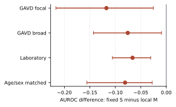
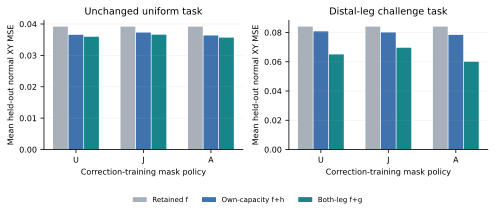
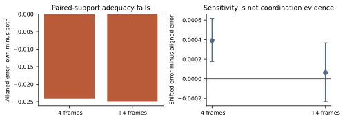

# Verified iteration02 results

The fixed combination of local movement and bilateral prediction benefit reduced anomaly-ranking performance. This is a result about the specified estimator, normal reference and equal-weight score. It does not show that opposite-leg information is useless. The independent laboratory study shows a clear completion benefit, while its relational score alone has AUROC 0.694.

The GAVD run is `d66e1b126c9d9a9adf1b`. The separate participant run is `external_fb9d0d23b56ce29fd846`. The [shared evidence record](../draft02/evidence.json), [raw source scores](../../artifacts/iteration02/d66e1b126c9d9a9adf1b/source_scores.csv), and [protocol](protocol.md) are the authorities for repeated numbers. Every table below comes from executed models and saved records. Synthetic dependency fixtures are excluded.

## Detection on fixed endpoints

The focal primary has 90 source recordings, including 28 normal. The broad secondary has 304 recordings, including the same 28 normals. Scores are identical between endpoints. AUROC is a fixed pair-count-weighted mean of four within-fold AUROCs. Average precision, fold values, prevalences, per-condition results and secondary pooled rankings are saved with the run.

| Method | Focal AUROC | Broad AUROC |
| --- | ---: | ---: |
| Local movement M, 16 descriptors | 0.694 | 0.707 |
| Bilateral benefit departure R | 0.445 | 0.560 |
| Fixed fusion S, U training | 0.576 | 0.631 |
| Richer motion distance, 36 descriptors | 0.677 | 0.669 |
| M plus own-capacity sham | 0.687 | 0.661 |
| M plus constituent-error distance | 0.684 | 0.685 |
| M plus baseline-error distance | 0.700 | 0.692 |
| Timing and waveform descriptors | 0.588 | 0.631 |
| Isolation Forest on movement descriptors | 0.551 | 0.593 |
| Adapted STG-NF, missing-data imputation | 0.376 | 0.435 |
| Normal-only availability and viewpoint distance | 0.389 | 0.520 |
| Supervised nuisance classifier | 0.461 | 0.506 |

For U training on the fixed U bank, S minus M is -0.118, conditional 95% interval [-0.217, -0.025], on the focal endpoint. The broad difference is -0.076, [-0.143, -0.009]. The fixed fusion therefore does not establish added detection value. Neither unfavorable nuisance nor pose-baseline scores were reversed after seeing labels.

## Prediction and masking

Every one of the 12 outer-policy fits passed the planned internal normal gate. Selection used the three grouped fitting-normal folds. This is an operational adequacy check, not an independent significance test. Internal candidate selection averages source/joint-weighted prediction requests; final scoring first merges repeated masks for each physical window target. Their weighting differs and is disclosed rather than called identical.

The following are errors averaged over held-out normal sources. The same U-trained baseline is preserved in every training arm. Equal nominal residual feature widths do not prove equal effective capacity: recorded numerical feature ranks and inductive biases differ.

| policy | bank | outer_fold | n_normal | loss_base | loss_own | loss_both | benefit |
| --- | --- | --- | --- | --- | --- | --- | --- |
| A | E_leg | 0 | 7 | 0.078362 | 0.074350 | 0.062817 | 0.011533 |
| A | E_leg | 1 | 7 | 0.086725 | 0.081607 | 0.056783 | 0.024824 |
| A | E_leg | 2 | 7 | 0.063624 | 0.054018 | 0.045373 | 0.008645 |
| A | E_leg | 3 | 7 | 0.107386 | 0.103511 | 0.075065 | 0.028447 |
| A | U | 0 | 7 | 0.037069 | 0.034737 | 0.033514 | 0.001223 |
| A | U | 1 | 7 | 0.039279 | 0.037271 | 0.035323 | 0.001948 |
| A | U | 2 | 7 | 0.030185 | 0.025780 | 0.026080 | -0.000299 |
| A | U | 3 | 7 | 0.050189 | 0.047622 | 0.047747 | -0.000124 |
| J | E_leg | 0 | 7 | 0.078362 | 0.075172 | 0.065463 | 0.009709 |
| J | E_leg | 1 | 7 | 0.086725 | 0.084334 | 0.071567 | 0.012767 |
| J | E_leg | 2 | 7 | 0.063624 | 0.053310 | 0.048375 | 0.004934 |
| J | E_leg | 3 | 7 | 0.107386 | 0.107412 | 0.092863 | 0.014549 |
| J | U | 0 | 7 | 0.037069 | 0.035318 | 0.034887 | 0.000431 |
| J | U | 1 | 7 | 0.039279 | 0.038020 | 0.037008 | 0.001012 |
| J | U | 2 | 7 | 0.030185 | 0.026198 | 0.026177 | 0.000021 |
| J | U | 3 | 7 | 0.050189 | 0.049658 | 0.048335 | 0.001324 |
| U | E_leg | 0 | 7 | 0.078362 | 0.076137 | 0.065955 | 0.010182 |
| U | E_leg | 1 | 7 | 0.086725 | 0.082631 | 0.061687 | 0.020944 |
| U | E_leg | 2 | 7 | 0.063624 | 0.057175 | 0.051375 | 0.005800 |
| U | E_leg | 3 | 7 | 0.107386 | 0.107132 | 0.081064 | 0.026067 |
| U | U | 0 | 7 | 0.037069 | 0.034662 | 0.033942 | 0.000720 |
| U | U | 1 | 7 | 0.039279 | 0.037618 | 0.035675 | 0.001944 |
| U | U | 2 | 7 | 0.030185 | 0.026793 | 0.027563 | -0.000769 |
| U | U | 3 | 7 | 0.050189 | 0.047211 | 0.046580 | 0.000631 |

The outer-normal U-bank mean benefit for U and A remains uncertain. E_leg exposes more completion headroom. A versus U on the unchanged U bank improves the focal S point estimate by 0.055, with conditional interval [−0.018, 0.127]. Its broad interval also includes zero. These comparisons do not establish a superior masking policy. A result on E_leg is a different task, not a substitute for the primary U task. The full U/J/A by U/E_leg matrix, every paired interval and bank-specific reference are retained in [the machine-readable metrics](../../artifacts/iteration02/d66e1b126c9d9a9adf1b/rawmetrics.json).

| policy | evaluation_bank | focal_S | broad_S | sources | reference_normals_each_fold |
| --- | --- | --- | --- | --- | --- |
| U | U | 0.576 | 0.631 | 304 | 5 |
| U | E_leg | 0.668 | 0.670 | 304 | 5 |
| J | U | 0.620 | 0.644 | 304 | 5 |
| J | E_leg | 0.668 | 0.667 | 304 | 5 |
| A | U | 0.631 | 0.672 | 304 | 5 |
| A | E_leg | 0.684 | 0.681 | 304 | 5 |

The [per-condition metrics](../../artifacts/iteration02/d66e1b126c9d9a9adf1b/per_condition_metrics.json), [common historical-source sensitivity](../../artifacts/iteration02/d66e1b126c9d9a9adf1b/historical_common_source_sensitivity.json), and [normal-reference sensitivity](../../artifacts/iteration02/d66e1b126c9d9a9adf1b/reference_sensitivity_metrics.csv) retain the full secondary analyses. The common-source comparison uses refitted current models, not old scores paired with a different population.

Direct interpolation is weaker than shared ridge in all four aggregates of GAVD internal held-out normals. This post-outcome inspection used the existing frozen masks, permitted values and targets; it did not change recipe selection. The [saved comparison](../../artifacts/iteration02/d66e1b126c9d9a9adf1b/interpolation_normal_adequacy.csv) gives its population and losses.

## Timing support changes the interpretation

The paired timing census retains 27 normal sources, with 7, 7, 6 and 7 outer-test normals across folds. It passes the planned recording-count floor. However, every one of the 24 outer fold/policy/offset combinations fails prediction adequacy on the exact paired original inputs. Only about 1.75 editable distal context tokens remain on average. The internally selected models also fail this paired-support check in all 72 internal combinations.

For U, the minus-four-frame error effect is about 0.000393, with interval [0.000177, 0.000618]. The plus-four-frame effect is about 0.000064, with interval [−0.000232, 0.000368]. A positive response on an inadequate predictor is not reliable evidence of coordination measurement. The code passes zero-offset, own-branch invariance, donor visibility, fixed target and fixed reference checks. These software properties do not repair the sparse observation task. [Timing summary](../../artifacts/iteration02/d66e1b126c9d9a9adf1b/timing_summary.json).

## Independent laboratory method replication

All 188 frozen participant trials were retrieved and parsed. Ten healthy trials fail the unchanged observation support, leaving 128 healthy and 50 stroke participants, with 433 windows. Six simultaneous hip, knee and ankle flexion signals retain a shared raw clock. This is a separately fitted method replication, with different units and descriptors, not video-weight transfer or a BlazePose mapping.

All four internal gates pass. On held-out healthy participants, both-leg prediction reduces error relative to the own-capacity control by 4.78% to 5.52% across folds. Nevertheless, M reaches 0.958 and S reaches 0.892; S minus M is -0.066, [-0.106, -0.031]. The prespecified age and sex matched analysis retains 45 pairs and also favors M. The [external report](external_replication_results.md) documents trial selection, metadata, simultaneous units, exclusions and matching. Walking speed was not matched; it may be part of the movement phenotype, and its influence remains unresolved.

## Separate supervised classification

The five-class task uses 89 source recordings after the frozen multi-membership exclusion. Encoders are newly trained on each outer fitting-normal pool; the label probe and Random Forest can use the permitted training abnormal sources. This is supervised classification and is not a normal-only anomaly benchmark. These are equal means over fold-level scores, with every confusion matrix retained.

| method | macro_f1 | balanced_accuracy |
| --- | --- | --- |
| learned_jepa_probe | 0.251 | 0.255 |
| random_encoder_probe | 0.309 | 0.310 |
| random_forest | 0.347 | 0.343 |

The compact learned JEPA probe does not establish an advantage over the random encoder. The encoder U/J/A ablation, stochastic positional queries, stochastic latent variables and phase modeling were deferred. Fresh learned/random U probes are not evidence that an unrun encoder-mask ablation succeeded.

## Observation review and uncertainty

Ten prespecified high/low prediction-error cases span all five focal labels. Each has a local video preview, pose overlay and three inspected frames. Visible concerns include camera movement, split-screen composition, assistance, limb overlap and feet leaving the frame. This is a small descriptive review, not clinical relabeling or continuous identity validation.

A separate post-outcome image-boundary audit finds high-confidence distal points outside the decoded image in frozen-window spans from 13 of 28 normal and 83 of 276 abnormal recordings. Their pooled point fractions are about 0.43% and 0.24%, respectively. Confidence is not proof of visible measurement. One requested frame could not be decoded in this audit. No scores, exclusions or fits were changed after inspecting these findings. [Audit ledger](../../artifacts/iteration02/d66e1b126c9d9a9adf1b/video_review/boundary_audit.md).

Bootstrap intervals condition on fitted models, roles, selected protocol and known recording groups. They omit training uncertainty, unknown repeated-person dependence and adaptive redesign. Four overlapping fits are not four independent studies. The mixed-view group is not a matched viewpoint, and single-view strata lack adequate four-fold normal support. Neither a global nuisance AUROC nor the small camera review resolves these alternatives. See [limitations](limitations.md) and [submission readiness](../draft02/submission_readiness.md).
