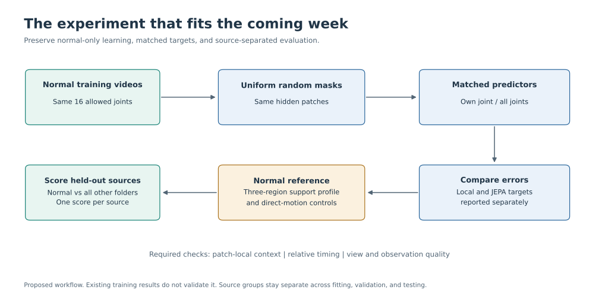
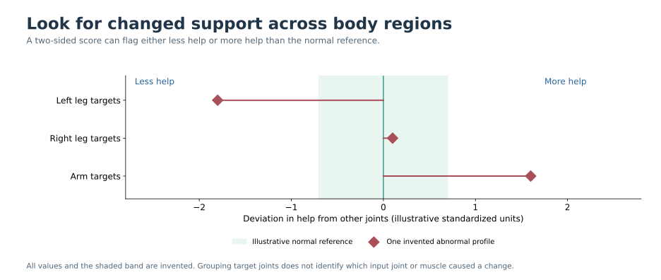

<!-- iteration02-navigation -->
> Historical study or planning record. Its scientific results and run identities remain unchanged. The executed [iteration02 study and draft02](draft02/README.md) contain the active results, six new notebooks and independent participant replication.

# Paper plan for the implemented context study

Build the manuscript around the evidence produced by the new source-held-out experiment, including a null or adverse result if that is what the artifacts show. The proposed contribution is a controlled test of **what other-joint information adds to a normal-only gait predictor**, not the first use of JEPA or prediction error for walking.

A neutral working title is *When Does Other-Joint Context Help Detect Unusual Gait? A Source-Held-Out Study of Skeleton Predictive Models*. The manuscript workspace is [draft01](draft01/README.md). Its results must come from [context study results](context_study_results.md), with the [implemented protocol](context_study_protocol.md) and [review record](context_study_review.md) as the internal evidence base. The [historical results](results.md) describe a different five-class experiment and must remain labeled as such.

## Submission requirements

The [official ASTAD4 call](https://ismart.ece.mcgill.ca/astad4/), rechecked on November 15, 2026, lists **November 20, 2026** as the submission deadline. It specifies a PDF through OpenReview, double-blind review, AAAI-27 formatting, and at most seven content pages plus two reference-only pages. The page does not state a cutoff timezone. Use the author kit linked from the [official AAAI-27 page](https://aaai.org/conference/aaai/aaai-27/) and check the submission portal for its actual cutoff and current instructions. Do not assume archival status or supplementary-material rules beyond the verified call.

The workshop's scope fits learning expected spatiotemporal behavior, detecting deviations and explaining model behavior. The present study addresses those areas through skeletal observations. It does not predict a future clinical event, infer a hidden lesion, or establish a treatment response.

## 1. Lead with a narrow biological and computational question

A walking pattern can be abnormal and highly repeatable. Changes in control, muscle capacity, mechanics or compensation may change relationships between body parts without making each part individually unpredictable. This motivates comparing a target joint's own visible trajectory with the extra information supplied by other joints.

The observation is limited. Stroke, Parkinsons and cerebral palsy can affect movement through varied neural and mechanical pathways. Myopathic gait is muscle-related and is not a single brain disorder. Several mechanisms can produce similar two-dimensional motion. Use the [clinical evidence review](draft00/advisory/neuromechanics_clinical_evidence.md) to motivate hypotheses without claiming that a public-video label verifies etiology, affected side, severity or medication state.

The study asks whether a signed three-region predictive-benefit profile departs from an inner-normal reference in ways that help rank source videos. Increased help and reduced help are both permitted departures. Fix that two-sided score before reporting test performance, retain its constituent losses, and preserve the one-sided comparator without reversing it after inspection.

## 2. State the novelty boundary before the method

| Prior work | What it already establishes | What our experiment must add |
| --- | --- | --- |
| [Skeleton S-JEPA](https://sjepa.github.io/) | Predicting skeleton features with a context encoder and EMA teacher. | A controlled anomaly-detection question and new evidence, not an architectural priority claim. |
| [FSGait](https://openaccess.thecvf.com/content/ACCV2024/html/Duan_FSGait_Fine_Grained_Self-Supervised_Gait_Abnormality_Detection_ACCV_2024_paper.html) and [GenGait](https://arxiv.org/abs/2604.01997) | Normal-only predictive or reconstructive gait anomaly analysis. | A measured distinction between own-joint, patch-local and broader context. |
| [SeeKer](https://arxiv.org/html/2506.18368v1) | Conditional keypoint density prediction, compositional scores and confidence-aware anomaly scoring. | Evidence that the matched contrast and reference profile provide information beyond raw surprise. |
| [STG-NF](https://arxiv.org/pdf/2211.10946) | Normal-only pose-sequence density modeling and anomaly ranking. | A supported information-access finding, not priority over normal motion modeling. |

Our implementation changes the original Skeleton S-JEPA's motion-aware masking to uniform random masking as required for these experiments. It adds VICReg, uses the fixed sixteen-joint subset and a small laptop-scale model, then freezes the encoder and teacher for the six-head study. These are disclosed adaptations, not an exact reproduction. The separately named stochastic-latent S-JEPA and StoP-style positional noise are not the primary experiment.

The [published-baseline feasibility audit](published_baseline_feasibility.md) documents why SeeKer and STG-NF have not yet been validated on the partially observed sixteen-joint protocol. That missing comparison limits superiority claims. A ridge control is valuable, but cannot replace a published detector while retaining a state-of-the-art claim.

## 3. Explain the cohort and its selection in one figure

The binary endpoint uses every current non-normal folder, including exercise, style and pregnancy. Its positive class is the declared GAVD folder rule, not exclusively neurological pathology. The four focal families remain interpretation examples and a separate supervised five-class endpoint.

The fresh inventory has 348 source IDs, including 32 normal and 316 abnormal sources, across 1,874 sequence CSVs and 458,116 annotation rows. All counts after acquisition, window quality and source-profile support must be read from the final run artifacts. Never put these annotation totals in a table labeled patients, accepted examples or evaluated cases.

Show a flow from fresh CSVs to available media, extracted sequences, admitted windows, profile-eligible sources and each outer fold. Report exclusions by folder and view, including missing media, frame-rate failures and insufficient joint support. The support gate is fixed before folds and uses observation validity and time identity rather than losses. It can still select an easier or differently composed population.

A source is not necessarily a person. Reposts and repeated participants may cross source IDs. Show the prior-use audit because this direction followed an earlier experiment on overlapping recordings. Four new source folds do not restore untouched confirmatory status. This is an exploratory internal GAVD evaluation unless a genuinely independent cohort is added.

## 4. Make the controlled comparison easy to reproduce

The methods section needs five connected steps:

1. Extract the annotated person with ambient, retain confidence and missing coordinates, apply the shared 15 Hz and visibility rules, and normalize with pelvis centering and prefix torso scale.
2. Use exactly sixteen allowed joints, four-frame tokens and uniform hidden-position sampling. Apply fixed-mask source support before fold assignment.
3. Train normal-only S-JEPA for the declared update budget, monitor VICReg and representation health, then freeze its encoders, teacher and center.
4. Fit own-joint, patch-local and full-context heads independently for coordinate and latent targets. Restrict measurements before contextual encoding and evaluate identical requested targets.
5. Aggregate within windows, sequences and sources; form equal-joint regional benefits; fit the three means and shrunk diagonal variances from five separate inner normals; evaluate outer-test sources.

The shared body normalization means own-joint prediction is conditional on a common reference. Patch-local context contains four frames and is not purely static geometry. The full-input latent teacher may itself encode other joints, so the coordinate-target comparison is essential. This is masked completion with possible later context, not future forecasting.

VICReg should be described as discouraging collapse and redundancy. Do not describe it as disease-class repulsion or proof of informative learning. The fixed 512 encoder and 512 head updates define a bounded recipe. Training adequacy requires actual development curves, variance, effective rank and teacher drift; a finite loss alone is insufficient.

## 5. Use an evidence table with predeclared interpretations

| Claim under consideration | Required observation | If the evidence is absent |
| --- | --- | --- |
| Normal learning is adequate for the comparison. | Stable development diagnostics, finite losses and evidence beyond the random-backbone control. | Describe a bounded training recipe. Do not infer that predictive learning cannot work. |
| Other joints provide useful predictive information. | Positive own-to-full benefit on held-out normals with matched targets. | Investigate representation or optimization effects before interpreting abnormal profiles. |
| Broader context adds beyond local geometry and motion. | Full context differs usefully from the trained patch-local branch. | Limit the finding to local context. |
| The anomaly contrast improves ranking. | Paired source-level difference from matched raw full KL, with an interval and fold support. | Report the uncertain or adverse comparison without reversing the score. |
| JEPA learning is necessary for the observed gain. | Advantage over the trained-head random-backbone control and a meaningful coordinate comparison with ridge. | Attribute the result to the comparison or representation architecture, without claiming a learning advantage. |
| The finding concerns movement rather than observation artifacts. | Coverage/view audit, paired observation controls and evidence not explained by contextual targets. | Retain missingness, viewpoint and teacher construction as alternative explanations. |
| The profile has biological interpretability. | Independent blinded movement annotation, agreement and appropriate geometric controls. | Call the outputs predictive-region scores or model sensitivities. |
| The method generalizes clinically. | Independent people and acquisition sites with appropriate clinical metadata. | Keep the claim internal to the retained GAVD source collection. |

## 6. Present results in separate, correctly weighted tables

The first table should describe the final retained population and source roles. The primary performance table compares the trained latent profile with matched raw full-context KL, constituent-distance controls, patch-local results and the coordinate profile. Include the random-backbone and ridge controls, the four-patch observation-budget sensitivity and reference sensitivity. Report every fold's normal and abnormal support.

Calculate AUROC inside each fold and weight its summary by the number of normal test sources. The paired source bootstrap must estimate that same weighted difference. Its interval conditions on fitted models, references and folds. State that it excludes retraining uncertainty and unknown repeated-person dependence. Normal-count-weighted average precision needs the fold prevalences beside it. Do not pool scores from differently fitted folds or bootstrap correlated windows as independent observations.

A second table reports the explicitly supervised five-class RF and frozen-encoder probe. These use the same outer assignments and accepted poses, but fit focal abnormal labels as well as normal labels, while excluding inner normal references. Their source-label weighting gives each source total weight one even if it has several focal labels. Report macro-F1, balanced accuracy, confusion and support without treating these as equal-supervision comparisons to the anomaly detector.

The historical three-seed classification findings can appear briefly as motivation or a clearly marked preliminary study. They are not additional replications of the new experiment. Synthetic runs belong in software validation, never a clinical-results table.

## 7. Explain failure and avoid simulated diagnoses

Inspect representative true and false rankings with video, annotated-person overlays, joint visibility and the signed three-region profile. Keep source selection for these examples transparent. A visually attractive case does not prove localization accuracy.

The implemented development controls compare relative limb timing with a whole-body shift, noise and observation deletion on paired targets. Report geometric damage and reduced support. A relative limb shift can distort pelvis or torso relations even when the limb's internal articulation is preserved. It is not a simulated stroke or a causal experiment on a nervous system.

The optional `--teacher-decomposition` diagnostic now separates original/edited predictor context and original/edited frozen teacher targets into four matched raw-KL losses. It uses only eight arm and right-leg joints whose local coordinates and own histories stay unchanged under the left-leg shift. Report its predictor, teacher and interaction terms per source and joint when measured. Do not call them a decomposition of the nonlinear three-region anomaly score: the left-leg group is absent, and the command does not construct that profile from eight joints. Dedicated software tests establish the calculation path, not a measured effect or physiological validation.

Completed independent phenotype annotation remains separate work. A blank review template is not validation. The long-term world-model proposal should remain in the discussion, where extra strength, EMG, force or clinical measurements can distinguish compatible mechanisms.

## 8. Build and review a seven-page paper

A workable allocation is approximately one page for the question and related work, one for cohort and observation handling, one and a half for the matched comparison and score, two for measured results, and the remaining space for controls, limitations and conclusions. Use the official template rather than adjusting font or margins to fit. Keep references within the two permitted reference-only pages.

Use a small set of legible vector figures: a hidden-joint context comparison, cohort attrition and roles, the signed profile with its reference, and a compact result/control panel. The [figure gallery](draft00/images/index.html) and [research slides](../slides/index.html) are source material, not evidence that every proposed branch was completed. Every caption should identify measured data, an illustration or a proposed extension.

Before freezing the paper, check every reported number against its saved artifact, read the fresh-kernel notebook execution records, and reconcile all manuscript claims with the implementation review. Review novelty, statistics, missingness and biological interpretation separately. Record an issue's disposition as fixed, explicitly limited or outstanding. A review pass is not an acceptance prediction.

| Date target | Concrete deliverable |
| --- | --- |
| November 15–17 | Frozen ingestion and eligibility, complete bounded real folds, saved histories and source scores. |
| November 17–18 | Matched controls, source-level intervals, reference/budget sensitivities and development failure review. |
| November 18–19 | Grounded draft in `docs/draft01`, vector figures, claim-to-artifact audit and independent critique. |
| November 19 | Resolve substantive findings, freeze claims, verify formatting and anonymization. |
| November 20 | Verify portal requirements and submit before its confirmed cutoff. |

These are planning targets, not assertions that the work is complete. If an essential comparison, fold or validation remains missing, narrow the abstract and conclusion to what ran. Do not fill gaps with anticipated gains. A careful, reproducible account of when context benefit fails can be a useful workshop finding when training adequacy and limitations are established honestly.
