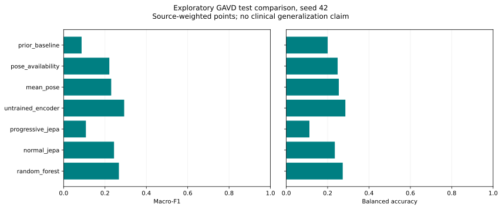

<!-- iteration02-navigation -->
> Historical study or planning record. Its scientific results and run identities remain unchanged. The executed [iteration02 study and draft02](draft02/README.md) contain the active results, six new notebooks and independent participant replication.

# Exploratory GAVD results

> Historical foundation record. This document describes the earlier five-condition experiment. The revised twelve-folder study is documented in [the current protocol](context_study_protocol.md), [real results](context_study_results.md), and [critical review](context_study_review.md). Its manuscript is in [draft01](draft01/README.md).

Across 3 prespecified short runs, RF source-weighted macro-F1 ranged from 0.267 to 0.482, compared with 0.244 to 0.331 for the validation-selected JEPA. RF had higher points in 3/3 runs. The untrained encoder had higher points than the selected trained JEPA in 3/3 runs. Point estimates alone do not establish a representation-learning advantage.

These are source-held-out technical baselines, not clinical validation. The walkthrough schedule does not establish convergence. Participant overlap, label semantics, temporal alignment and recording bias remain unresolved.

## Seed 42

Run `e9a0527c16adec52` retained 2504 windows, 450 sequences and 91 sources. Each stage used 3 epochs. Validation selected `normal_jepa`.

### Retained cohort

|Split|Label|Sources|Sequences|Windows|
|---|---|---:|---:|---:|
|test|cerebral palsy|2|9|100|
|test|myopathic|6|36|184|
|test|normal|5|17|118|
|test|parkinsons|1|7|16|
|test|stroke|4|21|158|
|train|cerebral palsy|6|33|230|
|train|myopathic|16|101|380|
|train|normal|17|79|225|
|train|parkinsons|7|22|136|
|train|stroke|10|37|611|
|val|cerebral palsy|2|14|60|
|val|myopathic|6|27|105|
|val|normal|6|39|139|
|val|parkinsons|2|6|32|
|val|stroke|1|2|10|

### Supervised condition recognition

The same sequences support every method. Normal-only describes encoder pretraining; its supervised probe still receives all five training labels.

|Method|Source-weighted macro-F1|Balanced accuracy|Abnormal AUROC|Abnormal AP|
|---|---:|---:|---:|---:|
|random_forest|0.267|0.273|0.909|0.965|
|normal_jepa|0.244|0.235|0.601|0.734|
|progressive_jepa|0.108|0.112|0.607|0.830|
|untrained_encoder|0.293|0.286|0.644|0.747|
|mean_pose|0.230|0.254|0.660|0.861|
|pose_availability|0.221|0.248|0.584|0.766|
|prior_baseline|0.087|0.200|0.497|0.721|

Severe class-support limitation: parkinsons has 1 test source. Bootstrap intervals cannot recover missing participant diversity.

### Per-class recall

|Label|Test sources|RF recall|Selected JEPA recall|
|---|---:|---:|---:|
|cerebral palsy|2|0.250|0.000|
|myopathic|6|0.400|0.369|
|normal|5|0.581|0.362|
|parkinsons|1|0.000|0.143|
|stroke|4|0.134|0.299|

Paired selected-JEPA minus RF **sequence-weighted** macro-F1 interval: [-0.143, 0.108]. 550/1000 source-cluster resamples retained every class. This weighting differs from the source-weighted points above.

### Normal-only anomaly ranking

|Model|AUROC|95% source-cluster interval|Abnormal AP|Normal calibration sources|Finite 5% threshold|
|---|---:|---|---:|---:|---|
|Masked completion|0.200|[0.000, 0.554]|0.596|6|False|
|Suffix forecasting|0.138|[0.000, 0.400]|0.571|6|False|
|Normal embedding distance|0.323|[0.077, 0.615]|0.709|6|False|

Matched seed-42 StoP-inspired position-noise ablation: source-weighted macro-F1 0.172. Paired sequence-weighted SPE minus deterministic-position interval [-0.139, -0.022]. This is a single-seed representation ablation, not a confirmed improvement.

Insufficient normal calibration support yields an infinite threshold, with zero sensitivity by construction. It cannot support operational detection claims. Ranking scores remain descriptive. Forecasting is retrospective on evaluable futures.

## Seed 43

Run `3b5c7b8627857b2f` retained 2504 windows, 450 sequences and 91 sources. Each stage used 3 epochs. Validation selected `progressive_jepa`.

### Retained cohort

|Split|Label|Sources|Sequences|Windows|
|---|---|---:|---:|---:|
|test|cerebral palsy|2|9|41|
|test|myopathic|5|27|94|
|test|normal|4|17|50|
|test|parkinsons|1|8|15|
|test|stroke|4|13|90|
|train|cerebral palsy|6|33|226|
|train|myopathic|17|101|441|
|train|normal|18|91|341|
|train|parkinsons|7|22|140|
|train|stroke|8|30|377|
|val|cerebral palsy|2|14|123|
|val|myopathic|6|36|134|
|val|normal|6|27|91|
|val|parkinsons|2|5|29|
|val|stroke|3|17|312|

### Supervised condition recognition

The same sequences support every method. Normal-only describes encoder pretraining; its supervised probe still receives all five training labels.

|Method|Source-weighted macro-F1|Balanced accuracy|Abnormal AUROC|Abnormal AP|
|---|---:|---:|---:|---:|
|random_forest|0.482|0.478|0.883|0.960|
|normal_jepa|0.214|0.263|0.805|0.902|
|progressive_jepa|0.252|0.273|0.835|0.939|
|untrained_encoder|0.327|0.342|0.848|0.941|
|mean_pose|0.250|0.325|0.662|0.880|
|pose_availability|0.204|0.180|0.703|0.857|
|prior_baseline|0.080|0.200|0.500|0.750|

Severe class-support limitation: parkinsons has 1 test source. Bootstrap intervals cannot recover missing participant diversity.

### Per-class recall

|Label|Test sources|RF recall|Selected JEPA recall|
|---|---:|---:|---:|
|cerebral palsy|2|0.583|0.417|
|myopathic|5|0.378|0.378|
|normal|4|0.679|0.417|
|parkinsons|1|0.500|0.125|
|stroke|4|0.250|0.031|

Paired selected-JEPA minus RF **sequence-weighted** macro-F1 interval: [-0.328, -0.096]. 558/1000 source-cluster resamples retained every class. This weighting differs from the source-weighted points above.

### Normal-only anomaly ranking

|Model|AUROC|95% source-cluster interval|Abnormal AP|Normal calibration sources|Finite 5% threshold|
|---|---:|---|---:|---:|---|
|Masked completion|0.604|[0.214, 0.933]|0.852|6|False|
|Suffix forecasting|0.417|[0.000, 0.792]|0.718|6|False|
|Normal embedding distance|0.625|[0.306, 0.917]|0.880|6|False|

Insufficient normal calibration support yields an infinite threshold, with zero sensitivity by construction. It cannot support operational detection claims. Ranking scores remain descriptive. Forecasting is retrospective on evaluable futures.

## Seed 44

Run `91e588536ebb8053` retained 2504 windows, 450 sequences and 91 sources. Each stage used 3 epochs. Validation selected `progressive_jepa`.

### Retained cohort

|Split|Label|Sources|Sequences|Windows|
|---|---|---:|---:|---:|
|test|cerebral palsy|2|12|62|
|test|myopathic|5|36|127|
|test|normal|5|29|58|
|test|parkinsons|2|7|29|
|test|stroke|3|14|99|
|train|cerebral palsy|6|32|262|
|train|myopathic|17|98|401|
|train|normal|18|77|331|
|train|parkinsons|6|22|109|
|train|stroke|9|39|562|
|val|cerebral palsy|2|12|66|
|val|myopathic|6|30|141|
|val|normal|5|29|93|
|val|parkinsons|2|6|46|
|val|stroke|3|7|118|

### Supervised condition recognition

The same sequences support every method. Normal-only describes encoder pretraining; its supervised probe still receives all five training labels.

|Method|Source-weighted macro-F1|Balanced accuracy|Abnormal AUROC|Abnormal AP|
|---|---:|---:|---:|---:|
|random_forest|0.333|0.340|0.840|0.913|
|normal_jepa|0.290|0.288|0.711|0.839|
|progressive_jepa|0.331|0.314|0.725|0.879|
|untrained_encoder|0.348|0.339|0.736|0.842|
|mean_pose|0.322|0.334|0.731|0.882|
|pose_availability|0.243|0.246|0.698|0.825|
|prior_baseline|0.091|0.200|0.500|0.706|

### Per-class recall

|Label|Test sources|RF recall|Selected JEPA recall|
|---|---:|---:|---:|
|cerebral palsy|2|0.000|0.227|
|myopathic|5|0.342|0.451|
|normal|5|0.733|0.400|
|parkinsons|2|0.167|0.292|
|stroke|3|0.457|0.200|

Paired selected-JEPA minus RF **sequence-weighted** macro-F1 interval: [-0.248, 0.124]. 722/1000 source-cluster resamples retained every class. This weighting differs from the source-weighted points above.

### Normal-only anomaly ranking

|Model|AUROC|95% source-cluster interval|Abnormal AP|Normal calibration sources|Finite 5% threshold|
|---|---:|---|---:|---:|---|
|Masked completion|0.583|[0.217, 0.950]|0.772|5|False|
|Suffix forecasting|0.567|[0.199, 0.967]|0.732|5|False|
|Normal embedding distance|0.250|[0.000, 0.571]|0.605|5|False|

Insufficient normal calibration support yields an infinite threshold, with zero sensitivity by construction. It cannot support operational detection claims. Ranking scores remain descriptive. Forecasting is retrospective on evaluable futures.

## Interpretation

Compare the selected JEPA with both RF and the untrained encoder. Read paired intervals alongside point estimates and do not equate a ranking metric with classification accuracy. Supervised abnormal ranking uses a different supervision setting from the normal-only detector. Score direction must remain as prespecified rather than being flipped after test inspection. Repeated source splits are dependent, not independent clinical observations. Extra progressive training changes compute and data exposure. A matched pooled schedule is required to isolate curriculum effects.

The [data audit](data_audit.md) documents attrition and semantic limits. Independent participant-identified data are needed for stronger generalization. A single short SPE run cannot establish the general value of positional noise. Longer training must be selected using validation and evaluated on genuinely untouched data. The learned stochastic-latent prior/posterior extension remains unimplemented. Per-sequence predictions, source assignments, checkpoints and software versions live in each recorded run directory.
