# Gait prediction: measured iteration02 results

Useful prediction does not guarantee better anomaly detection. This 43-slide deck reads the verified GAVD run and the independent laboratory replication. Slides 41–43 add a clearly labeled post-outcome completion interpretation from frozen predictions. The original primary findings remain visible. Conceptual drawings remain explicitly labeled illustrations.

GAVD run: `d66e1b126c9d9a9adf1b`. External run: `external_fb9d0d23b56ce29fd846`.

[PDF](tutorial.pdf) · [Offline viewer](index.html) · [Planning deck archive](archive/iteration02_plan/tutorial.pdf) · [Historical draft01 deck](archive/draft01_completed/tutorial.pdf) · [Positive draft03](../docs/draft03/README.md)

## 01. Useful prediction does not guarantee better anomaly detection.

Real GAVD video and an independent laboratory dataset both favor local movement over the fixed relational fusion.

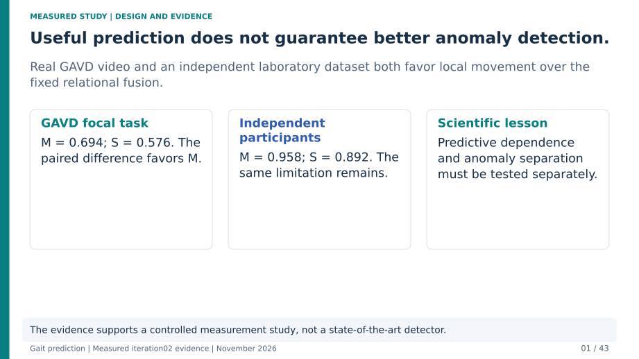

S is the fixed average of local movement M and calibrated relational evidence R. These are within-fold pair-count-weighted AUROCs. The independent experiment refits on laboratory angles and is not a transfer of GAVD weights. The negative fusion outcome is retained.

**The evidence supports a controlled measurement study, not a state-of-the-art detector.**

Sources: [Executed protocol](../docs/iteration02/protocol.md) · [Measured iteration02 results](../docs/iteration02/results.md)

## 02. Two different datasets answer complementary questions.

The source-video study tests uncontrolled projected pose. The laboratory study tests a separately fitted participant-level measurement.

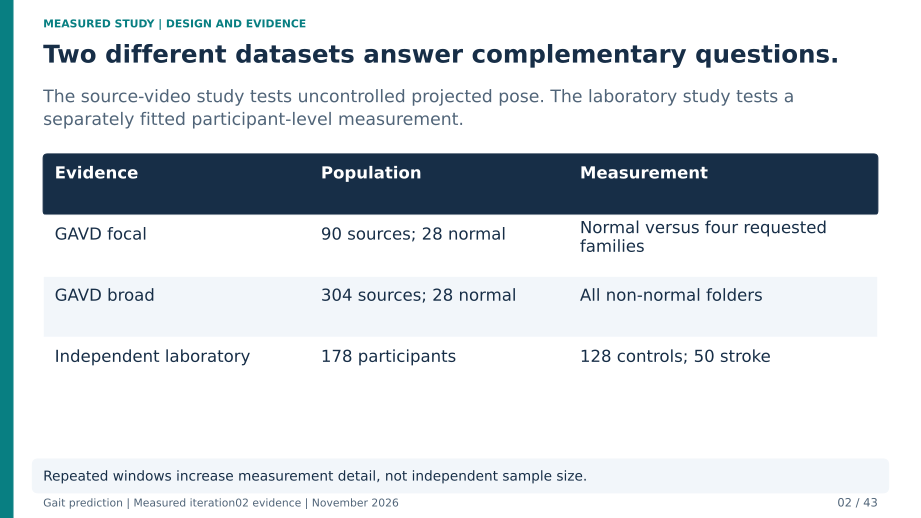

GAVD source IDs are not verified unique people. The laboratory cohort contains distinct participant IDs. Never pool the two datasets or compare their absolute AUROCs as an effect of sensor quality.

**Repeated windows increase measurement detail, not independent sample size.**

Sources: [Executed protocol](../docs/iteration02/protocol.md) · [Measured iteration02 results](../docs/iteration02/results.md)

## 03. Start with a hidden ankle and a concrete question.

If the left ankle disappears for four frames, does the right leg help after the visible left leg already constrains the answer?

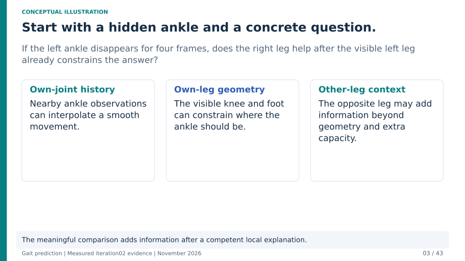

This is an illustration of conditional prediction, not a clinical example or an empirical finding. All branches predict the identical coordinate target under the same declared body reference.

**The meaningful comparison adds information after a competent local explanation.**

Sources: [Neurological evidence and novelty advice](../docs/iteration02/advice_neuro.md) · [Executed protocol](../docs/iteration02/protocol.md)

## 04. Neurological reasoning motivates observations, not diagnoses.

Different impairments and adaptations can produce similar projected motion, while one diagnostic label can contain varied gait patterns.

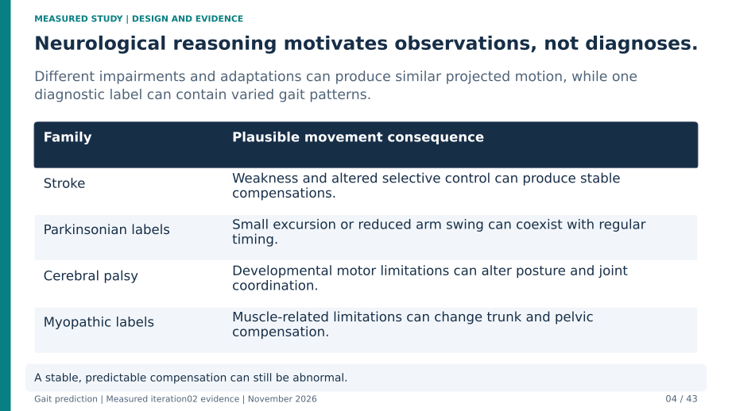

These are physiology-informed hypotheses supported by the linked primary studies, not diagnoses inferred from GAVD. Medication, lesion location, strength, EMG and forces are unavailable. Myopathy is not one central neurological lesion.

**A stable, predictable compensation can still be abnormal.**

Sources: [Neurological evidence and novelty advice](../docs/iteration02/advice_neuro.md) · [Stroke coordination and temporal symmetry](https://pubmed.ncbi.nlm.nih.gov/38709654/) · [PD arm amplitude, symmetry and coordination](https://pubmed.ncbi.nlm.nih.gov/25502948/) · [Selective motor control and gait in CP](https://pubmed.ncbi.nlm.nih.gov/27889619/) · [Longitudinal Duchenne muscle and gait observations](https://link.springer.com/article/10.1186/s12984-025-01718-5)

## 05. Preserve amplitude, asymmetry and relative information.

Regular timing can accompany small steps. A changed relationship can accompany ordinary excursion.

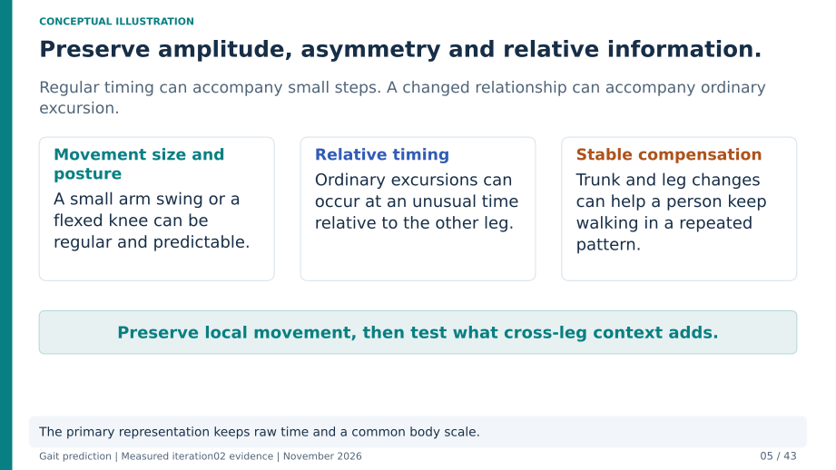

Illustrative patterns explain why a local channel and a relational channel need separate evaluation. Independent phase normalization could erase bilateral timing differences; per-limb amplitude normalization could erase a phenotype.

**The primary representation keeps raw time and a common body scale.**

Sources: [Neurological evidence and novelty advice](../docs/iteration02/advice_neuro.md) · [Executed protocol](../docs/iteration02/protocol.md)

## 06. Close prior work limits the novelty claim.

Normal-only gait modeling, dependence scores and anatomical masks already exist.

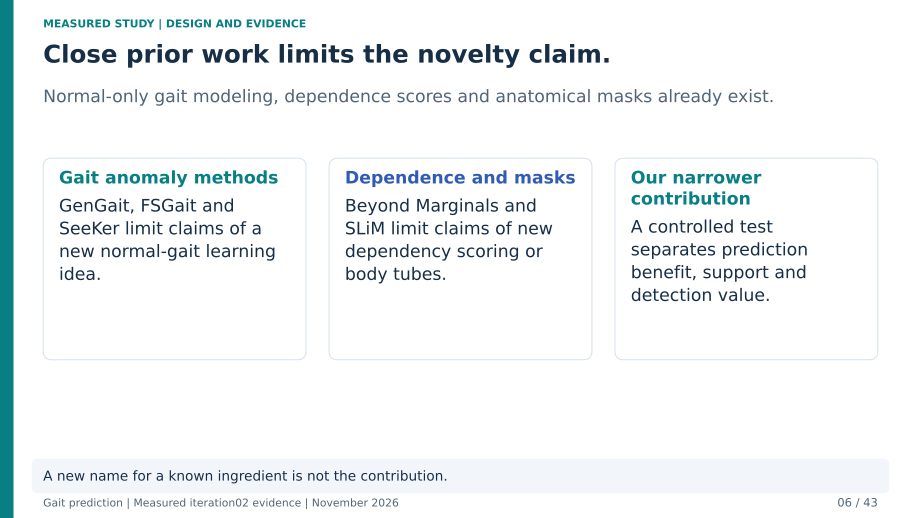

The manuscript should credit the closest primary work and avoid a novel-neural-world-model claim. The possible contribution is the experimental distinction and falsification controls, especially its independent participant replication.

**A new name for a known ingredient is not the contribution.**

Sources: [GenGait author manuscript](https://arxiv.org/abs/2604.01997v2) · [FSGait](https://openaccess.thecvf.com/content/ACCV2024/html/Duan_FSGait_Fine_Grained_Self-Supervised_Gait_Abnormality_Detection_ACCV_2024_paper.html) · [SeeKer](https://arxiv.org/abs/2506.18368) · [Beyond Marginals](https://arxiv.org/abs/2509.15033) · [SLiM current author manuscript](https://arxiv.org/html/2603.10648v4) · [Neurological evidence and novelty advice](../docs/iteration02/advice_neuro.md)

## 07. The focal labels contain small disease-family samples.

Use every eligible requested family, while preserving ambiguous labels and the broad secondary endpoint.

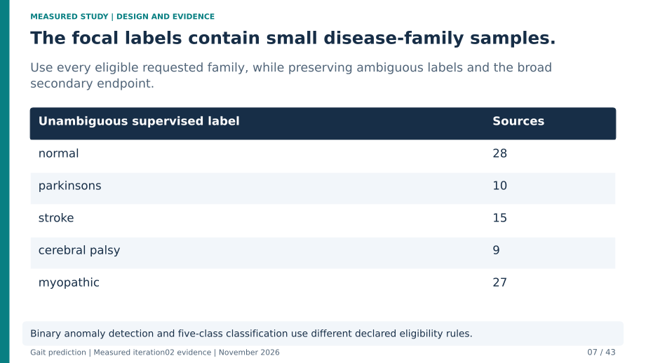

The supervised five-class total is 89. The focal binary total is 90; one focal source has ambiguous condition membership and is excluded from five-class classification. The full inventory has 348 source IDs and 347 known recording groups. The duplicate pair fails primary quality criteria, so the retained 304 IDs represent 304 known recording groups.

**Binary anomaly detection and five-class classification use different declared eligibility rules.**

Sources: [Executed protocol](../docs/iteration02/protocol.md) · [Measured iteration02 results](../docs/iteration02/results.md)

## 08. Trace annotations through local media and cached pose.

The refreshed condition CSVs determine labels. Reusable pose caches require matching media and extraction provenance.

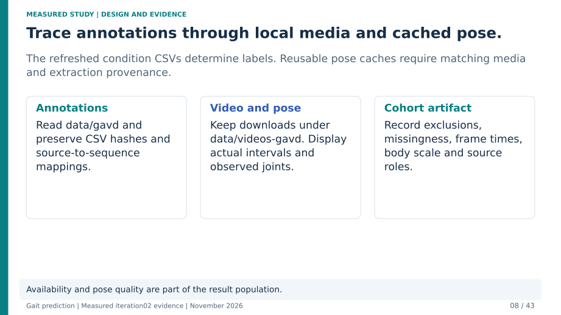

The notebooks reload current CSVs and assert agreement with the saved manifest. Local source previews remain under data/videos-gavd. Invalid coordinates stay missing; a visually plausible pose can still track the wrong person.

**Availability and pose quality are part of the result population.**

Sources: [Read-only data and ingestion review](../docs/iteration02/advice_data.md) · [Executed protocol](../docs/iteration02/protocol.md) · [Independent notebooks 12–17](../12_observation_population_and_video_context.ipynb)

## 09. Short windows are useful but do not guarantee gait cycles.

The primary 32 samples at 15 Hz span 31 intervals, about 2.07 seconds. The timing parent uses 48 samples.

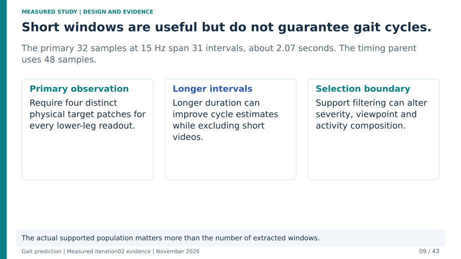

Repeated masks and overlapping windows cannot create new physical target support. The earlier read-only 96-frame candidate analysis retained only 12 normal sources and was not a model result. Validated normal contact-event phase scores are unavailable.

**The actual supported population matters more than the number of extracted windows.**

Sources: [Executed protocol](../docs/iteration02/protocol.md) · [Read-only data and ingestion review](../docs/iteration02/advice_data.md) · [Confidence filtering and selection shift](https://arxiv.org/abs/2610.39704)

## 10. Mask 16 approved joints and read the lower eight.

The allowlist is fixed and deduplicated. The score does not quietly introduce other landmarks.

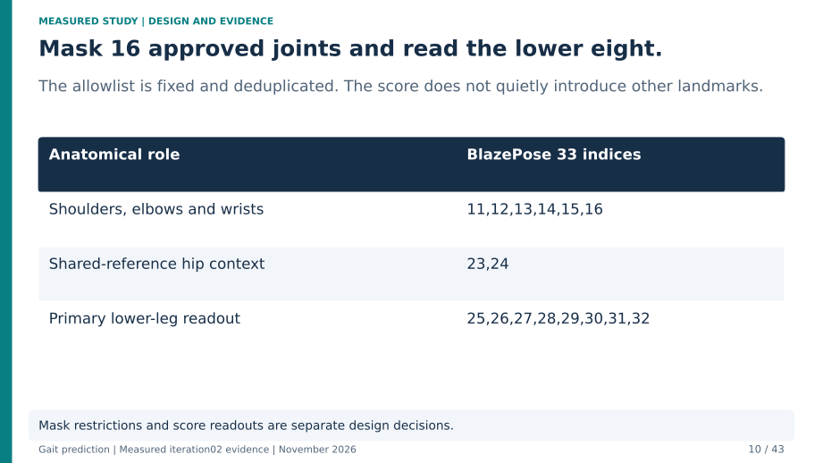

The notebooks include every keypoint in numerical order with its name and feature role. The shared normalization reference Q already uses body measurements. Conditional information-access claims must acknowledge Q.

**Mask restrictions and score readouts are separate design decisions.**

Sources: [Executed protocol](../docs/iteration02/protocol.md) · [Measured iteration02 results](../docs/iteration02/results.md)

## 11. Source roles separate fitting, calibration and evaluation.

Each outer fold holds out seven normals. Remaining normal sources split into 16 fitting and 5 reference sources.

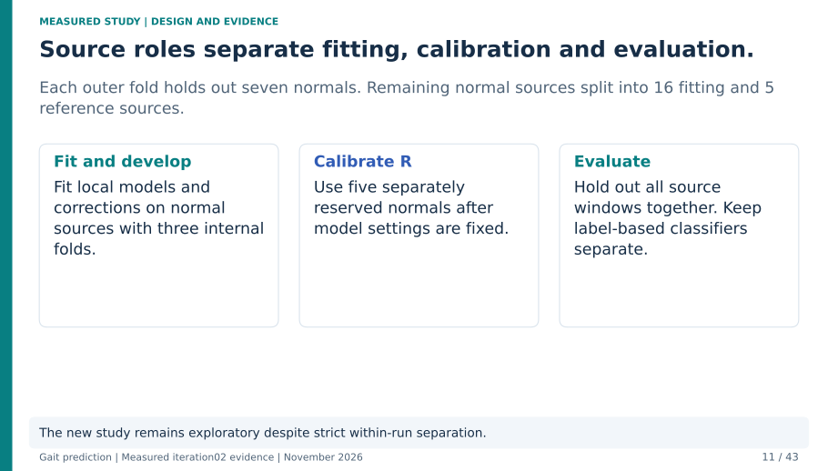

All 28 normal sources had earlier exploratory use. New folds do not create independent confirmation. Unknown repeated identities across different videos remain unresolved. The standalone laboratory dataset strengthens a separate measurement test.

**The new study remains exploratory despite strict within-run separation.**

Sources: [Executed protocol](../docs/iteration02/protocol.md) · [Measured iteration02 results](../docs/iteration02/results.md)

## 12. The baseline must work before added context is interpreted.

Known-answer fixtures and competent local prediction distinguish estimator failure from absence of a relationship.

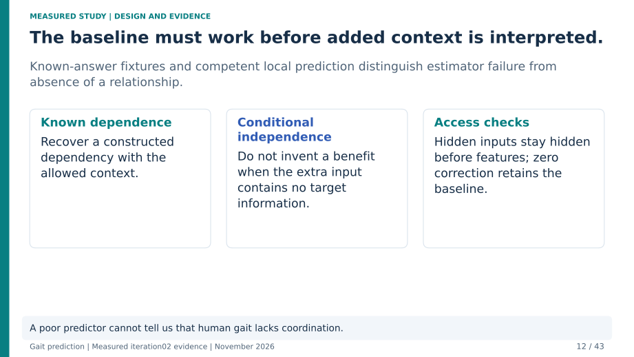

Software fixtures are explicitly synthetic checks, not gait efficacy. The real experiment then requires normal-development adequacy. A failed relational gate sets R=0 and retains the fold.

**A poor predictor cannot tell us that human gait lacks coordination.**

Sources: [Executed protocol](../docs/iteration02/protocol.md) · [Measured iteration02 results](../docs/iteration02/results.md)

## 13. Retain the local prediction while adding a correction.

The primary benefit compares own-leg and both-leg corrections with matched input width and the same frozen baseline.

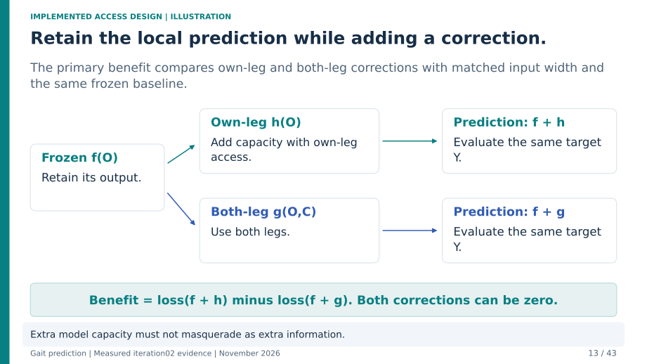

The diagram shows the primary own-capacity and both-leg comparison explicitly. The benefit is loss(f+h) minus loss(f+g). Both branches retain the same frozen f, predict the same target Y and can choose zero correction. The restriction is conditional on the shared body reference Q. Equal coefficient dimensions do not establish equal effective capacity, rank or inductive bias.

**Extra model capacity must not masquerade as extra information.**

Sources: [Executed protocol](../docs/iteration02/protocol.md) · [Measured iteration02 results](../docs/iteration02/results.md)

## 14. Three masks change what disappears together.

Every recipe hides 64 of 128 tokens without reading motion intensity, confidence, condition or loss.

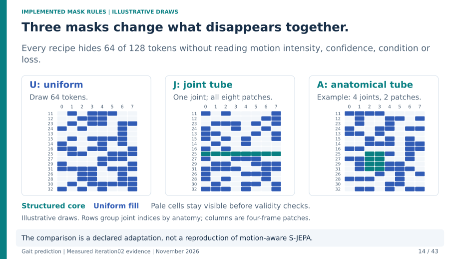

U is uniform. J selects one joint uniformly and removes all eight temporal patches, then fills 56 tokens. A selects an anatomical group with probability equal to width divided by 16, removes an aligned eight-token core, then fills 56 tokens. These example draws illustrate the implemented rule and are not model outputs.

**The comparison is a declared adaptation, not a reproduction of motion-aware S-JEPA.**

Sources: [Controlled masking methods review](../docs/iteration02/masking_method_review.md) · [MAMP primary paper](https://arxiv.org/abs/2308.07092) · [Skeleton S-JEPA primary paper](https://www.ecva.net/papers/eccv_2024/papers_ECCV/papers/04755.pdf) · [SLiM current author manuscript](https://arxiv.org/html/2603.10648v4) · [Executed protocol](../docs/iteration02/protocol.md)

## 15. Exact budgets and token marginals are matched.

The structured core has eight tokens. Its width determines the number of consecutive time patches.

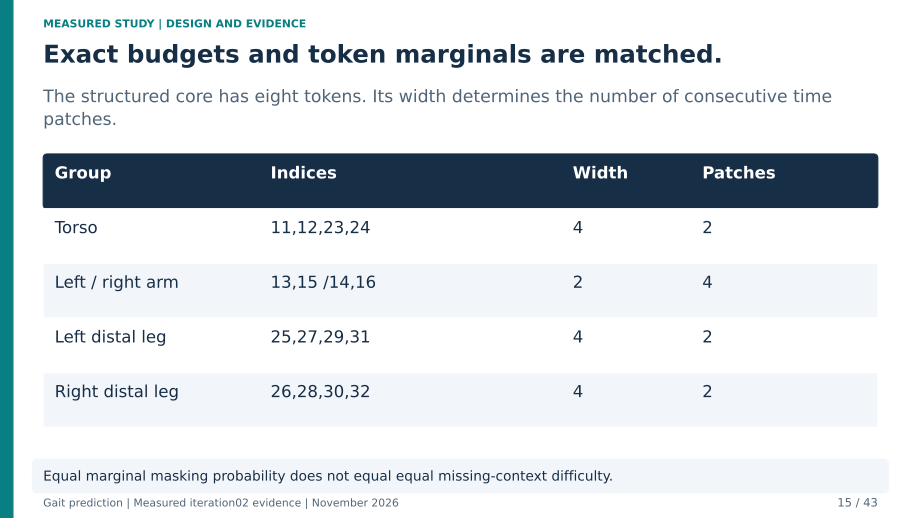

For every token, P(core)=1/16 and P(hidden)=1/16+(15/16)*(56/120)=1/2. This matches first-order probabilities, not difficulty or valid-target exposure. Starts are 0, 2, 4 and 6 for four-joint groups, and 0 or 4 for two-joint groups. No block wraps.

**Equal marginal masking probability does not equal equal missing-context difficulty.**

Sources: [Executed protocol](../docs/iteration02/protocol.md) · [Measured iteration02 results](../docs/iteration02/results.md)

## 16. Evaluate all training arms on the same frozen bank.

The uniform reference and distal-core challenge are separate tasks with separate references.

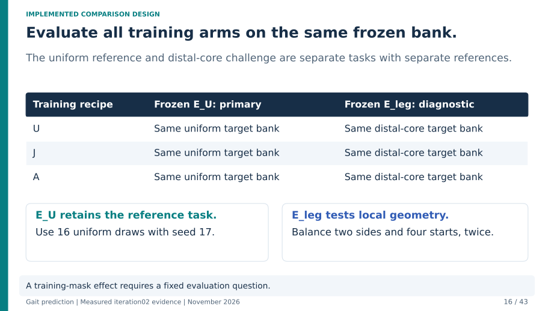

The uniform reference has 16 masks with seed 17. The distal-leg bank balances two sides and four starts twice, with seed 117. Each mask hides 64 tokens, while the diagnostic scores only its eight core targets. Compare training policies within one bank, never native task against native task.

**A training-mask effect requires a fixed evaluation question.**

Sources: [Executed protocol](../docs/iteration02/protocol.md) · [Measured iteration02 results](../docs/iteration02/results.md)

## 17. Only the correction masks change in the core ablation.

A common U-trained f is frozen across U, J and A corrections. Normal development chooses the small ridge and gate grid.

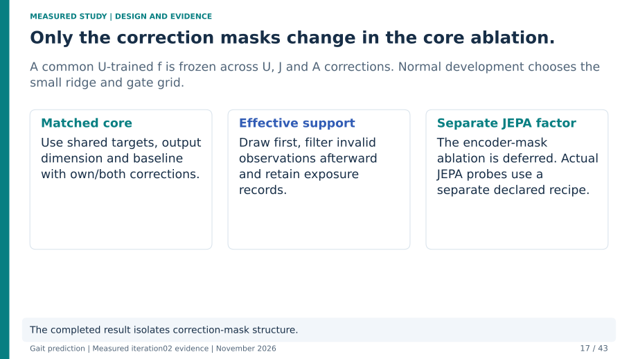

The completed coordinate comparison does not establish the best JEPA mask. VICReg discourages collapse; it does not separate disease categories by itself. Encoder-mask ablation, stochastic positional embeddings and stochastic latent variables remain deferred. Dedicated mask random streams preserve other sampling choices.

**The completed result isolates correction-mask structure.**

Sources: [Executed protocol](../docs/iteration02/protocol.md) · [Measured iteration02 results](../docs/iteration02/results.md)

## 18. All correction policies pass normal-development gates.

This gate is evaluated on internal fitting-normal validation, not on abnormal detection performance.

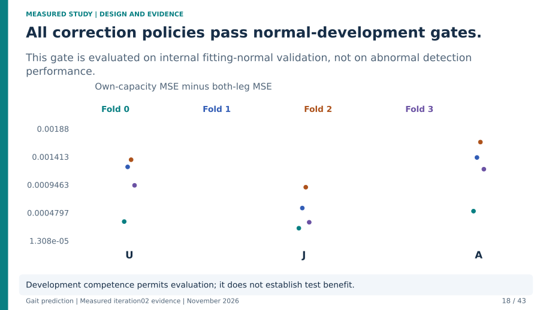

Every outer-fold and policy combination meets the operational two-of-three internal-fold rule against both the baseline and own-capacity correction. Points show the mean internal validation benefit after selection. These are development checks, not independent test evidence.

**Development competence permits evaluation; it does not establish test benefit.**

Sources: [Executed protocol](../docs/iteration02/protocol.md) · [Measured iteration02 results](../docs/iteration02/results.md)

## 19. Held-out normal benefit depends on the observation task.

The uniform-bank U and A intervals include zero. All three distal-core challenge intervals are positive.

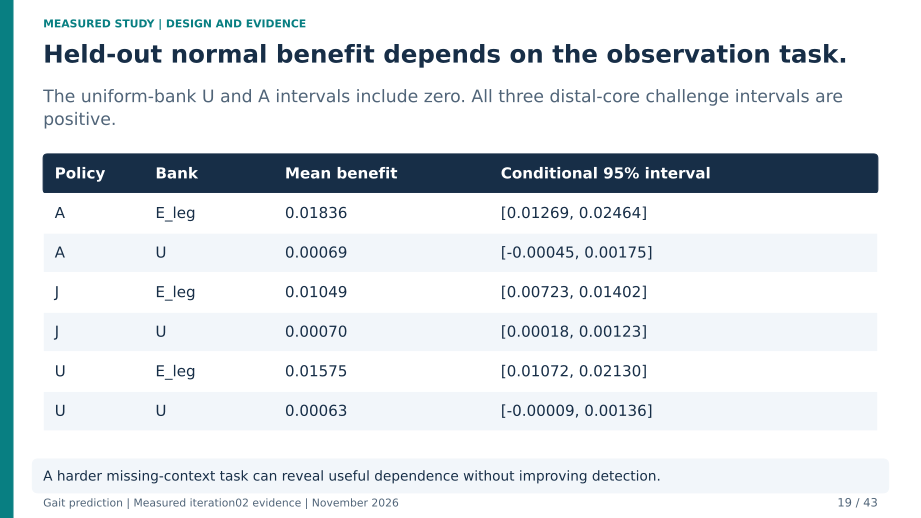

All 28 outer-test normal sources enter each result. Benefit is own-capacity loss minus both-leg loss after the declared hierarchical aggregation. The diagnostic bank removes more local geometry and reveals a different prediction task. It cannot establish an improvement on the uniform reference.

**A harder missing-context task can reveal useful dependence without improving detection.**

Sources: [Executed protocol](../docs/iteration02/protocol.md) · [Measured iteration02 results](../docs/iteration02/results.md)

## 20. Inspect one actual predicted normal coordinate patch.

The example is chosen deterministically by source and target order, not by the largest benefit.

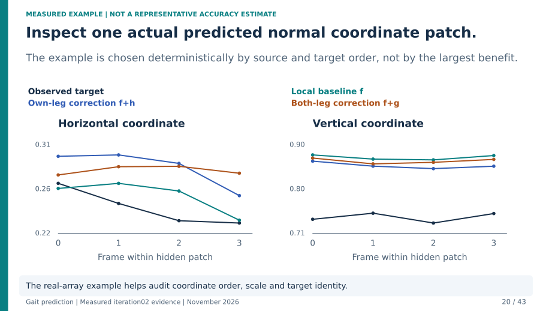

Actual saved source 3KnFt8bH3tE, sequence cljo2wwu7001a3n6ljmqm39l6, joint 25, patch 1. Notebook 13 displays the corresponding video and raw pose overlay. Every line uses the same observed target. This is an example for auditing coordinates, not a representative accuracy estimate.

**The real-array example helps audit coordinate order, scale and target identity.**

Sources: [Executed protocol](../docs/iteration02/protocol.md) · [Measured iteration02 results](../docs/iteration02/results.md)

## 21. Local movement and relational departure stay separate.

M uses 16 movement descriptors. R measures departure from reserved-normal benefit profiles. S = (M + R) / 2 is fixed.

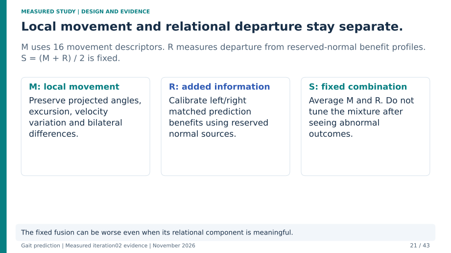

M excludes local prediction error. Its imputation, scale and covariance use fitting normals. R uses separately reserved normals after model selection. Stable compensations can increase or decrease predictive benefit, so R uses a two-sided reference. A reference of only five sources remains fragile.

**The fixed fusion can be worse even when its relational component is meaningful.**

Sources: [Executed protocol](../docs/iteration02/protocol.md) · [Measured iteration02 results](../docs/iteration02/results.md)

## 22. Aggregate repeated targets before ranking sources.

Masks, frames and windows are correlated observations, not independent test cases.

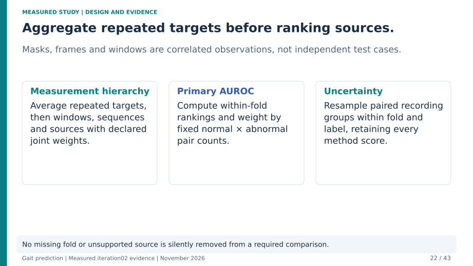

Intervals condition on the fitted models, selected protocol and original fold weights. They do not include training-seed variation or unknown repeated-person dependence. Average precision is reported per fold with prevalence. A pooled score plot is descriptive and does not replace the primary AUROC.

**No missing fold or unsupported source is silently removed from a required comparison.**

Sources: [Executed protocol](../docs/iteration02/protocol.md) · [Measured iteration02 results](../docs/iteration02/results.md)

## 23. The primary fusion loses to local movement.

The negative result appears in the focal endpoint and the required broad secondary endpoint.

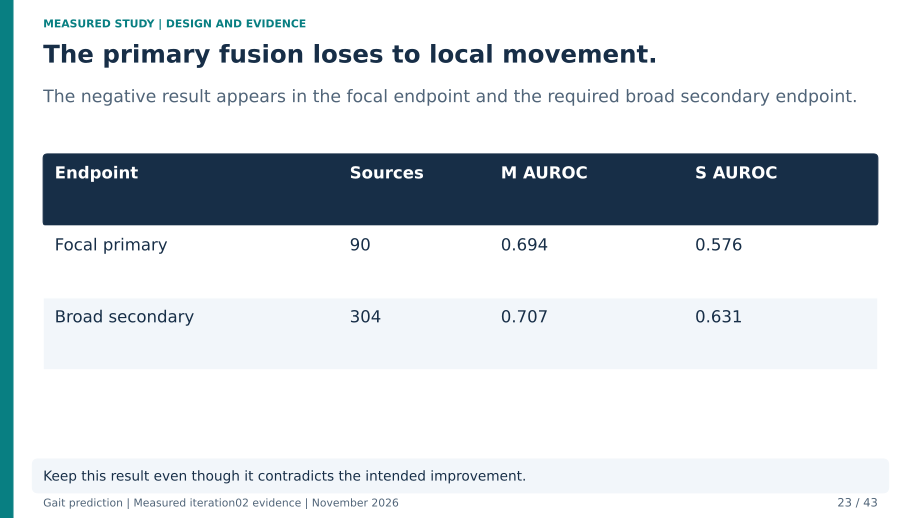

The focal endpoint was selected for the new exploratory iteration after reviewing earlier broadresults. It must not be described as preregistered independent confirmation. Both endpoints use exactly the same frozen source scores.

**Keep this result even though it contradicts the intended improvement.**

Sources: [Executed protocol](../docs/iteration02/protocol.md) · [Measured iteration02 results](../docs/iteration02/results.md)

## 24. Paired uncertainty rules out an established fusion gain.

Conditional intervals favor M. The apparent anatomical-mask increase is not established on the primary task.

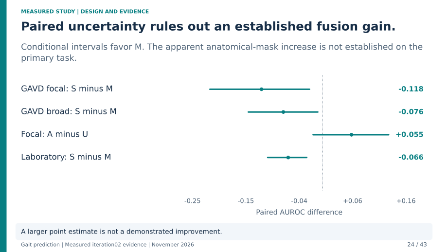

Intervals use 1,000 paired bootstrap resamples with fixed original fold weights. The mask-policy contrast compares S under the same uniform evaluation bank. An interval crossing zero does not establish equivalence or improvement.

**A larger point estimate is not a demonstrated improvement.**

Sources: [Executed protocol](../docs/iteration02/protocol.md) · [Measured iteration02 results](../docs/iteration02/results.md)

## 25. The anatomical mask does not establish a detection advantage.

Read all three recipes within the unchanged uniform evaluation task.

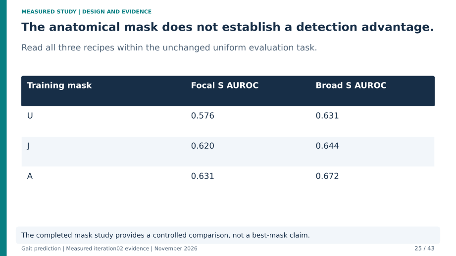

The A-minus-U focal difference is positive, but its conditional 95% interval crosses zero. A-minus-J and J-minus-U intervals also cross zero. All arms remain in the record; A is not selected as a new primary method after evaluation.

**The completed mask study provides a controlled comparison, not a best-mask claim.**

Sources: [Executed protocol](../docs/iteration02/protocol.md) · [Measured iteration02 results](../docs/iteration02/results.md)

## 26. The distal-core challenge is a different measurement task.

All retained sources support this diagnostic, but its result cannot replace the uniform reference.

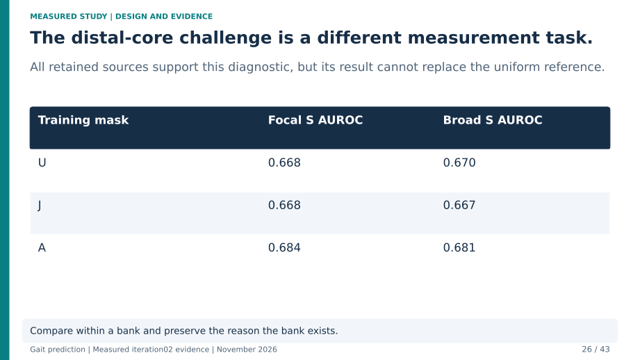

Each bank has its own relational reference, fitted using the same reserved source identities. Greater normal prediction benefit on the distal-leg bank does not imply better detection. The bank is a declared diagnostic with different targets.

**Compare within a bank and preserve the reason the bank exists.**

Sources: [Executed protocol](../docs/iteration02/protocol.md) · [Measured iteration02 results](../docs/iteration02/results.md)

## 27. Inexpensive baselines remain difficult to beat.

All listed anomaly models use normal-only fitting and the same focal test sources.

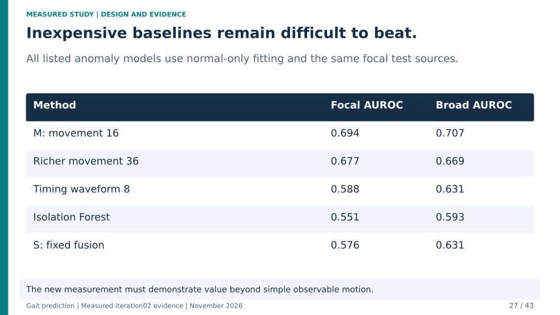

Timing8 is a waveform descriptor, not the phase coordination index or a validated physiological phase estimate. Nuisance, sham, constituent-error and calibrated-error comparisons remain in the complete metrics. The strongest local baseline must stay visible.

**The new measurement must demonstrate value beyond simple observable motion.**

Sources: [Executed protocol](../docs/iteration02/protocol.md) · [Measured iteration02 results](../docs/iteration02/results.md)

## 28. The published-method comparator is a bounded adaptation.

The actual STG-NF code ran with a 16-joint graph, fitting-normal median imputation and 128 updates.

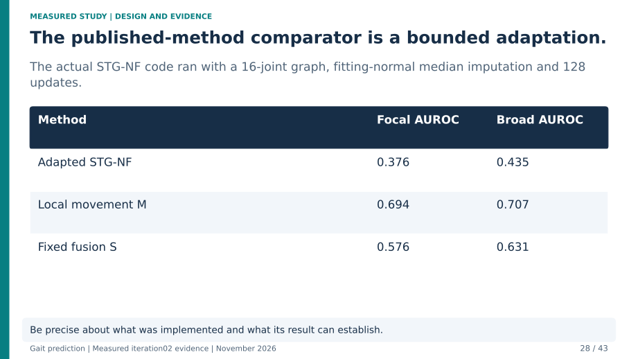

The upstream revision and adaptation are recorded. This is not a faithful reproduction of a published benchmark. The weak result from a bounded implementation cannot justify a state-of-the-art claim. All four folds completed on matched coverage.

**Be precise about what was implemented and what its result can establish.**

Sources: [Executed protocol](../docs/iteration02/protocol.md) · [Measured iteration02 results](../docs/iteration02/results.md)

## 29. Supervised condition classification is a separate task.

Real normal-only JEPA and random encoders feed supervised probes. The Random Forest uses permitted condition labels.

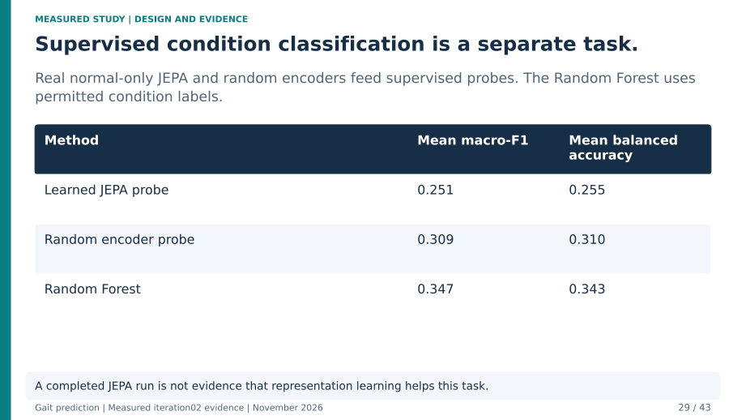

Fresh JEPA and random backbones use the same source folds. JEPA has 512 updates per fold and VICReg regularization. The table contains means of four held-out fold metrics, not clinical confidence intervals. Five-class evaluation contains 89 unambiguous sources. The learned representation does not improve this bounded comparison.

**A completed JEPA run is not evidence that representation learning helps this task.**

Sources: [Executed protocol](../docs/iteration02/protocol.md) · [Measured iteration02 results](../docs/iteration02/results.md)

## 30. The timing control keeps the answer fixed.

A 48-frame parent supplies earlier, aligned and later distal context. No sample wraps across the boundary.

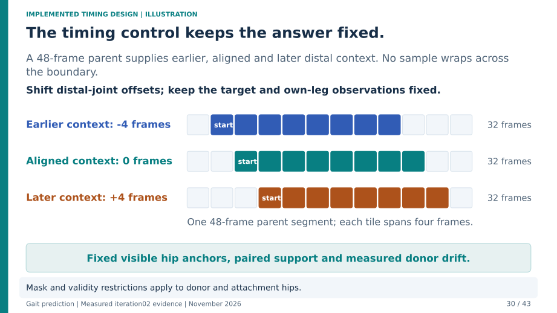

The target and own-leg window is frames 8:40, with donor intervals 4:36 and 12:44. Subtract the permitted donor hip and attach the offset to the permitted original opposite hip. Keep the common body reference and paired support fixed. This edits distal timing and geometry, not an isolated physiological phase.

**Mask and validity restrictions apply to donor and attachment hips.**

Sources: [Executed protocol](../docs/iteration02/protocol.md) · [Measured iteration02 results](../docs/iteration02/results.md)

## 31. Sparse timing support fails the normal-competence gate.

The paired-input model is worse than the own-capacity predictor even before the context is shifted.

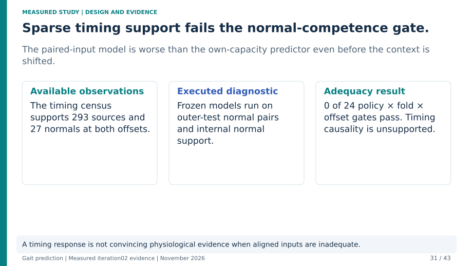

The core uniform-bank gate and the exact paired-support gate ask different questions. Sparse paired support leaves about 1.75 permitted distal tokens per target. The operational two-of-three internal-normal rule fails all 24 comparisons. Models and scores were not retuned after this result.

**A timing response is not convincing physiological evidence when aligned inputs are inadequate.**

Sources: [Executed protocol](../docs/iteration02/protocol.md) · [Measured iteration02 results](../docs/iteration02/results.md)

## 32. A measured input sensitivity survives, with a strict limit.

Earlier context increases loss slightly. Later-context uncertainty includes zero. Both comparisons fail paired-support adequacy.

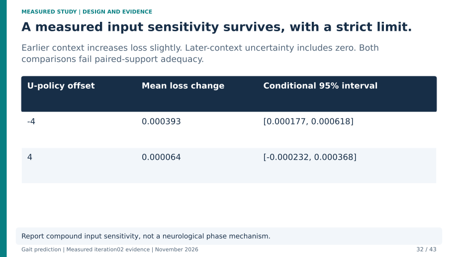

There are 27 outer-test normal sources, aggregated once per offset. Zero edits produce zero differences; own-leg predictions and targets stay fixed. Noise is not matched to timing displacement. Whole-body shifts are separate controls and do not qualify as fixed-target interventions.

**Report compound input sensitivity, not a neurological phase mechanism.**

Sources: [Executed protocol](../docs/iteration02/protocol.md) · [Measured iteration02 results](../docs/iteration02/results.md)

## 33. Independent participants test the measurement elsewhere.

The public laboratory dataset contains synchronized bilateral signals and explicit participant identities.

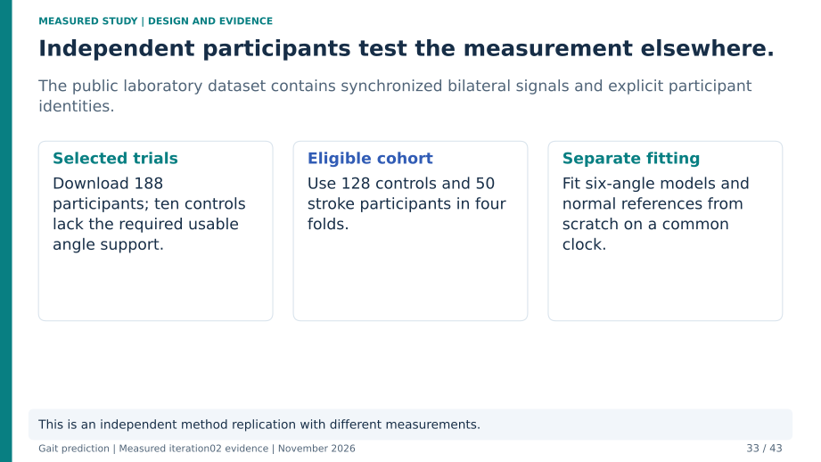

Van Criekinge and colleagues released this laboratory dataset in Scientific Data in 2023. The bounded replication uses one prespecified trial per participant and six synchronized angle signals on a common clock. It is not sensor transfer, weight transfer or validation of all four condition families.

**This is an independent method replication with different measurements.**

Sources: [Laboratory control and stroke dataset](https://pmc.ncbi.nlm.nih.gov/articles/PMC10692332/) · [Independent participant replication](../docs/iteration02/external_replication_results.md) · [Executed protocol](../docs/iteration02/protocol.md)

## 34. Other-leg context helps held-out laboratory normals.

The both-leg correction improves on the own-capacity correction in every outer test fold.

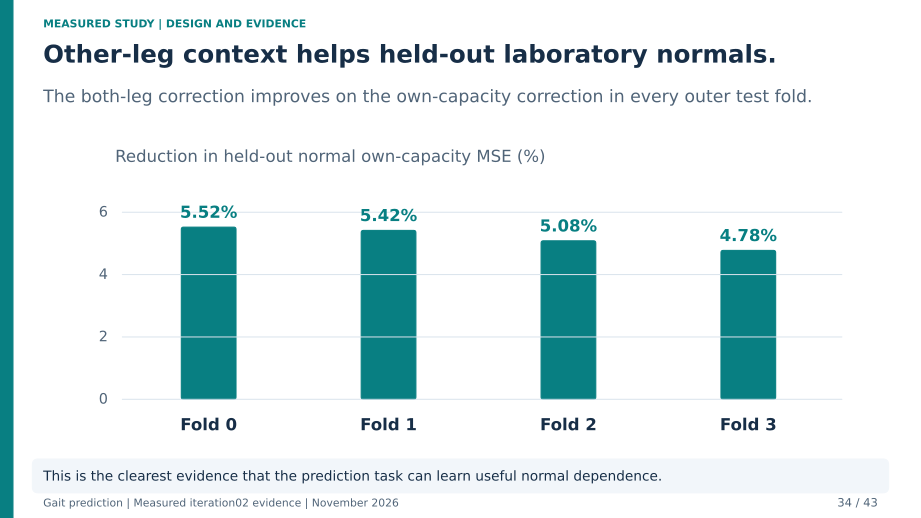

Each held-out normal fold has 32 participants. Relative own-capacity error reduction ranges from 4.78% to 5.52%. The errors use laboratory angle units, not GAVD coordinate units. This measurement contains useful cross-leg predictive information.

**This is the clearest evidence that the prediction task can learn useful normal dependence.**

Sources: [Executed protocol](../docs/iteration02/protocol.md) · [Measured iteration02 results](../docs/iteration02/results.md)

## 35. Laboratory detection still favors local movement.

The relational channel is above chance, but averaging it with M reduces separation.

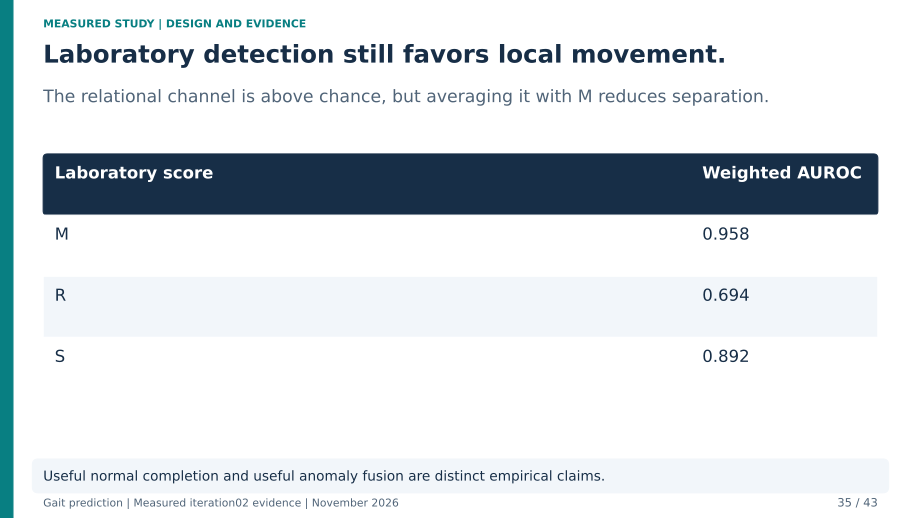

S minus M is -0.0663, with conditional 95% interval [-0.1056, -0.0306]. The negative result tests one fixed measurement and fusion recipe. It does not prove that relational information can never help.

**Useful normal completion and useful anomaly fusion are distinct empirical claims.**

Sources: [Executed protocol](../docs/iteration02/protocol.md) · [Measured iteration02 results](../docs/iteration02/results.md)

## 36. Age and sex balancing does not remove this limitation.

The frozen sensitivity matches same-sex participants within five years and within each outer fold.

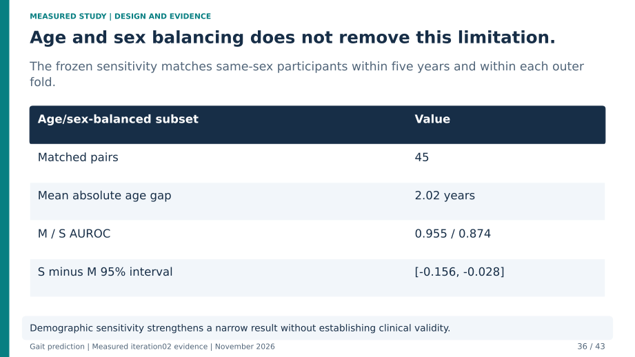

The maximum-cardinality, minimum-age-gap matching rule was fixed before outcomes. It produces 45 same-sex pairs: 16 female and 29 male, with fold counts 11, 12, 11 and 11. Models are not refitted. Bootstrap resampling carries whole matched pairs within each fold. This is a balanced sensitivity analysis, not causal adjustment.

**Demographic sensitivity strengthens a narrow result without establishing clinical validity.**

Sources: [Independent participant replication](../docs/iteration02/external_replication_results.md) · [Laboratory control and stroke dataset](https://pmc.ncbi.nlm.nih.gov/articles/PMC10692332/)

## 37. The remaining confounds still matter.

Camera view, confidence filtering and unknown repeated identities limit GAVD generalization.

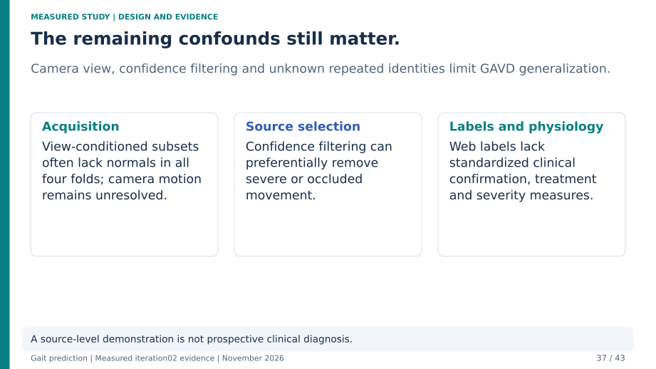

Notebook 17 shows deterministic context examples and explicitly labels outcome-selected failure candidates. Individual videos do not support invented causal clinical explanations. The independent laboratory data reduce some acquisition uncertainty without validating GAVD diagnoses.

**A source-level demonstration is not prospective clinical diagnosis.**

Sources: [Interpretation limits](../docs/iteration02/limitations.md) · [Confidence filtering and selection shift](https://arxiv.org/abs/2610.39704) · [Independent notebooks 12–17](../12_observation_population_and_video_context.ipynb)

## 38. The defensible contribution is a tested distinction.

The results explain why accurate conditional prediction alone is an insufficient objective for anomaly detection.

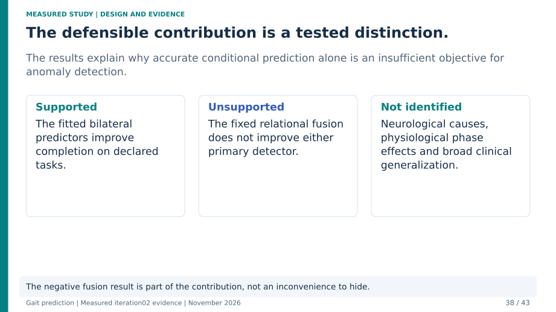

The GAVD uniform-bank U normal-benefit interval itself includes zero. The clearest useful-dependence findings come from the external dataset and distal-leg diagnostic bank. Do not combine these into a stronger universal claim. The contribution rests on transparent controls and replication, not on novel model components.

**The negative fusion result is part of the contribution, not an inconvenience to hide.**

Sources: [Measured iteration02 results](../docs/iteration02/results.md) · [Interpretation limits](../docs/iteration02/limitations.md) · [Neurological evidence and novelty advice](../docs/iteration02/advice_neuro.md) · [Current manuscript and readiness](../docs/draft02/README.md)

## 39. Six independent notebooks expose the evidence.

Each uses the exact verified run, current dotenv setup, real video examples and source-hashed figures.

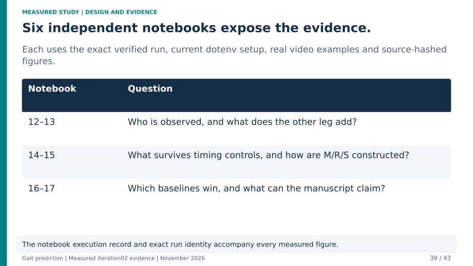

Use uv with the existing project configuration and set AAAI_ITERATION02_RUN_DIR to the exact run. The execution report records independent fresh kernels. Historical notebooks 00–11 preserve scientific cells and outputs; new replay checks write isolated artifacts. Read the execution record rather than assuming a notebook has run because its file exists.

**The notebook execution record and exact run identity accompany every measured figure.**

Sources: [Independent notebooks 12–17](../12_observation_population_and_video_context.ipynb) · [Executed protocol](../docs/iteration02/protocol.md)

## 40. The next paper should test a measurement, not promise a cure.

A strong submission needs a narrow result, transparent failed gates and a clear account of what would change the conclusion.

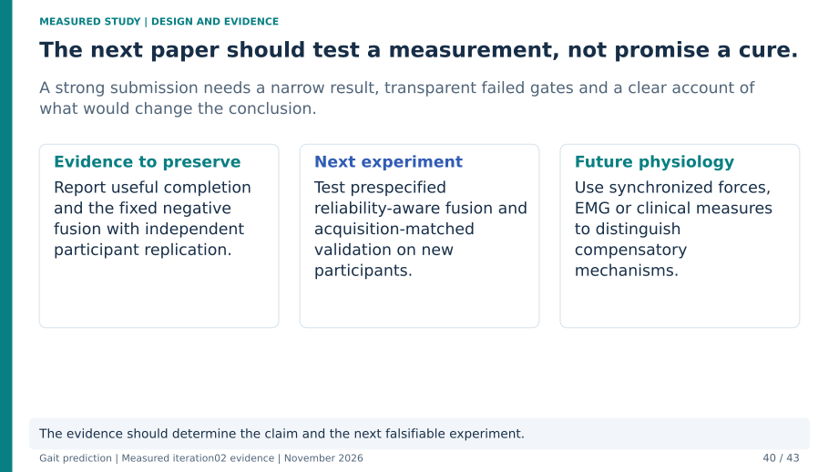

Reliability-aware fusion is future work, not a replacement selected after the fixed S result. Encoder-mask ablations, stochastic positional embeddings, stochastic latent variables and multiple training seeds remain unexecuted. The manuscript, format, links and claim ledger must agree with the evidence. These scores cannot determine workshop acceptance probability.

**The evidence should determine the claim and the next falsifiable experiment.**

Sources: [Current manuscript and readiness](../docs/draft02/README.md) · [ASTAD4 official requirements](https://ismart.ece.mcgill.ca/astad4/) · [Interpretation limits](../docs/iteration02/limitations.md)

## 41. The other leg helps on declared completion tasks.

The predeclared distal-leg diagnostic and independent laboratory study show positive prediction results.

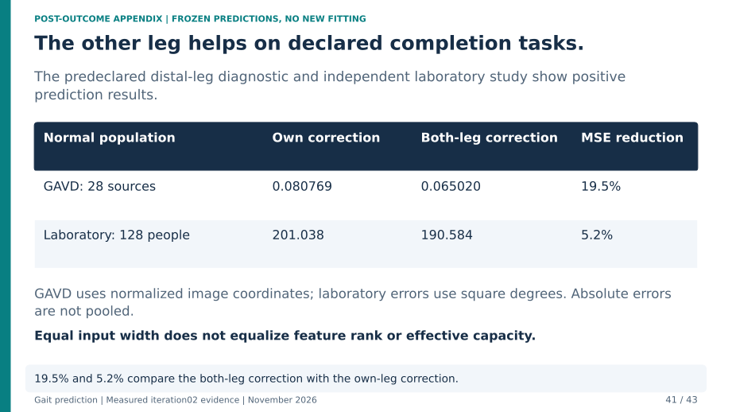

This appendix emphasizes completed secondary completion results after outcomes were inspected. It does not alter the primary detection endpoint, fitted models, targets or populations. Both rows compare loss(f+h) with loss(f+g), retaining the same local f. The GAVD row uses the uniform-trained reference on E_leg, not the largest gain selected across policies. Its absolute mean benefit is 0.015748, with the earlier 5,000-draw conditional interval [0.010721, 0.021300]. Percentages are differences of source or participant mean MSE divided by the comparator mean, not means of individual percentages. The observations are withheld measured poses or angles, not independent ground truth during real occlusion. The feature families and numerical ranks differ, so this is useful completion under fitted predictor families rather than isolated neural information.

**19.5% and 5.2% compare the both-leg correction with the own-leg correction.**

Sources: [Post-outcome paired completion audit](../docs/draft03/advisory/completion_audit_v1/README.md) · [Positive completion interpretation and limits](../docs/draft03/README.md) · [Executed protocol](../docs/iteration02/protocol.md)

## 42. The laboratory benefit is paired and consistent.

All four held-out fold means favor the both-leg predictor under a separately fitted angle-based measurement.

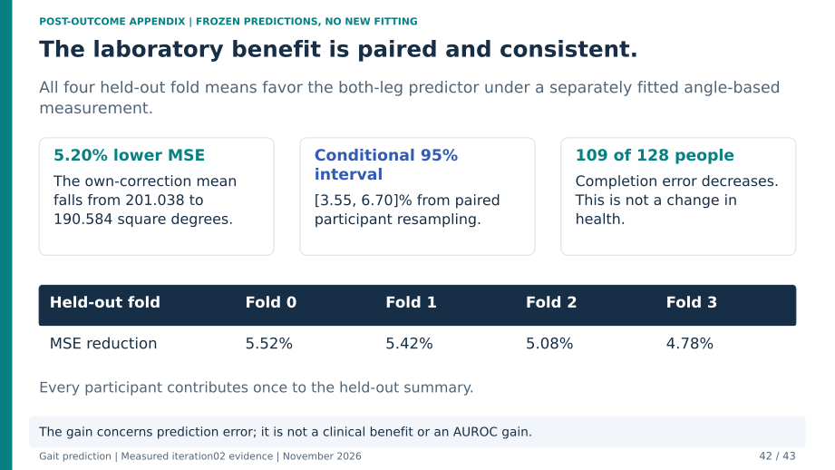

The post-outcome audit uses the frozen predictions for 128 healthy participants, with 32 in each original outer fold. It resamples participants jointly across compared methods within folds, fixes the original normal-count fold weights, and uses 1,000 draws with seed 42. The exact relative interval is [3.5530025847, 6.6975555170] percent. The absolute reduction is 10.454 square degrees, with conditional interval [7.154, 13.387]. Error decreases for 109 participants. Shared training data across fits mean that the four fold means are not independent replications. These intervals omit fitting, seed and protocol-selection uncertainty. The separate laboratory study is method replication, not transfer of GAVD weights or validation across all disease families.

**The gain concerns prediction error; it is not a clinical benefit or an AUROC gain.**

Sources: [Post-outcome paired completion audit](../docs/draft03/advisory/completion_audit_v1/README.md) · [Positive completion interpretation and limits](../docs/draft03/README.md) · [Executed protocol](../docs/iteration02/protocol.md) · [Independent participant replication](../docs/iteration02/external_replication_results.md)

## 43. Anatomical masking helps the focused gap task.

This is A versus U training for the bilateral predictor. It is a different contrast from adding opposite-leg context.

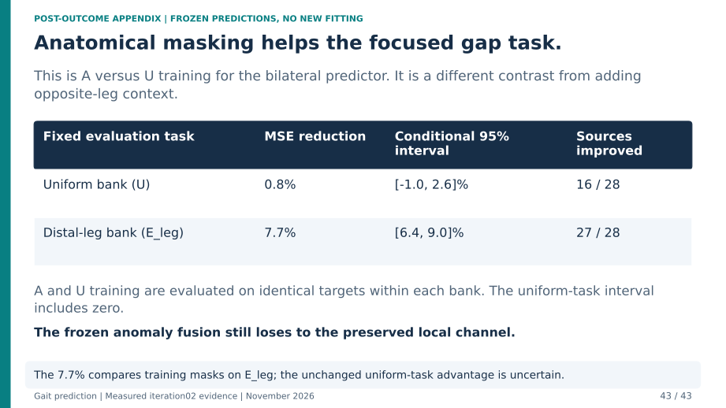

The paired audit checks identical normal sources, window metadata, physical target keys, mask-draw counts, evaluation mask hashes and distinct-patch support for A and U within each bank. On E_leg, MSE changes from 0.065020 to 0.060009; the relative interval is [6.3559980507, 9.0031877518] percent, with 27 of 28 sources improved and positive means in all four folds. On U, the relative interval is [-0.9546471486, 2.5838432525] percent; 16 sources improve and one fold mean is worse. The new intervals are post-outcome, unadjusted descriptive analyses of frozen outputs. They condition on training recipes, selected regularization, validity-dependent target exposure and the current sources. This supports task-specific completion specialization, not a new mask family, general mask superiority, a JEPA pretraining result or a neurological mechanism. Both banks and the negative original primary detection results remain visible.

**The 7.7% compares training masks on E_leg; the unchanged uniform-task advantage is uncertain.**

Sources: [Post-outcome paired completion audit](../docs/draft03/advisory/completion_audit_v1/README.md) · [Positive completion interpretation and limits](../docs/draft03/README.md) · [Executed protocol](../docs/iteration02/protocol.md)
