# Predictable walking can still be abnormal

A 40-slide internal research deck with completed primary, sensitivity and control results. This editable companion includes speaker notes and sources. SVG pages are fully vector.

## 01. Predictable walking can still be abnormal.

**IMPLEMENTATION, REAL RESULTS AND CLAIM BOUNDARIES**

We test whether the help supplied by other joints differs from a normal reference.

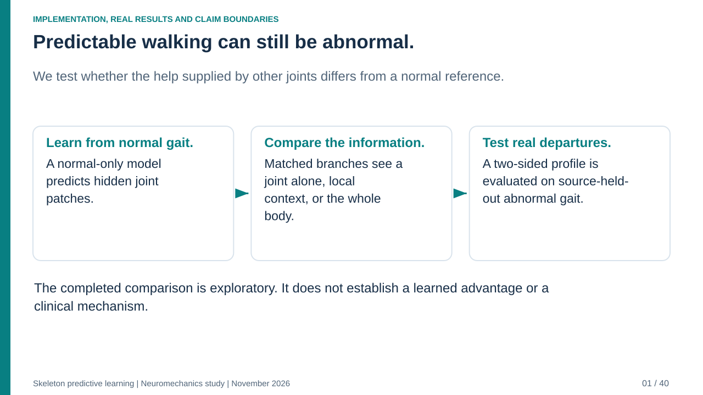

The revised study is motivated by neuromusculoskeletal constraints and altered organization. New results are distinguished from the earlier three-seed baseline throughout this deck. Every slide with toy curves is labeled as an illustration. This is an internal research deck, not an anonymized submission.

[Implemented study and evaluation protocol](../../../docs/context_study_protocol.md), [Biological motivation and world-model proposal](../../../docs/draft00/neurological_research_direction.md)

## 02. Biology produces motion before a camera measures it.

**RESEARCH MOTIVATION**

Several hidden causes can produce similar visible walking patterns.

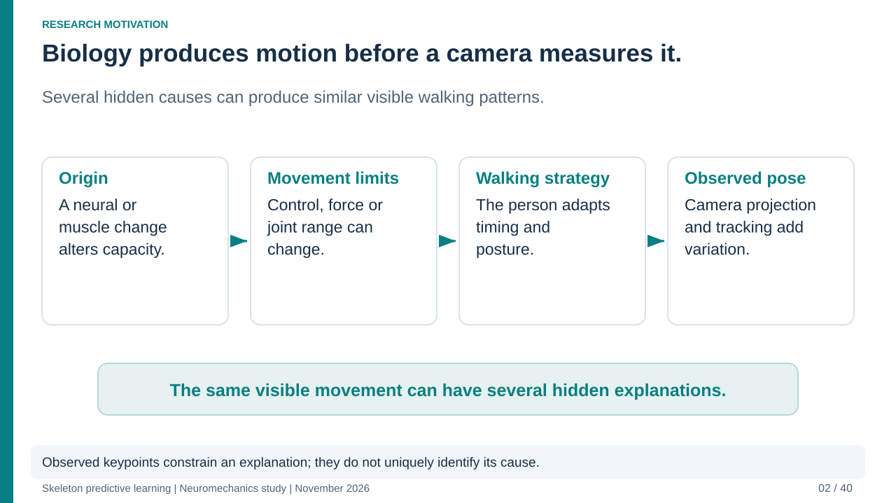

Observed keypoints constrain an explanation; they do not uniquely identify its cause.

This is a conceptual forward chain, not an estimated causal graph for GAVD. Control, muscles, mechanics, compensation, projection and pose estimation each affect the observation. Naming a latent variable weakness does not validate that interpretation.

[Biological motivation and world-model proposal](../../../docs/draft00/neurological_research_direction.md)

## 03. Four condition families motivate different hypotheses.

**RESEARCH MOTIVATION**

Stroke, Parkinson’s, cerebral palsy and myopathic gait have overlapping movement effects.

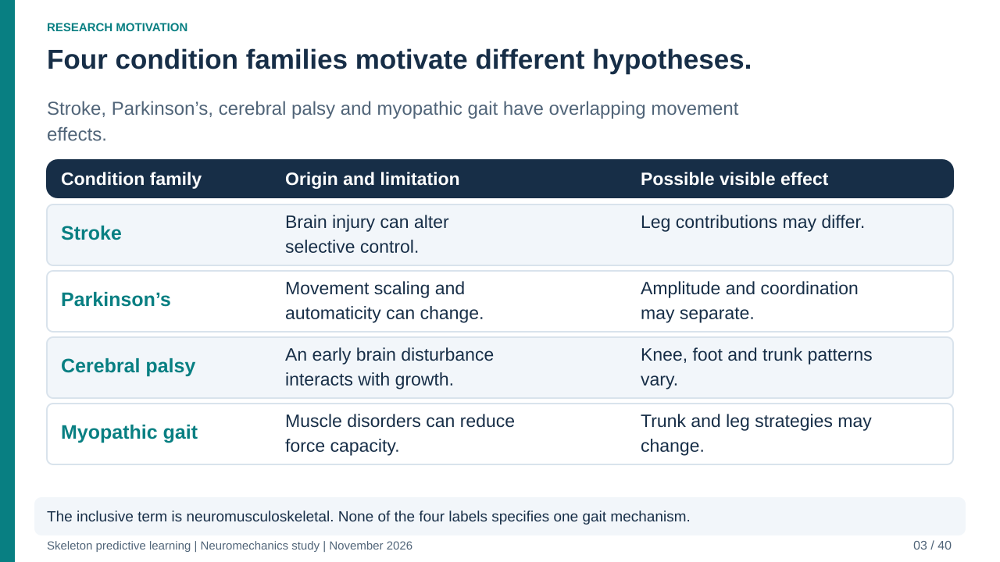

The inclusive term is neuromusculoskeletal. None of the four labels specifies one gait mechanism.

Stroke can alter selective activation and limb contributions. Parkinson’s can affect amplitude and coordination differently. Cerebral palsy arises from a developing-brain disturbance while body mechanics can change with growth. Myopathic means muscle-related and is not one brain disorder. The generic GAVD myopathic label is not Duchenne muscular dystrophy. Clinical studies motivate questions rather than diagnoses from video.

[Biological motivation and world-model proposal](../../../docs/draft00/neurological_research_direction.md), [Primary clinical evidence and limitations](../../../docs/draft00/advisory/neuromechanics_clinical_evidence.md)

## 04. A smooth repeated movement can have an unusual relationship.

**ILLUSTRATIVE SIGNALS**

Lower prediction error is not a universal definition of normal gait.

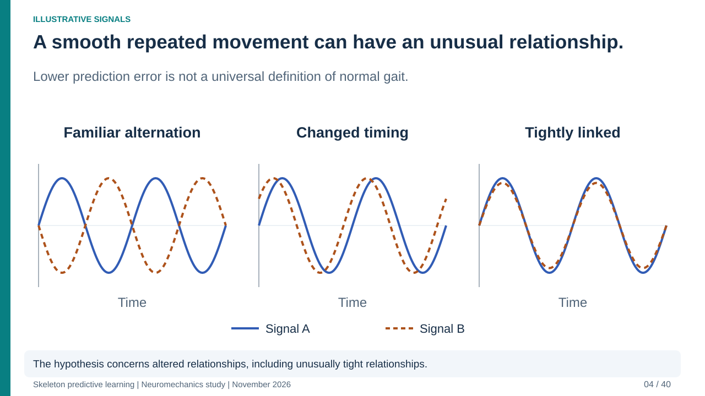

The hypothesis concerns altered relationships, including unusually tight relationships.

These curves are invented teaching signals, not simulated diseases. An abnormal movement may become more predictable, less predictable, or equally predictable. We therefore preserve the one-sided contrast and predeclare a two-sided profile.

[Biological motivation and world-model proposal](../../../docs/draft00/neurological_research_direction.md)

## 05. Hide the same left-ankle patch twice.

**STUDY PROTOCOL**

The intended difference is available information, conditional on a shared body reference.

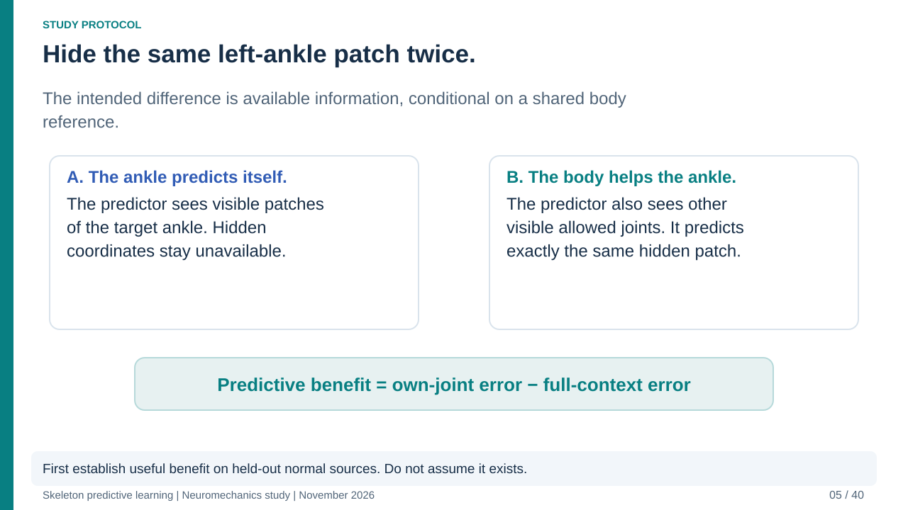

First establish useful benefit on held-out normal sources. Do not assume it exists.

Both branches use identical target positions, masks and valid-target support. Their normalized coordinates share pelvis centering and prefix torso scale, which already use other joints. The experiment restricts learned context rather than claiming preprocessing is ankle-independent. Uniform-mask completion may see both earlier and later observations.

[Implemented study and evaluation protocol](../../../docs/context_study_protocol.md)

## 06. A matched experiment connects the hypothesis to a score.

**STUDY DESIGN**

Normal fitting, information restrictions and independent source scoring have separate roles.

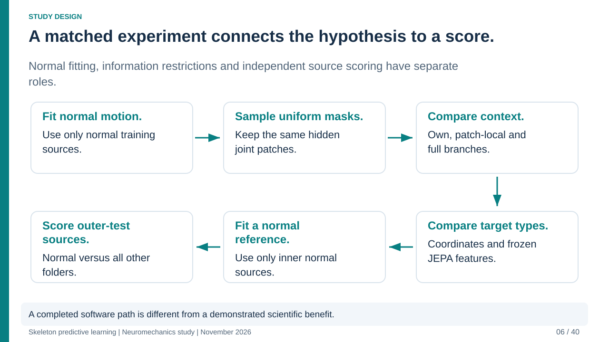

A completed software path is different from a demonstrated scientific benefit.

This figure originated in the proposal. The information restrictions and normal-only roles are implemented and tested. Real scores later in this deck distinguish the completed experiment from the illustrative diagram.

[Implemented study and evaluation protocol](../../../docs/context_study_protocol.md)

## 07. Only the normal folder is normal for this endpoint.

**FRESH ANNOTATION CENSUS**

The fresh inventory has 1,874 sequences and 348 source IDs, including 32 normal sources.

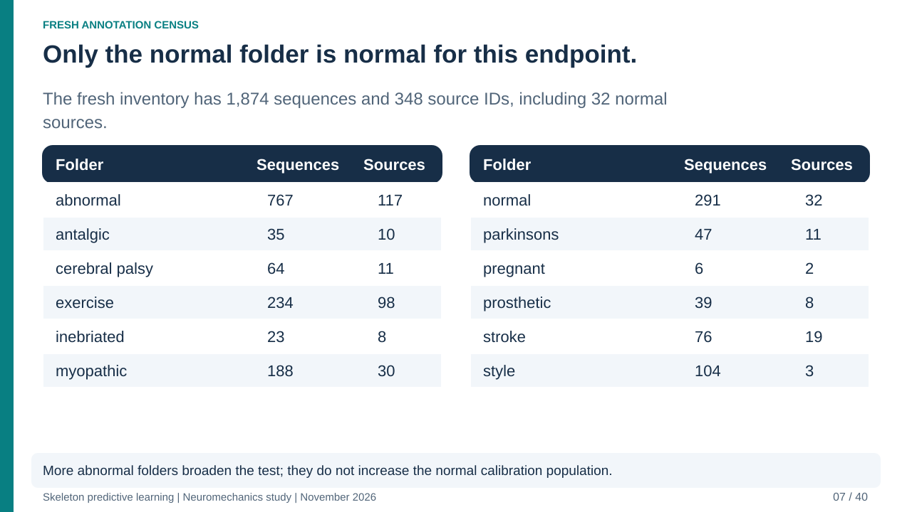

More abnormal folders broaden the test; they do not increase the normal calibration population.

Counts are recomputed from current per-sequence CSVs and exclude data/gavd/source. Every other folder, including exercise, style and pregnant, is positive abnormal under the stated folder rule. Folder-source totals can overlap, so sum unique source IDs for the union. These are pre-extraction annotation counts, not independent patients or accepted poses.

[GAVD dataset paper](https://arxiv.org/abs/2407.04190), [Implemented study and evaluation protocol](../../../docs/context_study_protocol.md)

## 08. Quality filtering leaves only 23 normal source videos.

**MEASURED: COHORT ATTRITION**

The frozen profile cohort has 251 sources. All are scored by every declared main comparator.

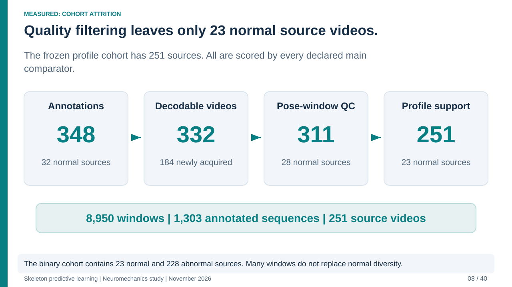

The binary cohort contains 23 normal and 228 abnormal sources. Many windows do not replace normal diversity.

The fresh census is 1874 annotation sequences and 348 sources. Acquisition recovered 332 videos. Pose QC retained 9474 windows, 1389 sequences and 311 sources. Fixed profile support retained 8950 windows, 1303 sequences and 251 sources. All 23 retained normals were in the earlier retained study index; 58 abnormal sources were also present, and 170 were absent from that index. Absence from the index does not prove no prior inspection. Videos and sequences are not verified independent people.

[Completed source-held-out context results](../../../docs/context_study_results.md), [Primary run and provenance](../../../artifacts/context_study/gavd/3044566091261819/summary.json)

## 09. The four focal families do not define every abnormal gait.

**STUDY PROTOCOL**

Category analyses complement the all-folder detection question.

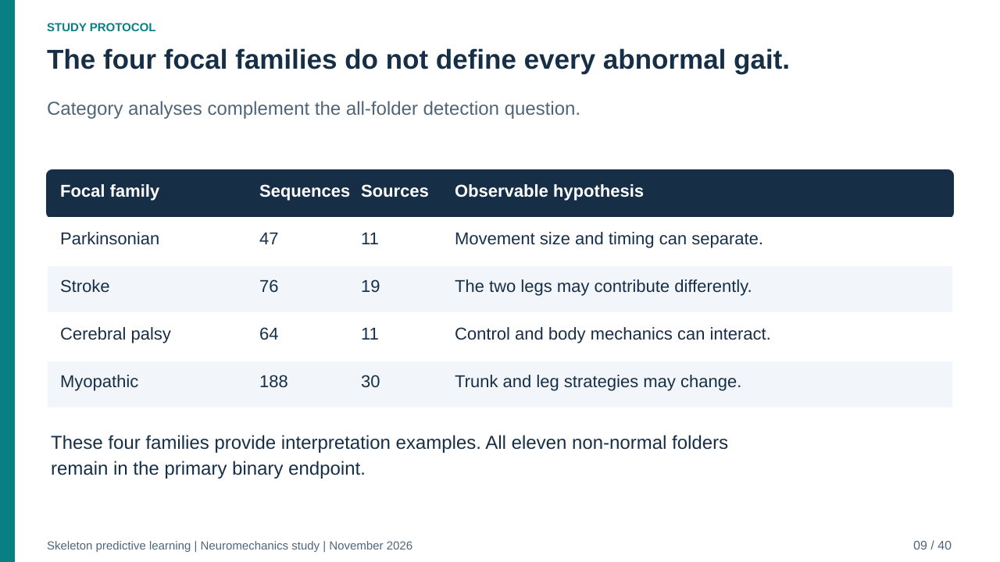

The original five-class recognition task includes normal plus these four families and remains secondary. The small category source counts constrain interpretation. We do not claim known affected side, medication status, verified etiology or diagnostic ground truth from the folder labels.

[Biological motivation and world-model proposal](../../../docs/draft00/neurological_research_direction.md), [Primary clinical evidence and limitations](../../../docs/draft00/advisory/neuromechanics_clinical_evidence.md)

## 10. A prediction must trace back to the walking video.

**IMPLEMENTED DATA FOUNDATION**

The current CSVs define the cohort; old feature caches are not experiment inputs.

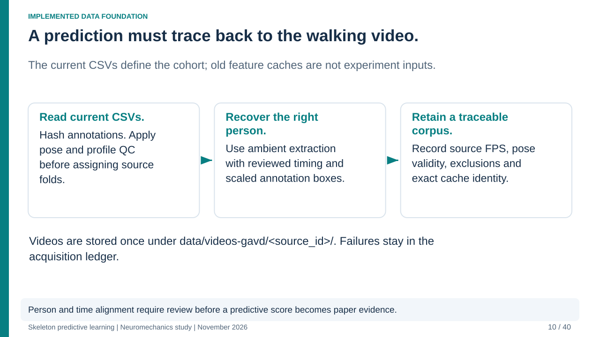

Person and time alignment require review before a predictive score becomes paper evidence.

Use ambient.pose.keypoint_extractor.SequenceKeypointExtractor on annotated crops. Preserve full-image XY, confidence, frame origin, source FPS and model hash. A decoded frame and a high-confidence pose do not prove that the current rendition still aligns with original annotation timing. Inspect overlays and sequence semantics. Never silently change labels or recover missing cases by favorable source selection.

[Implemented study and evaluation protocol](../../../docs/context_study_protocol.md)

## 11. Mask only the 16 declared joints, uniformly.

**FIXED JOINT AND MASK RULE**

Four frames of one joint form a token. A 32-frame window has 128 tokens.

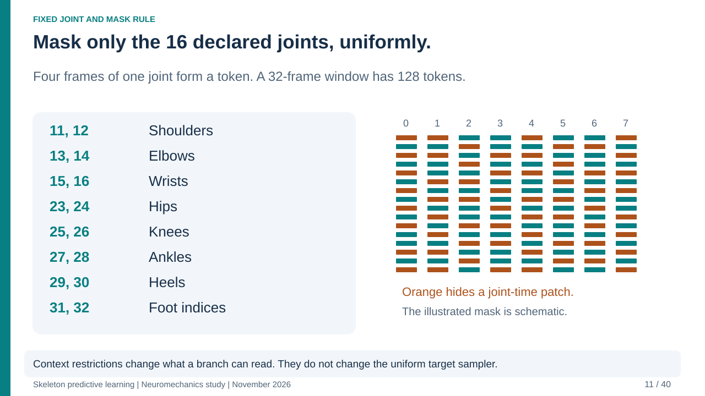

Context restrictions change what a branch can read. They do not change the uniform target sampler.

The only indices are 11,12,13,14,15,16,23,24,25,26,27,28,29,30,31,32. The sampler ranks independent random draws over the whole token grid without motion, velocity, confidence or labels. Validity filters target accounting afterward. The three-group readout does not remove hips or shoulders from model training.

[MAMP and its official uniform-mask branch](https://github.com/maoyunyao/MAMP/blob/main/model_mamp/transformer.py), [Implemented study and evaluation protocol](../../../docs/context_study_protocol.md)

## 12. Quality control must not manufacture motion.

**IMPLEMENTED DATA FOUNDATION**

Invalid patches are excluded from attention, target loss and pooled features.

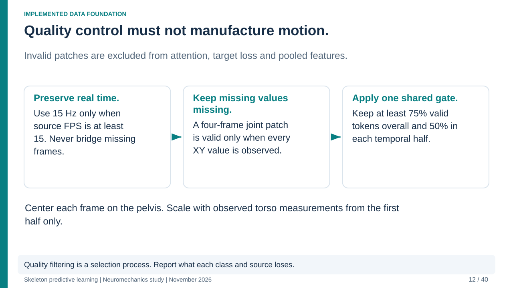

Quality filtering is a selection process. Report what each class and source loses.

The old complete-case pilot failed and led to this documented validity-aware protocol before classifier performance was inspected. Both methods use the same accepted cohort. Requiring future visibility makes suffix evaluation retrospective on evaluable futures. Camera view and missingness can still predict labels, so nuisance controls and coverage reports remain necessary.

[Implemented study and evaluation protocol](../../../docs/context_study_protocol.md)

## 13. Adequate learning must be checked, not assumed.

**STUDY PROTOCOL**

Both schedules are completed. Fixed update counts do not establish convergence.

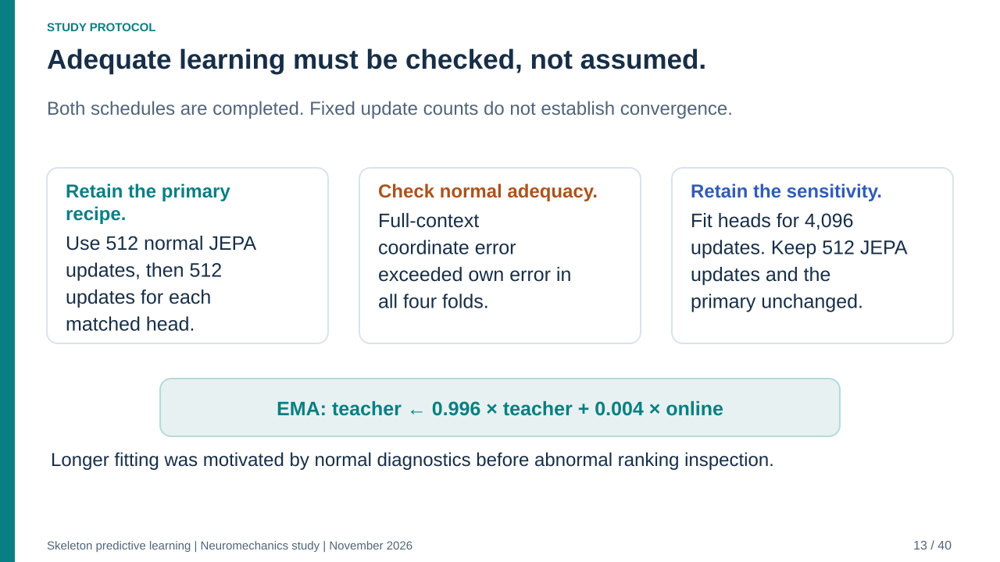

The longer run was launched from normal-development evidence before the new abnormal ranking results were inspected. The original 512-head comparison remains primary. Extra raw observations cannot worsen ideal Bayes MSE, but separately re-encoded frozen memories need not be nested, and finite heads can underfit. Negative normal coordinate benefit is a learner diagnostic, not biological harm. Actual results for both budgets appear later.

[Primary run and provenance](../../../artifacts/context_study/gavd/3044566091261819/summary.json), [4096-head-update sensitivity and provenance](../../../artifacts/context_study/gavd/eba2bd5a6e05efa1/summary.json), [Implemented study and evaluation protocol](../../../docs/context_study_protocol.md)

## 14. The teacher supplies features, while VICReg discourages collapse.

**STUDY PROTOCOL**

The online branch sees only permitted observations. The target branch has no gradients.

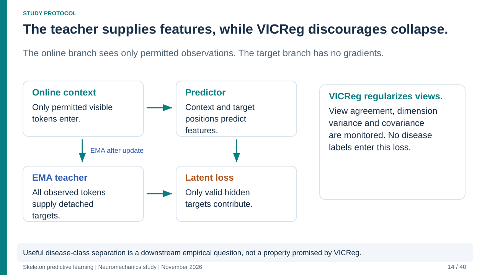

Useful disease-class separation is a downstream empirical question, not a property promised by VICReg.

This is a small paper-based adaptation of Skeleton S-JEPA with uniform masking and VICReg. VICReg is not class repulsion and does not guarantee informative representations. Track actual encoder health and independent prediction performance. Teacher centering, temperatures and weights are fixed during matched predictor comparisons.

[Skeleton S-JEPA, ECCV 2024](https://www.ecva.net/papers/eccv_2024/papers_ECCV/papers/04755.pdf), [VICReg](https://arxiv.org/abs/2105.04906), [Implemented study and evaluation protocol](../../../docs/context_study_protocol.md)

## 15. Information isolation must hold for each target token.

**STUDY PROTOCOL**

A restricted prediction head is insufficient if its input already contains the whole body.

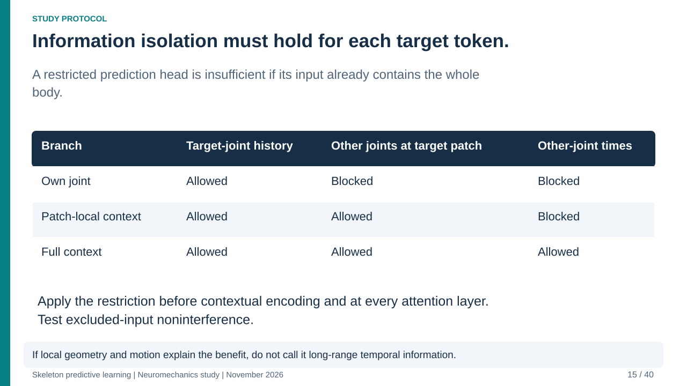

If local geometry and motion explain the benefit, do not call it long-range temporal information.

For each hidden target joint and temporal patch, the own branch can read valid visible patches of that joint only. The patch-local branch also reads other visible joints in the same four-frame patch. Full sees all visible allowed tokens. Enforce restrictions throughout encoding and prediction. Hold the shared body reference fixed when testing coordinate changes. A four-frame control includes short motion, so it is not purely static.

[Implemented study and evaluation protocol](../../../docs/context_study_protocol.md)

## 16. The teacher can change what the answer contains.

**STUDY PROTOCOL**

A local target control separates observable motion from contextual target construction.

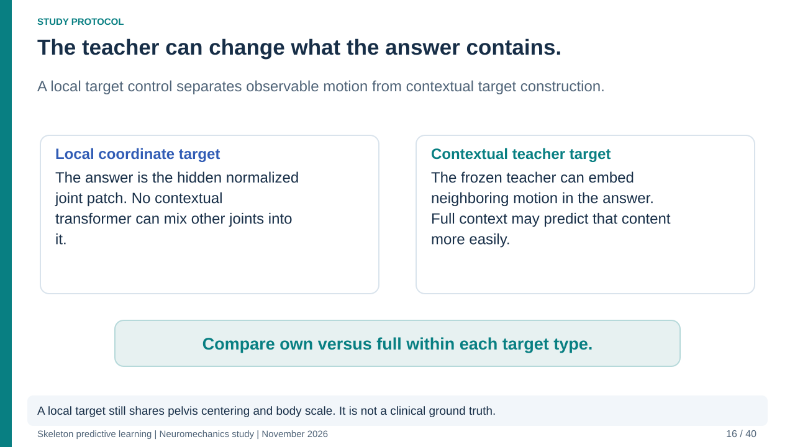

A local target still shares pelvis centering and body scale. It is not a clinical ground truth.

The core study contains coordinate-own, coordinate-full, latent-own and latent-full arms, plus the trained patch-local context control. Freeze teacher parameters, center and temperatures for fair latent comparisons. Coordinate MSE and latent KL have different units. Do not compare their raw magnitudes or select the favorable target after test inspection.

[Implemented study and evaluation protocol](../../../docs/context_study_protocol.md)

## 17. Use a small two-sided profile, fixed before scoring.

**ILLUSTRATIVE PROFILE**

Measure benefit for left-leg, right-leg and arm targets separately.

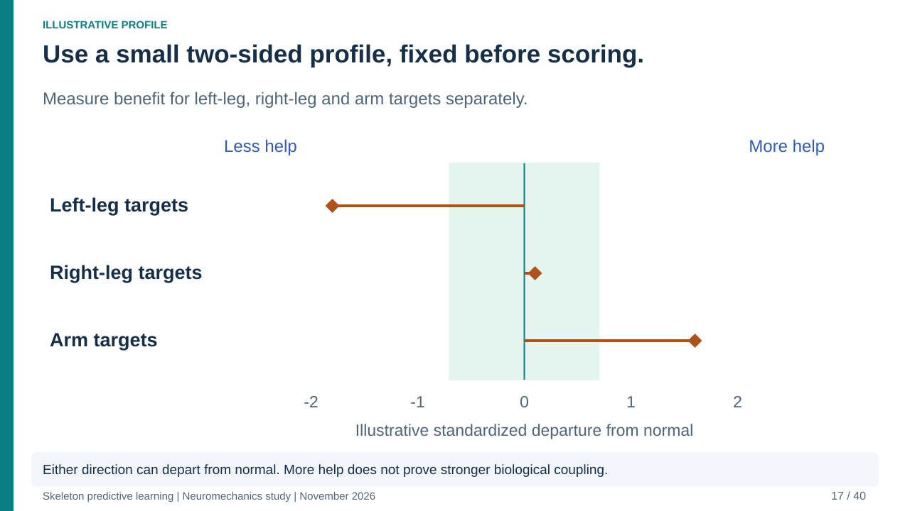

Either direction can depart from normal. More help does not prove stronger biological coupling.

Left targets are 25,27,29,31. Right targets are 26,28,30,32. Arm targets are 13,14,15,16. All four joints receive equal weight within a group. Hips and shoulders remain eligible for training masks and are reported separately because centering can create geometry shortcuts. The profile names target regions, not the input joints responsible for help.

[Implemented study and evaluation protocol](../../../docs/context_study_protocol.md)

## 18. Only inner normal sources define the profile reference.

**STUDY PROTOCOL**

A small diagonal reference can rank departures without pretending to be a clinical normal range.

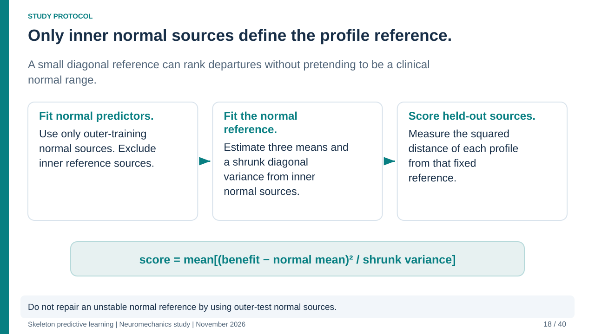

Do not repair an unstable normal reference by using outer-test normal sources.

For group g, use variance .5*v_g+.5*mean(v), floored at 1e-8. Reference means and sample variances are across sources, not windows. Reserve exactly five normal reference sources per fold; leave-one-reference-out sensitivity uses the remaining four. Model schedule selection uses normal development data only. Fit coordinate and latent references separately. This distance is not a calibrated probability.

[Implemented study and evaluation protocol](../../../docs/context_study_protocol.md)

## 19. More overlapping windows do not create independent evidence.

**STUDY PROTOCOL**

A minimum support rule and common cohort are part of the score definition.

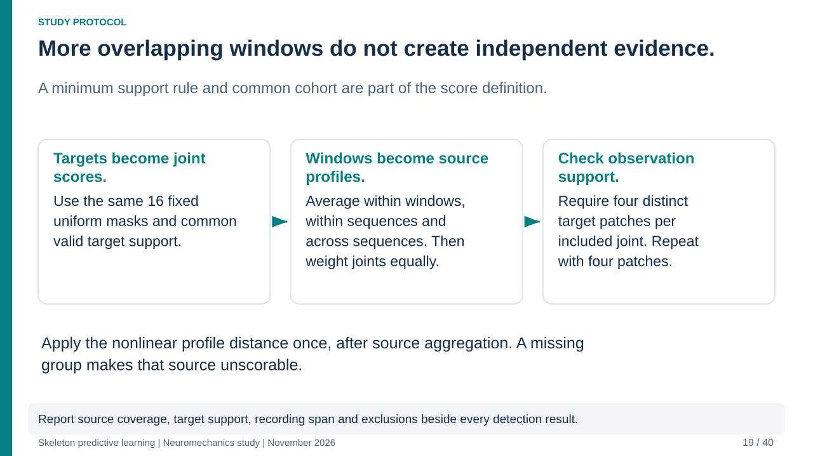

Report source coverage, target support, recording span and exclusions beside every detection result.

Require at least two valid visible patches of the target joint per scored target after uniform sampling. Do not redraw masks. Distinct support identifies sequence/time/joint patches, so repeated masks and overlaps do not inflate its count. The fixed-budget sensitivity samples four eligible patches per joint with a source-keyed seed independent of loss and label. Refit its normal reference with the same budget.

[Implemented study and evaluation protocol](../../../docs/context_study_protocol.md)

## 20. Four source folds reuse scarce normals without training on them.

**STUDY PROTOCOL**

Each source receives one out-of-fold score. All of its sequences keep the same role.

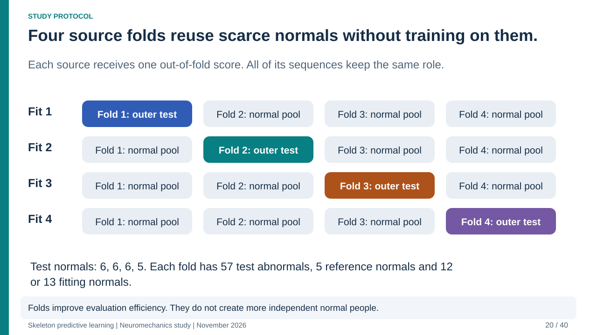

Folds improve evaluation efficiency. They do not create more independent normal people.

This is exploratory internal source cross-fitting. Assign folds after score-independent QC and before scoring. The original population has already been inspected, so a new fold assignment is not automatically untouched confirmatory evidence. All abnormal sources are excluded from normal-only representation and predictor fitting. Source IDs are not verified participant IDs.

[Implemented study and evaluation protocol](../../../docs/context_study_protocol.md)

## 21. The interval must estimate the same metric as the point.

**STUDY PROTOCOL**

Weight within-fold AUROC by the number of normal test sources.

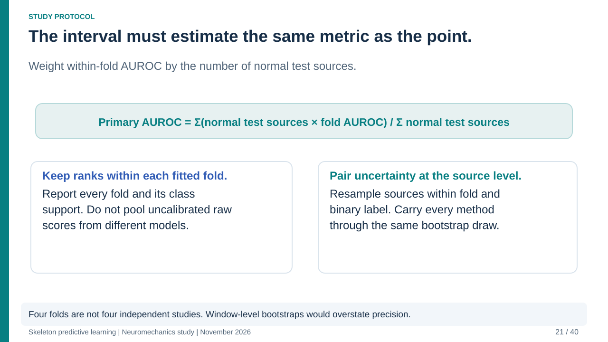

Four folds are not four independent studies. Window-level bootstraps would overstate precision.

This estimand gives each scarce normal test source equal weight in its within-fold abnormal-normal comparisons. The stratified paired bootstrap conditions on fitted models, fold assignments and normal references. It excludes retraining and unknown cross-source participant dependence. Report reference-removal and fixed-budget sensitivity separately. Report AP with abnormal prevalence. Tiny category supports are descriptive.

[Implemented study and evaluation protocol](../../../docs/context_study_protocol.md)

## 22. Compare information and supervision fairly.

**STUDY PROTOCOL**

The benefit profile must improve on more than a weak or differently weighted score.

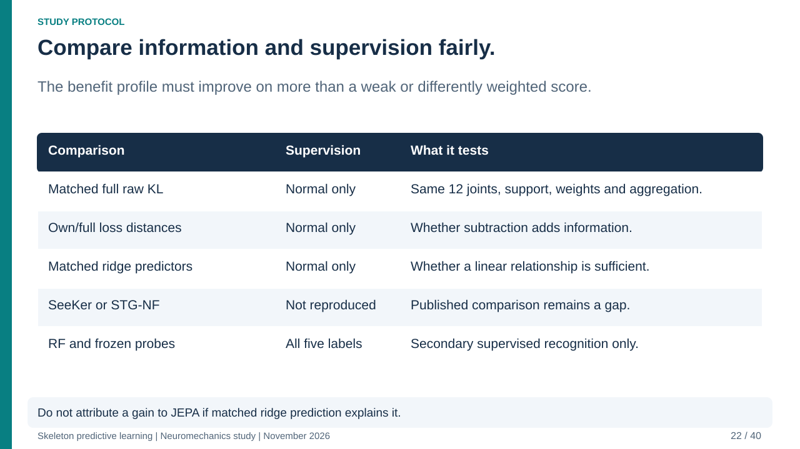

Do not attribute a gain to JEPA if matched ridge prediction explains it.

Keep historical 16-joint raw KL secondary. The primary raw KL comparator must use exactly the profile readout support and equal joint/group weights. Include untrained frozen encoder with identically fitted heads and normal posture/excursion distance where feasible. An inspired baseline is not an exact reproduction. Published normal-only comparisons remain evidence requirements until validated.

[Implemented study and evaluation protocol](../../../docs/context_study_protocol.md), [SeeKer, ICCV 2025](https://openaccess.thecvf.com/content/ICCV2025/html/Delic_Sequential_keypoint_density_estimator_an_overlooked_baseline_of_skeleton-based_video_ICCV_2025_paper.html)

## 23. Interventions test model behavior, not virtual diagnoses.

**IMPLEMENTED DEVELOPMENT DIAGNOSTICS**

Change a sequence in a controlled way, then compare matched targets and observations.

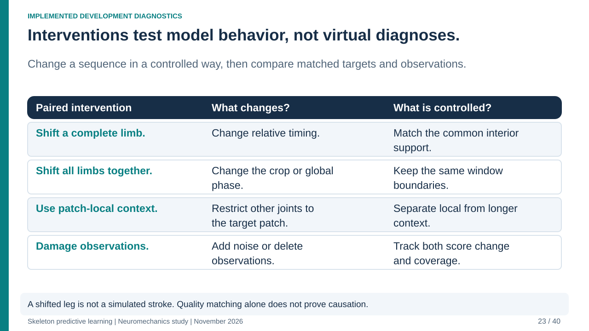

A shifted leg is not a simulated stroke. Quality matching alone does not prove causation.

Relative limb shifts need longer uninterrupted segments, common interior support and articulation checks. Compare with a matched whole-body shift. Observation noise/deletion is a separate axis. Keep normalization reference fixed. Do not claim finite-crop marginals are exactly preserved without checking them. Coordinate noise is not the complete visual pose-error process.

[Implemented study and evaluation protocol](../../../docs/context_study_protocol.md)

## 24. Separate prediction changes from teacher-target changes.

**IMPLEMENTED AND MEASURED RAW-LOSS DIAGNOSTIC**

Hold the local target patch fixed while editing eligible non-target context.

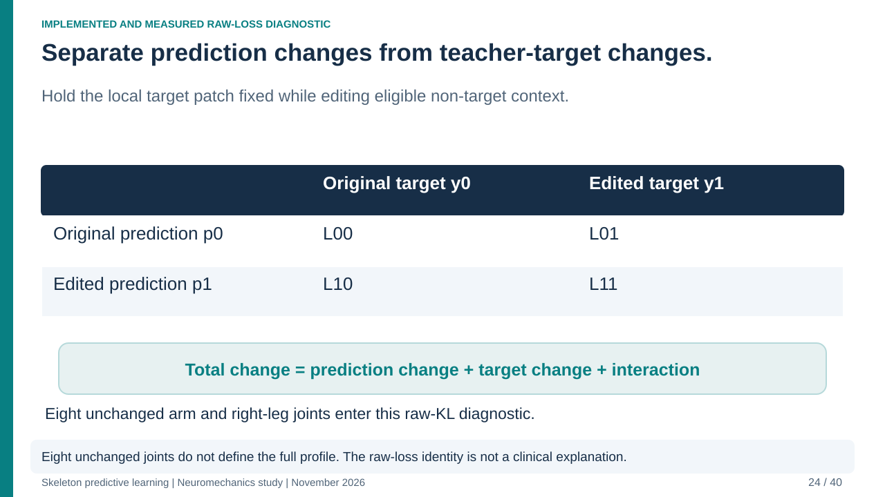

Eight unchanged joints do not define the full profile. The raw-loss identity is not a clinical explanation.

Run run_study_controls.py with --teacher-decomposition. The relative left-leg edit leaves all local measurements and own histories of joints 13,14,15,16,26,28,30,32 unchanged. Prediction change=L10−L00; target change=L01−L00; interaction=L11−L10−L01+L00. Apply per branch, retaining identical masks and paired eligibility. The implementation checks the additive identity and frozen teacher center. Outputs are raw KL components per source and unchanged joint, not the nonlinear three-region profile. Its left-leg group is absent. This is a computational model-loss diagnostic, not disease causality. The real fold-0 run is complete. Its raw own-predictor component is zero on unchanged joints, while teacher-target changes can alter KL. The paired full-profile controls retain five of twelve fitting sources; the raw teacher diagnostic has 87 observed source-joint rows from twelve sources. These are different coverage requirements. Numerical results and limitations appear later.

[Implemented study and evaluation protocol](../../../docs/context_study_protocol.md)

## 25. Visible-phenotype annotations can test interpretation.

**STUDY PROTOCOL**

A description of movement is different from a retrospective medical diagnosis.

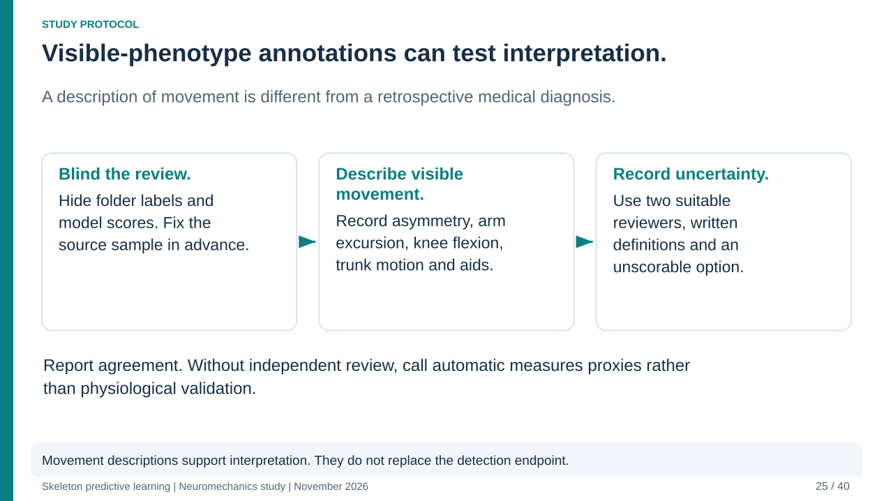

Movement descriptions support interpretation. They do not replace the detection endpoint.

View and pose quality must be recorded. Two seconds may not support reliable gait-cycle timing; phase analysis needs longer validated segments. Reviewers assess observable features, not paretic side, force, strength, dopamine or lesion location. If suitable reviewers are unavailable, do not manufacture annotation evidence.

[Biological motivation and world-model proposal](../../../docs/draft00/neurological_research_direction.md), [Implemented study and evaluation protocol](../../../docs/context_study_protocol.md)

## 26. Each scientific claim needs its own evidence gate.

**STUDY PROTOCOL**

A passing software test does not establish a useful anomaly detector.

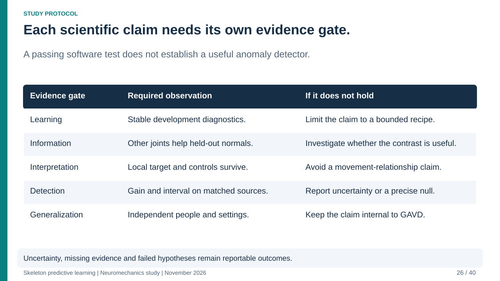

Uncertainty, missing evidence and failed hypotheses remain reportable outcomes.

The roadmap predeclares a 0.05 AUROC improvement target, not a clinical threshold. A positive interval and point estimate of at least 0.05 do not prove that the gain is at least 0.05 unless the lower bound also exceeds it. A wide interval is inconclusive. The earlier study had only five or six normal calibration sources, too few for a finite 5% threshold. Nineteen exchangeable units are only a mathematical minimum. Source grouping does not establish clinical generalization.

[Implemented study and evaluation protocol](../../../docs/context_study_protocol.md)

## 27. The earlier three runs did not establish a learning advantage.

**MEASURED: EARLIER FIVE-CLASS STUDY**

Source-weighted five-class macro-F1 is shown for the completed historical study.

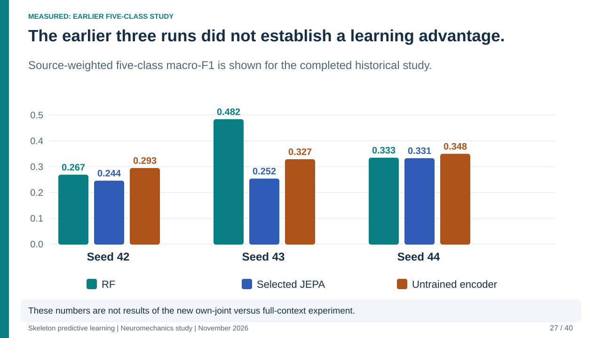

These numbers are not results of the new own-joint versus full-context experiment.

The historical cohort contains 450 sequences, 91 sources and 2,504 windows. All three classifiers use abnormal training labels. RF and the untrained encoder each numerically exceeded the selected JEPA in all three runs. Only 45 to 66 normal updates were used, so this does not establish general JEPA failure. Historical normal-only masked AUROCs were 0.200, 0.604 and 0.583; suffix AUROCs were 0.138, 0.417 and 0.567. These are separate supervision settings.

[Completed earlier three-seed results](../../../docs/results.md)

## 28. The primary result does not establish an advantage.

**MEASURED: PRIMARY 512-UPDATE STUDY**

All 251 sources are paired. Each fold contributes in proportion to its normal count.

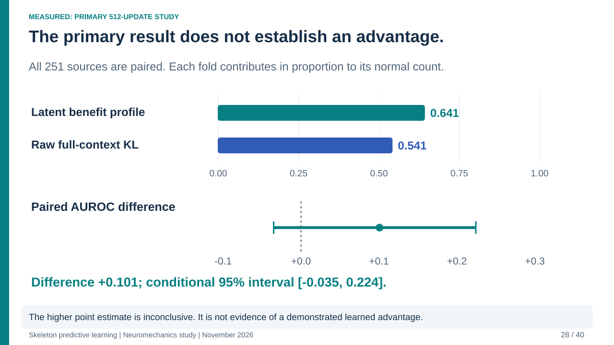

The higher point estimate is inconclusive. It is not evidence of a demonstrated learned advantage.

Run 3044566091261819. Raw and profile scores use the same 12 readout joints, support and source aggregation. The point estimates are normal-count-weighted within-fold AUROCs. The interval is for their paired difference, not either bar. It conditions on fixed models, references and folds, with 1,000 source bootstrap replicates. Only 23 normal test sources occur across the four folds. The interval contains zero.

[Completed source-held-out context results](../../../docs/context_study_results.md), [Primary run and provenance](../../../artifacts/context_study/gavd/3044566091261819/summary.json)

## 29. Constituent scores have higher point estimates.

**MEASURED: MATCHED ALTERNATIVE EXPLANATIONS**

Two-sided reference calibration can explain a gain over an uncalibrated raw loss.

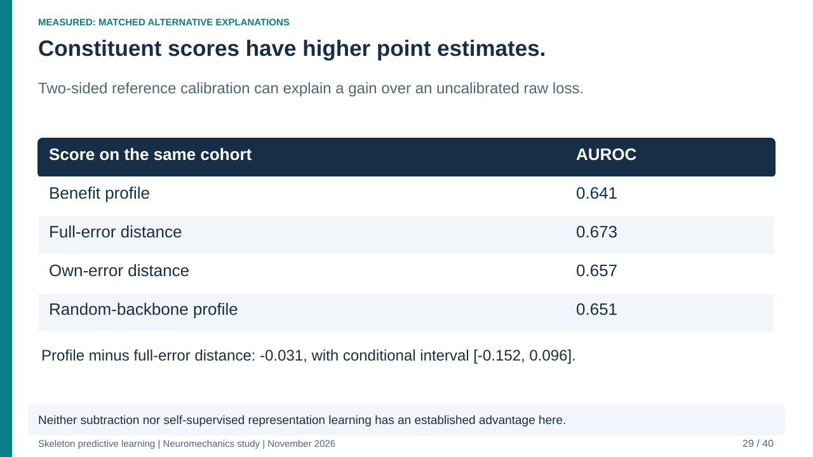

Neither subtraction nor self-supervised representation learning has an established advantage here.

The own/full distance controls preserve the same three regions, standardization and normal reference fitting. Their higher point estimates preclude attributing the raw-score difference specifically to benefit subtraction. Random backbone means no JEPA pretraining but identically fitted heads; its latent targets differ from trained targets. All supporting comparisons are exploratory and unadjusted for multiplicity.

[Completed source-held-out context results](../../../docs/context_study_results.md), [Primary run and provenance](../../../artifacts/context_study/gavd/3044566091261819/summary.json)

## 30. Coordinate targets do not establish a JEPA gain either.

**MEASURED: LOCAL-TARGET COMPARISON**

The local-target control removes the contextual teacher from the prediction answer.

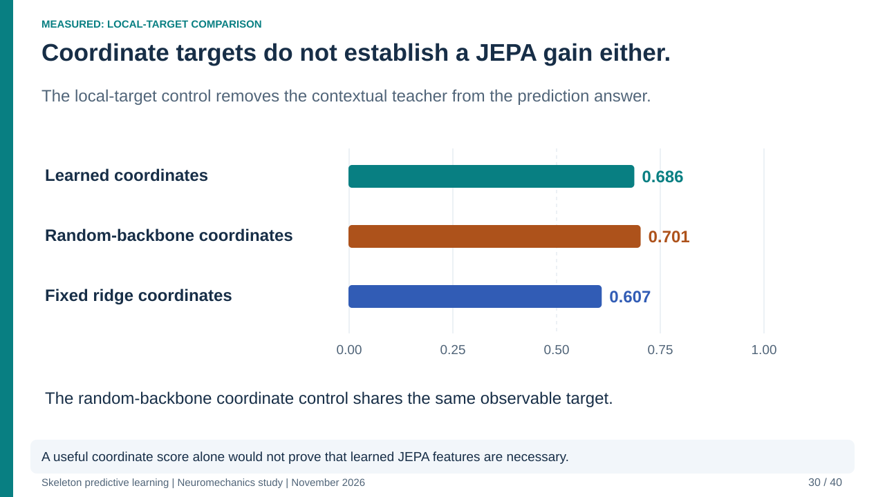

A useful coordinate score alone would not prove that learned JEPA features are necessary.

All values are profile-distance AUROCs. Coordinate MSE and latent KL have different units; their raw losses are not compared. Ridge uses fixed alpha 10 and 256 source-balanced draws, with different parameter sharing and training support. This limited ridge setting is not an optimization-equated baseline. No external published anomaly method has been validated on this protocol.

[Completed source-held-out context results](../../../docs/context_study_results.md), [Primary run and provenance](../../../artifacts/context_study/gavd/3044566091261819/summary.json)

## 31. Observation support and the normal reference matter.

**MEASURED: SUPPORT AND REFERENCE SENSITIVITY**

Five inner normal sources define each fitted reference.

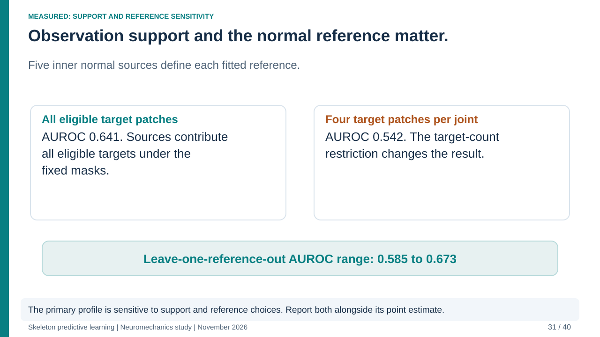

The primary profile is sensitive to support and reference choices. Report both alongside its point estimate.

The reference range combines the smallest or largest fold AUROC after omitting one reference source per fold; it is a perturbation range, not a confidence interval. Models remain fixed. Four distinct annotated patches per joint do not equalize context, overlap exposures, recording duration or precision. Reference source omissions do not create independent studies.

[Completed source-held-out context results](../../../docs/context_study_results.md), [Primary run and provenance](../../../artifacts/context_study/gavd/3044566091261819/summary.json)

## 32. A simple motion control is competitive.

**MEASURED: SUPPLEMENTARY SOURCE CONTROLS**

Source controls use the same 251 sources and outer source roles.

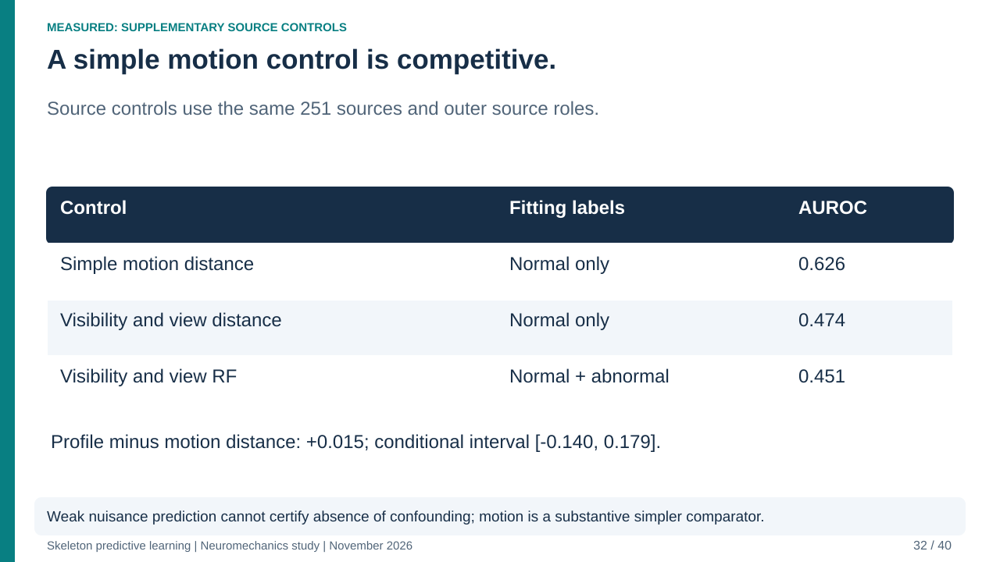

Weak nuisance prediction cannot certify absence of confounding; motion is a substantive simpler comparator.

Motion uses normal-source-fitted standardized motion features and covariance distance. Nuisance features represent availability and view. The nuisance RF receives binary abnormal training labels and is a separately supervised shortcut diagnostic. Its weak result does not prove that the neural score is free of unmeasured acquisition confounding. Four test sources have views absent from the normal fitting vocabulary. These are unadjusted supplementary comparisons.

[Supplementary motion and observation controls](../../../artifacts/context_study/gavd/3044566091261819/source_controls/7407af320461a092/summary.json), [Completed source-held-out context results](../../../docs/context_study_results.md)

## 33. Exercise separates more strongly than the focal families.

**MEASURED: DESCRIPTIVE CATEGORY ANALYSIS**

The primary endpoint includes every non-normal folder, including nonpathological circumstances.

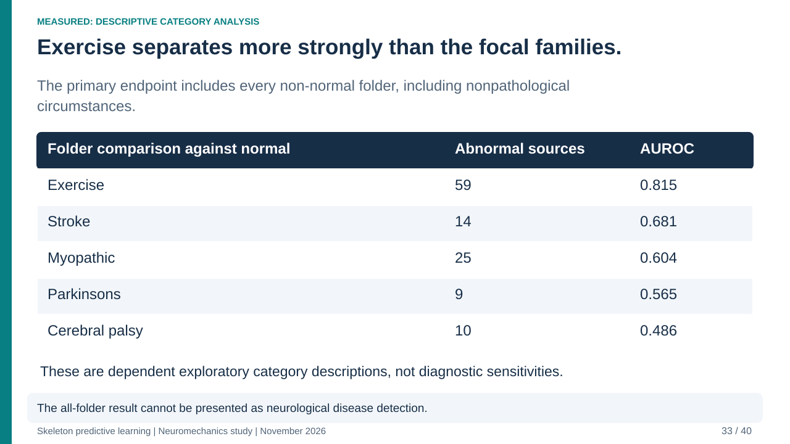

The all-folder result cannot be presented as neurological disease detection.

All five displayed categories have four supported folds. Every category comparison reuses normal sources, and mixed-category abnormal sources can also be reused. Category sample sizes are small. The observed variation does not identify an affected neural system, and a category AUROC is not a clinical diagnostic accuracy. Other folders and sparse categories remain in the full report.

[Completed source-held-out context results](../../../docs/context_study_results.md), [Primary run and provenance](../../../artifacts/context_study/gavd/3044566091261819/summary.json)

## 34. The supervised capstone favors the Random Forest.

**MEASURED: SEPARATELY SUPERVISED CLASSIFICATION**

Normal plus four focal labels define a separate five-class recognition task.

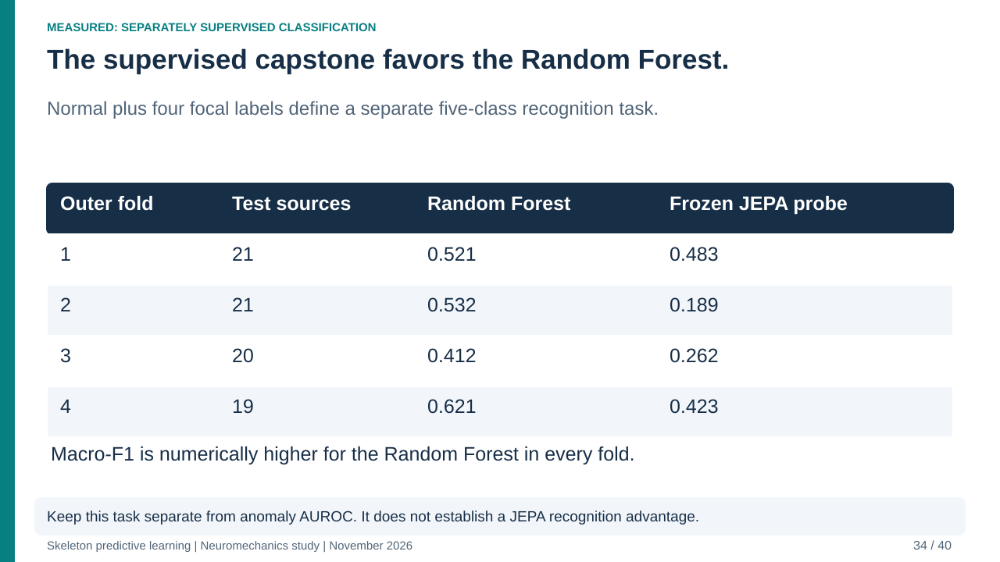

Keep this task separate from anomaly AUROC. It does not establish a JEPA recognition advantage.

Both methods receive abnormal-condition training labels and share outer folds and test support. Inner normal reference sources remain excluded from fitting. Source-label pairs share one total source weight, after averaging windows within sequences. The JEPA representation is frozen after normal-only pretraining. These are per-fold descriptive macro-F1 values, not the normal-only ranking metric or a significance test. The 4096-head sensitivity does not change these classifiers because it retains the pretrained encoder.

[Completed source-held-out context results](../../../docs/context_study_results.md), [Primary run and provenance](../../../artifacts/context_study/gavd/3044566091261819/summary.json)

## 35. The real diagnostic shows a contextual target effect.

**MEASURED: DEVELOPMENT DIAGNOSTICS, FOLD 1**

The left-leg timing edit preserves the eight measured arm and right-leg targets.

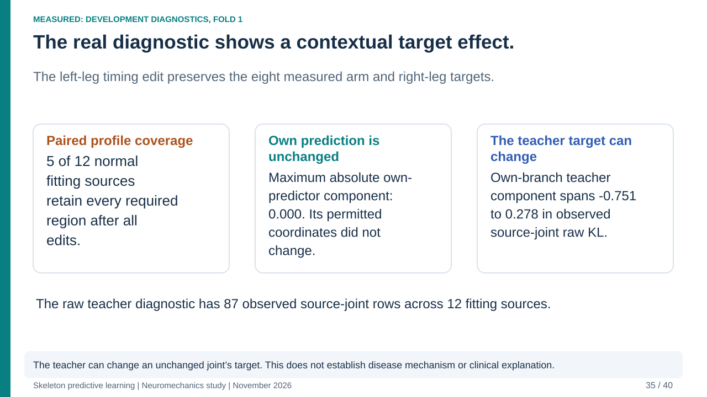

The teacher can change an unchanged joint’s target. This does not establish disease mechanism or clinical explanation.

The paired full-profile control requires joint support common to all edits and leaves only five of twelve training sources scorable. This coverage is distinct from the raw eight-joint teacher diagnostic, which has eligible rows from all twelve but incomplete source-joint combinations. The own prediction component is exactly zero, while teacher-target KL can change under an edited left leg. The component range is across observed source-joint summaries, not an interval or population statistic. The identity is algebraic, not mechanism validation. These are training-normal diagnostics, not held-out tests, virtual diagnoses or a decomposition of the nonlinear three-region score.

[Real development and teacher diagnostics](../../../artifacts/context_study/gavd/3044566091261819/fold_0/development_controls/protocol.json), [Completed source-held-out context results](../../../docs/context_study_results.md)

## 36. Longer head fitting does not settle the claim.

**MEASURED: NORMAL-DIAGNOSTIC-MOTIVATED SENSITIVITY**

The 512-head-update run stays primary. Both runs retain the same 512-update JEPA pretraining.

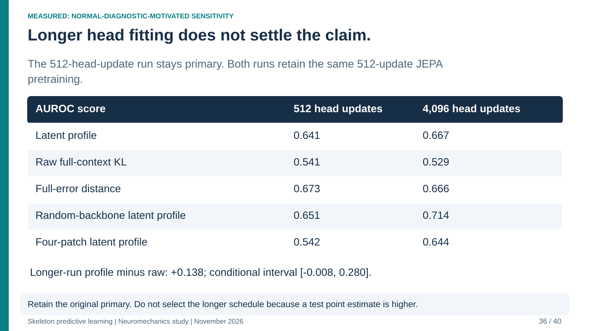

Retain the original primary. Do not select the longer schedule because a test point estimate is higher.

Run eba2bd5a6e05efa1 uses 4096 updates per head. It was launched because the 512-update normal coordinate full error exceeded own error in every fold, before abnormal ranking results were inspected. The primary recipe remains unchanged. The longer-run conditional interval still includes zero; full-error distance is essentially tied with the proposed profile, and random-backbone latent profile has a higher point estimate. This sensitivity is not a new co-primary endpoint and does not establish convergence.

[4096-head-update sensitivity and provenance](../../../artifacts/context_study/gavd/eba2bd5a6e05efa1/summary.json), [Completed source-held-out context results](../../../docs/context_study_results.md)

## 37. Normal predictive adequacy remains unresolved.

**MEASURED: LEARNING ADEQUACY**

Validation uses fixed normal development draws. These are coordinate MSE diagnostics.

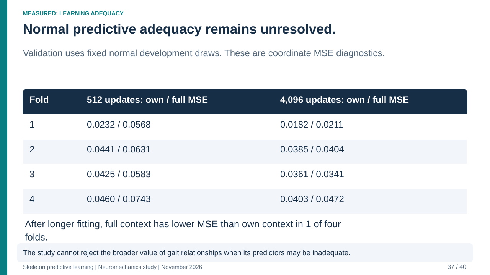

The study cannot reject the broader value of gait relationships when its predictors may be inadequate.

Additional raw input cannot increase optimal Bayes squared-error risk when the ideal predictor can ignore it. Our frozen transformer re-encodes context separately, so memories are not guaranteed nested; finite heads can underfit or overfit. Normal negative benefit concerns these fitted learners, not harm from biological coordination. The longer schedule reduces error, but does not demonstrate the intended predictive ordering across folds. These are sampled batch-averaged normal-development diagnostics, not source-level anomaly metrics.

[4096-head-update sensitivity and provenance](../../../artifacts/context_study/gavd/eba2bd5a6e05efa1/summary.json), [Primary run and provenance](../../../artifacts/context_study/gavd/3044566091261819/summary.json)

## 38. A longer-term world model would represent the forward process.

**LONGER-TERM PROPOSAL**

Control, body mechanics, state feedback and observation are separate modeling components.

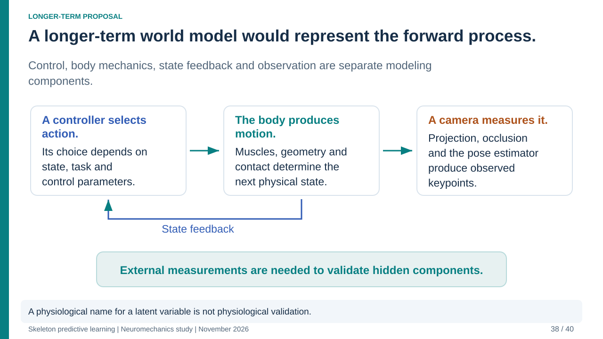

A physiological name for a latent variable is not physiological validation.

This is not the current JEPA architecture. A physical forward model needs validated dynamics, contact, controller and observation assumptions. GAVD supplies projected observations but does not identify forces, muscle strength or controller parameters. Additional simulation and clinical measurements are necessary.

[Biological motivation and world-model proposal](../../../docs/draft00/neurological_research_direction.md)

## 39. Preserve multiple explanations when the video is ambiguous.

**LONGER-TERM PROPOSAL**

Ask which additional measurement would distinguish compatible mechanisms.

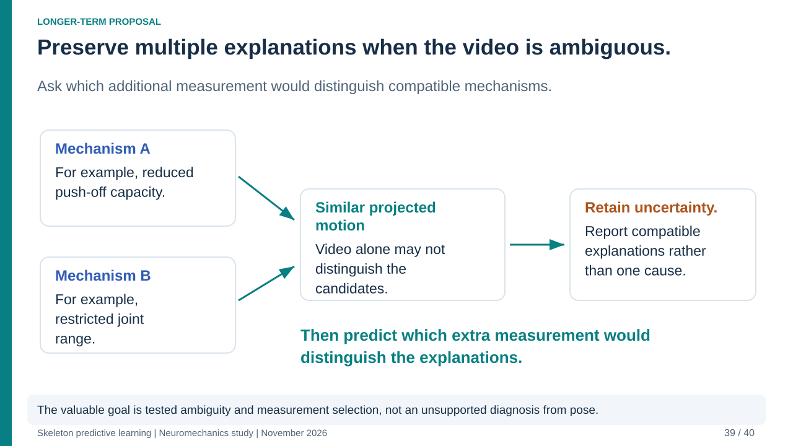

The valuable goal is tested ambiguity and measurement selection, not an unsupported diagnosis from pose.

The diagram is a candidate benchmark design, not an established pair of clinically equivalent conditions. Distinct control and body parameters may produce similar projected motion. A useful posterior would retain ambiguity and predict the value of additional measurements. Simulation parameter recovery and clinical validation are different evidence levels. Generating gait from weakness already has prior art.

[Biological motivation and world-model proposal](../../../docs/draft00/neurological_research_direction.md)

## 40. Build a paper around the demonstrated limitations.

**EVIDENCE AND SUBMISSION**

The workshop deadline is November 20, 2026, verified on the official site on November 15.

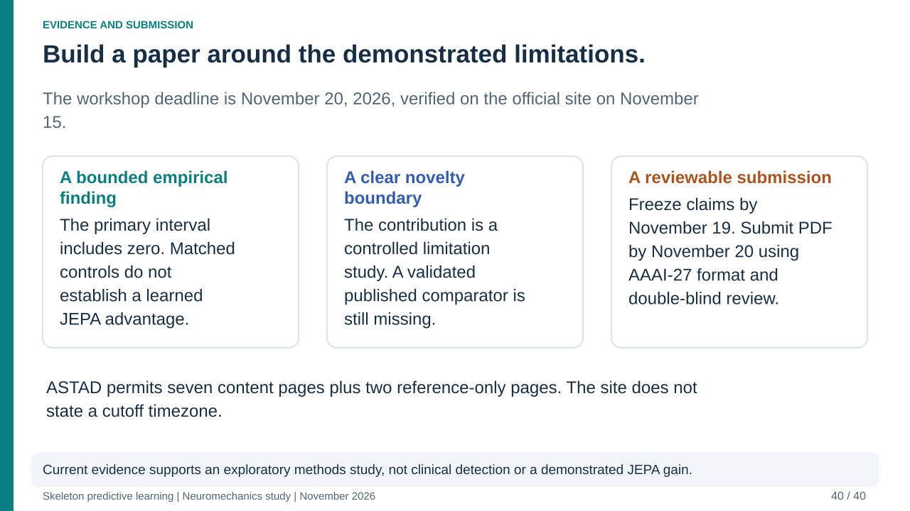

Current evidence supports an exploratory methods study, not clinical detection or a demonstrated JEPA gain.

Normal-only gait modeling, masking, VICReg, positional noise and confidence weighting have prior art. Novelty must be a demonstrated mechanism, useful comparison or bounded empirical insight. Do not promise clinical diagnosis, future falls or population generalizability. Verify the exact OpenReview cutoff before upload. Archival proceedings are intended but not confirmed.

[ASTAD4 call, checked November 15, 2026](https://ismart.ece.mcgill.ca/astad4/), [FSGait, ACCV 2024](https://link.springer.com/chapter/10.1007/978-981-96-0960-4_19), [SeeKer, ICCV 2025](https://openaccess.thecvf.com/content/ICCV2025/html/Delic_Sequential_keypoint_density_estimator_an_overlooked_baseline_of_skeleton-based_video_ICCV_2025_paper.html), [Skeleton S-JEPA, ECCV 2024](https://www.ecva.net/papers/eccv_2024/papers_ECCV/papers/04755.pdf), [Manuscript source evidence and claim limits](../../../docs/draft01/primary_source_claim_map.md), [Completed source-held-out context results](../../../docs/context_study_results.md)
