# Gait prediction: proposed second iteration

This deck distinguishes completed draft01 measurements, read-only availability checks and new proposals. Notebooks 12 through 17 and the proposed residual models have not been implemented or run. The exact historical 40-page deck is preserved in [the completed draft01 archive](../draft01_completed/tutorial.pdf).

[Open the current PDF](tutorial.pdf) or [the offline slide viewer](index.html).

## 01. Can the other leg improve a reliable local prediction?

**Status: PROPOSED NEXT ITERATION.**

The next study asks whether projected cross-leg relationships add useful information beyond movement size, posture and local geometry.

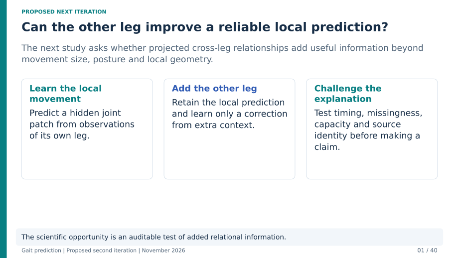

This is a proposed second iteration. It has not been implemented or evaluated. Neurological reasoning motivates observable comparisons; projected video does not identify a neural lesion or establish a clinical diagnosis.

**The scientific opportunity is an auditable test of added relational information.**

Sources: [Canonical next-iteration instructions](../../../../../notes/aaai/05-iterate-02-INSTR.md) · [Working design and scientific scope](../../../docs/iteration02/design_brief.md)

## 02. The completed result does not establish an improvement.

**Status: MEASURED DRAFT01 RESULT.**

The primary completed run includes 251 sources, of which only 23 have a normal label.

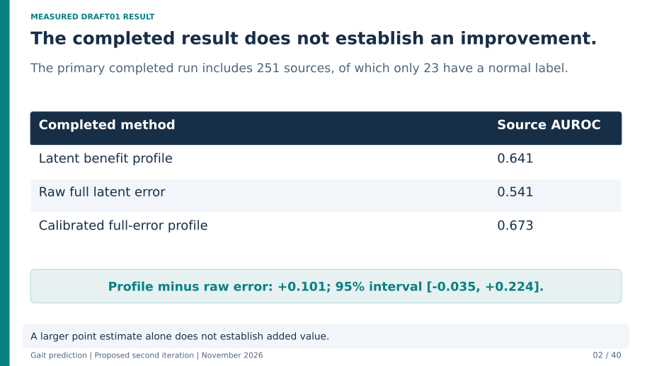

These are completed source-level results from run 3044566091261819, not outcomes of the proposed method. The paired source bootstrap interval conditions on the trained models, reference sets and fixed folds. It crosses zero. Calibrated full-error distance also exceeds the latent benefit profile point estimate. The AUROC is computed over all non-normal folders in the historical endpoint.

**A larger point estimate alone does not establish added value.**

Sources: [Completed draft01 results](../../../docs/context_study_results.md) · [Completed draft01 manuscript](../../../docs/draft01/manuscript.pdf)

## 03. A random encoder matches or exceeds the learned one.

**Status: MEASURED DRAFT01 RESULT.**

A common coordinate target makes the encoder comparison more interpretable than comparing separate latent target spaces.

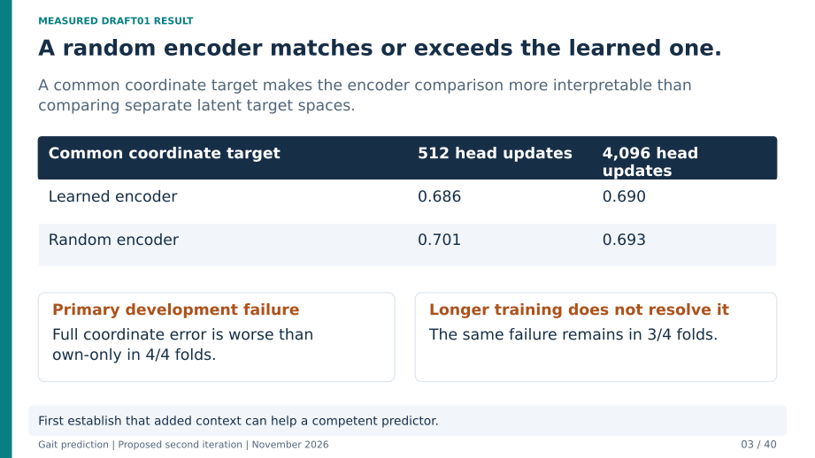

The longer-budget sensitivity changes predictor training, not the source-level sample size. The learned contextual predictor has not yet shown reliable predictive competence on normal development data. A poor context model can create an apparent abnormality score without measuring a meaningful biological relation.

**First establish that added context can help a competent predictor.**

Sources: [Completed draft01 results](../../../docs/context_study_results.md) · [Completed sensitivity results](../../../docs/context_study_sensitivity.md) · [Methodological advice](../../../docs/iteration02/advice_method.md)

## 04. Keep three evidence statuses separate.

**Status: EVIDENCE AND PROVENANCE.**

Completed efficacy, read-only feasibility and a research proposal answer different questions.

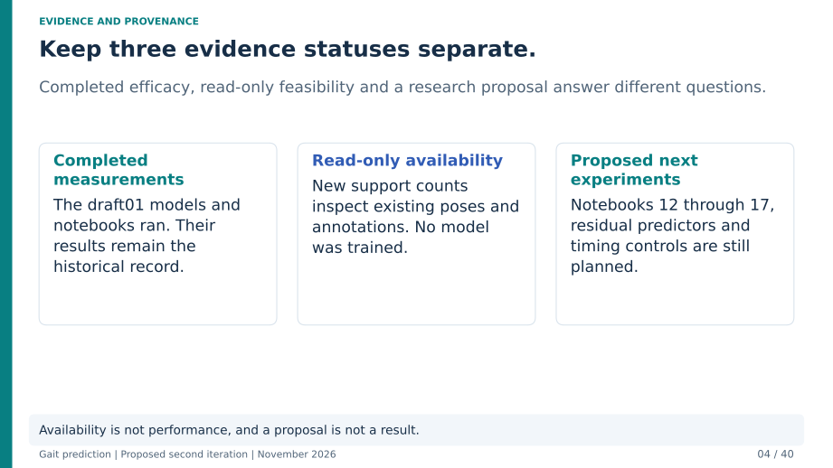

The new deck is a planning document. It must not be cited as a new accuracy result or a completed validation. The exact prior 40-page deck is preserved under archive/draft01_completed.

**Availability is not performance, and a proposal is not a result.**

Sources: [Completed execution validation](../../../docs/current_execution_validation.md) · [Read-only availability calculations](../../../docs/iteration02/data_feasibility_probe.json) · [Canonical next-iteration instructions](../../../../../notes/aaai/05-iterate-02-INSTR.md)

## 05. Different origins can produce overlapping visible adaptations.

**Status: NEUROLOGICAL RATIONALE.**

A neurological or muscle mechanism can motivate a measurement without making that measurement a diagnosis.

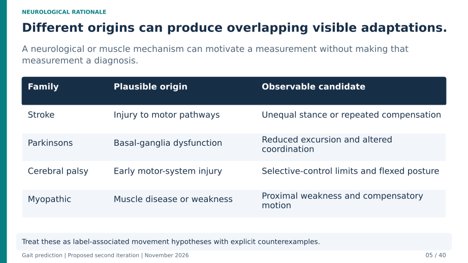

Stroke can alter selective activation, strength and balance. Parkinson disease can affect automatic movement and movement amplitude. Cerebral palsy involves heterogeneous early motor-system injury and secondary musculoskeletal changes. Myopathic is a broad muscle-disease label, not one neurological lesion. The Duchenne study is a mechanistic example, not evidence that every GAVD myopathic sequence has Duchenne muscular dystrophy. Camera view, speed, aids and individual compensation can create overlapping projected signatures.

**Treat these as label-associated movement hypotheses with explicit counterexamples.**

Sources: [Neurological evidence and novelty advice](../../../docs/iteration02/advice_neuro.md) · [Stroke coordination and temporal symmetry](https://pubmed.ncbi.nlm.nih.gov/38709654/) · [PD arm amplitude, symmetry and coordination](https://pubmed.ncbi.nlm.nih.gov/25502948/) · [Selective motor control and gait in CP](https://pubmed.ncbi.nlm.nih.gov/27889619/) · [Longitudinal Duchenne muscle and gait observations](https://link.springer.com/article/10.1186/s12984-025-01718-5)

## 06. A regular movement can still differ from typical gait.

**Status: ILLUSTRATION OF THE PROPOSED STUDY.**

Small movement, unusual timing and stable compensation require different tests.

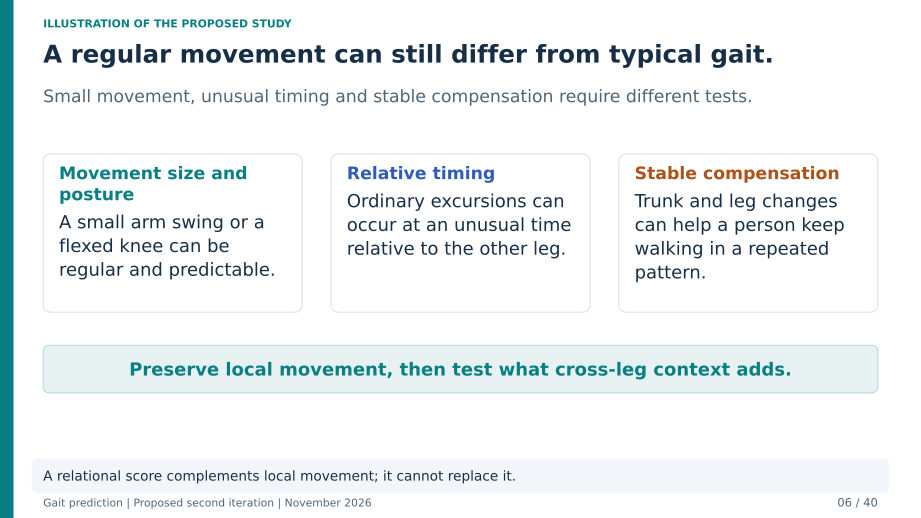

Example one: a person with small but regular arm swing may have a local amplitude difference while cross-leg prediction remains accurate. Example two: ordinary leg excursion may occur at an unusual relative time. Example three: repeated trunk compensation can make movement more predictable despite a marked impairment. None of these signs uniquely identifies a condition.

**A relational score complements local movement; it cannot replace it.**

Sources: [Neurological evidence and novelty advice](../../../docs/iteration02/advice_neuro.md) · [PD arm amplitude, symmetry and coordination](https://pubmed.ncbi.nlm.nih.gov/25502948/) · [Stroke coordination and temporal symmetry](https://pubmed.ncbi.nlm.nih.gov/38709654/)

## 07. Normal-only masked gait modeling is already established.

**Status: NOVELTY BOUNDARY.**

Using a world-model label or adding another mask is not enough to distinguish the paper.

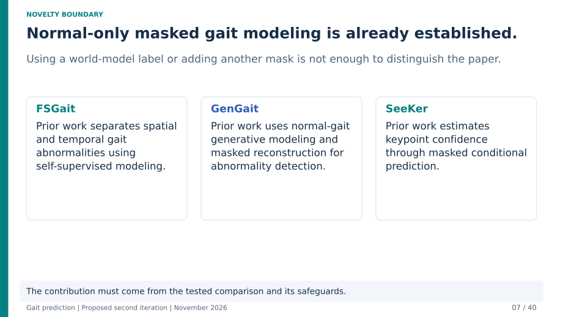

Read and cite the primary papers. The proposed study must outperform and explain stronger matched baselines before attributing value to the encoder. GenGait has an available author manuscript and publisher record; publication timing does not establish its applicability or our performance against it.

**The contribution must come from the tested comparison and its safeguards.**

Sources: [FSGait](https://openaccess.thecvf.com/content/ACCV2024/html/Duan_FSGait_Fine_Grained_Self-Supervised_Gait_Abnormality_Detection_ACCV_2024_paper.html) · [GenGait author manuscript](https://arxiv.org/abs/2604.01997v2) · [SeeKer](https://arxiv.org/abs/2506.18368) · [Published-baseline feasibility audit](../../../docs/published_baseline_feasibility.md)

## 08. Coordination and dependence scores also have close precedents.

**Status: NOVELTY BOUNDARY.**

The plausible new contribution is a careful separation of local motion, extra information and predictor failure.

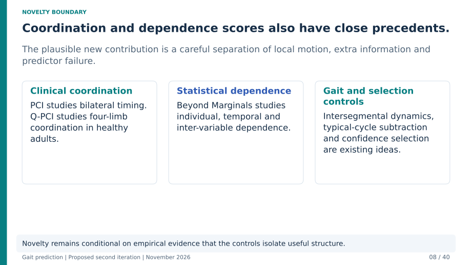

Q-PCI was evaluated in healthy adults and must not be presented as established PD or CP clinical evidence. The LTI asymmetry study is a small preprint. The recent confidence-filtering study directly motivates measuring the selection shift caused by support gates. No claim of being the first phase or dependence-based gait method is supported.

**Novelty remains conditional on empirical evidence that the controls isolate useful structure.**

Sources: [Original bilateral phase coordination study](https://pubmed.ncbi.nlm.nih.gov/17503027/) · [Four-limb coordination in healthy adults](https://pmc.ncbi.nlm.nih.gov/articles/PMC11435969/) · [Beyond Marginals](https://arxiv.org/abs/2509.15033) · [Intersegmental LTI asymmetry metric](https://arxiv.org/abs/2505.10869) · [Typical-cycle representation and lightweight ST-GCN](https://homepages.inf.ed.ac.uk/rbf/PAPERS/lochheadcbm24.pdf) · [Confidence filtering and selection shift](https://arxiv.org/abs/2610.39704)

## 09. Follow the existing ingestion pipeline and inspect its weak points.

**Status: VERIFIED INGESTION DESIGN.**

A single cached source video can appear in multiple labeled sequences. Source identity must follow every derived window.

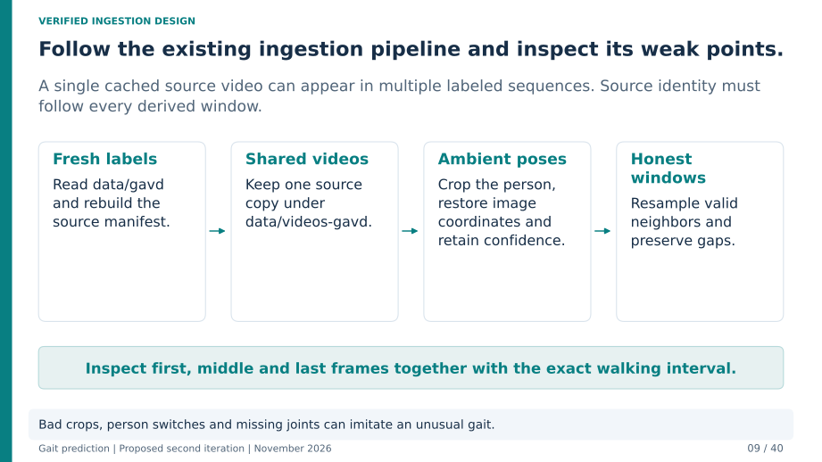

The study manifest reads the refreshed condition folders. ambient.utils.youtube_cache.download_youtube_urls downloads videos. Ambient SequenceKeypointExtractor uses MediaPipe IMAGE mode and the first pose in a crop, so it is not a validated temporal person tracker. The ingestion code handles one-based annotation frames, scaled bounding boxes and a small crop margin. Use raw image coordinates for new prefix-based normalization. Preserve confidence and interpolation provenance. Never store duplicate condition-specific source videos.

**Bad crops, person switches and missing joints can imitate an unusual gait.**

Sources: [Read-only data and ingestion review](../../../docs/iteration02/advice_data.md) · [Canonical next-iteration instructions](../../../../../notes/aaai/05-iterate-02-INSTR.md)

## 10. More supported sources do not create independent validation.

**Status: READ-ONLY AVAILABILITY, NOT NEW MODEL RESULTS.**

The lower-leg readout improves coverage without requiring reliable arm observations for every score.

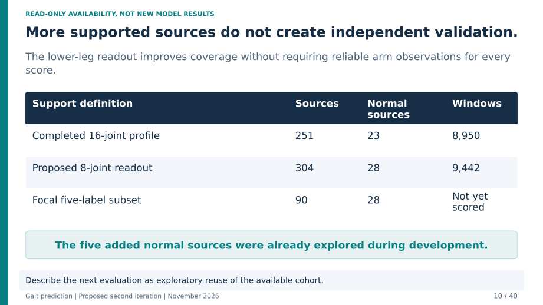

The candidate readout includes BlazePose indices 25 through 32 and requires four distinct usable patches per joint. Inputs and uniform training masks still cover the original 16-joint allowlist. The read-only candidate cohort has 304 sources, 28 normal sources, 1,381 sequences and 9,442 windows. The five recovered normal sources were excluded previously by arm support. All 28 normal sources have appeared in prior exploration. Source identity is only a proxy for a person; person independence is not established.

**Describe the next evaluation as exploratory reuse of the available cohort.**

Sources: [Read-only availability calculations](../../../docs/iteration02/data_feasibility_probe.json) · [Read-only data and ingestion review](../../../docs/iteration02/advice_data.md)

## 11. Longer windows sharply reduce the normal evidence.

**Status: READ-ONLY AVAILABILITY, NOT NEW MODEL RESULTS.**

These upper-bound counts precede the final joint-profile and phase-reliability gates.

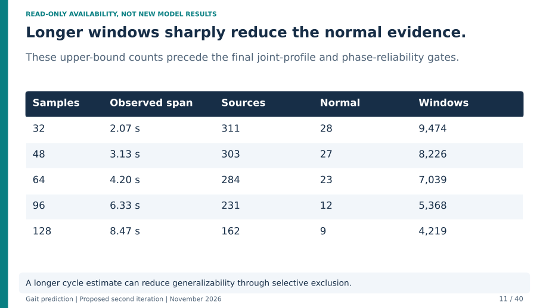

The sample span is (samples minus one) divided by 15 Hz. It is not samples divided by 15. At 96 samples, only 12 normal sources survive the initial rewindowing probe. The 32-sample upper-bound cohort has 311 sources before the eight-joint readout gate, compared with 304 after that gate. The analysis must not confuse these two denominators. Keep 32 samples as the main proposed setting. Treat phase analyses as optional, separately reported subsets.

**A longer cycle estimate can reduce generalizability through selective exclusion.**

Sources: [Read-only availability calculations](../../../docs/iteration02/data_feasibility_probe.json) · [Read-only data and ingestion review](../../../docs/iteration02/advice_data.md)

## 12. The contact labels cannot validate normal phase estimation.

**Status: READ-ONLY ANNOTATION AUDIT.**

They are useful auxiliary annotations, but their source and condition coverage is limited.

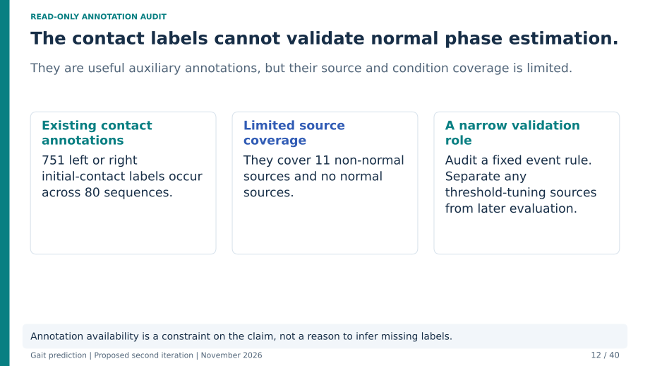

The event inventory also contains seven other nonempty rows. The 751 initial contacts are not 751 independent subjects. If abnormal contact labels influence a phase estimator or reliability threshold, this is supervised development on abnormal sources. Reserve these sources from the relevant evaluation and label the analysis accordingly. Do not silently describe such a pipeline as fully normal-only.

**Annotation availability is a constraint on the claim, not a reason to infer missing labels.**

Sources: [Read-only availability calculations](../../../docs/iteration02/data_feasibility_probe.json) · [Read-only data and ingestion review](../../../docs/iteration02/advice_data.md) · [Methodological advice](../../../docs/iteration02/advice_method.md)

## 13. Keep the mask allowlist and readout set explicit.

**Status: PROPOSED NEXT ITERATION.**

The table groups left and right pairs for space. The notebook must also print all 16 individual indices in numerical order.

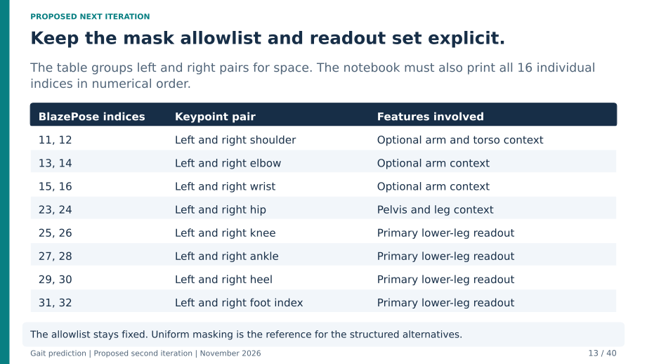

The U reference masks uniformly over indices 11 through 16 and 23 through 32. J and A use declared structured masks on that identical allowlist, without motion-intensity or velocity weighting. No other joints may become masked prediction targets. The candidate score readout is the subset 25 through 32. Removing arm observations from a required score is separate from the declared training-mask comparison.

**The allowlist stays fixed. Uniform masking is the reference for the structured alternatives.**

Sources: [Canonical next-iteration instructions](../../../../../notes/aaai/05-iterate-02-INSTR.md) · [Read-only data and ingestion review](../../../docs/iteration02/advice_data.md)

## 14. Structured masking is established. Test its added value.

**Status: MASKING PRIOR ART AND PROPOSED TEST.**

The literature supports alternatives, but no cited action-recognition result establishes the best mask for pathological gait.

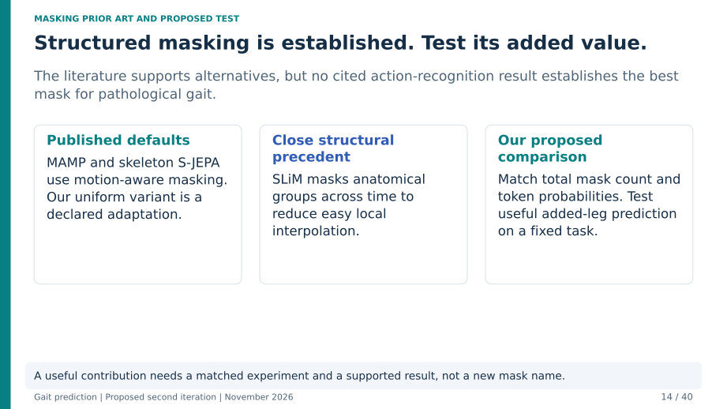

The original S-JEPA uses a 0.9 motion-aware mask on resized 120-frame action sequences. Our 32-frame, 16-joint projected gait input does not justify copying that ratio. The current SLiM author record identifies NeurIPS 2026 and its semantic tube strategy is close prior art. ASMa uses motion and topology and is reported as TMLR 2026 by its authors. U, J and A are controlled motion-independent adaptations, not reproductions of those complete systems. Do not claim a new anatomical tube or state-of-the-art gait accuracy.

**A useful contribution needs a matched experiment and a supported result, not a new mask name.**

Sources: [Controlled masking methods review](../../../docs/iteration02/masking_method_review.md) · [Masking and neurological interpretation](../../../docs/iteration02/masking_neuro_review.md) · [MAMP primary paper](https://arxiv.org/abs/2308.07092) · [Skeleton S-JEPA primary paper](https://www.ecva.net/papers/eccv_2024/papers_ECCV/papers/04755.pdf) · [SLiM current author manuscript](https://arxiv.org/html/2603.10648v4) · [ASMa author publication record](https://23wm13.github.io/ASMa/)

## 15. Every recipe hides exactly 64 of the same 128 tokens.

**Status: ILLUSTRATIVE MASKS, NOT MODEL RESULTS.**

U samples freely. J and A first hide an eight-token core, then uniformly sample 56 of the remaining 120 tokens.

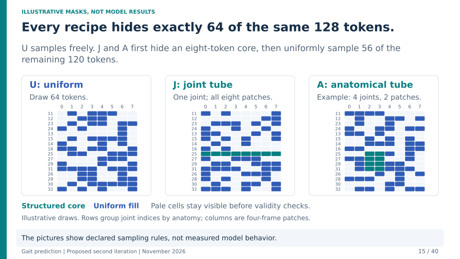

A 32-sample window contains eight four-frame temporal patches and the same 16 allowed joints. U samples 64 distinct token positions uniformly. J selects one joint uniformly and masks all eight temporal positions. A selects an anatomical group with probability equal to its width divided by 16, then an aligned nonwrapping temporal block of length eight divided by its width. Both structured families fill 56 further positions uniformly without replacement. The pictured A draw is one distal-leg example; A also samples the torso and arm groups. Mask generation cannot read motion, confidence, labels or loss. The graphic groups row labels by anatomy for readability and does not redefine the index mapping.

**The pictures show declared sampling rules, not measured model behavior.**

Sources: [Controlled masking methods review](../../../docs/iteration02/masking_method_review.md) · [Canonical next-iteration instructions](../../../../../notes/aaai/05-iterate-02-INSTR.md)

## 16. Match how often each token is hidden.

**Status: PROPOSED NEXT ITERATION.**

For two-patch cores, starts are 0, 2, 4 or 6. For four-patch cores, starts are 0 or 4. No interval wraps.

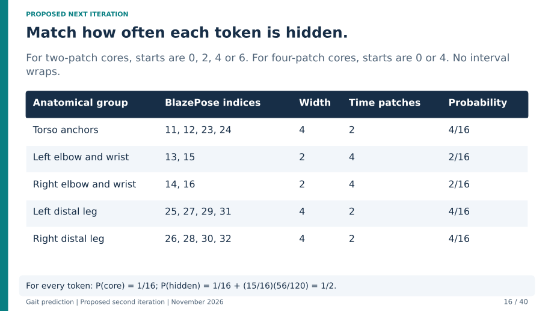

The five groups are disjoint and cover exactly the 16 allowed joints. For a group of width w, choose it with probability w/16 and choose one of the aligned blocks of length h=8/w uniformly. Every token therefore enters the core with probability (w/16)*(h/8)=1/16. After uniform fill, its hidden probability is 1/16+(15/16)*(56/120)=1/2. J has the same core and final marginal probabilities. This matches first-order token probabilities and exact budgets, not higher-order dependence, valid support or task difficulty. Torso or filler masks can hide hip tokens. All branches remain conditional on the explicitly shared body reference Q; no additional hidden hip may enter a derived feature.

**For every token: P(core) = 1/16; P(hidden) = 1/16 + (15/16)(56/120) = 1/2.**

Sources: [Controlled masking methods review](../../../docs/iteration02/masking_method_review.md) · [Canonical next-iteration instructions](../../../../../notes/aaai/05-iterate-02-INSTR.md)

## 17. Evaluate every training arm on the same frozen masks.

**Status: ILLUSTRATION OF THE PROPOSED COMPARISON.**

Compare U, J and A within an evaluation column. Native-mask versus native-mask scores answer different questions.

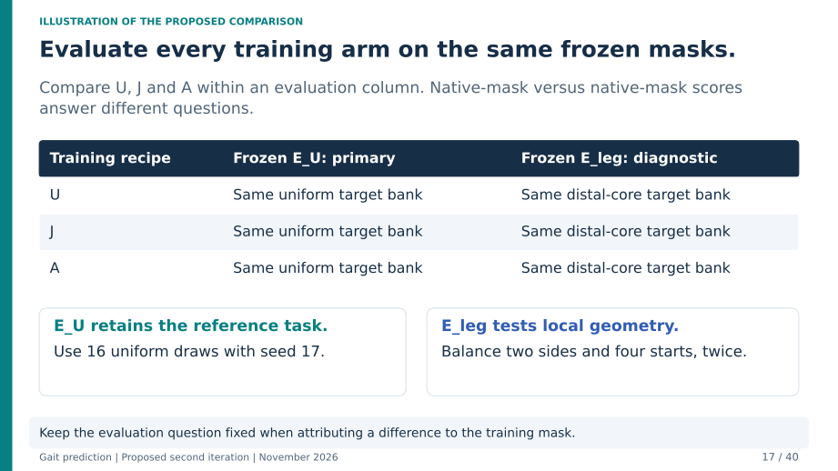

The primary bank E_U is the unchanged 16-draw uniform bank with seed 17. A versus U is the primary masking-policy contrast on this fixed bank. A versus J tests anatomical co-masking beyond a joint tube; J versus U is secondary. These contrasts are distinct from the primary S-versus-M detection comparison. E_leg contains two sides times four aligned starts times two repetitions, giving 16 masks. Each E_leg draw forces the four distal joints of that side over two temporal patches, then uniformly fills 56 additional tokens using dedicated seed 117. Save the exact banks and their hashes. Score valid core targets only in E_leg. Match target keys, loss weights and support across training arms within each bank. E_leg emphasizes lower-limb cores by design and is a separate diagnostic, not a marginally matched replacement for E_U. Fit separate reserved-normal relational references for each bank using the same five reserved source identities. If a required reference lacks support, report the diagnostic unavailable; never substitute a test source. Disclose diagnostic coverage and do not form one intersection across all mask banks and timing controls.

**Keep the evaluation question fixed when attributing a difference to the training mask.**

Sources: [Controlled masking methods review](../../../docs/iteration02/masking_method_review.md) · [Canonical next-iteration instructions](../../../../../notes/aaai/05-iterate-02-INSTR.md)

## 18. Separate training factors and their random streams.

**Status: PROPOSED NEXT ITERATION.**

A masking comparison must not silently change initialization, sample order, regularization or the second training view.

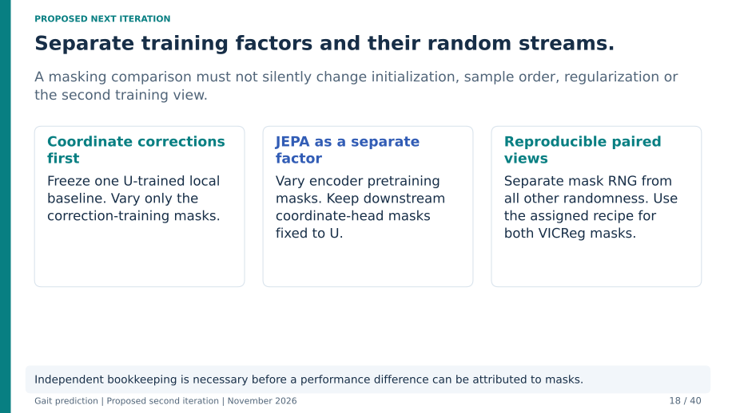

Compare correction-training masks with one common retained U-trained baseline f. Do not refit f under every mask recipe and then call it the same isolated comparison. If JEPA is evaluated, vary encoder pretraining masks separately while keeping head training on U, with the random-encoder control retained. Use dedicated random generators for masking, initialization, source sampling and augmentations. Derive the second VICReg mask from the assigned U, J or A recipe using its own declared stream; do not leave an implicit uniform second mask in structured arms. Match updates and nominal target counts, and report effective valid-target exposures. Any operational selection uses grouped fitting-normal validation, not calibration normals or disease AUROC.

**Independent bookkeeping is necessary before a performance difference can be attributed to masks.**

Sources: [Controlled masking methods review](../../../docs/iteration02/masking_method_review.md) · [Canonical next-iteration instructions](../../../../../notes/aaai/05-iterate-02-INSTR.md)

## 19. Check support and learning before interpreting a mask.

**Status: PROPOSED NEXT ITERATION.**

Report support and normal prediction competence before interpreting a condition-associated score.

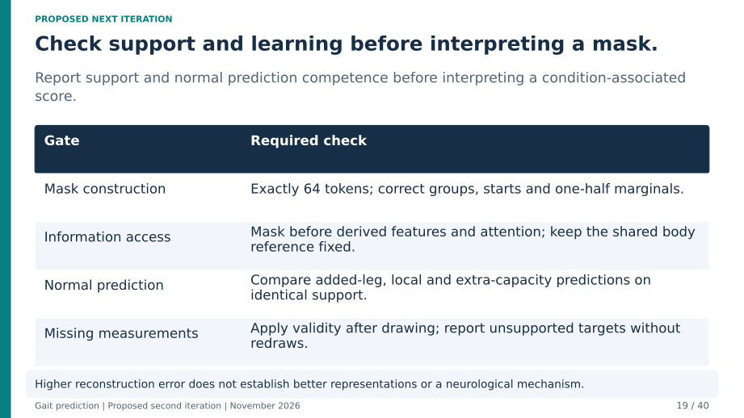

Run known-dependence, conditional-independence, zero-gate and hidden-input invariance fixtures for each arm. Invariance is conditional on the declared shared reference Q, not proof of independence from every body measurement used to construct Q. A J tube removes all history of its selected joint; an old eligibility rule that requires visible history of that very joint would exclude precisely those targets. Use a declared own-leg context rule for training and diagnostics while preserving the frozen primary U population. Audit available own-leg and opposite-leg tokens, repeated target keys and source weighting. Keep failed arms in the report. A failed normal relational gate sets R to zero within the fold; it does not authorize changing the endpoint or masking recipe after evaluation.

**Higher reconstruction error does not establish better representations or a neurological mechanism.**

Sources: [Controlled masking methods review](../../../docs/iteration02/masking_method_review.md) · [Masking and neurological interpretation](../../../docs/iteration02/masking_neuro_review.md) · [Canonical next-iteration instructions](../../../../../notes/aaai/05-iterate-02-INSTR.md)

## 20. Separate local geometry from the opposite-leg increment.

**Status: PROPOSED NEXT ITERATION.**

A knee often helps predict its own ankle simply because the leg is connected. That is a useful control, but a different question.

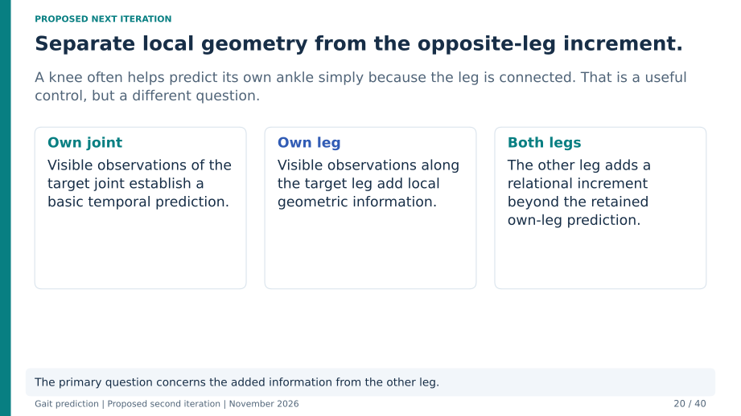

Use the same hidden target patch, visible-support rules and loss weights in each comparison. Shared torso or pelvis information must be assigned explicitly and consistently. The primary added-context comparison is own-leg versus both-leg prediction. Own-joint versus own-leg is the geometry control. Do not rename a model that receives the opposite leg or target-derived phase as own-only.

**The primary question concerns the added information from the other leg.**

Sources: [Methodological advice](../../../docs/iteration02/advice_method.md) · [Canonical next-iteration instructions](../../../../../notes/aaai/05-iterate-02-INSTR.md)

## 21. Preserve the local predictor when adding context.

**Status: ILLUSTRATION OF THE PROPOSED MODEL.**

Fit a competent local baseline, freeze it, then learn a correction that starts at zero.

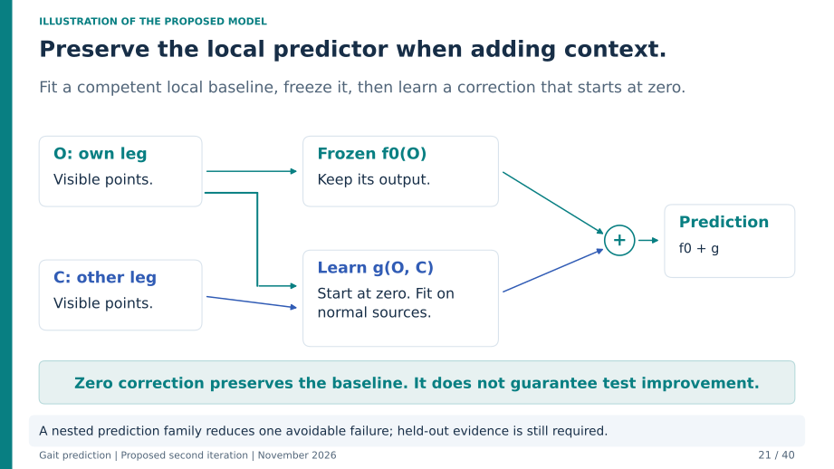

Let O denote visible own-leg information, C visible opposite-leg information and Y the same hidden coordinate patch. First fit f0(O) using normal development sources. Then predict f0(O) plus g(O,C), with the correction initialized to zero. The original f0 remains an available function when the correction is zero. This function-class containment does not guarantee better held-out performance, so normal development gates remain necessary.

**A nested prediction family reduces one avoidable failure; held-out evidence is still required.**

Sources: [Methodological advice](../../../docs/iteration02/advice_method.md) · [Canonical next-iteration instructions](../../../../../notes/aaai/05-iterate-02-INSTR.md)

## 22. Give the own-leg control the same extra capacity.

**Status: PROPOSED NEXT ITERATION.**

A more flexible model may improve even when the additional leg contains no useful information.

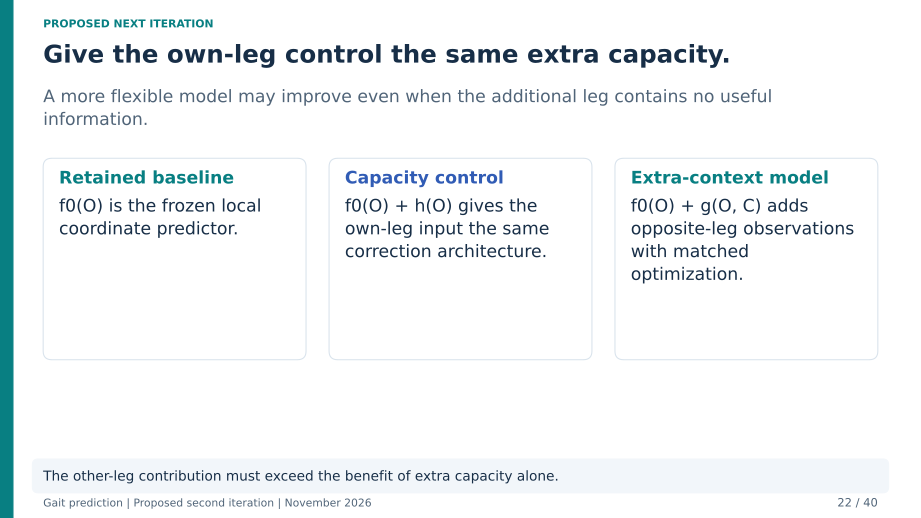

Match correction width, depth, update budget, initialization and source sampling as closely as possible. Record effective input dimension and parameter count. Use a shared coordinate target rather than comparing arbitrary latent errors from separate teachers. Start with shared ridge and a small temporal model before adding a JEPA encoder.

**The other-leg contribution must exceed the benefit of extra capacity alone.**

Sources: [Methodological advice](../../../docs/iteration02/advice_method.md) · [Canonical next-iteration instructions](../../../../../notes/aaai/05-iterate-02-INSTR.md)

## 23. Make the estimator pass processes with known answers.

**Status: PROPOSED NEXT ITERATION.**

Controlled synthetic data validate the measurement logic. They are not clinical simulations or efficacy results.

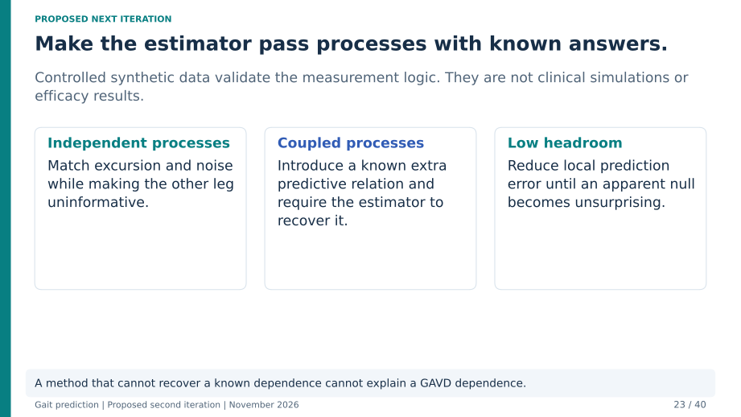

Generate independent and coupled processes with comparable marginals, missingness and noise. These fixtures answer whether the estimator can distinguish known statistical structures. They do not reproduce stroke, Parkinson disease, cerebral palsy or myopathy. Predeclare tolerance and reproducibility rules before viewing GAVD outcome scores. A contiguous-gap sensitivity can test a low-headroom concern, but it is separate from the registered U, J and A training comparison.

**A method that cannot recover a known dependence cannot explain a GAVD dependence.**

Sources: [Methodological advice](../../../docs/iteration02/advice_method.md) · [Canonical next-iteration instructions](../../../../../notes/aaai/05-iterate-02-INSTR.md)

## 24. Phase estimation can accidentally reveal the hidden answer.

**Status: PROPOSED NEXT ITERATION.**

A phase variable computed from the full target sequence can carry information about the masked movement.

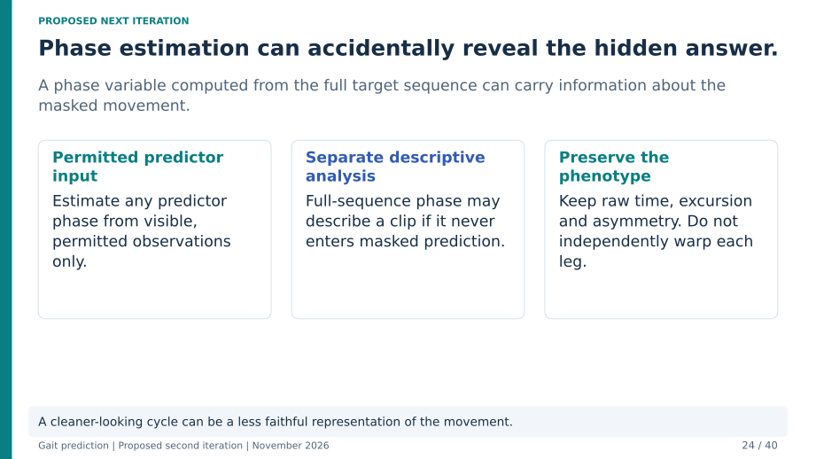

Independent leg warping can erase timing asymmetry. Joint-wise variance normalization can erase small excursion. Removing trunk tilt can erase compensation. Very small or irregular excursions can make phase undefined, so report an unavailable phase rather than a zero anomaly. The main proposed predictor keeps the raw clock and does not depend on successful cycle estimation.

**A cleaner-looking cycle can be a less faithful representation of the movement.**

Sources: [Neurological evidence and novelty advice](../../../docs/iteration02/advice_neuro.md) · [Methodological advice](../../../docs/iteration02/advice_method.md) · [Original bilateral phase coordination study](https://pubmed.ncbi.nlm.nih.gov/17503027/) · [Four-limb coordination in healthy adults](https://pmc.ncbi.nlm.nih.gov/articles/PMC11435969/)

## 25. Shift distal-leg timing without changing the target.

**Status: ILLUSTRATION OF A PROPOSED TIMING CONTROL.**

Use a longer source segment and visible hip-relative offsets to construct aligned and shifted contexts without circular wrap.

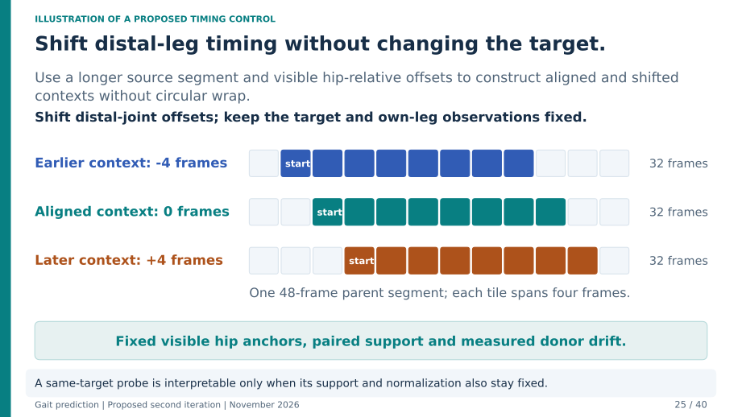

For a 48-frame parent segment, fix Y and O to frames 8:40 in zero-based half-open indexing. Use C from 4:36, 8:40 and 12:44. Apply uniform masks on the original 12-by-16 parent token grid before deriving features. Move donor values with their original visibility flags, so a hidden value cannot reappear after shifting. For each visible distal joint, subtract the visible donor hip and attach that offset to the permitted original opposite hip. Require valid, permitted donor and anchor hips. Never derive a feature from a hidden hip. Keep the original body normalization anchor and use the intersection of permitted context within each original-versus-shifted pair. Restrict the aligned input to that exact paired support. Evaluate offsets separately; the symmetric average on sources eligible for both is secondary. Do not force all timing, noise and dropout controls onto one intersection. This is distal-leg timing, not a shift of the complete leg trajectory. This is a predictor-input challenge, not a physically realizable counterfactual body or a synthetic disease.

**A same-target probe is interpretable only when its support and normalization also stay fixed.**

Sources: [Methodological advice](../../../docs/iteration02/advice_method.md) · [Canonical next-iteration instructions](../../../../../notes/aaai/05-iterate-02-INSTR.md)

## 26. No-wrap changes still need geometry and drift controls.

**Status: PROPOSED NEXT ITERATION.**

Hip-relative donor offsets can change distal geometry as well as timing. Measure both effects before interpreting the error change.

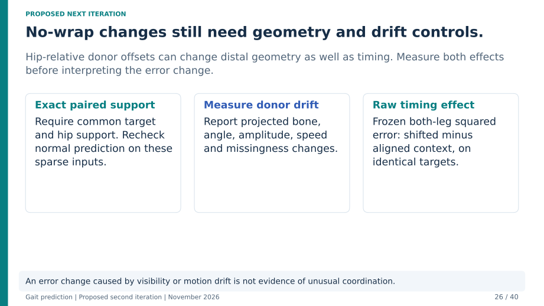

This is a compound distal timing-and-geometry input challenge, not an isolated physiological phase intervention. Report projected bone-length and joint-angle changes as well as motion and support drift. Do not claim exact marginal preservation. No-wrap shifts remove a wrap discontinuity but use different donor frames. A coherent global temporal shift changes both the target and the context; it is not the same-target negative control. Timing changes are input interventions on a predictor and do not establish neural causation. The primary timing effect is source-aggregated squared error of the frozen both-leg predictor with shifted context minus aligned-context error, on identical targets and paired support. A positive effect means aligned context helped this predictor. Calibrated R or S changes are secondary. Recheck normal-development adequacy, available context-token counts and remaining headroom on the exact paired-support aligned inputs. A null response with almost no permitted context is uninformative; do not relax its masking rules.

**An error change caused by visibility or motion drift is not evidence of unusual coordination.**

Sources: [Methodological advice](../../../docs/iteration02/advice_method.md) · [Neurological evidence and novelty advice](../../../docs/iteration02/advice_neuro.md)

## 27. Report local movement and relational evidence separately.

**Status: PROPOSED NEXT ITERATION.**

Both signals may be useful, and each has a different failure mode.

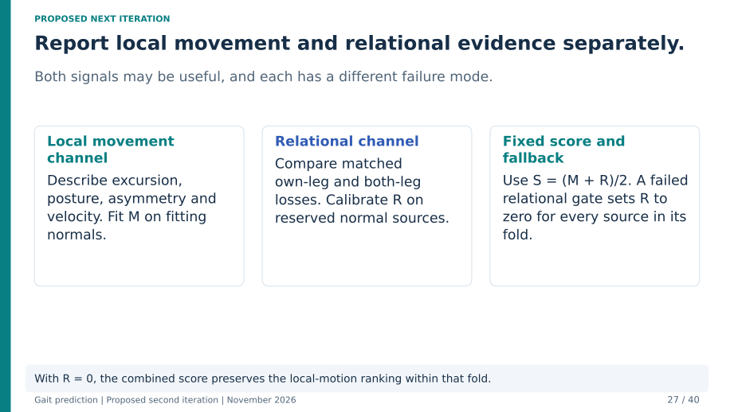

M contains only the declared visible-movement descriptors, not local prediction error. Fit its imputation, scaling and covariance on fitting-normal sources. Fit the relational reference R on separate reserved normal sources. The primary relation is loss of f0(O) + h(O) minus loss of f0(O) + g(O,C), measured on the same target and support. A two-sided deviation from a normal relational pattern is more defensible than assuming all abnormal clips must have less context benefit. Stable compensation may increase predictability. Use a fixed aggregation rule and source-balanced weighting. The frozen combined score is S = 0.5(M + R). If a fold fails the normal relational gate, mark R unavailable and set it to zero for every source in that fold. S = M/2 then preserves the local-motion ranking within the fold. Keep the fold and its sources, report which folds support relational learning, and do not claim a successful mechanism from fallback performance. The primary method comparison is S versus M. Relational references remain fitted on the separate reserved normal sources.

**With R = 0, the combined score preserves the local-motion ranking within that fold.**

Sources: [Neurological evidence and novelty advice](../../../docs/iteration02/advice_neuro.md) · [Methodological advice](../../../docs/iteration02/advice_method.md) · [Canonical next-iteration instructions](../../../../../notes/aaai/05-iterate-02-INSTR.md)

## 28. Separate fitting, calibration and evaluation by source.

**Status: PROPOSED NEXT ITERATION.**

The proposed four-fold split needs a manifest audit before these planned counts become binding.

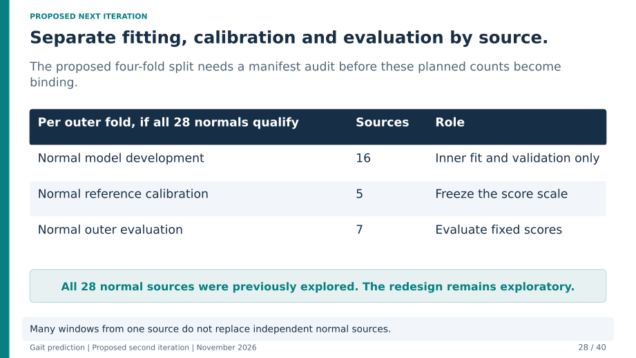

The 16 development sources must be split again by source for fitting and model selection. Five reference sources must never select a predictor, hyperparameter or phase threshold. Seven normal sources per outer fold are planned for evaluation. Group overlapping clips and known duplicates, and document unresolved identity links. Historical source reuse prevents describing the redesign as a fresh confirmatory study, even when the new pipeline obeys source separation internally.

**Many windows from one source do not replace independent normal sources.**

Sources: [Methodological advice](../../../docs/iteration02/advice_method.md) · [Read-only data and ingestion review](../../../docs/iteration02/advice_data.md) · [Canonical next-iteration instructions](../../../../../notes/aaai/05-iterate-02-INSTR.md)

## 29. Compare every method on the same frozen source cohort.

**Status: PROPOSED NEXT ITERATION.**

Refit every comparator on the same source roles. Compare rankings within a fold before aggregating across folds.

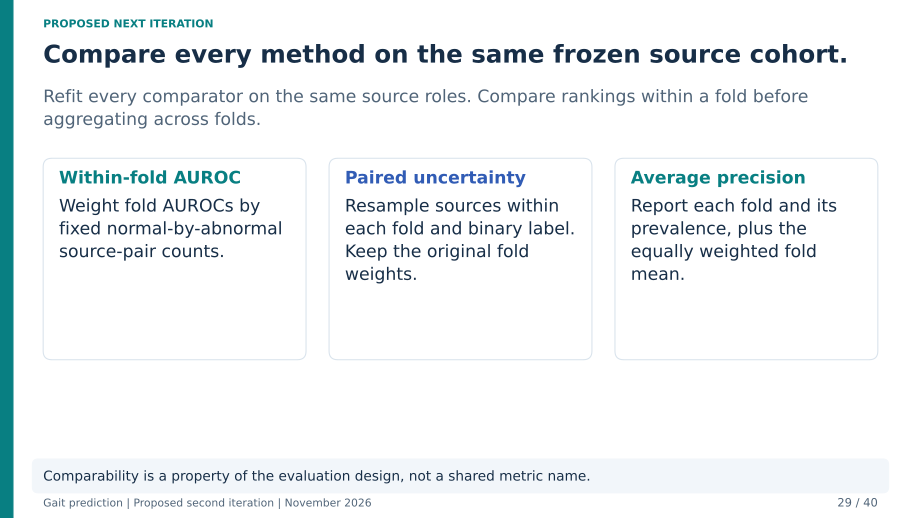

Do not compare an old 251-source AUROC with a new 304-source AUROC as if the difference were caused by the method. Refit old-style baselines under the new source manifest. Report focal primary and all-folder secondary endpoints with the same frozen scores. The primary AUROC summary is the fixed pair-count-weighted mean of within-fold AUROCs, not a pooled out-of-fold ranking. Show every fold and an equally weighted fold mean as a sensitivity. Report average precision per fold, its prevalence and its equally weighted fold mean. The paired bootstrap resamples whole sources or confirmed duplicate-recording groups within each fold and binary-label stratum, retaining all method scores and the original fold weights. Pooled rankings are secondary because five reference normals do not establish common score calibration across folds. Source bootstrap intervals do not measure training-seed uncertainty or person-generalization. Disease-family slices are small and descriptive.

**Comparability is a property of the evaluation design, not a shared metric name.**

Sources: [Methodological advice](../../../docs/iteration02/advice_method.md) · [Canonical next-iteration instructions](../../../../../notes/aaai/05-iterate-02-INSTR.md)

## 30. A strong result must survive inexpensive alternatives.

**Status: PROPOSED NEXT ITERATION.**

Choose one primary model family before inspecting the focal endpoint and keep the comparator set fixed.

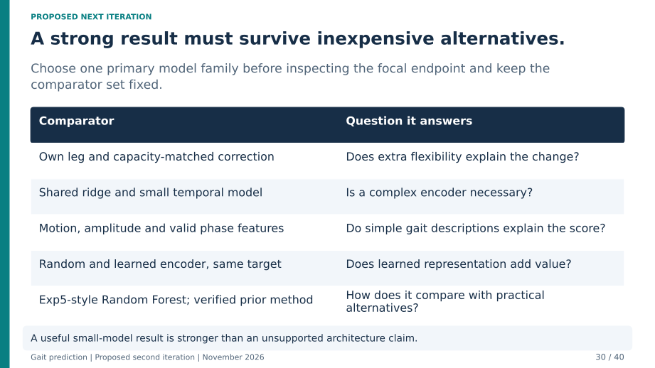

The Random Forest follows the existing exp5 feature pipeline with matched source splits and the same focal labels. Train supervised family classifiers only on training sources and report them separately from normal-only anomaly detection. Include normal-only local-motion and nuisance controls. A published baseline is a reproduced baseline only after its adaptation and data compatibility have been verified; otherwise label it an explicitly adapted method and avoid an unsupported state-of-the-art comparison.

**A useful small-model result is stronger than an unsupported architecture claim.**

Sources: [Published-baseline feasibility audit](../../../docs/published_baseline_feasibility.md) · [Methodological advice](../../../docs/iteration02/advice_method.md) · [Canonical next-iteration instructions](../../../../../notes/aaai/05-iterate-02-INSTR.md)

## 31. Freeze the new endpoint choice before scoring the redesign.

**Status: PROPOSED NEXT ITERATION.**

The focal question follows the requested neurological and muscle families. The broader task remains mandatory.

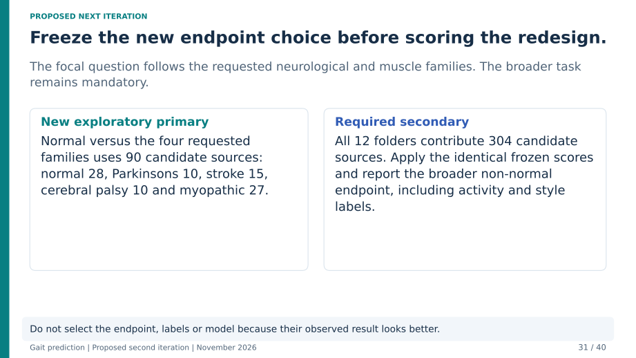

This is a post-historical-results redesign. It does not replace the original all-folder primary result or create a new confirmatory claim. Stroke appears twice in the request but represents one class. Folder labels are not verified clinical diagnoses. The pooled primary endpoint is normal versus the four requested abnormal families. Five-class classification and individual family analyses are secondary and descriptive, with source-balanced evaluation and broad uncertainty.

**Do not select the endpoint, labels or model because their observed result looks better.**

Sources: [Canonical next-iteration instructions](../../../../../notes/aaai/05-iterate-02-INSTR.md) · [Read-only availability calculations](../../../docs/iteration02/data_feasibility_probe.json) · [Read-only data and ingestion review](../../../docs/iteration02/advice_data.md)

## 32. Notebooks 12 through 14 establish whether the study is possible.

**Status: PROPOSED NEXT ITERATION.**

Each notebook needs its own setup, explicit data status and inspectable outputs.

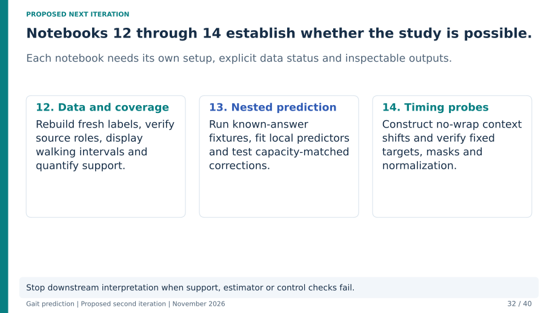

These notebooks are new planned deliverables. They must not be numbered as completed experiments in the evidence ledger. Notebook 12 writes an immutable cohort and exclusion manifest. Notebook 13 writes synthetic checks and normal-development reports before model choice is frozen. Notebook 14 validates pairing and drift before any condition-associated interpretation.

**Stop downstream interpretation when support, estimator or control checks fail.**

Sources: [Canonical next-iteration instructions](../../../../../notes/aaai/05-iterate-02-INSTR.md) · [Methodological advice](../../../docs/iteration02/advice_method.md)

## 33. Notebooks 15 through 17 test value and document the limits.

**Status: PROPOSED NEXT ITERATION.**

The final evidence package must preserve unsuccessful results as well as favorable ones.

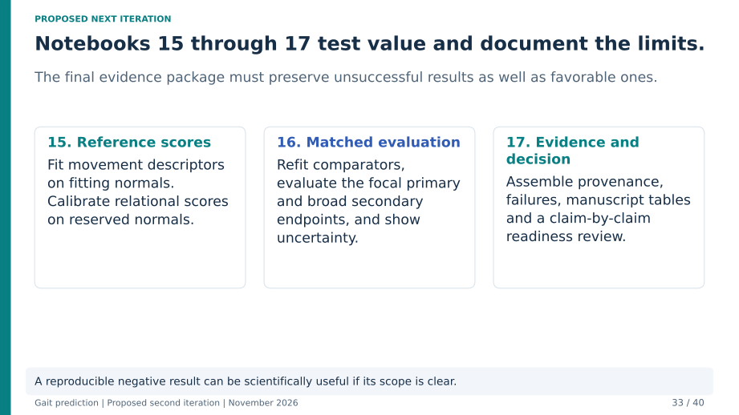

The score definition and aggregation rule must be frozen before outcome evaluation. Notebook 16 pairs methods at the source level and displays subgroup sample sizes. Notebook 17 must generate reported numbers from saved artifacts, link every figure to its inputs and classify each manuscript claim as supported, descriptive or untested.

**A reproducible negative result can be scientifically useful if its scope is clear.**

Sources: [Canonical next-iteration instructions](../../../../../notes/aaai/05-iterate-02-INSTR.md) · [Methodological advice](../../../docs/iteration02/advice_method.md)

## 34. Make every notebook understandable on the laptop.

**Status: PROPOSED NEXT ITERATION.**

A reader should be able to open one notebook, run its setup and understand the exact movement being scored.

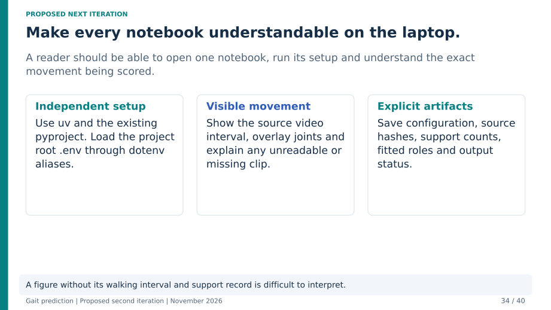

Use from dotenv import load_dotenv as load_env and find_dotenv as find_env, then load_env(find_env()) after resolving the project root. Never print secrets. Use a local uv kernel, explain CPU or MPS execution, and make cached pose reuse dependent on configuration and source provenance. For video display, use existing media.show_window_context and annotated-frame helpers with explicit source timestamps. Store all downloads under data/videos-gavd.

**A figure without its walking interval and support record is difficult to interpret.**

Sources: [Canonical next-iteration instructions](../../../../../notes/aaai/05-iterate-02-INSTR.md) · [Read-only data and ingestion review](../../../docs/iteration02/advice_data.md)

## 35. Require evidence before strengthening the claim.

**Status: ILLUSTRATION OF PROPOSED EXECUTION GATES.**

Each gate has a declared failure response. The study does not continue by searching for favorable subgroups.

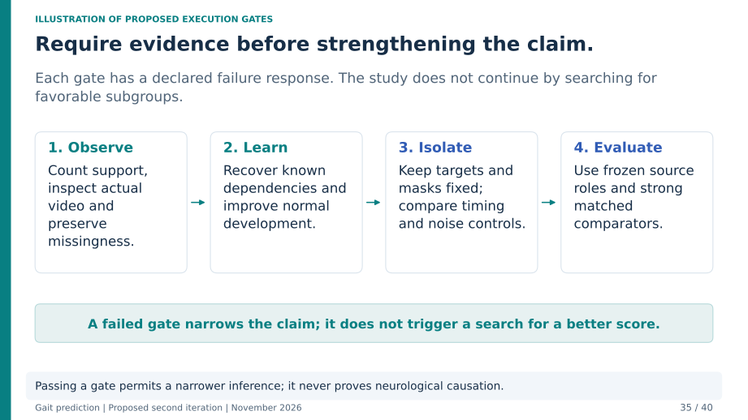

The observation gate audits support and person visibility. The learning gate requires known-dependence recovery and competent normal prediction. The isolation gate requires same-target pairing, capacity controls, documented donor drift and adequate prediction on the exact sparse paired-support inputs. The evaluation gate requires matched source roles, uncertainty and comparison against strong inexpensive baselines. Gate thresholds and fallback claims must be frozen before focal endpoint scores are inspected. A failed relational gate sets R = 0 for all sources in that fold, preserving the M ranking within that fold while retaining all eligible sources.

**Passing a gate permits a narrower inference; it never proves neurological causation.**

Sources: [Canonical next-iteration instructions](../../../../../notes/aaai/05-iterate-02-INSTR.md) · [Methodological advice](../../../docs/iteration02/advice_method.md)

## 36. Use the remaining week for one falsifiable study.

**Status: PROPOSED NEXT ITERATION.**

The workshop page lists November 20, 2026. It does not state a submission timezone.

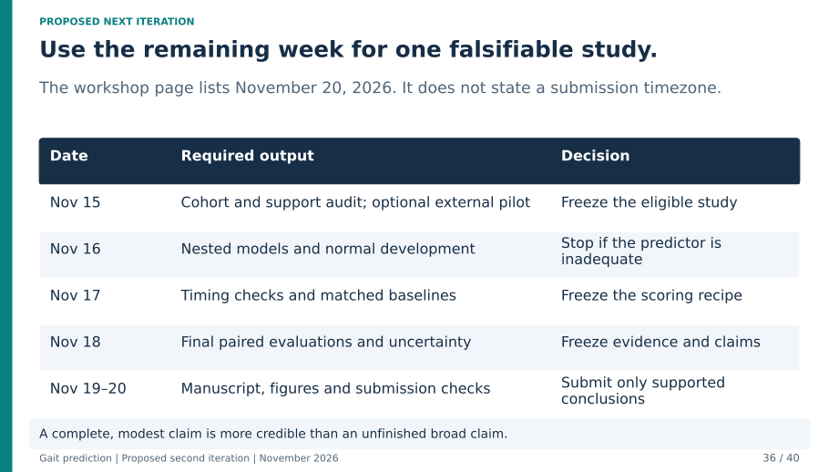

Verify the live workshop instructions before submission, because deadlines and format can change. Freeze research evidence by November 18 to leave time for writing and final checks. A failed gate should trigger the predefined narrower paper, not a larger architecture search. The proposed schedule is a plan and is not evidence that experiments have run.

**A complete, modest claim is more credible than an unfinished broad claim.**

Sources: [Canonical next-iteration instructions](../../../../../notes/aaai/05-iterate-02-INSTR.md) · [ASTAD4 official requirements](https://ismart.ece.mcgill.ca/astad4/)

## 37. Keep the compute budget small and the choice process visible.

**Status: PROPOSED NEXT ITERATION.**

Additional capacity is useful only when it resolves an identified uncertainty.

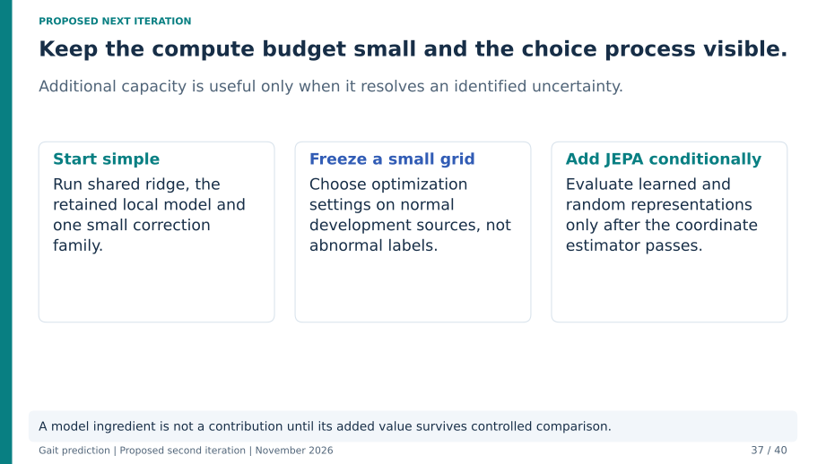

Stochastic positional embeddings, stochastic latent variables and large architecture searches are optional follow-up ablations. They are not the critical path to this workshop study. VICReg can guard against representational collapse, but it does not force clinical classes apart or guarantee a useful anomaly score. Retain uniform masking as the reference and keep all proposed alternatives motion-independent. Record all attempted settings and failed runs.

**A model ingredient is not a contribution until its added value survives controlled comparison.**

Sources: [Canonical next-iteration instructions](../../../../../notes/aaai/05-iterate-02-INSTR.md) · [Methodological advice](../../../docs/iteration02/advice_method.md)

## 38. The strongest plausible claim is conditional and specific.

**Status: PROPOSED NEXT ITERATION.**

The proposed method is valuable only if a measured relational signal survives the obvious alternative explanations.

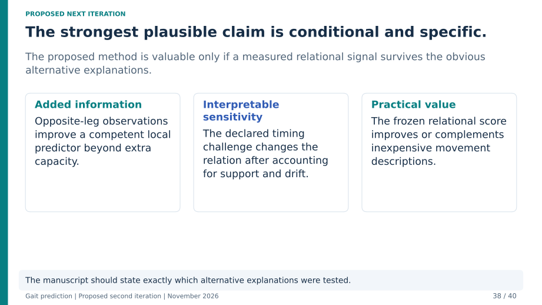

All three statements require new evidence. A successful result would support an observable relational signature in projected video from this source dataset. It would not prove a neural world model, a diagnostic mechanism, a causal effect of disease or generalization to an unseen clinical population. Compare against the closest dependence and normal-gait methods in the manuscript.

**The manuscript should state exactly which alternative explanations were tested.**

Sources: [Canonical next-iteration instructions](../../../../../notes/aaai/05-iterate-02-INSTR.md) · [Neurological evidence and novelty advice](../../../docs/iteration02/advice_neuro.md) · [Methodological advice](../../../docs/iteration02/advice_method.md)

## 39. Precommit to three honest manuscript outcomes.

**Status: PROPOSED NEXT ITERATION.**

The result determines the paper scope. The paper title should not determine the result.

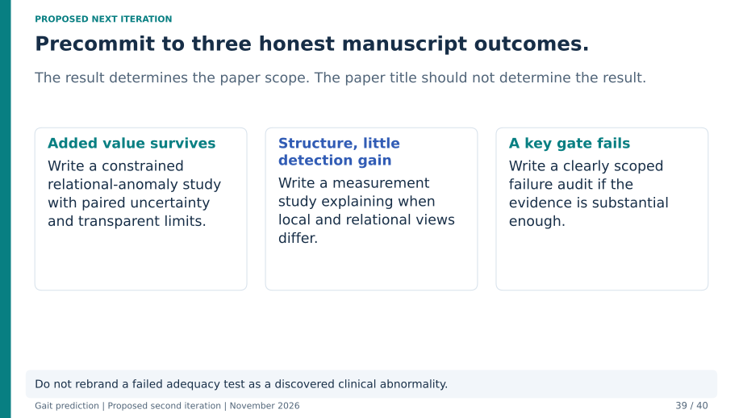

A null result is not automatically a strong paper. A negative or audit paper still needs a precise research question, systematic controls, reproducible findings and a generalizable methodological lesson. Do not claim workshop acceptance probability from the current exploratory scores. The decision should include independent adversarial review of the final evidence and novelty.

**Do not rebrand a failed adequacy test as a discovered clinical abnormality.**

Sources: [Canonical next-iteration instructions](../../../../../notes/aaai/05-iterate-02-INSTR.md) · [Methodological advice](../../../docs/iteration02/advice_method.md)

## 40. A useful world model must first predict what can be observed.

**Status: PROPOSED NEXT ITERATION.**

The near-term goal is a trustworthy comparison. Mechanistic interpretation comes after the comparison works.

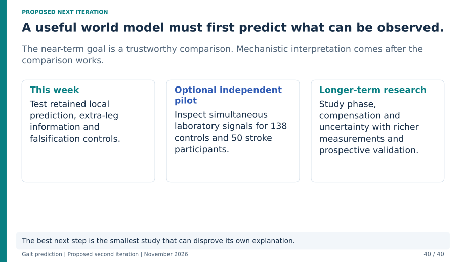

Schedule the optional two-hour external parsing pilot early, before committing the remaining week to GAVD-only execution. The independent laboratory dataset has 138 controls and 50 stroke participants. Its two C3D archives total 779,608,713 bytes. No scientific data were downloaded in this review. Reserve two hours to establish participant identity, common time and signal meaning; stop if a complete measurement replication exceeds one working day. Refit within the external dataset and describe this as method replication, not transfer of GAVD weights. Future studies could test mechanism-sensitive hypotheses using synchronized multi-view motion, force plates or EMG. The current projected GAVD sequences do not identify muscle force, central motor commands or disease etiology. The immediate deliverable is a defensible evidence trail, not an ungrounded neurological explanation.

**The best next step is the smallest study that can disprove its own explanation.**

Sources: [Canonical next-iteration instructions](../../../../../notes/aaai/05-iterate-02-INSTR.md) · [Neurological evidence and novelty advice](../../../docs/iteration02/advice_neuro.md) · [Bounded independent replication review](../../../docs/iteration02/external_replication_feasibility.md) · [Laboratory control and stroke dataset](https://pmc.ncbi.nlm.nih.gov/articles/PMC10692332/) · [ASTAD4 official requirements](https://ismart.ece.mcgill.ca/astad4/)
