# Skeleton JEPA for gait anomalies

Open `index.html` locally. Use the browser print dialog for PDF. Arrow keys move between slides.

## 1. Skeleton JEPA for gait anomalies

Progressive tutorials for ASTAD4

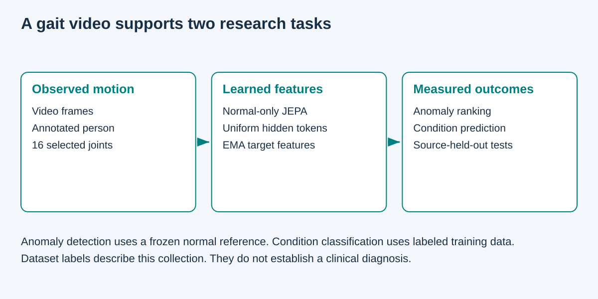

Learn a normal reference, then test carefully defined deviations. All results must identify their dataset and split. No clinical performance is claimed by this deck.

## 2. Research questions

Anomaly ranking and condition recognition use different supervision.

Primary task: normal-only anomaly detection. Secondary task: five-condition classification. The latter receives condition labels through a separate supervised classifier.

## 3. Fresh GAVD annotations

Five labels yield 666 sequences and 103 source videos.

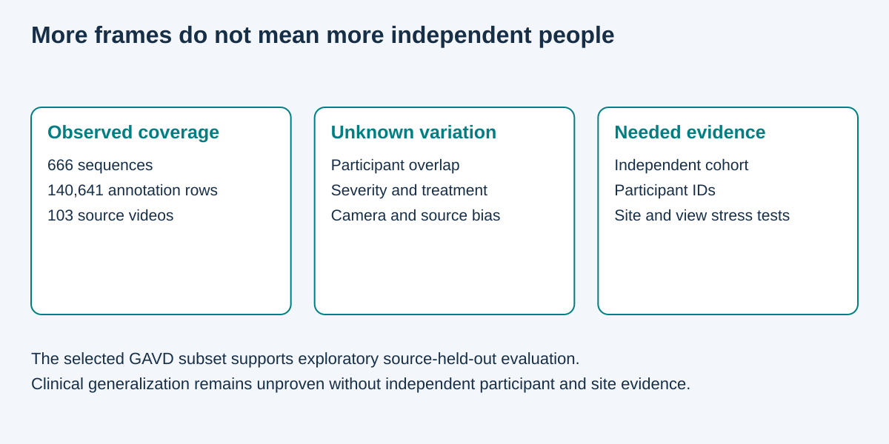

The counts are audited from the current data/gavd folders. Source videos are not verified independent participants. Normal 291; Parkinsons 47; stroke 76; cerebral palsy 64; myopathic 188.

## 4. Video and skeleton provenance

Every retained window traces back to an annotation file.

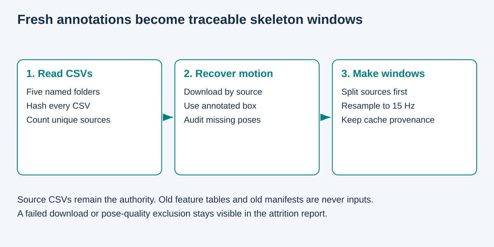

Download each source once under data/videos-gavd. Audit frame origin, bounding boxes, pose confidence, time gaps and attrition before producing a paper result.

## 5. Source-level separation

One source has exactly one role in each evaluation run.

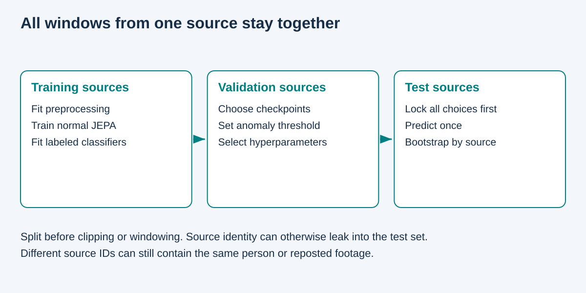

All preprocessing learned from data and all parameter choices use training or validation only. Test windows never enter encoder pretraining, including normal-only pretraining.

## 6. Selected joint features

The whitelist covers trunk, arm, and lower-limb motion.

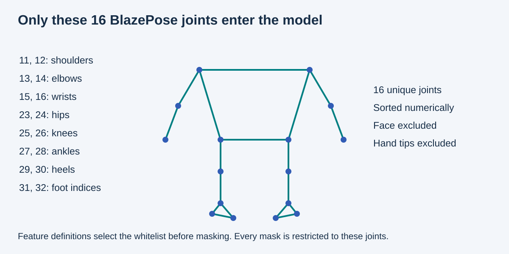

The notebook and joint table give every BlazePose index and its feature contribution. This choice is a declared experiment design, not a validated optimal clinical subset.

## 7. Temporal tokens

Four consecutive frames describe one joint token.

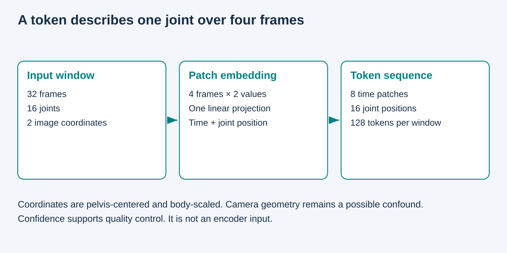

At 15 Hz a 32-frame window spans about two seconds. This may miss very slow gait cycles. Examine longer windows as a prespecified ablation.

## 8. Uniform random masking

Motion intensity never changes the selection probability.

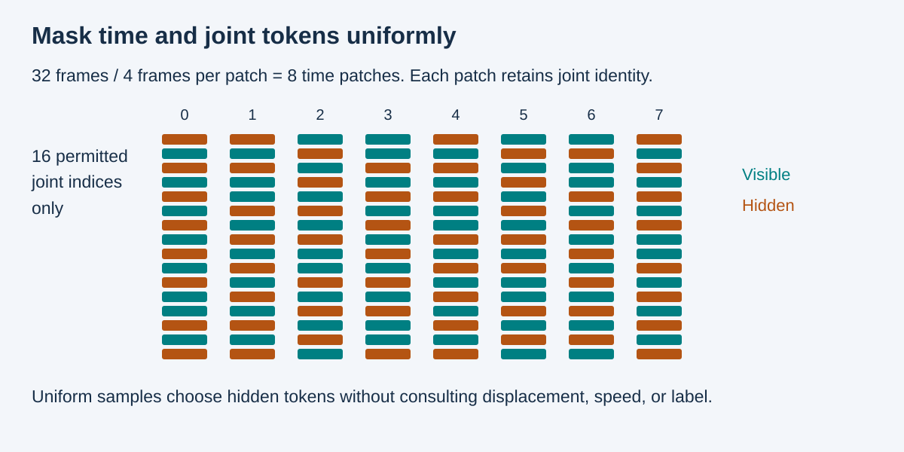

The published skeleton S-JEPA and MAMP default use motion-aware strategies. This tutorial intentionally uses the uniform option, consistent with the requested experimental design.

## 9. Context and target encoders

An EMA teacher supplies hidden feature targets.

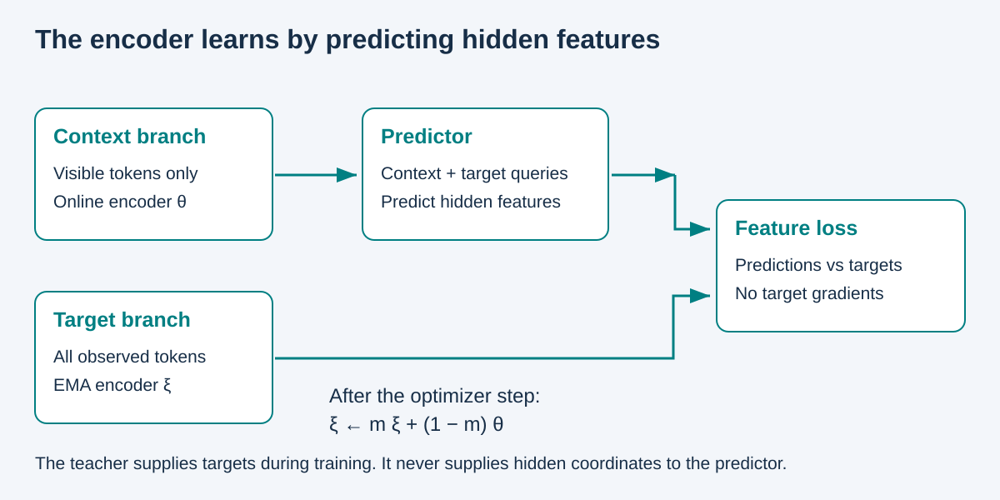

This is a pedagogical adaptation. The published skeleton S-JEPA uses centered distributional targets and cross-entropy, and this implementation retains that objective while adding VICReg and uniform masking.

## 10. Collapse prevention

VICReg regularizes two online views.

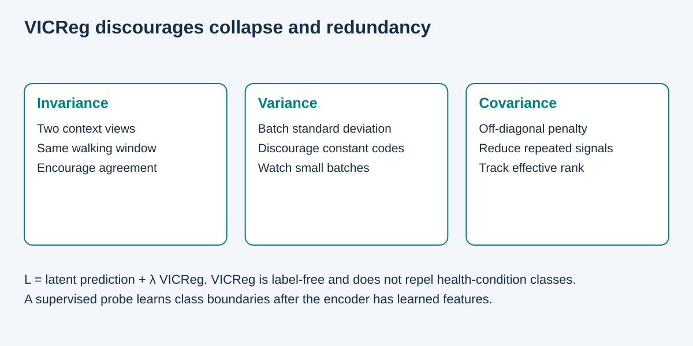

Track variance, effective rank and prediction loss together. Low prediction loss alone can indicate collapse. VICReg does not require or maximize separation among disease classes.

## 11. Normal-first curriculum

An immutable normal anchor survives later adaptation.

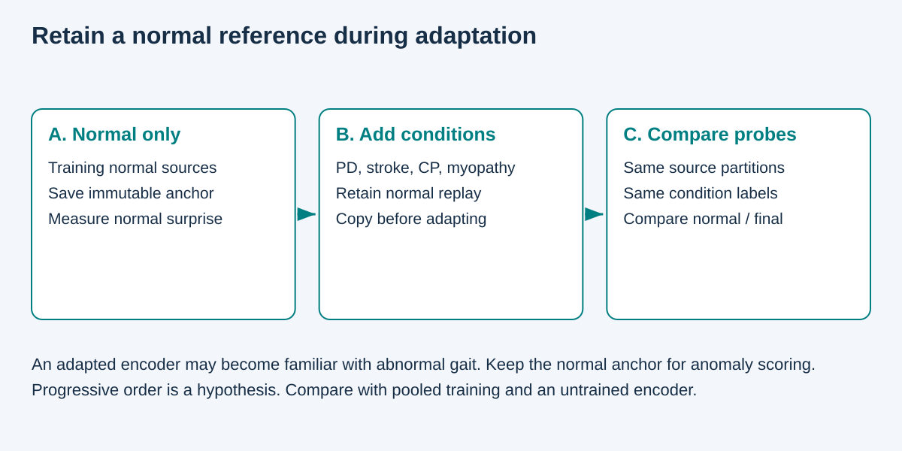

The normal anchor supports anomaly scoring. A copied model learns from normal replay and progressively added conditions. Compare validation performance of the normal and final encoders.

## 12. Stochasticity ablations

Masking, positions, and latent variables have different roles.

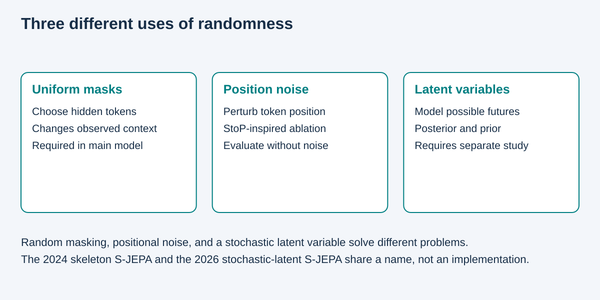

StoP adds projected position noise. The 2026 stochastic latent-variable paper introduces prior/posterior and KL machinery. A noise tensor alone is not that method.

## 13. Future motion prediction

All future coordinates are absent from context.

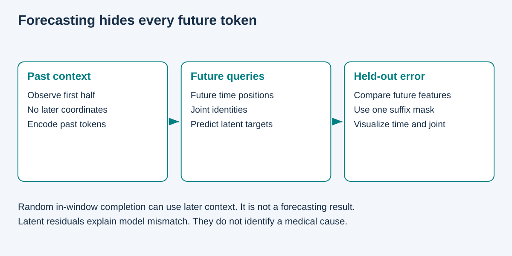

Report this separately from random masked completion. Predicting latent features does not reconstruct a visible skeleton unless an additional coordinate readout is fitted.

## 14. Anomaly decisions

Normal validation data set the decision threshold.

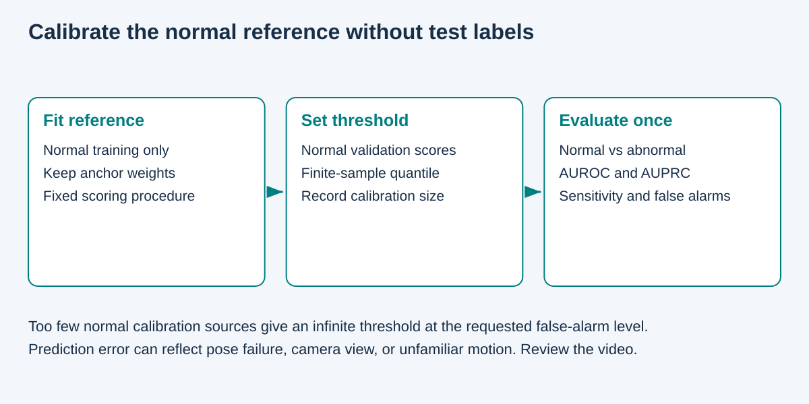

Freeze the scoring procedure before test evaluation. Report finite-sample uncertainty and failures linked to low pose confidence or view changes.

## 15. Random Forest comparison

Both approaches use the same retained sequences.

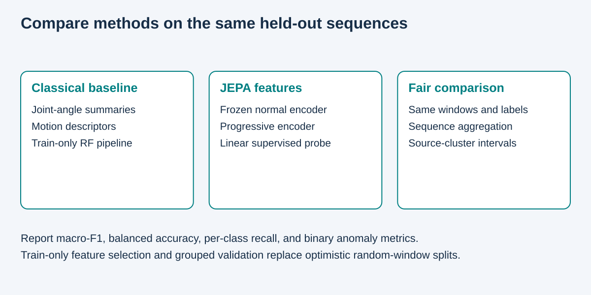

Compare handcrafted features plus Random Forest against frozen JEPA embeddings plus a linear probe. Include untrained encoder and mean-pose controls. Hyperparameters use validation only.

## 16. Paper evidence and limits

The workshop deadline is November 20, 2026.

Official ASTAD4 instructions allow seven pages of content plus two reference-only pages and require double-blind review using AAAI-27 format. The site does not state a deadline timezone. Verify the submission portal. Report actual runs, attrition, seeds and uncertainty; never use synthetic checks as empirical results.
