# Understanding gait prediction

This 43-slide guide is written for general AI/ML researchers. It explains the question, measurements, prediction comparisons and anomaly results using the verified experiments.

[Slide PDF](tutorial.pdf) · [Offline viewer](index.html) · [Manuscript](../docs/draft03/README.md) · [Technical details](../docs/draft03/technical_details.md)

Every slide has notes on purpose, explanation, reading the visual, evidence and limits, and the transition to the next slide.

## 01. Can the other leg help explain unusual walking?

We test whether the opposite leg improves prediction and whether that improvement helps detect unusual gait.

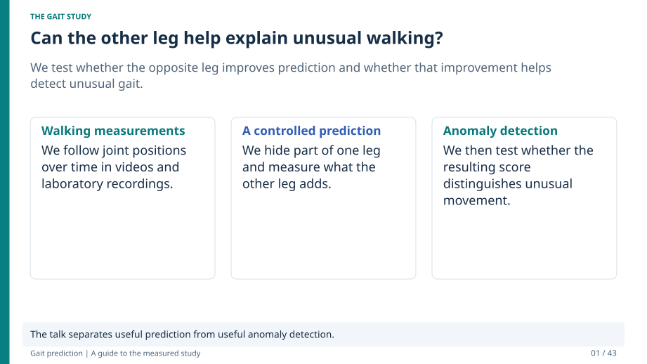

*Figure caption: The talk separates useful prediction from useful anomaly detection.*

### Purpose

Gait means the way a person walks. Introduce the study through a practical question: can observations of the other leg help a model understand movement that appears unusual?

### Explanation

Walking usually repeats, but a repeated movement can still reflect a limitation or an adaptation. A model may also make a large prediction error because the recording hides useful information. We therefore examine two questions separately: whether the other leg improves a prediction, and whether the resulting measurement helps distinguish normal from abnormal recordings.

### Reading the visual

Read the three panels as the path through the study. Walking measurements provide the observations. Controlled prediction tests what the other leg adds to a hidden-movement estimate. Anomaly detection then asks whether that added information helps distinguish normal-labeled from abnormal-labeled recordings. The two datasets are introduced later.

### Evidence and limits

These summaries come from completed experiments with real recordings and separately fitted laboratory models. The study is exploratory, and its main contribution is a controlled comparison with inspectable inputs, predictions and scores. The following slides explain that comparison before interpreting its numerical results.

### Transition

To make the comparison concrete, consider what a model could use when a short part of the left ankle's movement is hidden.

[Plain-language guide to the three scores](score_guide.md)

Sources: [Executed protocol](../docs/iteration02/protocol.md) · [Verified study results](../docs/iteration02/results.md) · [Accessible manuscript and technical notes](../docs/draft03/README.md)

## 02. Start with a short hidden part of the left ankle.

The visible left leg already gives clues. We ask what the right leg adds after those clues have been used.

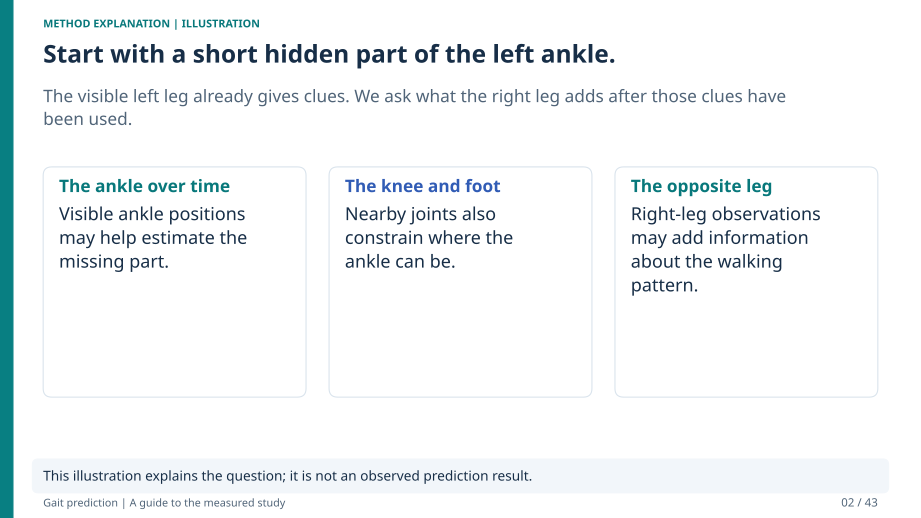

*Figure caption: This illustration explains the question; it is not an observed prediction result.*

### Purpose

Use one hidden-ankle example to explain why seeing more of the body is not automatically evidence that a model has learned a useful relationship between the legs.

### Explanation

Suppose we hide the left ankle for four consecutive samples. Ankle observations immediately before and after the gap may suggest a smooth continuation. The visible left knee, heel and front of the foot may provide further geometric clues. We can then ask whether the right leg improves the estimate after these same-leg clues have already been used.

### Reading the visual

Read the three panels from left to right as sources of information for the same missing movement. They progress from the target joint's history, to nearby joints on its own leg, and then to the opposite leg. The answer being predicted stays fixed throughout this comparison.

### Evidence and limits

This is an illustration of the experimental question. In the actual study, we hide observations that have been measured and retain their values for scoring. Naturally unavailable coordinates cannot supply those answers. Better reconstruction under artificial hiding therefore concerns the recorded measurements and their declared input conditions.

### Transition

Before deciding which movement relationships to measure, it helps to consider why different health conditions can produce different adaptations during walking.

Sources: [Neurological evidence and novelty advice](../docs/iteration02/advice_neuro.md) · [Executed protocol](../docs/iteration02/protocol.md)

## 03. Different conditions can change walking in different ways.

Clinical findings guide what we measure, but the videos do not reveal the cause of an individual movement.

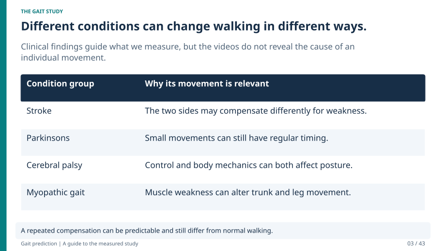

*Figure caption: A repeated compensation can be predictable and still differ from normal walking.*

### Purpose

Explain how clinical knowledge motivates the measurements while keeping the distinction between an observed walking pattern and its possible cause clear.

### Explanation

After stroke, weakness and altered control can affect the two sides differently. Parkinsonian gait may involve smaller movements or reduced arm swing, even when some aspects of timing remain regular. Cerebral palsy combines motor-control and musculoskeletal limitations. Myopathic conditions involve muscle disease and can change how the trunk and pelvis contribute to walking. People can adapt to these limitations in different ways.

### Reading the visual

Read each row as a condition family paired with a plausible movement consequence. The rows explain why we retain several kinds of observable information. They do not assign a diagnosis to a video or claim that every person in a category walks in the same way.

### Evidence and limits

The linked clinical studies motivate these examples. GAVD supplies annotation categories, while lesion location, medication, muscle strength, electrical muscle activity and walking forces are unavailable here. A repeatable compensation may be unusual yet predictable, which makes raw prediction error an incomplete description of abnormality.

### Transition

These examples suggest that movement size, relative timing and stable compensation should remain distinguishable in the measurements we give the models.

Sources: [Neurological evidence and novelty advice](../docs/iteration02/advice_neuro.md) · [Stroke coordination and temporal symmetry](https://pubmed.ncbi.nlm.nih.gov/38709654/) · [PD arm amplitude, symmetry and coordination](https://pubmed.ncbi.nlm.nih.gov/25502948/) · [Selective motor control and gait in CP](https://pubmed.ncbi.nlm.nih.gov/27889619/) · [Longitudinal Duchenne muscle and gait observations](https://link.springer.com/article/10.1186/s12984-025-01718-5)

## 04. Keep posture and movement size visible to the model.

Changing every movement to the same size or timing can remove the differences we want to study.

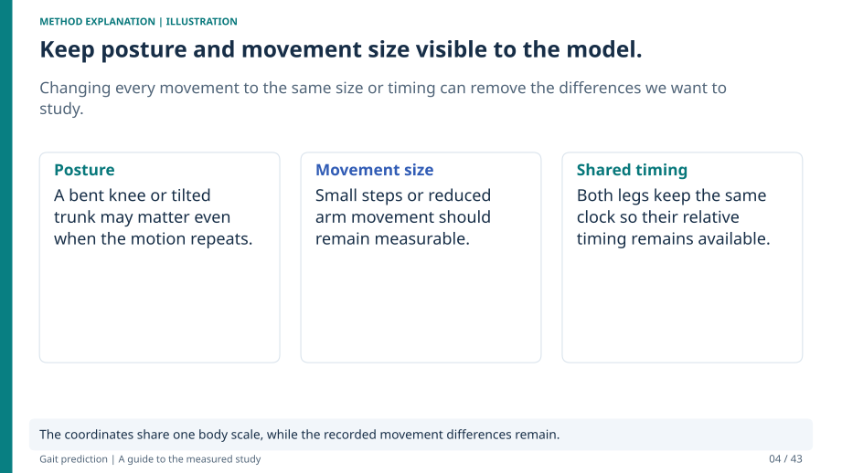

*Figure caption: The coordinates share one body scale, while the recorded movement differences remain.*

### Purpose

Show why preprocessing should preserve observable differences that might matter for gait analysis, including how far a joint moves and how the two sides move together.

### Explanation

Movement amplitude describes the size of a movement. A small excursion can repeat regularly, while an ordinary-sized movement can occur at an unusual time relative to the other leg. If every joint is rescaled separately, a small excursion may become indistinguishable from a larger one. Independently aligning each leg's cycle can similarly remove the timing relationship we hoped to examine.

### Reading the visual

The panels show posture, movement size and shared timing. Posture describes how the joints and trunk are positioned. Movement size describes how far they travel. Shared timing preserves when the two legs move relative to each other. These examples motivate the measurements; they are not measured disease-specific curves.

### Evidence and limits

The video representation uses a shared body reference and preserves elapsed time on a shared 15 Hz grid without independently aligning each leg to its own walking cycle. It centers positions on the pelvis and uses one torso scale, while retaining trunk tilt and differences between the limbs. These image measurements still depend on camera view and do not directly measure physical walking speed or ground clearance.

### Transition

We examine these ideas in two datasets that provide different observations: varied web videos and synchronized laboratory joint angles.

Sources: [Neurological evidence and novelty advice](../docs/iteration02/advice_neuro.md) · [Executed protocol](../docs/iteration02/protocol.md)

## 05. The study uses videos and laboratory measurements.

The datasets let us ask the same prediction question under different recording conditions.

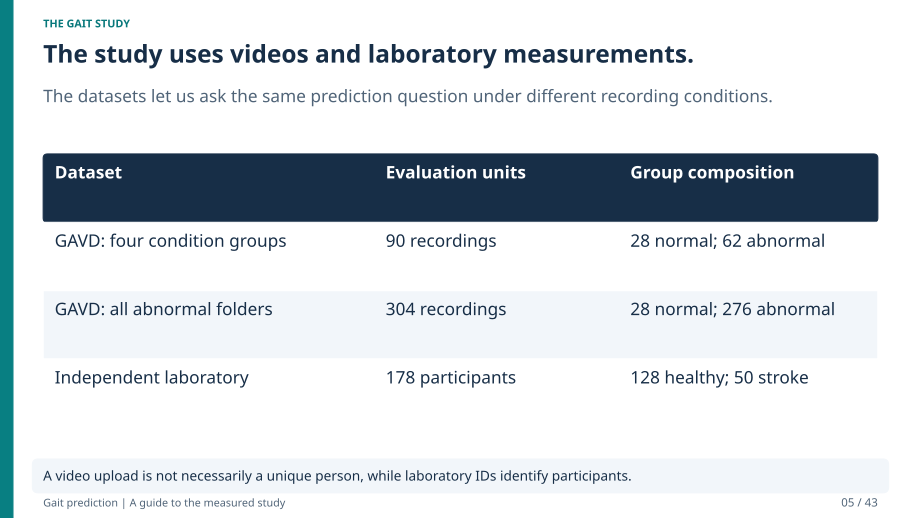

*Figure caption: A video upload is not necessarily a unique person, while laboratory IDs identify participants.*

### Purpose

Introduce the two observation settings and explain what an independent laboratory comparison adds to the video study.

### Explanation

GAVD contains web videos with annotated walking sequences. Its variety makes it useful for studying estimated body positions under different cameras and recording conditions. The laboratory dataset provides simultaneous angles from both legs and explicit participant identities. We fit new models to those angles, allowing us to examine the prediction comparison with a different measurement system.

### Reading the visual

The table separates the main GAVD comparison, the broader GAVD analysis and the laboratory population. The main video comparison contains 90 recordings, including 28 normal recordings. The broader analysis uses 304 recordings with the same 28 normals. The laboratory study contains 128 healthy and 50 stroke participants.

### Evidence and limits

A GAVD upload is a recording unit, and different uploads may show the same person. Laboratory identifiers support participant-level separation. Many overlapping windows from one recording provide repeated measurements rather than new people. The datasets also have different units and populations, so we keep their errors and rankings separate instead of pooling them.

### Transition

With the observation settings established, we can place our prediction task alongside existing approaches to learning from skeleton sequences.

Sources: [Executed protocol](../docs/iteration02/protocol.md) · [Verified study results](../docs/iteration02/results.md)

## 06. Prediction can use coordinates or learned features.

Self-supervised learning creates training targets from the observations rather than requiring condition labels.

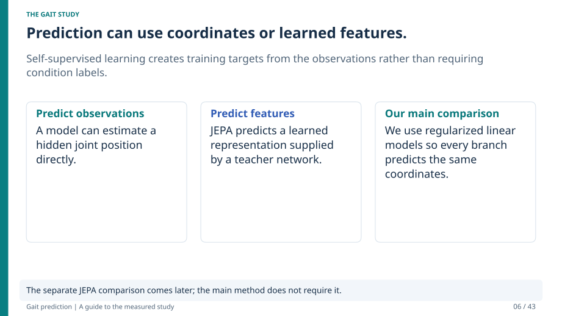

*Figure caption: The separate JEPA comparison comes later; the main method does not require it.*

### Purpose

Explain the difference between predicting an observable joint position and predicting a learned representation, so the audience can follow the study without prior JEPA knowledge.

### Explanation

Self-supervised learning creates a learning task from the data themselves, such as hiding part of a sequence and predicting what was removed. A Joint Embedding Predictive Architecture, or JEPA, predicts learned features supplied by a teacher network. Those features summarize the input. Our core experiment predicts coordinates or laboratory angles with regularized linear models, giving every branch the same observable answer.

### Reading the visual

The three panels distinguish predicting observations, predicting learned features and the main comparison in this study. Coordinate prediction is checked against recorded positions or angles. Feature prediction is checked against a learned representation. The third panel explains why a common observable answer helps us compare the effect of different inputs.

### Evidence and limits

GenGait, FSGait and SeeKer already study normal movement or conditional pose behavior. Beyond Marginals examines dependencies between signals, and SLiM uses anatomical masking. Our contribution concerns the controlled comparison and its evaluation. Separate small JEPA experiments are reported later and do not establish that JEPA causes the core completion gains.

### Transition

To make an observable-answer experiment credible, we first need to trace how annotations and downloaded videos become the joint measurements used for training.

Sources: [GenGait author manuscript](https://arxiv.org/abs/2604.01997v2) · [FSGait](https://openaccess.thecvf.com/content/ACCV2024/html/Duan_FSGait_Fine_Grained_Self-Supervised_Gait_Abnormality_Detection_ACCV_2024_paper.html) · [SeeKer](https://arxiv.org/abs/2506.18368) · [Beyond Marginals](https://arxiv.org/abs/2509.15033) · [SLiM current author manuscript](https://arxiv.org/html/2603.10648v4) · [Neurological evidence and novelty advice](../docs/iteration02/advice_neuro.md) · [Accessible manuscript and technical notes](../docs/draft03/README.md)

## 07. Follow each recording from annotation to joint coordinates.

The current CSV files determine the cohort, and saved metadata connects every measurement to its video.

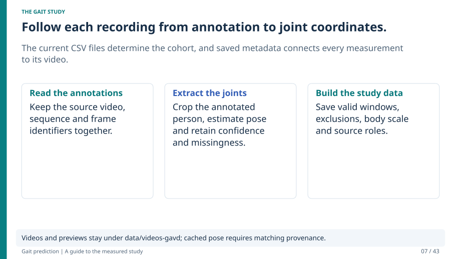

*Figure caption: Videos and previews stay under data/videos-gavd; cached pose requires matching provenance.*

### Purpose

Explain the data-processing path so that every prediction can be traced back to an annotated walking interval and its local video.

### Explanation

The refreshed files in data/gavd provide category labels and annotated sequences. Downloads belong under data/videos-gavd. The pose pipeline crops the annotated person, estimates body landmarks and maps their positions back into the full image. Coordinates with insufficient confidence remain unavailable. A plausible-looking pose can still follow the wrong person, so extraction quality needs direct video inspection.

### Reading the visual

Follow the panels from annotations, through video and pose extraction, to the retained cohort record. Each stage contributes information needed to reproduce the next. Recording identifiers connect sequences and windows to the same source rather than treating every short segment as a separate person.

### Evidence and limits

Reusable pose files require matching video and extraction provenance, while category labels are rebuilt from the current annotation files. The retained 304-recording population follows explicit quality and observation requirements. The saved evidence includes source mappings, unavailable measurements and exclusion reasons, allowing another researcher to check who actually enters a result.

### Transition

Once this processing path is clear, we can examine the category counts and the distinction between detecting abnormal gait and predicting a specific condition label.

Sources: [Read-only data and ingestion review](../docs/iteration02/advice_data.md) · [Executed protocol](../docs/iteration02/protocol.md) · [Independent notebooks 12–17](../12_observation_population_and_video_context.ipynb)

## 08. The main video comparison contains 90 recordings.

We compare normal walking with four condition groups and retain every other abnormal folder in a second analysis.

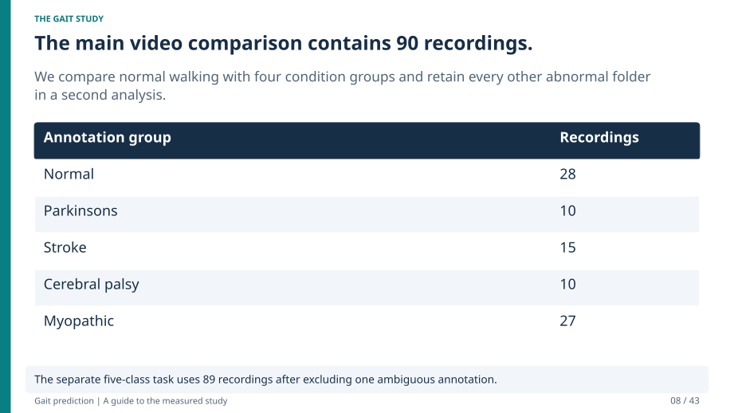

*Figure caption: The separate five-class task uses 89 recordings after excluding one ambiguous annotation.*

### Purpose

Clarify the two label-based questions and make the small number of recordings in each condition family visible.

### Explanation

The main binary task asks whether a recording is labeled normal or belongs to one of four selected condition groups. It includes 28 normal, 10 Parkinsons, 15 stroke, 10 cerebral-palsy and 27 myopathic recordings, totaling 90. A separate five-class task asks which category applies, so it requires an unambiguous category label and uses a different eligibility rule.

### Reading the visual

Read the table as recording counts for the main comparison. The sizes describe the available groups rather than verified numbers of independent patients. The normal folder supplies the normal category, and the selected non-normal folders supply the abnormal side of the binary comparison.

### Evidence and limits

One cerebral-palsy recording also carries a generic abnormal annotation. It remains one recording in binary evaluation but is excluded from the five-class experiment under the fixed ambiguity rule, leaving 89 recordings. The broader secondary binary analysis uses all non-normal folders. None of these folder labels is independently revalidated as a clinical diagnosis.

### Transition

These recordings produce many short windows, so the next step is to distinguish the amount of movement observed from the number of independent evaluation units.

Sources: [Executed protocol](../docs/iteration02/protocol.md) · [Verified study results](../docs/iteration02/results.md)

## 09. A short window contains several related observations.

At 15 samples per second, 32 samples span about 2.07 seconds from the first sample to the last.

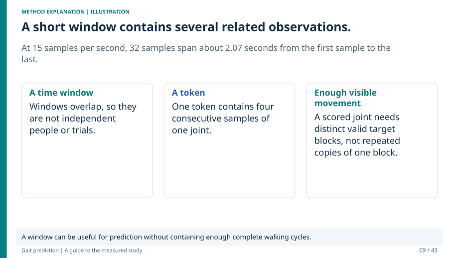

*Figure caption: A window can be useful for prediction without containing enough complete walking cycles.*

### Purpose

Explain what one model window contains and why adding windows or masks does not create additional independent evidence.

### Explanation

The video measurements are sampled 15 times per second. A window contains 32 samples, spanning 31 intervals or about 2.07 seconds. Within a window, a token is one joint observed over four consecutive samples. Walking speed varies, so the same duration does not guarantee a fixed number of complete walking cycles. Longer windows can provide more context but also exclude short or incomplete recordings.

### Reading the visual

Read the panels from a window to a token and then to the support required for a measured target. An overlapping window is one short interval, while a token contains four samples of one joint. Distinct target support counts different hidden intervals, not repeated masks of the same interval. None of these units is an independent participant.

### Evidence and limits

The retained video population supplies 9,442 overlapping windows from 304 recordings. Evaluation groups these measurements by their recording. Each scored joint must have four distinct physical target blocks, and drawing another mask over an existing block cannot increase that support count. Timing tests use a separate 48-sample parent interval.

### Transition

Having defined the time window and token, we can identify which body landmarks enter the model and which ones contribute to its final joint-specific measurements.

Sources: [Executed protocol](../docs/iteration02/protocol.md) · [Read-only data and ingestion review](../docs/iteration02/advice_data.md) · [Confidence filtering and selection shift](https://arxiv.org/abs/2610.39704)

## 10. Use a fixed set of 16 joints and score the lower legs.

The joint list is fixed before training. Overall window-quality checks still include all 16 joints.

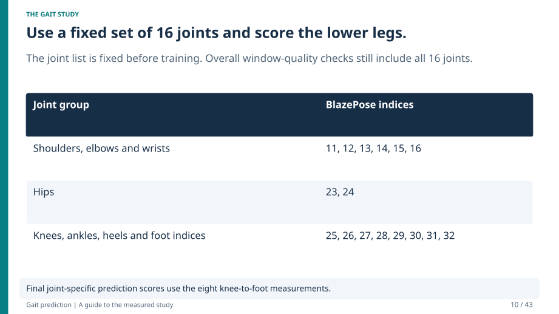

*Figure caption: Final joint-specific prediction scores use the eight knee-to-foot measurements.*

### Purpose

Separate the landmarks available to the processing pipeline from the lower-leg targets used to summarize prediction performance.

### Explanation

The fixed input set contains 16 BlazePose landmarks. Indices 11 through 16 cover paired shoulders, elbows and wrists; 23 and 24 are the hips; and 25 through 32 cover knees, ankles, heels and foot-index points near the front of each foot. The eight lower-leg landmarks supply the joint-specific readouts. Overall window-quality checks still include all 16 landmarks, so missing arms can affect eligibility.

### Reading the visual

Read the table by anatomical role. The upper row belongs to the masking and overall quality-check set; it does not grant unrestricted arm access to the leg predictors. The hip row contributes to the shared body reference, and the lower row contains the scored targets. Each predictor receives only its permitted leg observations, conditional on that shared reference.

### Evidence and limits

Coordinates are centered on the pelvis and divided by a torso scale from the first half of the window. Both prediction branches share this body reference. Consequently, an own-leg input restriction is conditional on that reference and cannot establish independence from every opposite-side body measurement.

### Transition

The measurements are now defined. We next assign recordings to fitting, reference estimation and testing so that those stages do not reuse the same evaluation observations.

Sources: [Executed protocol](../docs/iteration02/protocol.md) · [Verified study results](../docs/iteration02/results.md)

## 11. Give fitting, reference estimation and testing separate roles.

Each of four outer folds assigns the 28 normal recordings to three distinct groups.

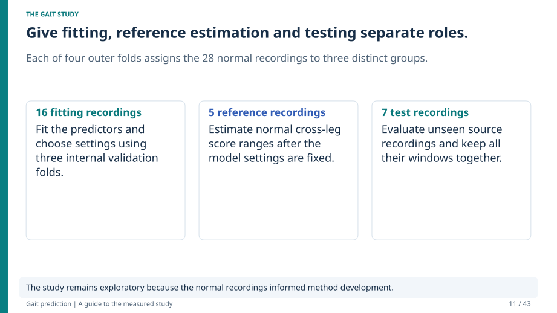

*Figure caption: The study remains exploratory because the normal recordings informed method development.*

### Purpose

Explain the different jobs of fitting, reference and test recordings, especially why normal examples are needed for more than model training.

### Explanation

The study uses four rotations of the evaluation split, called folds. In each fold, 16 normal recordings fit the prediction models, five other normals describe the usual range of cross-leg benefit, and seven normals are held out for testing. Abnormal recordings are evaluated without training these normal-only models. Separately labeled supervised classifiers use their own training labels.

### Reading the visual

Read the three panels as distinct groups of recordings. Fitting includes internal validation for choosing model settings. Reference estimation establishes the normal comparison range after those settings are chosen. Testing measures behavior on recordings excluded from both jobs in that fold. All overlapping windows from a recording remain together.

### Evidence and limits

The five reference recordings do not choose model settings or score weights. The 28 normal GAVD recordings informed method development, so this remains exploratory despite the within-experiment separation. Different fold models share training sources, and unknown repeated people across uploads remain possible. The laboratory study separately assigns participant identities.

### Transition

With these roles in place, we can fit a local prediction once and ask what each additional correction contributes to the same hidden answer.

Sources: [Executed protocol](../docs/iteration02/protocol.md) · [Verified study results](../docs/iteration02/results.md)

## 12. Compare two corrections to the same own-leg baseline.

One correction uses extra own-leg features, while the other adds opposite-leg observations.

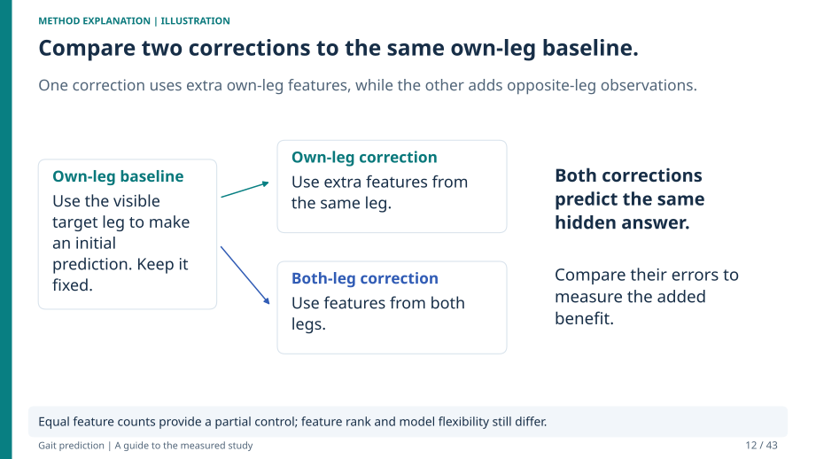

*Figure caption: Equal feature counts provide a partial control; feature rank and model flexibility still differ.*

### Purpose

Make the three prediction branches explicit and explain why the central comparison includes an additional own-leg correction.

### Explanation

The Own-leg baseline f predicts the hidden movement from visible observations on the target leg. After fitting, its output stays fixed. The Own-leg correction f+h adds movement summaries from that same leg. The Both-leg correction f+g adds opposite-leg information while retaining the baseline. Comparing f+h with f+g helps distinguish useful added context from the benefit of fitting an extra correction.

### Reading the visual

Follow the saved baseline into the two correction branches. Both end at predictions of the identical target, so their squared errors can be compared directly. The benefit is own-leg-correction error minus both-leg-correction error. A positive value means that the both-leg branch predicts more accurately for that target.

### Evidence and limits

Both corrections have 154 input features and can choose zero correction, which reproduces the baseline. Their recorded numerical feature ranks differ, however, so equal width does not equalize all modeling flexibility. Input restrictions also remain conditional on the shared body reference. The measured gain applies to these fitted predictor families.

### Transition

Before interpreting such a gain, we need checks that the implementation respects its input restrictions and that the prediction task is learnable from the available normal observations.

Sources: [Executed protocol](../docs/iteration02/protocol.md) · [Verified study results](../docs/iteration02/results.md)

## 13. Check the predictor before interpreting its behavior.

Software checks and normal-data validation test whether the model can answer the intended question.

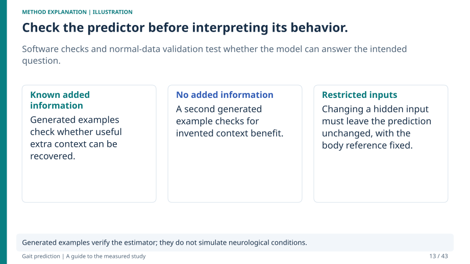

*Figure caption: Generated examples verify the estimator; they do not simulate neurological conditions.*

### Purpose

Explain the checks that distinguish a useful prediction comparison from a software error or a predictor that cannot solve its assigned task.

### Explanation

Generated examples can make the additional input genuinely informative or deliberately uninformative about the target. These cases check whether the estimator responds in the expected direction. Other checks change inaccessible inputs or set a correction to zero. The predictions should remain unchanged when hidden inputs change, and zero correction should return the saved baseline exactly.

### Reading the visual

Read the panels as three complementary checks: recovering known dependence, avoiding invented dependence, and enforcing the information-access rules. Passing a generated example validates a particular behavior of the implementation. The next requirement uses real normal recordings with the same input conditions as the intended prediction task.

### Evidence and limits

Normal-only internal validation requires the both-leg predictor to beat both local alternatives in at least two of three folds and in their average error. This is an operational selection rule. A failure disables the relational component while retaining movement-based ranking within the fold. Adequacy must be checked again when a diagnostic removes additional observations.

### Transition

The pattern of hidden observations is therefore part of the question we are testing. We now specify the three training patterns before comparing their effects.

Sources: [Executed protocol](../docs/iteration02/protocol.md) · [Verified study results](../docs/iteration02/results.md)

## 14. Three training masks hide observations in different patterns.

Every example below hides half the tokens without inspecting movement speed or the condition label.

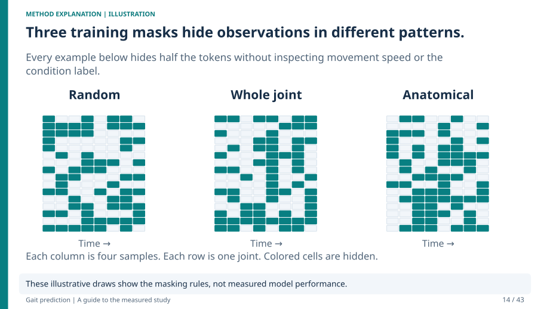

*Figure caption: These illustrative draws show the masking rules, not measured model performance.*

### Purpose

Introduce the three masking methods as different ways of hiding observations together while keeping the total hidden amount fixed.

### Explanation

Each window has eight time blocks for each of 16 joints, giving 128 tokens. Random U hides 64 tokens uniformly. Whole joint J hides all eight blocks of one randomly selected joint, then fills the remaining budget with 56 random tokens. Anatomical A hides an eight-token group covering a small body region over consecutive times and then adds 56 random tokens.

### Reading the visual

In each grid, rows identify joint landmarks and columns identify four-sample time blocks. Teal cells are hidden; pale cells are visible before measurement-validity checks. All hidden cells use the same color, whether they belong to the structured core or the random fill. The anatomical draw illustrates one permitted group; other draws can hide other declared body groups.

### Evidence and limits

The drawings illustrate implemented sampling rules rather than model predictions. None of the methods consults movement speed, confidence, condition labels or prediction loss when choosing masks. Naturally invalid observations are filtered afterward without redrawing a more favorable mask. This deliberately separates masking from motion-aware sampling used in related skeleton methods.

### Transition

An equal total is only one control. The next slide shows how the structured choices also give each individual token the same probability of being hidden.

Sources: [Controlled masking methods review](../docs/iteration02/masking_method_review.md) · [MAMP primary paper](https://arxiv.org/abs/2308.07092) · [Skeleton S-JEPA primary paper](https://www.ecva.net/papers/eccv_2024/papers_ECCV/papers/04755.pdf) · [SLiM current author manuscript](https://arxiv.org/html/2603.10648v4) · [Executed protocol](../docs/iteration02/protocol.md)

## 15. Keep the hiding rate equal while changing the pattern.

The methods differ in which observations disappear together, not in how often each token is hidden.

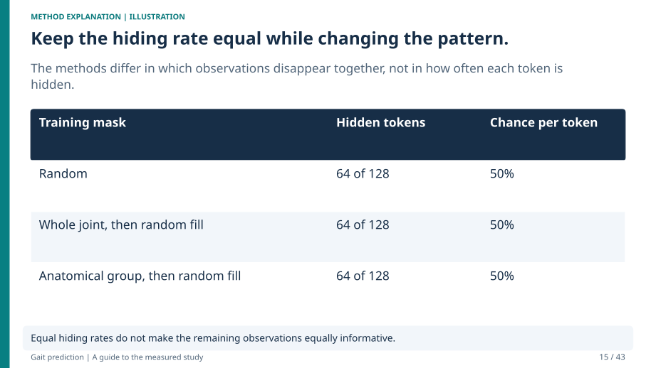

*Figure caption: Equal hiding rates do not make the remaining observations equally informative.*

### Purpose

Explain the probability control behind anatomical masking without implying that equally frequent hiding makes every reconstruction task equally difficult.

### Explanation

The anatomical groups are disjoint and cover the 16 landmarks. A four-joint group occupies two consecutive time blocks, while a two-joint arm group occupies four blocks. Every structured core therefore contains eight tokens. Choosing groups in proportion to their width and choosing among the listed aligned starts gives each token a one-in-sixteen chance of entering that core.

### Reading the visual

Read across the three training-mask rows. Each hides exactly 64 of 128 tokens, and every individual token has a 50% chance of being hidden. The equal totals and probabilities are the controls shown in this table. The eight-token-core calculation explains how the structured policies achieve those controls; it is not a separate table of body groups on this slide.

### Evidence and limits

A token outside the core can still be selected when 56 of the other 120 positions are filled. Its total hiding probability is 1/16 plus 15/16 times 56/120, which equals one half. Random U and Whole joint J have the same individual probability. Correlations between hidden positions and the number of usable targets can still differ.

### Transition

These controls define comparable training procedures. We next keep the evaluation masks fixed so that a training difference is measured against the same prediction question.

Sources: [Executed protocol](../docs/iteration02/protocol.md) · [Verified study results](../docs/iteration02/results.md)

## 16. Test every training mask on the same two hiding tasks.

Scattered hiding leaves different local clues from grouped hiding, so comparisons stay within each task.

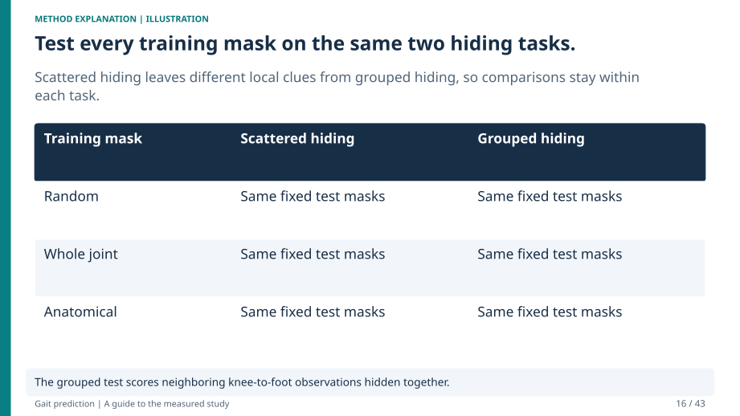

*Figure caption: The grouped test scores neighboring knee-to-foot observations hidden together.*

### Purpose

This slide explains how we compare training masks fairly. If each model were tested on a different pattern of missing joints, a performance difference could reflect the question we asked rather than what the model learned.

### Explanation

We therefore give Random U, Whole joint J and Anatomical A the same saved test masks. Scattered hiding (U bank) removes observations throughout the window. Grouped hiding E_leg deliberately removes neighboring lower-leg observations together, making nearby joints less available as clues. These are two distinct completion tasks, and each is evaluated separately.

### Reading the visual

Read across each training-method row. Every method is tested on both scattered and grouped hiding, using the saved masks for each task. Within either column, the same physical targets and mask draws support the comparison, rather than a fresh random test for each method.

### Evidence and limits

Both banks contain 16 masks, each hiding 64 of 128 tokens. Grouped hiding E_leg balances left and right legs and four temporal starts, and scores only the eight deliberately grouped tokens in each mask. The stored banks make these comparisons reproducible. Matching the number hidden does not make the two tasks equally difficult.

### Transition

With the evaluation questions fixed, the next slide identifies which parts of model fitting change across the three training methods and which parts remain shared.

Sources: [Executed protocol](../docs/iteration02/protocol.md) · [Verified study results](../docs/iteration02/results.md)

## 17. Hold the rest of the prediction experiment fixed.

The mask comparison reuses the own-leg baseline and changes how the correction models see missing inputs.

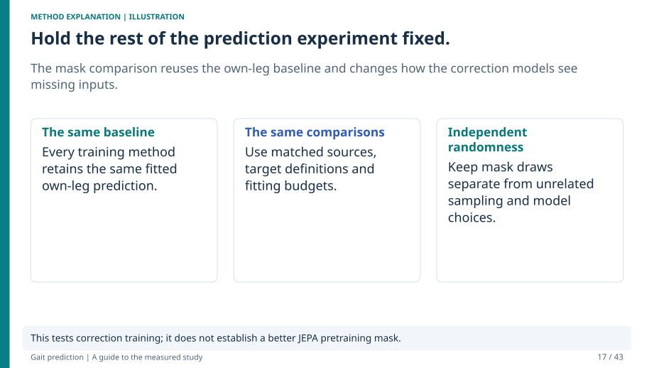

*Figure caption: This tests correction training; it does not establish a better JEPA pretraining mask.*

### Purpose

This slide locates the masking experiment within the model. It tests how different missing-observation patterns train the corrections, while preserving a common starting prediction for every comparison.

### Explanation

The Own-leg baseline f is trained with Random U and then kept fixed. For each masking policy, the Own-leg correction f+h learns from the target leg, while the Both-leg correction f+g can also use the opposite leg. Normal-only internal validation selects regularization and correction size. Separate random streams prevent a mask choice from unintentionally changing the source sampling schedule.

### Reading the visual

The first card identifies the shared baseline, the second identifies the matched comparisons, and the third explains separate random streams. A drawn mask can hide measurements that were already invalid, so equal masking budgets need not produce identical numbers of usable training targets. The saved support counts show that difference.

### Evidence and limits

The two corrections each have 154 features and the same output dimension. Their recorded numerical ranks differ, so equal width does not establish equal effective flexibility. This completed comparison concerns coordinate predictors. It does not demonstrate an optimal JEPA encoder mask, and the separate JEPA experiment has its own training recipe.

### Transition

The next slide checks whether these fitted corrections work adequately on normal development recordings before we interpret their behavior on held-out recordings.

Sources: [Executed protocol](../docs/iteration02/protocol.md) · [Verified study results](../docs/iteration02/results.md)

## 18. The corrections pass the internal prediction check.

These points summarize normal validation data used for model selection, before evaluating test recordings.

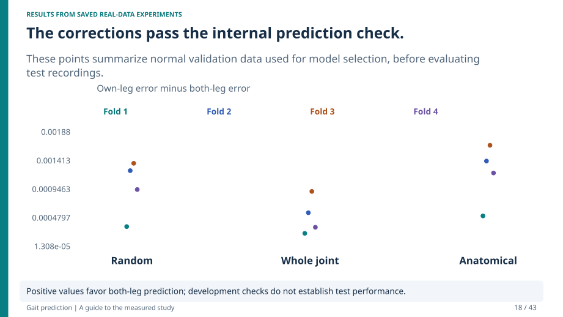

*Figure caption: Positive values favor both-leg prediction; development checks do not establish test performance.*

### Purpose

Before using a cross-leg prediction as a measurement, we need evidence that the model can make useful predictions. This development check asks whether the Both-leg correction f+g improves on sensible local alternatives.

### Explanation

Within each outer training set, three internal folds hold out normal recordings in turn. The selected both-leg recipe must improve on the Own-leg baseline f and the Own-leg correction f+h in at least two of those three folds, with improvement in the average validation loss as well. Abnormal labels do not choose these settings.

### Reading the visual

Each point summarizes one outer fold and training policy. Positive values mean that the Both-leg correction f+g has lower validation error than the Own-leg correction f+h. The point plot shows one part of the check; the saved gate also compares against the baseline.

### Evidence and limits

All 12 combinations of four outer folds and three masking policies pass the declared development rule. These are checks after model selection on the same development folds, so they are not independent test results. Passing permits evaluation; it cannot guarantee a benefit on every recording or observation pattern.

### Transition

We now move from normal development data to the held-out normal recordings and examine how the prediction benefit changes between scattered and grouped hiding.

Sources: [Executed protocol](../docs/iteration02/protocol.md) · [Verified study results](../docs/iteration02/results.md)

## 19. Test-set prediction benefit depends on what is hidden.

Each normal recording is evaluated by its held-out fold model, using identical targets within each task.

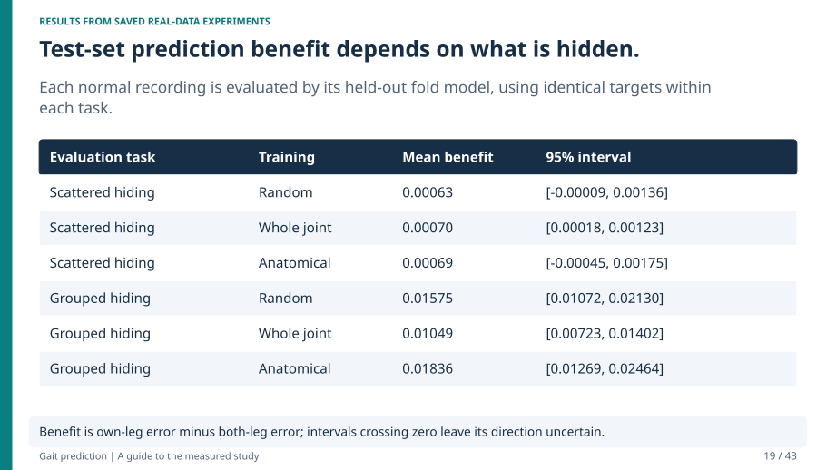

*Figure caption: Benefit is own-leg error minus both-leg error; intervals crossing zero leave its direction uncertain.*

### Purpose

This slide asks the central completion question on held-out normal recordings: after using the target leg, how much does the fitted model gain from also using the other leg?

### Explanation

Benefit is the error of the Own-leg correction f+h minus the error of the Both-leg correction f+g on the same hidden target. A positive value means that the both-leg prediction is more accurate. We calculate that difference for Random U, Whole joint J and Anatomical A under each fixed evaluation bank.

### Reading the visual

First compare the three methods within Scattered hiding (U bank), then within Grouped hiding E_leg. Read the interval beside each mean, rather than ranking methods from the means alone. An interval crossing zero leaves the direction of the benefit uncertain under this analysis.

### Evidence and limits

All 28 held-out normal recordings contribute to each result. On scattered hiding, the Random U and Anatomical A intervals include zero. All three grouped-hiding intervals are positive. Removing neighboring leg observations together makes opposite-leg context more useful to these fitted predictors, although the two banks ask different questions and their absolute errors are not interchangeable.

### Transition

The next slide makes these predictions concrete by showing one saved coordinate patch alongside its measured target, before we return to the aggregate completion results.

Sources: [Executed protocol](../docs/iteration02/protocol.md) · [Verified study results](../docs/iteration02/results.md)

## 20. Inspect one saved prediction alongside its hidden answer.

All three predictions refer to the same four samples from a real normal-labeled recording.

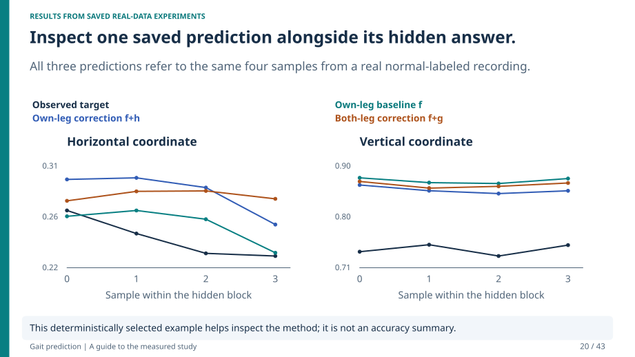

*Figure caption: This deterministically selected example helps inspect the method; it is not an accuracy summary.*

### Purpose

This example connects the numerical experiment to an actual movement measurement. It lets us inspect what the three predictors produce for the same hidden patch instead of treating an error value as an abstract result.

### Explanation

The observed target is a four-sample block from BlazePose joint 25, the left knee. The Own-leg baseline f predicts it from permitted target-leg observations. The Own-leg correction f+h adjusts that prediction using additional own-leg features, while the Both-leg correction f+g can also use opposite-leg observations. Every comparison retains the same target and body reference.

### Reading the visual

Follow each predicted trace against the observed coordinate trace. The plotted coordinates use the experiment's body-centered, torso-scaled representation, so their values are not distances in meters. The accompanying source identifiers allow the corresponding video and pose overlay to be opened in notebook 13.

### Evidence and limits

This is the saved example from source 3KnFt8bH3tE, sequence cljo2wwu7001a3n6ljmqm39l6, joint 25 and patch 1. It was selected deterministically by source and target order, not by the largest improvement. One patch helps audit coordinate order and target identity, but it does not estimate typical accuracy.

### Transition

Having seen an individual prediction, we can now summarize completion gains across the normal recordings and the independent laboratory participants without mistaking this example for the overall result.

Sources: [Executed protocol](../docs/iteration02/protocol.md) · [Verified study results](../docs/iteration02/results.md)

## 21. The other leg helps complete two kinds of measurements.

Both rows compare the both-leg correction with the own-leg correction on the same hidden answers.

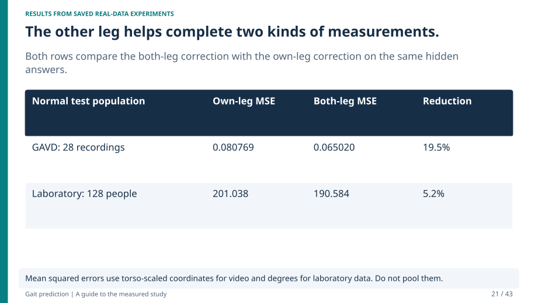

*Figure caption: Mean squared errors use torso-scaled coordinates for video and degrees for laboratory data. Do not pool them.*

### Purpose

The two results here show where opposite-leg context improves completion across groups of held-out observations. They compare the Both-leg correction f+g with the Own-leg correction f+h, rather than comparing two training masks.

### Explanation

In GAVD, Random U training reduces mean normal-recording error by 19.5% on Grouped hiding E_leg. In the laboratory data, the corresponding reduction is 5.2% across 128 held-out healthy participants. Each percentage divides the difference between group mean errors by the own-leg comparator's mean error. It is not an average of individual percentage improvements.

### Reading the visual

Read the two results separately. GAVD predicts torso-scaled image coordinates, whereas the laboratory study predicts processed joint angles in degrees. The percentages communicate relative improvement within each study; the underlying error values should not be pooled across these measurement systems.

### Evidence and limits

The GAVD absolute benefit is 0.015748, with conditional 95% interval [0.010721, 0.021300]. The laboratory relative interval is [3.6%, 6.7%], calculated after outcome inspection from frozen predictions. Neither interval includes retraining uncertainty. Different feature ranks also mean these gains establish useful fitted predictor families, rather than isolate a capacity-free neurological relationship.

### Transition

The next slide asks a different question: using the same both-leg predictor design and evaluation targets, with the correction weights refitted, does Anatomical A training improve completion compared with Random U training?

Sources: [Post-outcome paired completion audit](../docs/draft03/advisory/completion_audit_v1/README.md) · [Accessible manuscript and technical notes](../docs/draft03/README.md) · [Executed protocol](../docs/iteration02/protocol.md)

## 22. Anatomical training helps when neighboring joints are hidden.

Only the correction training mask changes; predictor design and evaluation targets remain the same.

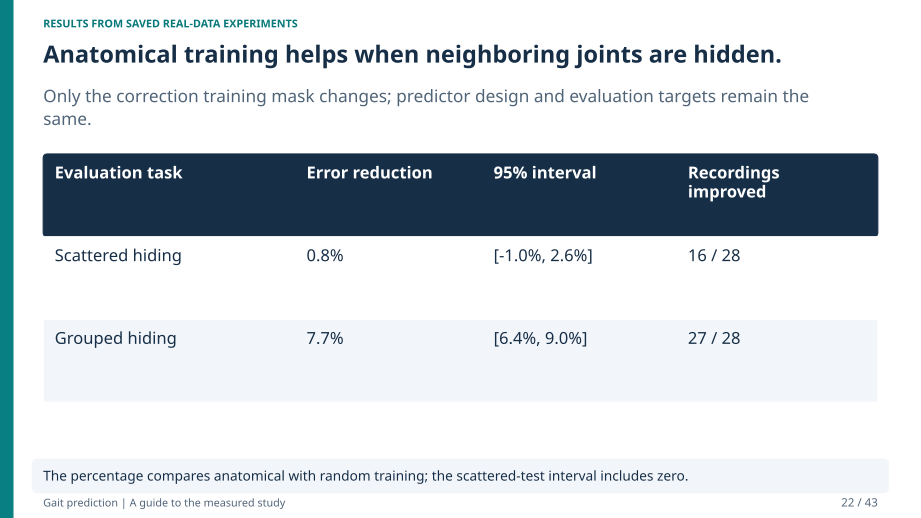

*Figure caption: The percentage compares anatomical with random training; the scattered-test interval includes zero.*

### Purpose

This comparison tests the training mask itself. Both sides use the Both-leg correction f+g, so the question is whether Anatomical A training prepares that model better than Random U training for a particular missing-observation task.

### Explanation

On Grouped hiding E_leg, mean error decreases from 0.065020 with Random U to 0.060009 with Anatomical A. That is a 7.7% reduction, with a conditional 95% interval from 6.4% to 9.0%. On Scattered hiding (U bank), the reduction is only 0.8%, with an interval from -1.0% to 2.6%.

### Reading the visual

Use zero as the reference for the two relative-improvement estimates. The grouped-hiding interval stays above zero, while the scattered-hiding interval crosses it. The pattern supports matching training to a specific kind of missing context, rather than expecting the same advantage everywhere.

### Evidence and limits

The paired audit verifies matching sources, physical targets and evaluation masks across the two training methods. On grouped hiding, 27 of 28 recordings improve. These intervals were calculated after inspecting saved outcomes and are descriptive, with models held fixed. The result concerns coordinate completion, not a new masking family, neurological mechanism or demonstrated anomaly-detection gain.

### Transition

To examine anomaly detection, we next turn prediction benefit into a separate cross-leg score and explain how it is combined with directly observed movement.

Sources: [Post-outcome paired completion audit](../docs/draft03/advisory/completion_audit_v1/README.md) · [Accessible manuscript and technical notes](../docs/draft03/README.md) · [Executed protocol](../docs/iteration02/protocol.md)

## 23. The three anomaly scores describe different quantities.

Cross-leg benefit becomes an anomaly score only after comparison with separate normal reference recordings.

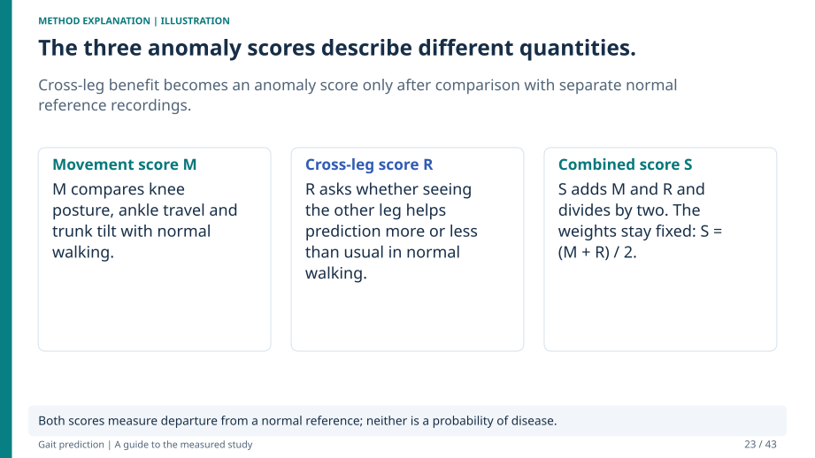

*Figure caption: Both scores measure departure from a normal reference; neither is a probability of disease.*

### Purpose

Accurate completion and anomaly detection answer different questions. This slide explains how the study turns observed movement and cross-leg prediction benefit into separate recording-level anomaly scores.

### Explanation

Movement M measures how unusual the visible posture and movement are. Its 16 video measurements describe knee posture, ankle travel, changes in movement speed, trunk tilt and side differences. Cross-leg R asks a different question: is the improvement from seeing the other leg unusual compared with separate normal reference recordings? Either an unusually large or unusually small improvement can increase R.

### Reading the visual

Read the first two cards as separate measurements. M describes the visible movement. R describes how much the opposite leg helps predict a hidden part of movement, compared with the normal reference. The third card adds these two scores and divides by two to form S. The weights stay fixed rather than being selected to improve the test results.

### Evidence and limits

M learns its reference from fitting-normal recordings. R uses five different normal recordings reserved until after model selection. For each target leg, R subtracts the normal mean benefit, scales the difference by estimated normal variation, and squares it; the final score averages the two legs. This reference scaling does not produce a probability of disease. Five recordings give an uncertain estimate, and equal weights do not guarantee equally reliable score scales.

### Transition

Before comparing these scores, the next slide explains how repeated predictions become one recording-level result and how the evaluation avoids counting correlated windows as independent evidence.

[Plain-language guide to the three scores](score_guide.md)

Sources: [Executed protocol](../docs/iteration02/protocol.md) · [Verified study results](../docs/iteration02/results.md)

## 24. Evaluate whole recordings rather than repeated windows.

Multiple masks and overlapping windows provide repeated measurements of the same recording.

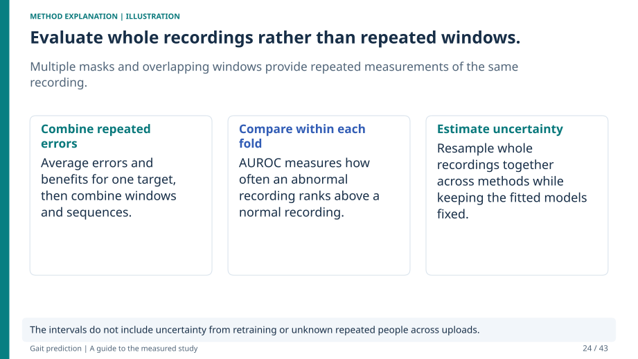

*Figure caption: The intervals do not include uncertainty from retraining or unknown repeated people across uploads.*

### Purpose

A recording can generate many overlapping windows and masked predictions, but those predictions do not create new independent people. This slide explains the aggregation and uncertainty calculations used to evaluate the anomaly scores.

### Explanation

We first average prediction errors and benefits across repeated masks of the same physical target, then aggregate targets, windows and sequences into recording-level measurements while retaining the declared joint weights. AUROC then measures how often an abnormal recording receives a higher anomaly score than a normal recording. We calculate it within each fold and weight folds by their numbers of normal-abnormal pairs.

### Reading the visual

Follow the measurement hierarchy toward a single recording score before reading the ranking step. This avoids giving a long or heavily sampled video extra influence merely because it supplies more windows. The resampling step keeps every method's score for a recording together.

### Evidence and limits

Detection intervals use 1,000 paired bootstrap resamples within fold and label group, with the original fold weights fixed. They condition on the saved fitted models and selected analysis. They exclude retraining variation and cannot resolve unknown repeated people across uploads. Average precision is also reported with each fold's abnormal fraction, because that fraction affects its interpretation.

### Transition

With the recording-level evaluation defined, the next slide compares Movement M and Combined S on the main four-condition group and the broader collection of abnormal folders.

[Plain-language guide to the three scores](score_guide.md)

Sources: [Executed protocol](../docs/iteration02/protocol.md) · [Verified study results](../docs/iteration02/results.md)

## 25. Movement alone ranks the video labels more accurately.

Both comparisons use the same frozen scores; one includes four condition groups and the other all abnormal folders.

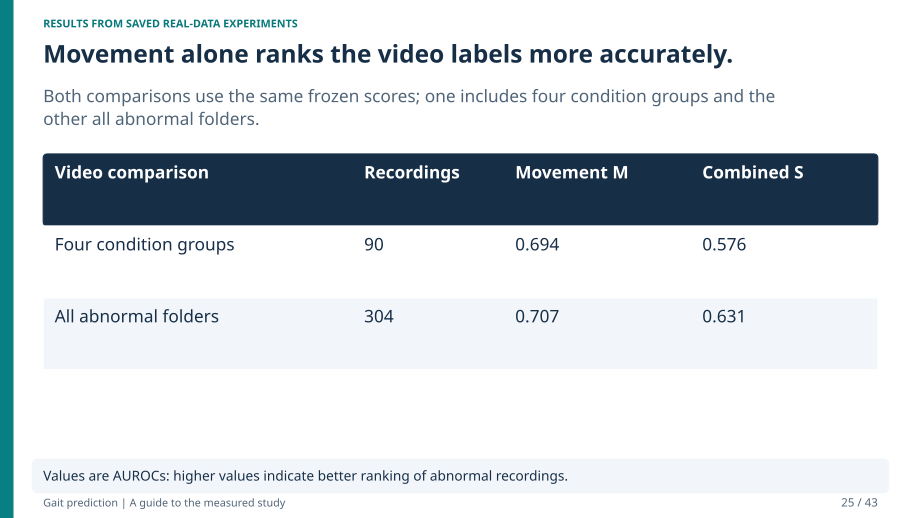

*Figure caption: Values are AUROCs: higher values indicate better ranking of abnormal recordings.*

### Purpose

This slide reports whether adding Cross-leg R to Movement M improves the ranking of abnormal recordings. It keeps the detection question separate from the positive completion results we have already examined.

### Explanation

In the main group of 90 recordings, Movement M reaches AUROC 0.694 and Combined S reaches 0.576. This group contains normal recordings and the four requested condition families. Across all 304 retained recordings, treating every non-normal folder as abnormal, the corresponding values are 0.707 and 0.631. Higher AUROC means more accurate ranking under these dataset labels.

### Reading the visual

Compare the two score columns within each row. Both rows show the same direction: the fixed average performs less well than movement alone. The broader row reuses the main group's recordings, so it is a wider population analysis rather than a second independent dataset.

### Evidence and limits

Both comparisons use the same frozen source scores, and prediction-based scores use Scattered hiding (U bank). The study remains exploratory, and folder labels are not independently verified diagnoses. These findings concern the specified cross-leg score and fixed combination. They do not imply that opposite-leg information is useless for completion or for every possible detector.

### Transition

The next slide examines paired uncertainty around these differences, so we can distinguish a measured direction from a small change that the current data cannot resolve.

[Plain-language guide to the three scores](score_guide.md)

Sources: [Executed protocol](../docs/iteration02/protocol.md) · [Verified study results](../docs/iteration02/results.md)

## 26. Use paired intervals to judge the size of a difference.

Each interval compares two scores on the same recordings, with the trained models held fixed.

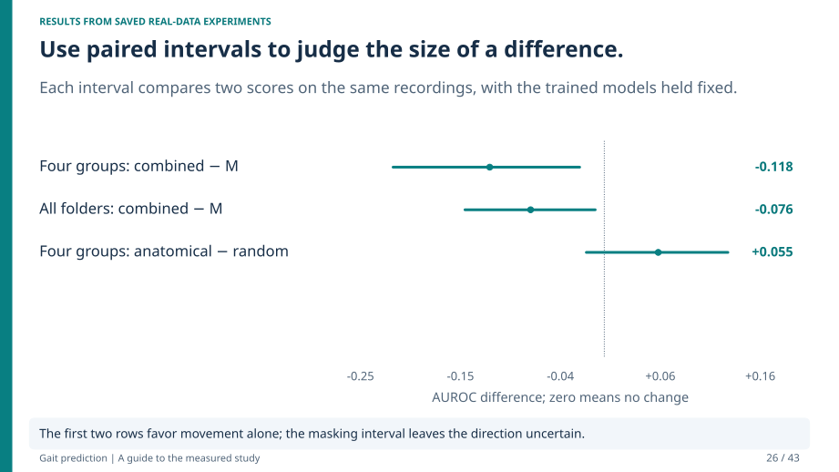

*Figure caption: The first two rows favor movement alone; the masking interval leaves the direction uncertain.*

### Purpose

Point estimates summarize the saved test results, while paired intervals show how much those differences vary when recordings are resampled. This slide puts the key score comparisons on a common difference scale.

### Explanation

For Combined S minus Movement M, a negative value favors movement alone. The main GAVD difference is -0.118, with a conditional 95% interval from -0.217 to -0.025. The broad difference is -0.076, with interval [-0.143, -0.009]. The third row compares Anatomical with Random training for the same combined score on the main group.

### Reading the visual

Use the vertical zero line to interpret each bar. The two combination comparisons lie below zero. The Anatomical A minus Random U detection comparison crosses zero, even though its point estimate is positive. That uncertainty is compatible with several directions of effect; it does not establish equivalence.

### Evidence and limits

The detection intervals use 1,000 paired resamples of recordings while keeping fitted models and original fold weights fixed. Multiple comparisons remain exploratory and unadjusted. The two GAVD rows share recordings, so the plot should not be read as independent confirmations.

### Transition

We next examine all three training-mask detection results together, preserving the same scattered-hiding evaluation task and the distinction between a higher point estimate and an established advantage.

[Plain-language guide to the three scores](score_guide.md)

Sources: [Executed protocol](../docs/iteration02/protocol.md) · [Verified study results](../docs/iteration02/results.md)

## 27. The scattered test does not establish a better training mask.

All three rows use the same scattered-hiding task and the same combined-score definition.

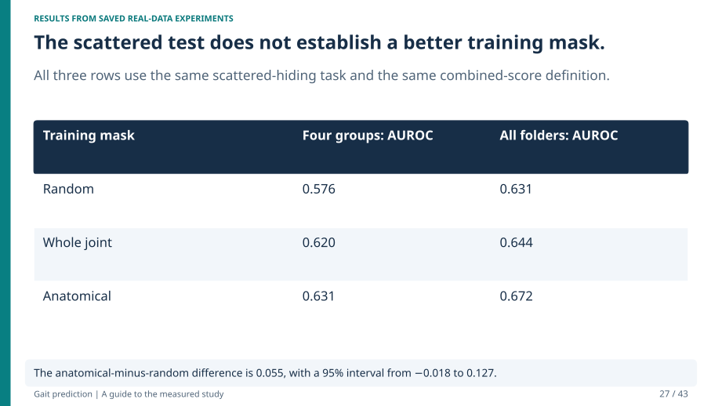

*Figure caption: The anatomical-minus-random difference is 0.055, with a 95% interval from −0.018 to 0.127.*

### Purpose

This slide shows the complete training-mask comparison for anomaly detection under Scattered hiding (U bank). Keeping all three policies visible prevents the largest point estimate from becoming a stronger conclusion than the uncertainty supports.

### Explanation

For the main four-condition group, Combined S reaches AUROC 0.576 with Random U, 0.620 with Whole joint J and 0.631 with Anatomical A. The broad results are 0.631, 0.644 and 0.672. Every row uses the same evaluation masks, recording population and score formula; the correction training policy is the factor being compared.

### Reading the visual

Read down one population column at a time. Anatomical A has the largest displayed point estimate, but the table alone does not show whether its advantage is established. Relate it to the paired interval from the preceding slide rather than interpreting row order as a ranking of proven methods.

### Evidence and limits

The main Anatomical A minus Random U difference is 0.055, with conditional interval [-0.018, 0.127]. The other pairwise masking intervals also cross zero. These detection comparisons therefore do not establish a masking advantage, even though the separate grouped completion task shows a clear anatomical-training benefit.

### Transition

The next slide changes the evaluation question to Grouped hiding E_leg and explains why its detection values must be interpreted as a separate diagnostic comparison.

[Plain-language guide to the three scores](score_guide.md)

Sources: [Executed protocol](../docs/iteration02/protocol.md) · [Verified study results](../docs/iteration02/results.md)

## 28. Grouped hiding asks a separate anomaly question.

Here the prediction target is a neighboring group of leg observations, with a reference fitted for this task.

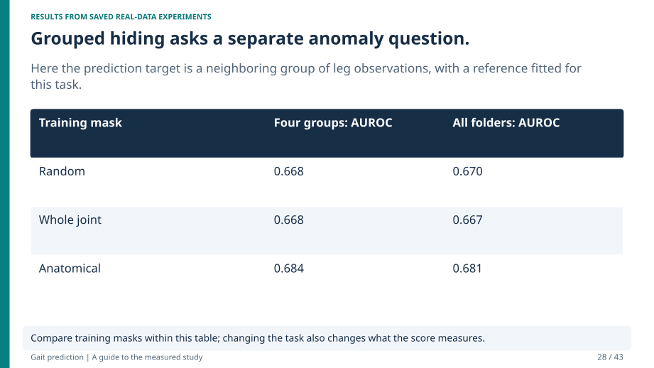

*Figure caption: Compare training masks within this table; changing the task also changes what the score measures.*

### Purpose

Grouped hiding E_leg tests what happens when neighboring lower-leg observations disappear together. This slide carries that distinct observation task through to anomaly scoring without treating it as interchangeable with scattered hiding.

### Explanation

The main-group Combined S AUROCs are 0.668 for Random U, 0.668 for Whole joint J and 0.684 for Anatomical A. These scores are calculated from grouped targets. Each policy uses a grouped-task normal reference estimated from the same reserved recording identities, because the typical prediction benefit changes when the available context changes.

### Reading the visual

Compare rows within this table to assess training policies on the grouped task. Do not subtract a row from the scattered-hiding table and call the result a pure training improvement. Changing banks changes hidden targets, permitted context and the reference distribution used by Cross-leg R.

### Evidence and limits

All 304 retained recordings support this diagnostic, including the 90-recording main group. Positive normal completion benefits therefore coexist with these separate detection results. The anatomical point estimate remains below Movement M's 0.694 in the main group, and the grouped task does not establish an anomaly-detection advantage over movement alone.

### Transition

We now broaden the comparison to inexpensive movement and prediction-error baselines, which help determine whether a more elaborate relational measurement adds useful detection information.

[Plain-language guide to the three scores](score_guide.md)

Sources: [Executed protocol](../docs/iteration02/protocol.md) · [Verified study results](../docs/iteration02/results.md)

## 29. Simple comparisons help explain the anomaly scores.

These methods use the same recordings and normal-only fitting, but summarize movement in different ways.

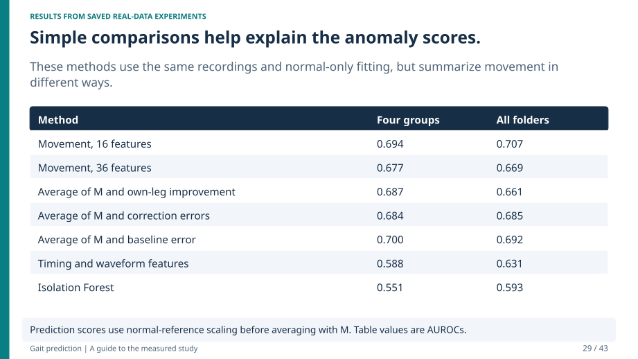

*Figure caption: Prediction scores use normal-reference scaling before averaging with M. Table values are AUROCs.*

### Purpose

A new anomaly measurement needs comparison with practical alternatives that use the same test recordings. This slide places the cross-leg combination beside simpler movement, waveform and prediction-error approaches.

### Explanation

Movement M reaches main-group AUROC 0.694, while the movement-plus-baseline-error score reaches 0.700. That score averages M with a normal-referenced distance derived from the Own-leg baseline f's error; it does not simply add raw error. Richer movement features reach 0.677, timing and waveform features reach 0.588, and Isolation Forest reaches 0.551. Combined S with Random U reaches 0.576.

### Reading the visual

Read each row as another way to rank the same recordings. Keep the movement-plus-baseline-error score visible: Movement M is a strong comparator, but it is not the largest point estimate in every comparison. The small difference between 0.700 and 0.694 should not be described as a demonstrated statistical gain.

### Evidence and limits

These anomaly models fit or estimate references using normal recordings only. The complete results also retain own-leg-improvement, correction-error and recording-condition controls. The timing descriptors summarize waveforms; they are not a validated physiological phase measure. These distinctions matter when deciding what a score actually measures.

### Transition

The next slide examines the adapted published pose model, explaining both its measured result and the implementation differences that limit comparisons with the original publication.

[Plain-language guide to the three scores](score_guide.md)

Sources: [Executed protocol](../docs/iteration02/protocol.md) · [Verified study results](../docs/iteration02/results.md)

## 30. A published pose model needs a missing-data adaptation.

STG-NF models pose likelihoods. We adapt its graph and fill missing values using fitting-normal medians.

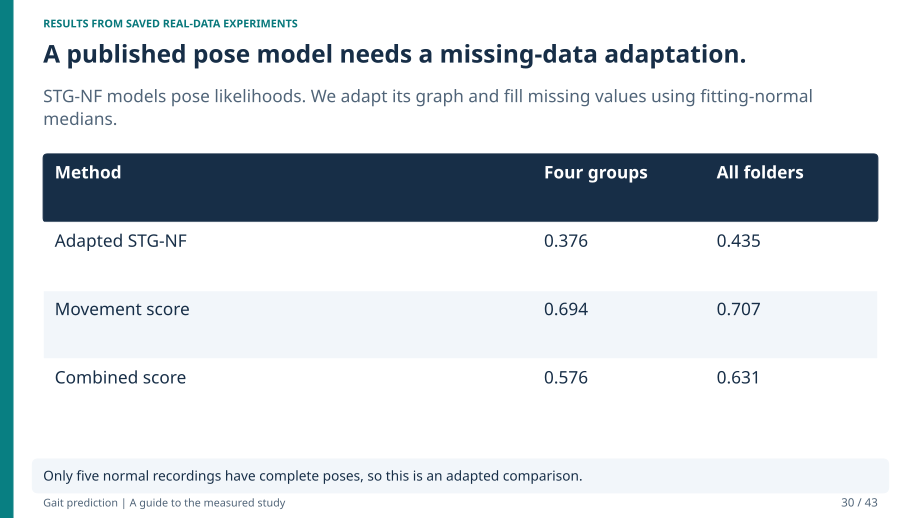

*Figure caption: Only five normal recordings have complete poses, so this is an adapted comparison.*

### Purpose

Including a published pose-based anomaly method adds a useful reference, provided we explain exactly what was run. This slide reports the STG-NF adaptation used with the available GAVD skeletons and missing measurements.

### Explanation

STG-NF learns a distribution of pose sequences and can score observations that depart from normal training data. Here, the authors' implementation is adapted to the 16-joint graph, and missing values are replaced with medians estimated from fitting-normal recordings. Each fold uses 128 training updates. The comparison preserves the same eligible recordings as the other methods.

### Reading the visual

Compare the adapted STG-NF row with Movement M and Combined S in each population column. Its AUROCs are 0.376 for the main group and 0.435 for the broad group. These values describe this specific fitted adaptation and training budget, rather than the best performance the published method could achieve.

### Evidence and limits

All four folds complete, and the upstream revision and adaptations are recorded. Only five normal recordings have fully complete poses, so an unmodified complete-case analysis cannot use the same split. The result supports a transparent implementation comparison, but not a state-of-the-art claim or a general judgment about normalizing-flow methods.

### Transition

The next slide turns to a separate supervised question: whether learned JEPA features help distinguish the five gait-label groups when condition labels are available for classifier training.

[Plain-language guide to the three scores](score_guide.md)

Sources: [Executed protocol](../docs/iteration02/protocol.md) · [Verified study results](../docs/iteration02/results.md)

## 31. Condition classification uses labels in a separate experiment.

We fit classifiers for five categories after obtaining motion features or encoder features.

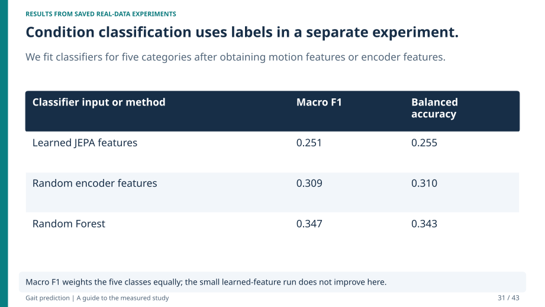

*Figure caption: Macro F1 weights the five classes equally; the small learned-feature run does not improve here.*

### Purpose

This slide separates identifying a named gait category from detecting an unusual recording. A five-class classifier must choose normal, Parkinsons, stroke, cerebral palsy or myopathic gait, and it is allowed to learn from category labels during classifier training.

### Explanation

JEPA learns a representation by predicting another encoder's representation of hidden observations. Here, its encoder trains only on fitting-normal recordings, with a slowly updated teacher. VICReg discourages constant or redundant representations. A supervised classifier then uses those features, while a randomly initialized encoder provides a comparison that has not learned those representations.

### Reading the visual

Read the table as three classifiers evaluated on the same recording splits. Macro F1 gives each of the five categories equal weight, so the largest category cannot dominate the reported average. The numbers summarize four test folds rather than clinical certainty for an individual video.

### Evidence and limits

The saved protocol uses 512 JEPA updates per fold and 89 recordings with unambiguous five-class labels. Mean macro F1 is 0.347 for Random Forest, 0.251 for learned JEPA features and 0.309 for random-encoder features. This bounded experiment does not demonstrate an advantage from the learned encoder.

### Transition

We now return to the prediction model and ask a more specific question: how does its error change when the other leg's observations come from a slightly different time?

Sources: [Executed protocol](../docs/iteration02/protocol.md) · [Verified study results](../docs/iteration02/results.md)

## 32. Shift the other leg while keeping the hidden answer fixed.

Earlier and later observations come from one valid 48-sample interval, without wrapping or padding.

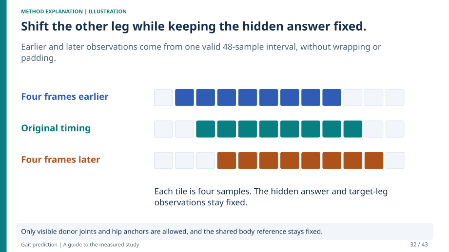

*Figure caption: Only visible donor joints and hip anchors are allowed, and the shared body reference stays fixed.*

### Purpose

The timing experiment changes the other leg's observations while keeping the answer unchanged. This helps distinguish a response to altered context from a comparison in which both the input and the target have moved.

### Explanation

A continuous 48-frame interval supplies a central 32-frame prediction window and observations four frames earlier or later. At 15 samples per second, that offset is about 0.27 seconds. The target leg, hidden answer and body scale remain fixed, and samples never wrap around a sequence boundary.

### Reading the visual

Follow the highlighted middle window before examining the earlier and later windows. Each donor knee, ankle, heel or toe position is expressed relative to its visible donor hip, then attached to the original visible hip on that side. This preserves the declared body reference while changing the supplied lower-leg movement.

### Evidence and limits

The protocol requires both the donor hip and the attachment hip to be visible and valid. It uses only observations available in both versions, so a hidden point cannot leak back through the edit. The construction changes timing and instantaneous geometry together; it does not isolate a physiological phase or a neurological cause.

### Transition

Before interpreting the response to this edit, we must check whether the model still predicts adequately from the smaller set of observations that the comparison permits.

Sources: [Executed protocol](../docs/iteration02/protocol.md) · [Verified study results](../docs/iteration02/results.md)

## 33. The timing comparison leaves very little usable context.

Both versions must use observations that are valid and permitted in the aligned and shifted inputs.

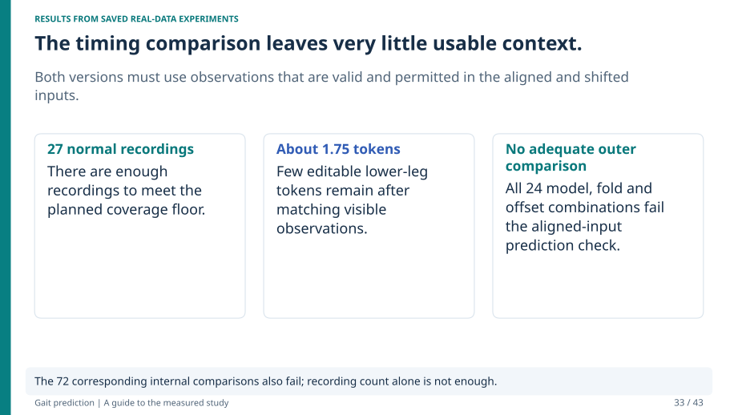

*Figure caption: The 72 corresponding internal comparisons also fail; recording count alone is not enough.*

### Purpose

This slide checks whether the unshifted prediction is useful before any timing change is interpreted. A model's response to an edit is difficult to explain when the model already predicts poorly from the observations available to that edit.

### Explanation

Requiring an observation to remain usable in both the original and shifted versions removes substantial context. On average, only about 1.75 lower-leg tokens remain editable for each target. A token contains one joint across four samples, so this is a sparse input even when the recording itself contains many frames.

### Reading the visual

Compare the Both-leg correction f+g with the Own-leg correction f+h using the same unshifted inputs. The negative benefit means that adding the other leg produces higher error here. This is a check on the timing experiment's restricted inputs, rather than a contradiction of completion results measured with richer observations.

### Evidence and limits

The saved timing records contain 27 held-out normal recordings. The prediction check fails in all 24 outer combinations of four folds, three training masks and two timing offsets, and in all 72 corresponding internal comparisons. Models are not refitted after observing these results.

### Transition

We can still report how the fixed model responds to earlier and later observations, provided that this weak unshifted prediction remains part of the interpretation.

Sources: [Executed protocol](../docs/iteration02/protocol.md) · [Verified study results](../docs/iteration02/results.md)

## 34. A timing response needs an adequate starting prediction.

The Random U model uses 27 normal test recordings; prediction is already poor with the aligned inputs.

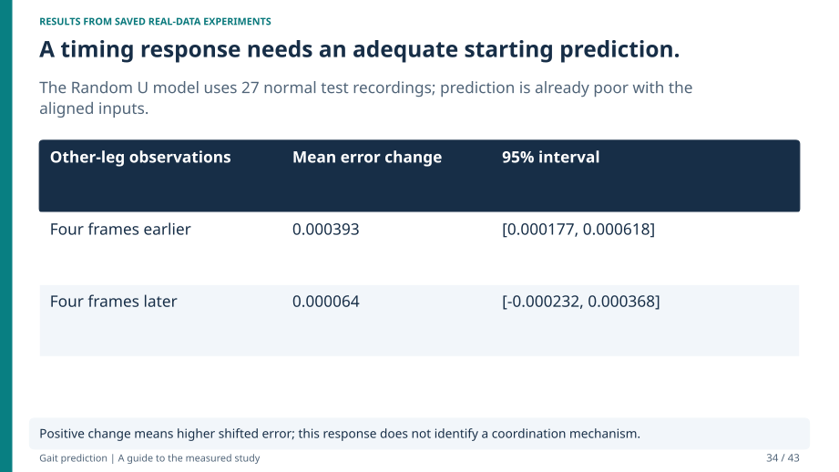

*Figure caption: Positive change means higher shifted error; this response does not identify a coordination mechanism.*

### Purpose

The timing response is a measured property of this predictor under a specified input edit. The purpose of this slide is to show that response and its uncertainty without treating it as a measurement of a person's neurological coordination.

### Explanation

This table uses the Random U model on 27 held-out normal recordings. The reported quantity is shifted prediction error minus unshifted prediction error. A positive value means the edit makes prediction worse, while a negative value means it makes prediction better. Each comparison keeps the target and the own-leg observations fixed and uses the common valid context described on the preceding slides.

### Reading the visual

Read the earlier and later offsets separately. Earlier samples raise mean error by 0.000393, with interval [0.000177, 0.000618]. Later samples change it by 0.000064, with interval [-0.000232, 0.000368]. These are squared normalized image-coordinate errors, and the later interval includes zero.

### Evidence and limits

All 27 eligible normal recordings contribute at each offset. Zero edits reproduce the input, and changing the other leg leaves own-leg predictions unchanged. However, the unshifted prediction check fails. Noise controls are not matched to the timing edit's displacement, and the edit changes geometry as well as timing, limiting causal interpretation.

### Transition

We next test the prediction idea in a separate laboratory dataset, where participant identities and synchronized joint-angle measurements provide a different basis for evaluation.

Sources: [Executed protocol](../docs/iteration02/protocol.md) · [Verified study results](../docs/iteration02/results.md)

## 35. Test the prediction method on independent participants.

The laboratory dataset records both legs on one clock and provides participant identities.

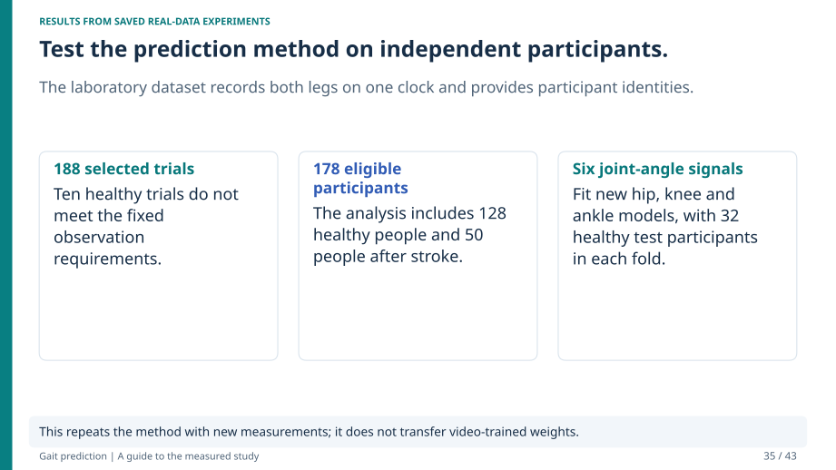

*Figure caption: This repeats the method with new measurements; it does not transfer video-trained weights.*

### Purpose

The laboratory study asks whether the prediction comparison also works with identified participants and synchronized joint measurements. It provides evidence from a different measurement system while keeping the question about the benefit of the other leg recognizable.

### Explanation

The public dataset from Van Criekinge and colleagues contains 138 healthy participants and 50 participants with stroke. One walking trial is selected for each person before outcomes are examined. Ten selected healthy trials do not supply eligible windows, leaving 178 participants: 128 healthy and 50 with stroke.

### Reading the visual

Follow the six simultaneous signals for left and right hip, knee and ankle flexion. Their original shared clock is preserved, so each side is not independently stretched into a normalized gait cycle. The model uses 32-sample windows containing 48 four-sample tokens, with half hidden.

### Evidence and limits

The linked Scientific Data article and external execution records identify the processed laboratory angles, selected trials and exclusions. Models are fitted separately on these signals, with healthy participants assigned to fitting, reference and test roles. These are neither GAVD coordinates nor transferred GAVD weights, and the evaluated condition is stroke.

### Transition

With the participant groups and measurements defined, we can inspect whether the Both-leg correction improves hidden-angle prediction for healthy people in each test fold.

Sources: [Laboratory control and stroke dataset](https://pmc.ncbi.nlm.nih.gov/articles/PMC10692332/) · [Independent participant study](../docs/iteration02/external_replication_results.md) · [Executed protocol](../docs/iteration02/protocol.md)

## 36. The both-leg model improves laboratory prediction.

Every test fold shows lower healthy-participant error than the own-leg correction.

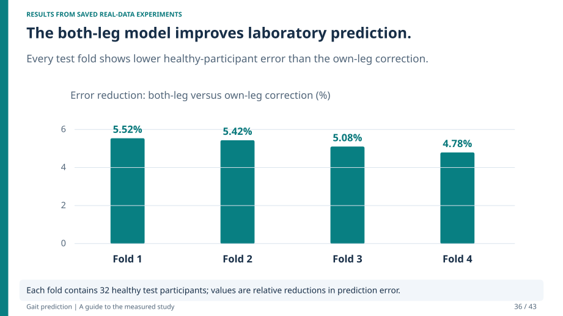

*Figure caption: Each fold contains 32 healthy test participants; values are relative reductions in prediction error.*

### Purpose

This slide shows the laboratory prediction comparison before converting it into an anomaly score. The question is whether both legs help reconstruct deliberately hidden measurements for healthy participants who were excluded from the corresponding model fit.

### Explanation

The Own-leg baseline f supplies the initial prediction. The Own-leg correction f+h adds features from the target leg, while the Both-leg correction f+g can also use the opposite leg. All methods predict the same hidden angle values. Their errors are measured in squared degrees, which should not be compared numerically with GAVD's image-coordinate errors.

### Reading the visual

Each bar shows the reduction in mean error when the Both-leg correction replaces the Own-leg correction in one test fold. Every fold contains 32 held-out healthy participants. The accompanying saved comparison also reports mean errors of 309.838 for interpolation, 206.262 for the baseline, 201.038 for the own-leg correction and 190.584 for the both-leg correction, all in squared degrees.

### Evidence and limits

The both-leg improvement relative to the own-leg correction ranges from 4.78% to 5.52% across folds. Both corrections have 72 feature columns, but their recorded numerical ranks are 44 and 62. The gain therefore concerns these fitted feature families and does not isolate information content from every difference in model flexibility.

### Transition

The next slide summarizes the participant-by-participant comparison and explains what the uncertainty interval includes when the fitted models are kept fixed.

Sources: [Executed protocol](../docs/iteration02/protocol.md) · [Verified study results](../docs/iteration02/results.md)

## 37. The laboratory improvement appears across participants.

Paired summaries of the saved predictions show the size and consistency of the completion gain.

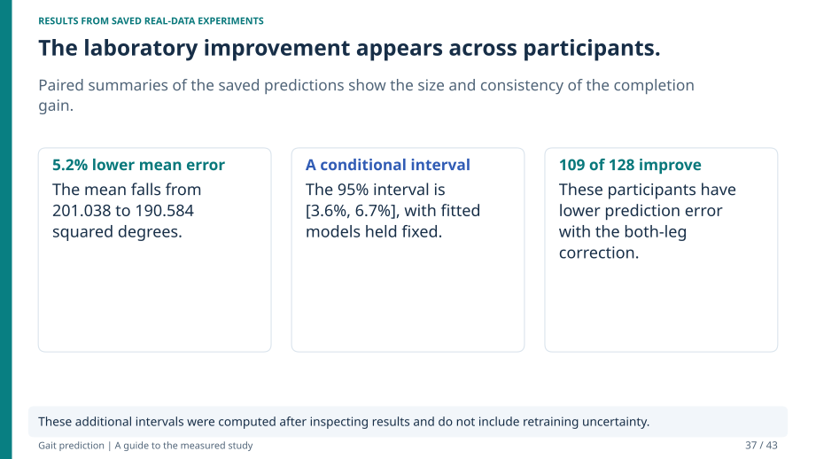

*Figure caption: These additional intervals were computed after inspecting results and do not include retraining uncertainty.*

### Purpose

The aggregate laboratory gain becomes more informative when we compare the two predictions for the same person. This slide quantifies the mean reduction, the number of participants who improve and the uncertainty conditional on the completed fits.

### Explanation

Across 128 held-out healthy participants, the Both-leg correction f+g reduces mean error by 5.2% relative to the Own-leg correction f+h. The conditional 95% interval is [3.6%, 6.7%]. In absolute units, the reduction is 10.454 squared degrees, with interval [7.154, 13.387]. Error decreases for 109 participants.

### Reading the visual

Read the interval as uncertainty about this paired mean comparison, not as the range of individual benefits. All four fold means favor the both-leg model. The folds share some training participants across fits, so they are not four independent experimental replications.

### Evidence and limits

The completion audit uses 1,000 paired participant resamples within the original folds, preserving both methods together and holding the fold weights fixed. These additional summaries were calculated after outcome inspection from saved predictions. They omit uncertainty from retraining, random seeds and analysis choices, and the unequal feature ranks remain a limitation.

### Transition

The saved predictions show a completion gain in this fitted comparison. We next ask whether the resulting Cross-leg score helps distinguish stroke participants from healthy participants.

Sources: [Post-outcome paired completion audit](../docs/draft03/advisory/completion_audit_v1/README.md) · [Accessible manuscript and technical notes](../docs/draft03/README.md) · [Executed protocol](../docs/iteration02/protocol.md) · [Independent participant study](../docs/iteration02/external_replication_results.md)

## 38. Laboratory anomaly ranking also favors movement alone.

The cross-leg score provides a ranking, but its fixed average with movement reduces accuracy.

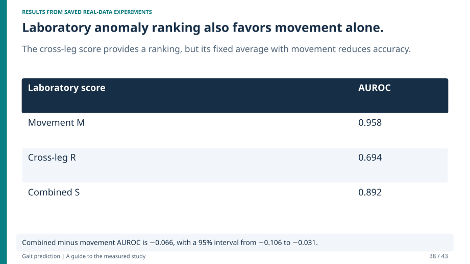

*Figure caption: Combined minus movement AUROC is −0.066, with a 95% interval from −0.106 to −0.031.*

### Purpose

This slide tests a different claim from accurate completion. An anomaly score must rank unusual participants above typical participants, so a reduction in healthy prediction error does not automatically improve detection.

### Explanation

Here, Movement M compares 12 measurements of joint-angle levels and ranges with the healthy fitting group. Cross-leg R compares the left and right prediction benefits with 20 separately reserved healthy reference participants per fold. A benefit that is unusually high or unusually low increases R. Combined S adds M and R and divides by two; its weights are not tuned on test labels.

### Reading the visual

Compare all three scores on the same 178 eligible laboratory participants. Their AUROCs are 0.958 for Movement, 0.694 for Cross-leg and 0.892 for Combined. AUROC describes how often a stroke participant receives a higher anomaly score than a healthy participant when the comparison is made within a test fold.

### Evidence and limits

The saved paired analysis gives a Combined-minus-Movement difference of -0.066, with conditional 95% interval [-0.106, -0.031]. Thus this particular fixed combination loses ranking performance despite the completion gain. It does not establish that every way of using cross-leg information must fail, or identify the cause of the loss.

### Transition

Because the healthy and stroke groups have different demographic distributions, the next slide repeats the comparison in a fixed age- and sex-balanced subset.

[Plain-language guide to the three scores](score_guide.md)

Sources: [Executed protocol](../docs/iteration02/protocol.md) · [Verified study results](../docs/iteration02/results.md)

## 39. Compare participants with similar age and the same sex.

The fixed matching rule pairs healthy and stroke participants within five years inside each test fold.

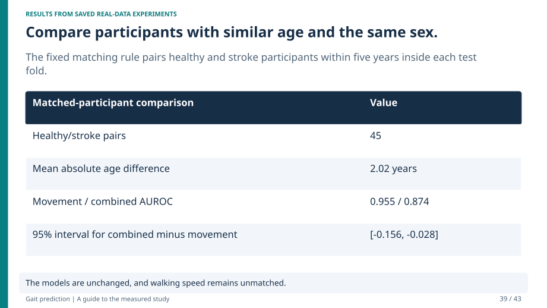

*Figure caption: The models are unchanged, and walking speed remains unmatched.*

### Purpose

The demographic analysis checks whether the laboratory finding persists when healthy and stroke participants are more comparable in age and sex. This is a sensitivity analysis of the saved scores, rather than a new model fit.

### Explanation

The matching rule pairs participants of the same recorded sex, within five years of age and within the same outer test fold. It first finds as many pairs as possible and then minimizes the total age difference. The rule is fixed before outcome scoring, and no person is reused.

### Reading the visual

The result contains 45 pairs, or 90 participants, including 16 female and 29 male pairs. The four folds contain 11, 12, 11 and 11 pairs. Movement AUROC is 0.955 and Combined AUROC is 0.874, so the direction of the comparison remains the same.

### Evidence and limits

The Combined-minus-Movement difference is -0.081, with conditional interval [-0.156, -0.028]. Resampling carries each whole matched pair within its fold. The main 178-person evaluation remains unchanged. Matching does not remove all confounding, and walking speed is not matched because it may itself reflect the effects of stroke.

### Transition

Demographic balance addresses one part of generalization. We now bring the laboratory and public-video evidence together to examine the measurement limits that still remain.

[Plain-language guide to the three scores](score_guide.md)

Sources: [Independent participant study](../docs/iteration02/external_replication_results.md) · [Laboratory control and stroke dataset](https://pmc.ncbi.nlm.nih.gov/articles/PMC10692332/)

## 40. Recording conditions still limit what we can conclude.

A difference between web recordings can reflect the camera, missing observations or the people being recorded.

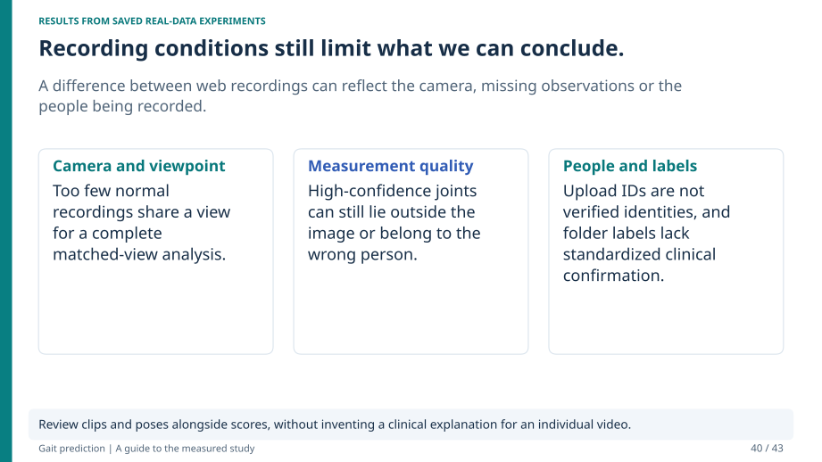

*Figure caption: Review clips and poses alongside scores, without inventing a clinical explanation for an individual video.*

### Purpose

This slide explains why neither dataset supports unrestricted clinical claims. Prediction and anomaly scores depend on what was measured, how the recording was made and which people entered the evaluation, as well as on their movement.

### Explanation

GAVD identifies recording sources rather than verified unique people. Camera view, apparent body size, assistance, overlapping limbs and edited layouts can change the estimated skeleton. All 28 normal recordings contributed to exploratory development, and extra windows from those recordings do not create new independent participants.

### Reading the visual

Use the selected videos and pose overlays to identify visible measurement problems, without diagnosing the person from the example. Ten high- and low-error cases were chosen by a fixed review rule. Checks of three frames help reveal problems but do not verify continuous tracking throughout a clip.

### Evidence and limits

The boundary audit finds high-confidence lower-leg points outside the decoded image in 13 of 28 normal and 83 of 276 abnormal recordings. The corresponding pooled point fractions are about 0.43% and 0.24%. Confidence is therefore not proof of visibility. These observations do not trigger outcome-based exclusions or refitting, and the laboratory study does not validate GAVD's clinical labels.

### Transition

With these limits visible, we can state the contribution at the level supported by the measured prediction and detection comparisons.

Sources: [Interpretation limits](../docs/iteration02/limitations.md) · [Confidence filtering and selection shift](https://arxiv.org/abs/2610.39704) · [Independent notebooks 12–17](../12_observation_population_and_video_context.ipynb)

## 41. The method makes cross-leg evidence easier to examine.

The experiments measure useful prediction and anomaly ranking separately, under explicit observation rules.

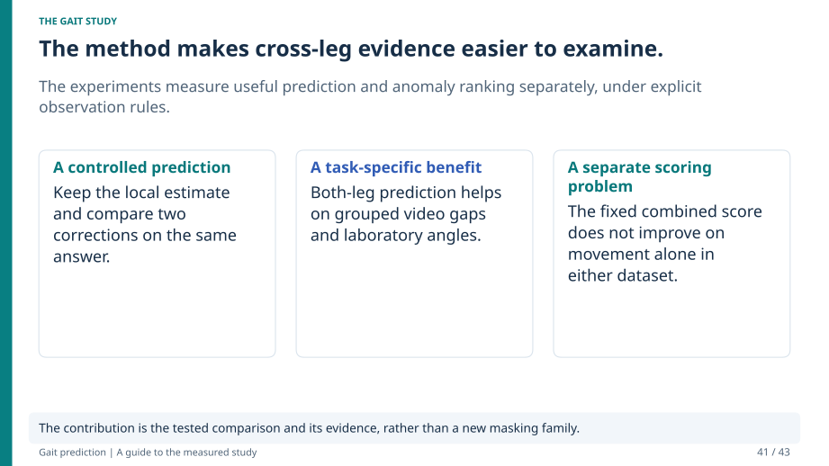

*Figure caption: The contribution is the tested comparison and its evidence, rather than a new masking family.*

### Purpose

The central contribution is a controlled distinction between learning to complete movement and learning to detect abnormal movement. The experiments make that distinction observable through shared targets, restricted inputs, explicit comparison models and a separate participant-based study.

### Explanation

In GAVD's Grouped hiding task, the random-trained Both-leg correction reduces error by 19.5% relative to the Own-leg correction. In the laboratory comparison, the corresponding reduction is 5.2%. Anatomical training separately improves grouped-task error by 7.7% relative to Random training for the same both-leg predictor. These percentages answer different questions.

### Reading the visual

Connect each result to its own comparator and measurement system. Scattered hiding leaves the normal benefit uncertain for Random and Anatomical training. The positive grouped-task and laboratory findings therefore support particular prediction conditions, while the Combined score's lower AUROC shows that completion gain alone does not guarantee detection gain.

### Evidence and limits

The linked manuscript, saved results and limitation records keep all these outcomes together. Unequal feature ranks, limited normal references and recording-related effects constrain interpretation. The experiments do not recover a neurological mechanism or establish a universally superior mask, and the additional completion intervals remain descriptive analyses of fixed predictions.

### Transition

The next slide shows how the six independent notebooks let another researcher inspect these comparisons, their data context and the evidence behind each claim.

[Plain-language guide to the three scores](score_guide.md)

Sources: [Verified study results](../docs/iteration02/results.md) · [Interpretation limits](../docs/iteration02/limitations.md) · [Neurological evidence and novelty advice](../docs/iteration02/advice_neuro.md) · [Accessible manuscript and technical notes](../docs/draft03/README.md)

## 42. Six notebooks explain how the evidence is produced.

Each notebook runs independently and connects the measurements to real video or saved participant data.

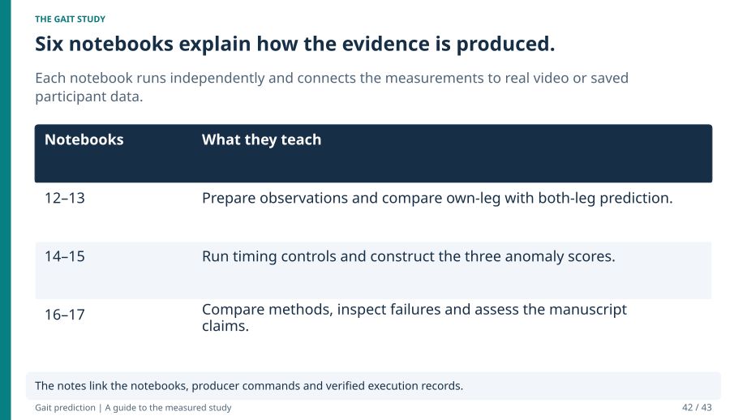

*Figure caption: The notes link the notebooks, producer commands and verified execution records.*

### Purpose

The six notebooks provide an accessible route from real observations to the study's conclusions. Each notebook can be opened independently, so understanding a result does not depend on variables left in memory by a previous tutorial.

### Explanation

Notebook 12 introduces the population and video context, and notebook 13 explains the prediction comparison. Notebook 14 constructs timing edits, notebook 15 calculates Movement M, Cross-leg R and Combined S, and notebook 16 evaluates baselines and classifiers. Notebook 17 connects failure examples, laboratory replication and the limits of the claims.

### Reading the visual

Follow the notebook map as a learning sequence, while treating each page as a separate executable document. Real clips and pose overlays provide context for the arrays. Saved run identities and file hashes connect displayed figures to the actual experiments rather than to illustrative replacement data.

### Evidence and limits

From the repository root, run `uv sync --project experiments/aaai`, then `uv run --project experiments/aaai jupyter lab experiments/aaai`. The root `.env` sets `AAAI_ITERATION02_RUN_DIR` to the verified run listed in the README. The execution record documents fresh-kernel runs of notebooks 12 through 17; it should be checked alongside the displayed outputs.

### Transition

Having made the evidence inspectable, we can finish by identifying the specific new experiments that would most improve the next research claim.

Sources: [Independent notebooks 12–17](../12_observation_population_and_video_context.ipynb) · [Executed protocol](../docs/iteration02/protocol.md)

## 43. The next experiment should test when cross-leg scores help.

The next study should improve model comparisons, estimate normal variation reliably and use new participants.

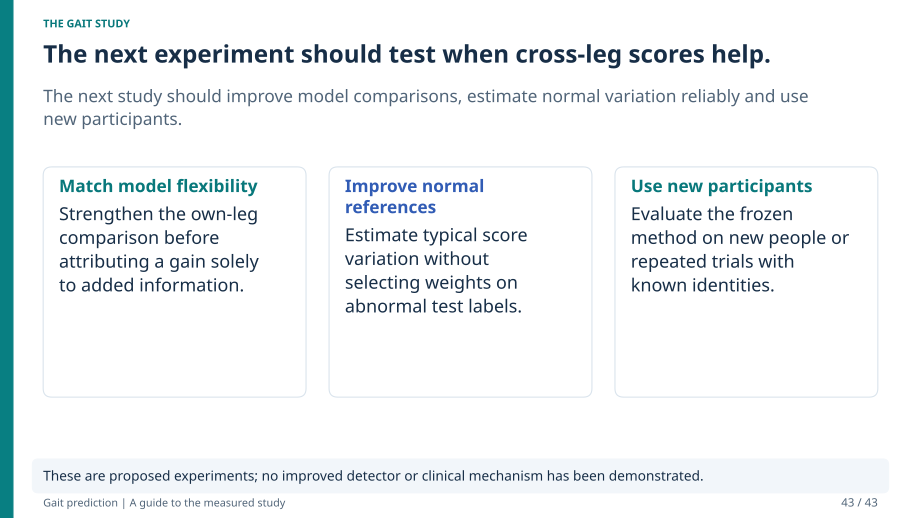

*Figure caption: These are proposed experiments; no improved detector or clinical mechanism has been demonstrated.*

### Purpose

The next study should resolve the uncertainties exposed by these results with a small number of testable questions. A stronger claim will come from evidence that separates model flexibility, score construction and population generalization.

### Explanation

First, compare own-leg and both-leg features with tighter control of effective model capacity, using fitting-normal data to choose any rank or regularization constraint. Second, test whether estimates of normal score variation are reliable and account for left and right benefits that change together under a protocol fixed before evaluation. These are proposed experiments, not methods already shown to repair detection.

### Reading the visual

Treat the roadmap as three connected stages: clarify what the predictor learns, define how its output becomes an anomaly score, and evaluate that score on new participants. The population stage needs known identities, better recording metadata and relevant clinical measurements, with training and evaluation separated at the person level.

### Evidence and limits

The current record supplies concrete reasons for each priority: unequal feature ranks, different Movement and Cross-leg score distributions, sparse timing context and limited GAVD normal coverage. Additional training seeds and controlled JEPA comparisons could measure robustness, but their outcomes remain unknown. New evaluation participants are necessary to move beyond exploratory reuse of existing recordings.

### Transition

The study closes with a bounded finding: cross-leg context can improve completion, while useful anomaly detection requires its own validation. The proposed work is designed to test when those two benefits can coincide.

[Plain-language guide to the three scores](score_guide.md)

Sources: [ASTAD4 official requirements](https://ismart.ece.mcgill.ca/astad4/) · [Interpretation limits](../docs/iteration02/limitations.md) · [Accessible manuscript and technical notes](../docs/draft03/README.md)
