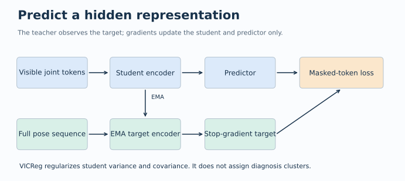
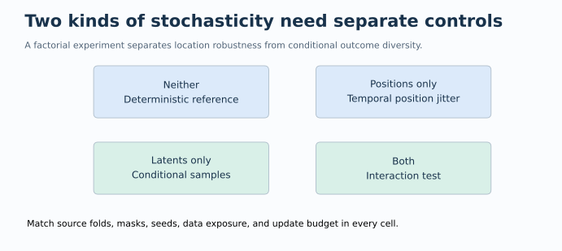
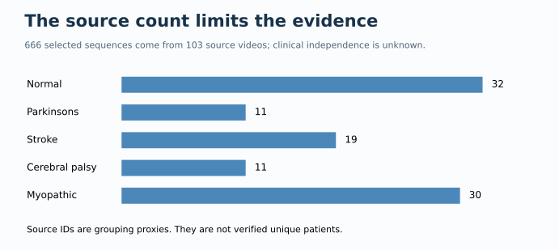

# Predictive skeleton representations for medical gait research

This project provides eight progressive Jupyter tutorials, a compact S-JEPA-inspired implementation, a matched Random Forest comparison, and twenty illustrated teaching and results slides for the [First Workshop on Medical World Models at AAAI-27](https://med-wm.github.io/aaai27-mwm/). The research question is whether learning expected normal motion helps detect and characterize deviations in gait. The implementation predicts body-relative skeletal articulation; it is a component toward a medical world model, not a validated clinical diagnostic system.

**Execution is complete:** all eight notebooks passed on real GAVD data with 88 executed code cells, and 43 focused tests passed. Models, predictions, figures and executed notebook outputs are saved locally. Start with the [results draft](docs/manuscript.md), [complete result tables](docs/results_tables.md), [independent review](docs/final_scientific_review.md), or [execution record](docs/execution.md).

The primary binary JEPA probe achieved balanced accuracy 0.818 versus RF 0.788 on seventeen test sources; the paired difference interval includes zero. Normal forecasting showed a small uncertain gain over persistence. A favorable secondary excess-error ranking and a latent energy-score gain did not establish useful temporal dynamics or uncertainty-based deferral. These distinctions, rather than a clinical-superiority claim, form the draft's contribution.



The workshop page currently lists **November 20, 2026, Anywhere on Earth**, with a November 16 extension announcement. The project began on November 15 and continued on November 16; [the workshop audit](docs/workshop.md) records the source check and the unresolved independent OpenReview deadline check. Full papers are 6–8 pages; short and position papers are 2–4 pages, excluding references and appendices. A position paper is an available route when empirical evidence is incomplete. These tutorials do not guarantee paper acceptance.

## Start locally with uv

Run from the AlexPose repository root:

```bash
uv sync --project experiments/aaai-worldmodels --python 3.12
uv run --project experiments/aaai-worldmodels python -m ipykernel install --user --name medwm-gait --display-name "Med-WM gait (Python 3.12)"
uv run --project experiments/aaai-worldmodels jupyter lab experiments/aaai-worldmodels
```

Select the **Med-WM gait (Python 3.12)** kernel. Each notebook initializes its own imports, paths, data examples and small training state, so it can run independently. Synthetic examples are explicitly labeled. Real data preparation and comparison are separate commands with recorded identities. Use the project `pyproject.toml` for all dependencies; it installs shared `ambient` interfaces through the editable root `alexpose` package. No requirements file or committed environment lock is generated. `uv` can create an ignored local lock during synchronization, and each measured run records installed versions.

The project root here means `experiments/aaai-worldmodels`. Its ignored `.env` contains local settings, not the repository root `.env`. An initial local file has been created without credentials. If cloning this project elsewhere, create it with settings such as:

```dotenv
WM_SEED=27
WM_EPOCHS=5
WM_POSE_MODEL=
WM_EMBED_VIDEO=0
```

The first protocol fixes CPU execution, 16 frames and eight context frames. `WM_SEED` and `WM_EPOCHS` supply CLI defaults, while explicit CLI arguments take precedence. `WM_POSE_MODEL` selects the local pose weights and `WM_EMBED_VIDEO` controls notebook video display. No paid provider is required. To preserve the requested spelling, notebooks use `load_env(find_env())`: `load_env` aliases python-dotenv's `load_dotenv`, and the local `find_env` resolves only this experiment's `.env`. Never print its contents or commit keys.

## The learning sequence

| Notebook | What you learn and execute |
|---|---|
| [00: Question, data and protocol](00_inventory_and_research_question.ipynb) | Separate anomaly detection from diagnosis classification; audit fresh CSVs and fixed source groups. |
| [01: Video, pose and quality](01_video_pose_and_quality.ipynb) | Watch an annotated excerpt, extract a bounded real pose sequence with Ambient, and inspect missingness. |
| [02: Joint tokens and masks](02_joint_tokens_and_uniform_masks.ipynb) | Read the exact deduplicated joint table and test uniform joint-time masks. |
| [03: Normal pretraining](03_normal_only_jepa_and_vicreg.ipynb) | Train a small student, EMA target and predictor; inspect VICReg and representation diagnostics. |
| [04: Progressive adaptation](04_progressive_condition_adaptation.ipynb) | Preserve a normal reference and adapt a copy with normal replay as conditions are introduced. |
| [05: Future motion and stochasticity](05_forecasting_and_stochasticity.ipynb) | Train explicit future-suffix prediction and examine optional position jitter and conditional latent samples. |
| [06: RF versus JEPA capstone](06_capstone_rf_vs_jepa.ipynb) | Compare identical observations and partitions, select classifiers on validation sources, and inspect real run artifacts. |
| [07: Ablations and paper evidence](07_ablation_and_paper_evidence.ipynb) | Plan controlled variants, inspect failures and distinguish completed evidence from proposed experiments. |

Open [the slide deck](slides/tutorial.html) in a browser. Its twenty pages use editable SVG figures and can be printed to PDF. [The slide guide](slides/README.md) describes regeneration. Diagrams have source generators, rendered previews and an independent visual review. The slide format is HTML with SVG, not PowerPoint.

## What method is implemented

The [literature review](docs/literature.md) traces every supplied reference and identifies where this implementation differs. Published Skeleton S-JEPA uses motion-aware masking, EMA targets and centered, sharpened cross-entropy prediction. MAMP predicts motion and also provides a uniform masking implementation. Here, **uniform random masks over exactly sixteen declared BlazePose joints** are mandatory. Motion intensity and velocity do not affect mask probabilities. Missing observations cannot become prediction targets.

The compact transformer uses one joint-time observation per token, final-layer teacher targets, a smaller laptop model, VICReg variance/covariance regularization, and an auxiliary coordinate head. These are declared adaptations, not an official reproduction. The teacher receives no gradients. A separate suffix-mask training stage predicts future relative articulation from past observations. Random completion and future forecasting are distinct tasks.

VICReg helps resist representation collapse and redundancy. It does not force medical categories apart. Class discrimination comes from training a supervised linear probe on embeddings. A normal-only checkpoint is retained for anomaly scoring while a copy learns progressively from parkinsons, stroke, cerebral palsy and myopathic training sources, with normal replay. The repeated stroke item in the brief denotes one class.

Stochastic positional embeddings and stochastic latent variables are different ideas. Temporal position jitter is a declared inspired variant, not a faithful implementation of predictor-only, weight-tied StoP. The optional conditional latent model has a context prior and a training-only target-informed posterior. Inference samples only from the prior. Compare deterministic, positions-only, latents-only and combined variants with matched objectives, masks, update budgets and seeds before claiming an uncertainty benefit. The separate 2026 Stochastic-JEPA paper must not be confused with the 2024 Skeleton-JEPA paper.



The requested `/Users/pmui/vaults/worldmodels/gait/skeleton-jepa/background` file was unavailable in this workspace, including the plausible `/Users/alexmui` equivalent. The review therefore relies on the verified supplied public papers and code. Access limitations and the official skeleton implementation's unresolved availability are recorded explicitly.

## Current GAVD scope and generalization

The inventory reads the refreshed transformed CSV files under `data/gavd`, rather than a historical notebook cache. The full source authority is [the GAVD README](../../data/gavd/README.md) and its pinned source manifest. Upstream `source/` CSVs are excluded from derivative counts.

| Label | Sequences | Source videos |
|---|---:|---:|
| normal | 291 | 32 |
| parkinsons | 47 | 11 |
| stroke | 76 | 19 |
| cerebral palsy | 64 | 11 |
| myopathic | 188 | 30 |
| **Selected total** | **666** | **103** |

The full inventory contains 1,874 sequences, 458,116 annotation rows and 348 source IDs. The selected labels contain 140,641 annotation rows. The current media audit retains **652 sequences from 98 sources**, excluding nine sequences with missing videos, four documented source-reference mismatches, and one sequence beyond the available frame range. Pose filtering introduces further attrition, retained in each run.

The fixed seed-27 split is assigned before pose filtering. Media-eligible test sources include six normal, two parkinsons, four stroke, one cerebral palsy and six myopathic sources. The single cerebral palsy test source is a major limitation. More windows do not increase the number of independent patients. Source IDs are grouping proxies, and repeated participants or related uploads may still cross groups. GAVD can support an exploratory observational benchmark, but cannot by itself establish patient-level, multi-site or clinical deployment generalization. External patient-disjoint evaluation is necessary for stronger claims.

Myopathic gait is a neuromuscular category and should not be described as exclusively a central neurological condition. Restricting the primary benchmark to these five labels improves interpretability and feasibility but narrows the meaning of “abnormal.” Other GAVD labels should be a separately declared out-of-distribution evaluation, not silently merged into the selected task. The folder labels are annotations, not verified diagnoses or causal neuroscience measurements.



See [the data protocol](docs/data_protocol.md), [the exact joint table](docs/joints.md), and [the frozen research protocol](docs/protocol.md). The joint table uses the required `BLAZEPOSE_33 index | Keypoint name | Features involved` format. Its sorted union is 11–16 and 23–32. No other joint enters the model.

## Videos, frames and pose quality

Reuse current source videos under `data/videos-gavd`; preserve the existing category layout. New downloads use the Ambient helper and `data/videos-gavd/sources/<video_id>.*`, once per source. Previews belong under `data/videos-gavd/previews/`, with no copied condition-specific media. No new media downloads were necessary for the executed studies.

GAVD frames are one-based. The adapter converts to zero-based decoded indices exactly once, records timestamps and image dimensions, and calls the shared `SequenceKeypointExtractor` RGB image API. It uses full-image first-person detection followed by an annotation-box pelvis gate. Visual review found identity switches and scene cuts in two stroke sources, which were excluded before final test access. Box containment still cannot guarantee identity when people overlap. Confidence and missingness remain explicit. The threshold of 0.5 and minimum valid fraction of 0.7 are study choices.

Normalization centers each frame on the pelvis and scales using the observed prefix torso length. The resulting forecast is relative articulation, not global displacement or physical velocity. Under arbitrary random masking, the normalization has already used hip/shoulder observations, so the task is completion of pre-normalized articulation, not strict conditional prediction of raw hidden coordinates. Future coordinates and future validity cannot change the model's prefix-conditioned prediction; regression tests cover that boundary.

## Executed experiments and reproduction

The corrected classification cohort contains **405 short sequences from 89 source videos**, with 53 training, 19 validation and 17 test sources. The prediction cohort contains **407 longer sequences from 91 sources**, with 53 training, 19 validation and 19 test sources. Each retained sequence contributes one bounded window. The two cohorts use different context lengths and quality support, so their metrics must not be compared as if they shared a test set.

The classifier uses 16 sampled frames and an eight-frame normalization prefix. RF has 37 exp5-style features and training-only imputation. JEPA uses a small encoder and a training-only linear probe. Both receive identical corrected observations and source partitions. Normal pretraining precedes four adaptation stages, each with normal replay; a mixed-adaptation comparator and untrained encoder probe are retained. The direct binary endpoint balances normal against the union of four selected abnormal labels. The five-class endpoint is secondary. Summing four probabilities from a class-balanced five-class classifier is not equivalent to training a balanced binary classifier.

The forecast experiment uses 32 frames, 16 context frames, and three seeds (27, 41, 73). Every seed receives 200 uniform-mask normal pretraining updates, then 300 updates for each of the direct, residual and conditional-latent forecast arms. A single secondary loss-weight sensitivity repeats the residual fit with coordinate weight ten. The original weight-one result remains primary. Native stride-two sampling means the horizon is fixed in frames, with varying duration in seconds.

The [execution report](docs/execution.md) provides the complete commands and immutable run identities. The preparation sequence is:

```bash
# From experiments/aaai-worldmodels, on a fresh checkout with local GAVD videos:
uv run python -m worldmodels.workflow prepare --full --max-frames 16 --output artifacts/runs/pilot-input-v2
uv run python -m worldmodels.extended_data --output artifacts/runs/extended-input-v1
# After the documented source-identity review, build the corrected cohorts.
# clean_data also expects the original forecast development runs for inheritance.
uv run python -m worldmodels.clean_data
uv run python -m worldmodels.workflow compare --input artifacts/runs/pilot-input-clean-v1 --output artifacts/runs/pilot-comparison-clean-v1 --epochs 5 --seed 27
uv run python -m worldmodels.binary_clean develop --prepared artifacts/runs/pilot-input-clean-v1 --baseline artifacts/runs/pilot-comparison-clean-v1 --output artifacts/runs/binary-development-clean-v1
```

Existing run directories are immutable. Do not rerun these commands over delivered artifacts. The execution report gives the complete ordered replay, including the forecast development prerequisites. The final release script checks the joint decision manifest and each evaluator verifies frozen code, inputs, checkpoints and dependencies. The source exclusion ledger and forecast reuse certificate explain why normal-only checkpoints were inherited without retraining, while every affected supervised component was refitted.

To run the eight notebooks with real inputs and saved final results:

```bash
WM_RELEASE_TEST_RESULTS=1 uv run python scripts/execute_notebooks.py --data-mode real --timeout 600
```

Real mode refuses missing prerequisites rather than substituting synthetic observations. Executed notebook copies and their outputs live under `artifacts/executed-real`; teaching sources remain in the project root. Each notebook can also run independently. Bounded video previews, actual model calls, checkpoint files and execution hashes are preserved. The synthetic teaching mode is a separate execution record.

Saved classifiers also support local input-video inference through [the inference guide](docs/inference.md). A new video requires correct person selection; these research annotation probabilities are not clinical diagnoses. Six normal validation sources cannot establish a useful finite distribution-free threshold at a 5% false-positive target, and the result records that limitation.

## Evidence and verification

[The execution report](docs/execution.md) records exactly what ran, measured pilot results, failed checks and remaining prerequisites. [The run ledger](docs/run_record.json) records delegation, ownership and artifact identities. [Independent review](docs/review_literature_model.md) distinguishes resolved defects from remaining scientific limitations. The released study includes three-seed deterministic and latent-variable forecast comparisons. Full-sequence training, the complete positional/latent factorial comparison, and external clinical validation remain unperformed.

Run the focused tests and regenerate teaching assets:

```bash
uv run pytest -c pyproject.toml tests -q
uv run python scripts/build_visuals.py
uv run python scripts/build_notebooks.py
```

The tutorials call shared Ambient functionality. Study-specific models, preprocessing contracts and evaluation remain in `worldmodels/`. Historical studies and results are neither imported as dependencies nor relabeled. Existing unrelated workspace edits, datasets and submodules are preserved.
