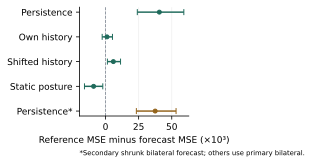

# Gait Forecasting for Medical World Models: A Source-Grouped Study

Author details pending confirmation

Affiliation pending confirmation

## Abstract

Medical world models need observation dynamics that remain useful under simple controls. We test whether correctly timed opposite-leg history improves short-horizon gait forecasts beyond a leg's own history. Full-duration processing of selected GAVD videos yields 2,815 eligible windows from 456 sequences and 91 source videos, including 29 normal sources. Normal-only ridge predictors forecast eight observations at a nominal 10 Hz using nested source-grouped cross-validation. The primary bilateral forecast reduces mean squared error by 33.5% relative to persistence, with paired difference 0.04063 [0.02399, 0.05911]. The corresponding own-history and shifted-context differences are 0.00111 [-0.00253, 0.00524] and 0.00591 [0.00141, 0.01134]. A current-posture-conditioned regression is stronger still, with MSE 0.07164 versus bilateral 0.08063. Bilateral history improved normal-source forecasting over persistence in this exploratory evaluation. The complete set of primary comparisons does not establish a timing-specific bilateral forecasting advantage. A predeclared movement-referenced excess-error score reaches abnormality AUROC 0.793, a secondary association. Intervals resample sources conditional on fixed cross-validation fits. The study is exploratory because earlier GAVD outcomes were known. The contribution is a controlled evaluation of a motor-observation layer, without claims about treatment, disease progression, or neurological mechanism.

## Introduction

Movement supplies an observable aspect of patient state. A gait observation model could eventually support longitudinal assessment, but low prediction error alone does not show that a system has learned clinically meaningful dynamics. Persistence may already predict a short future reasonably well, while appearance, movement amplitude, and recording conditions may distinguish dataset labels. We therefore separate useful forecasting, timing-sensitive information, and abnormality ranking.

Neurological evidence motivates a relational question without fixing its answer. Laboratory gait exhibits structured intersegmental covariation [borghese1996], and bilateral phase coordination is affected in Parkinson's disease [plotnik2007]. Studies of stroke and cerebral palsy relate altered EMG modular organization to impaired movement [clark2010; steele2015]. These measurements differ from projected video coordinates. A predictable compensation can still be abnormal, and no video forecast score identifies a neural module or lesion.

We ask whether adding the opposite leg's correctly timed history improves prediction beyond the target leg's own history. Our contribution is a fixed-time, fuller-sequence, source-grouped audit with matched timing controls and explicit negative-result conditions. Bilateral gait analysis and normal-only prediction are established ideas. We aim to determine what the available observations actually support before introducing a more complex medical model.

## Related work

Skeleton S-JEPA learns action representations through latent masked-observation prediction [abdelfattah2024]. This is distinct from a strict future-only task. MoCoDAD generates future skeletons for anomaly detection [flaborea2023]; GenGait reconstructs normative gait [motta2026]; BioGait-VLM combines visual, language, and biomechanical evidence [chen2026]. These precedents preclude broad first-method claims. Strong static baselines are particularly relevant because low motion-prediction error need not require a learned motion model [martinez2017].

## Data and observation contract

The pinned local GAVD derivative contains 1,874 annotation sequences and 348 source IDs. The requested normal, Parkinson's, stroke, cerebral palsy, and myopathic labels contain 666 sequences from 103 sources [ranjan2025]. Media checks retain 652 sequences from 98 sources. Two previously reviewed sources with person switches or scene cuts are excluded, leaving 641 sequences from 96 sources for extraction. Timing, person, and observation gates retain 2,818 windows from 456 sequences and 91 sources. The common distal-target gate removes 3 windows, retaining 2,815 windows from 456 sequences and 91 sources. These are video groups, not verified independent people.

We reuse cached originals under data/videos-gavd and perform 46,783 recorded Ambient pose-model calls in this preparation invocation. We sample nearest native frames on a nominal 10 Hz grid without interpolating target observations. Each window contains 16 past and eight future samples, with stride eight. The final forecast time spans 0.767 to 0.834 seconds relative to the last prefix frame. Actual frame indices, decoded times, confidence, and missingness are retained. Each source/native-frame tuple is decoded for pose once within a source cache, and identical window tuples are deduplicated.

The observation contract uses BlazePose joints 11–16 and 23–32, confidence at least 0.5, and at least 70% observed joints in both the 16-sample prefix and eight-sample suffix. Full-image detection is followed by an annotation-box pelvis gate; unresolved geometry is rejected. This gate cannot guarantee identity when people overlap. Coordinates are centered on each frame's pelvis and divided by a torso scale estimated only from the prefix. Forecasts therefore describe relative 2D articulation, not physical velocity or clinical joint angles. Own-leg input is conditional on this shared body reference, which already uses both hips.

Retention differs by annotation: 141 of 287 normal sequences selected for extraction remain (49.1%), compared with 168 of 183 myopathic sequences (91.8%). Gates combine duration, geometry, identity, and observation support; this is not purely pose-quality attrition. Selection can affect pooled abnormality ranking. All 32 annotated normal sources are already in the selected scope, so other GAVD labels cannot increase its normal-source ceiling. More windows improve temporal coverage without adding independent patients.

| Annotation | Catalog sources | Final sources | Windows |
| --- | --- | --- | --- |
| Normal | 32 | 29 | 465 |
| Parkinsons | 11 | 11 | 292 |
| Stroke | 19 | 16 | 695 |
| Cerebral Palsy | 11 | 8 | 518 |
| Myopathic | 30 | 27 | 845 |

## Predictors and evaluation

For each target leg, we predict the next eight samples of knee, ankle, heel, and foot-index x/y coordinates. Prefix values are causally forward-filled, with zero before the first observation and explicit observation indicators. Eight fixed prefix positions, including both endpoints, limit dimensionality. The own-leg design has 104 features; the bilateral design has 208, including historical residuals, observation indicators, and anchors. Targets are residuals from each joint's latest observed prefix position. Output-specific ridge fits use observed targets only; imputed targets never become measurements.

The own-leg model uses target-leg history. The bilateral model adds opposite-leg history. A separately trained shifted model retains the same selected values, missingness, and latest opposite-leg observation, but cyclically shifts its seven earlier observations by a window-specific offset derived from the window identity. This disrupts timing with matched capacity; a global feature permutation would instead be absorbable by ridge regression. The static-context model repeats the last observed posture as input but learns a separate future transition at each horizon. It does not repeat a static output. Persistence and velocity extrapolation with fixed damping 0.5 provide elementary references. Additional inference-time shift and static perturbations are reported separately because they can create input distribution shift.

Five outer folds stratify source IDs by annotation with seed 2701. Only normal sources outside each outer fold fit motion models. Three inner source folds select ridge strength from {0.1, 1, 10, 100}; scaling is refitted inside every inner fold. A prospective secondary amendment jointly selects residual shrinkage beta from {0, 0.25, 0.5, 1}, with zero corresponding to persistence. Unshrunk models remain primary. Left and right legs are fitted separately, producing 80 saved fold/leg/arm checkpoints, some sharing the same fitted ridge solution.

All methods use a common observed target support. Each leg must have at least four observed joint-time points in the first four future samples and eight over the full future; each target joint must also have a prefix observation. Coordinate errors are averaged within leg and window, then legs equally, windows within sequence, sequences within source, and sources equally. Training weights follow the same source/sequence/window hierarchy with adjustment for observed target counts. This prevents long videos or denser pose support from determining the endpoint.

The primary endpoint is normal-source MSE averaged over all eight future observations, nominally 0.1 to 0.8 seconds, rather than only the final instant. Paired differences compare bilateral prediction with persistence, own history, shifted history, and static posture; positive values favor bilateral prediction. Four-step results and shrinkage are secondary. We use 5,000 source resamples for error intervals and 2,000 stratified source resamples for secondary AUROC and average precision. These descriptive intervals condition on fixed fits with overlapping training folds. They exclude retraining and patient-population uncertainty and are not multiplicity-adjusted confirmatory tests. Earlier GAVD outcomes were exposed, so the new cross-fitting study is exploratory.

For prefix features $z_i$ and latest observed articulation $a_{i,j}$, the predictor is $\widehat y_{i,h,j}=a_{i,j}+\beta(z_i^\top w_{h,j}+b_{h,j})$. The primary model fixes $\beta=1$; the secondary amendment selects it inside normal-source validation.

## Results

Bilateral history improved normal-source forecasting over persistence in this exploratory evaluation. Persistence and bilateral normal-source MSE are 0.12126 and 0.08063. Their paired difference is 0.04063 [0.02399, 0.05911], equivalent to 33.5% of the persistence mean. Bilateral error is lower on 23 of 29 normal sources. The gain over own history is 0.00111 [-0.00253, 0.00524], over the separately trained timing control 0.00591 [0.00141, 0.01134], and over static posture -0.00900 [-0.01589, -0.00207]. The complete set of primary comparisons does not establish a timing-specific bilateral forecasting advantage.

The secondary shrunk bilateral forecast has persistence-minus-model difference 0.03748 [0.02328, 0.05326] and lower error on 24 normal sources. Its selected beta counts across ten fold/leg fits are 0.5: 5/10, 1: 5/10. The secondary shrunk forecast also improves persistence, but does not improve on the unshrunk bilateral model. Selection used only inner normal-source outcomes; no model or score was promoted based on outer abnormal labels. Appendix tables retain every arm, both horizons, and all paired comparisons.

Abnormality ranking is a separate descriptive endpoint. Larger bilateral MSE, excess MSE above persistence, and bilateral-minus-own MSE are fixed to indicate more abnormal gait. Persistence error and prefix missingness are controls. Bilateral MSE has AUROC 0.304 [0.178, 0.431]. Persistence MSE has AUROC 0.194 [0.096, 0.300]. Excess MSE has AUROC 0.793 [0.680, 0.896]. Bilateral minus own has AUROC 0.549 [0.410, 0.684]. Prefix missingness has AUROC 0.427 [0.296, 0.555]. The abnormal-source prevalence is 0.681. No score direction is reversed, and these comparisons do not measure clinical sensitivity or diagnosis accuracy.

| Forecast | MSE ×1000 | 95% interval |
| --- | --- | --- |
| Persistence | 121.262 | [94.150, 150.800] |
| Damped velocity | 267.828 | [193.236, 353.148] |
| Own-leg history | 81.744 | [64.066, 100.723] |
| Bilateral history | 80.632 | [62.522, 100.023] |
| Shifted bilateral | 86.541 | [67.032, 108.215] |
| Static posture | 71.636 | [55.850, 88.622] |
| Shrunk bilateral | 83.779 | [66.582, 102.528] |

## Discussion and limitations

The positive forecasting gain shows usable information in this observation contract. Correctly timed bilateral context also outperforms its matched shifted control. However, the small uncertain gain over own history and the stronger current-posture-conditioned predictor prevent a broader claim of bilateral temporal superiority. The static-context model learns horizon-specific transitions from the current state; its performance is a useful positive reference, not evidence that the output is motionless. These findings favor testing a compact current-state transition model before increasing temporal complexity.

The predeclared excess-error score also has a favorable abnormality association, while raw error ranks in the opposite direction. Subtracting matched persistence error accounts for a basic component of observed motion difficulty, but does not isolate disease or neurological mechanism. Predictive dependence can arise from mechanics, speed, camera geometry, compensation, and correlated pose noise. The model has no treatment input, longitudinal disease state, clinical reward, or intervention outcome.

Generalization is limited by public-video selection, uncertain participant overlap, annotation validity, acquisition differences, and quality-dependent attrition. Source grouping addresses repeated windows from a video, but cannot establish patient-disjoint or external-site evaluation. Pooled out-of-fold AUROC also assumes comparable score scales across separately fitted fold models; cross-fold offsets remain a limitation. Small normal-source support limits model selection and uncertainty estimates. GAVD alone therefore supports an exploratory observational benchmark, not deployment claims. The highest-value extension is an external cohort with verified identities, clinician assessments, repeated visits, and measured interventions.

Bilateral history improved normal-source forecasting over persistence in this exploratory evaluation. The complete set of primary comparisons does not establish a timing-specific bilateral forecasting advantage. The reusable contribution is a complete evidence chain from real video inference to controlled source-level estimates. It makes forecast utility, timing-specific information, and abnormality association separately testable, which is necessary before a gait observation component can support stronger medical modeling claims.

## Reproducibility appendix

All tables use completed run artifacts. Intervals are conditional and descriptive.

### All Forecasts

| Forecast | Horizon (s) | MSE ×1000 [95% interval] |
| --- | --- | --- |
| Bilateral history | 0.4 | 71.838 [54.566, 91.196] |
| Shrunk bilateral | 0.4 | 76.246 [58.289, 96.254] |
| Damped velocity | 0.4 | 157.107 [110.674, 210.279] |
| Inference shift | 0.4 | 86.547 [67.969, 108.831] |
| Inference static | 0.4 | 68.688 [52.774, 86.527] |
| Own-leg history | 0.4 | 71.231 [54.991, 89.393] |
| Shrunk own-leg | 0.4 | 73.086 [56.702, 91.336] |
| Persistence | 0.4 | 101.710 [74.483, 131.526] |
| Shifted bilateral | 0.4 | 75.449 [57.943, 95.573] |
| Shrunk shifted | 0.4 | 73.407 [55.687, 93.848] |
| Static posture | 0.4 | 64.166 [48.454, 81.562] |
| Shrunk static | 0.4 | 64.166 [48.454, 81.562] |
| Bilateral history | 0.8 | 80.632 [62.522, 100.023] |
| Shrunk bilateral | 0.8 | 83.779 [66.582, 102.528] |
| Damped velocity | 0.8 | 267.828 [193.236, 353.148] |
| Inference shift | 0.8 | 94.855 [75.079, 116.534] |
| Inference static | 0.8 | 82.261 [65.641, 100.124] |
| Own-leg history | 0.8 | 81.744 [64.066, 100.723] |
| Shrunk own-leg | 0.8 | 82.741 [66.126, 100.615] |
| Persistence | 0.8 | 121.262 [94.150, 150.800] |
| Shifted bilateral | 0.8 | 86.541 [67.032, 108.215] |
| Shrunk shifted | 0.8 | 84.278 [65.702, 104.376] |
| Static posture | 0.8 | 71.636 [55.850, 88.622] |
| Shrunk static | 0.8 | 71.636 [55.850, 88.622] |

### Paired Contrasts

| Reference | Forecast | Horizon (s) | Gain ×1000 [95% interval] |
| --- | --- | --- | --- |
| Persistence | Bilateral history | 0.4 | 29.872 [12.220, 50.128] |
| Own-leg history | Bilateral history | 0.4 | -0.607 [-4.023, 2.979] |
| Shifted bilateral | Bilateral history | 0.4 | 3.611 [-0.260, 7.751] |
| Static posture | Bilateral history | 0.4 | -7.672 [-13.888, -1.271] |
| Inference shift | Bilateral history | 0.4 | 14.709 [8.969, 20.812] |
| Inference static | Bilateral history | 0.4 | -3.150 [-11.091, 5.259] |
| Persistence | Shrunk bilateral | 0.4 | 25.464 [11.897, 40.421] |
| Bilateral history | Shrunk bilateral | 0.4 | -4.408 [-10.995, 0.616] |
| Shrunk own-leg | Shrunk bilateral | 0.4 | -3.161 [-6.742, 0.224] |
| Shrunk shifted | Shrunk bilateral | 0.4 | -2.840 [-9.688, 3.336] |
| Shrunk static | Shrunk bilateral | 0.4 | -12.081 [-18.263, -6.063] |
| Persistence | Bilateral history | 0.8 | 40.630 [23.993, 59.111] |
| Own-leg history | Bilateral history | 0.8 | 1.112 [-2.525, 5.244] |
| Shifted bilateral | Bilateral history | 0.8 | 5.909 [1.407, 11.336] |
| Static posture | Bilateral history | 0.8 | -8.996 [-15.894, -2.068] |
| Inference shift | Bilateral history | 0.8 | 14.224 [8.375, 20.592] |
| Inference static | Bilateral history | 0.8 | 1.629 [-7.975, 11.520] |
| Persistence | Shrunk bilateral | 0.8 | 37.483 [23.277, 53.257] |
| Bilateral history | Shrunk bilateral | 0.8 | -3.147 [-7.493, 0.494] |
| Shrunk own-leg | Shrunk bilateral | 0.8 | -1.038 [-4.612, 3.182] |
| Shrunk shifted | Shrunk bilateral | 0.8 | 0.499 [-5.119, 6.375] |
| Shrunk static | Shrunk bilateral | 0.8 | -12.143 [-18.240, -6.523] |

### Anomaly

| Score | AUROC [95% interval] | AP [95% interval] |
| --- | --- | --- |
| Bilateral MSE | 0.304 [0.178, 0.431] | 0.558 [0.520, 0.632] |
| Persistence MSE | 0.194 [0.096, 0.300] | 0.519 [0.495, 0.573] |
| Excess MSE | 0.793 [0.680, 0.896] | 0.865 [0.788, 0.938] |
| Bilateral minus own | 0.549 [0.410, 0.684] | 0.694 [0.618, 0.795] |
| Prefix missingness | 0.427 [0.296, 0.555] | 0.646 [0.577, 0.740] |

### Selection

Bilateral shrinkage beta counts: 0.5: 5/10, 1: 5/10. Complete per-fold and per-leg selection is in selection.csv.

### References

Citation keys resolve to the accompanying references.bib. The compiled PDF contains the formatted bibliography.
