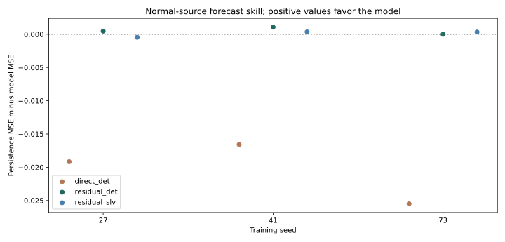
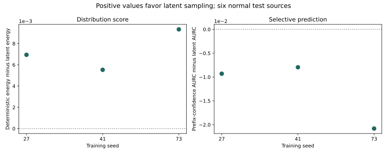

# Separating Forecast Skill, Predictive Uncertainty, and Abnormality Ranking in Skeleton JEPA

**Draft for the First Workshop on Medical World Models, AAAI-27.** Prepared after real-data execution, controlled revisions, joint test release, independent statistical review, and successful execution of all eight final notebooks on November 16, 2026. This is an empirical methodological study; author details and the final AAAI-format PDF remain editorial tasks. Tables and figures are linked to the released evidence rather than illustrative simulated results.

## Abstract

Predictive representations offer an appealing foundation for medical gait models, but abnormality discrimination does not establish that a model has learned useful motion dynamics. We examine forecasting skill, predictive distribution quality, and abnormality ranking separately in a compact Skeleton-JEPA adaptation. We use current GAVD annotations, source-grouped partitions, sixteen declared BlazePose joints, uniform masked pretraining on normal gait, and explicit future-only prediction. Person-quality review yields 407 bounded sequences from 91 sources for forecasting and a separate matched classifier cohort of 405 sequences from 89 sources. Across three training seeds and six normal test sources, the primary residual predictor's MSE improvement over persistence is 0.000513, with a paired source-bootstrap interval spanning zero. Conditional latent samples improve energy score, while their uncertainty ranking gives worse selective prediction than simple prefix-quality rankings. On nineteen test sources, the prespecified excess-error score from the less accurate direct predictor achieves AUROC 0.923, illustrating a separation between normal forecasting skill and abnormality ranking. On seventeen classifier test sources, the primary JEPA probe and Random Forest achieve balanced accuracy 0.818 and 0.788, with an inconclusive paired difference. These exploratory results support evaluating dynamics, discrimination, and uncertainty as separate requirements before drawing medical-world-model conclusions.

## 1. Introduction

A medical world model should represent how a patient's observable state evolves and help quantify uncertainty about possible outcomes. Gait is a tractable setting for studying part of this problem: videos provide sequences of body configurations, and deviations from expected movement may be informative. However, a source-level abnormality label, a low prediction error, and a useful uncertainty estimate answer different questions. A classifier may exploit posture or acquisition characteristics. A persistence predictor may be accurate over a short interval without learning temporal structure. A stochastic predictor may improve a distribution score without identifying the cases on which it will fail.

We study these distinctions using an executable Skeleton-JEPA adaptation and a modest, source-grouped GAVD cohort. Our contribution is an audited evaluation case study and reproducible teaching implementation. We separate a normal-only forecasting experiment from supervised annotation classification, preserve elementary references and failed criteria, and inspect whether the resulting endpoints agree. We do not claim a new state-of-the-art architecture, clinical diagnosis, or treatment-response simulation.

Gait-forecasting pretraining is established by [GaitForeMer](https://arxiv.org/abs/2207.00106), and normal-reference reconstruction and temporal prediction are studied by [FSGait](https://openaccess.thecvf.com/content/ACCV2024/html/Duan_FSGait_Fine_Grained_Self-Supervised_Gait_Abnormality_Detection_ACCV_2024_paper.html). Diverse skeletal futures appear in [MoCoDAD](https://arxiv.org/abs/2307.07205), while [SeeKer](https://arxiv.org/abs/2506.18368) considers conditional keypoint densities and detector confidence. Our question is consequently narrower than whether predictive or stochastic skeleton models can detect anomalies: what does a favorable score demonstrate about learned gait dynamics in this particular setting?

## 2. Data and observation contract

We read the refreshed transformed annotations from the pinned [GAVD source snapshot](https://github.com/Rahmyyy/GAVD/tree/a87859c881603443f200bcd640663d2c3d7a8136/data). The selected scope contains 666 annotated sequences from 103 source videos: normal, parkinsons, stroke, cerebral palsy, and myopathic. Media eligibility retains 652 sequences from 98 sources. These labels are dataset annotations, not independently adjudicated diagnoses. Myopathic gait is a neuromuscular category; the scope should not be described as exclusively central neurological disease.

We assign source videos to training, validation and test partitions before pose filtering. Every sequence from a source retains that assignment. Ambient interfaces decode the videos and call MediaPipe. We preserve one-based annotation frames, decoded indices, sample rates, dimensions, confidence and missingness. Model inputs contain exactly joints 11–16 and 23–32 in BlazePose-33 indexing. Each frame is pelvis-centered, and scale is estimated from observed-prefix torso lengths. The target is relative two-dimensional articulation, not physical locomotion speed or three-dimensional anatomy.

Both hips must meet confidence 0.5 before a pelvis is usable. An annotation-box containment rule rejects clear person mismatches when annotation and decoded image geometry are compatible. A window requires at least 70% valid selected-joint observations. Manual review of unresolved geometry identified person switches and scene changes in two stroke sources, one from training and one from validation. Both complete sources were removed before final metric inspection. Containment and flagged-case review do not verify every remaining person's identity.

| Cohort | Sampled frames / prefix | Sequences | Train / validation / test sources |
|---|---|---:|---|
| Matched classifier comparison | 16 / 8 | 405 | 53 / 19 / 17 |
| Forecasting and acquisition controls | 32 / 16 | 407 | 53 / 19 / 19 |

Each retained sequence contributes one bounded window. The classifier test set has six normal, two parkinsons, two stroke, one cerebral palsy, and six myopathic sources. Forecasting retains two additional stroke sources. These test populations differ and are not pooled. Forecast learning uses 84 normal sequences from seventeen training sources; normal validation has 27 sequences from six sources. Native stride-two sampling gives a sixteen-frame future duration of approximately 1.07–1.33 seconds on test sources. The full cleaned cohort extends to 2.13 seconds, so this is a fixed-frame rather than fixed-duration task.

## 3. Models and controlled development

### 3.1 A declared Skeleton-JEPA adaptation

Published [Skeleton JEPA](https://www.ecva.net/papers/eccv_2024/papers_ECCV/papers/04755.pdf) predicts teacher representations with an EMA target encoder and motion-aware masks. [MAMP](https://arxiv.org/pdf/2308.07092) predicts masked motion and also provides a uniform masking implementation. Our required adaptation samples joint-time masks uniformly, independently of coordinates or velocity, over the sixteen allowed joints. It uses a compact width-48 transformer with two encoder layers, a predictor, stop-gradient teacher targets, centered and sharpened latent cross-entropy and [VICReg-inspired variance and covariance penalties](https://arxiv.org/pdf/2105.04906). This is not an official reproduction. Regularization encourages variation; it does not guarantee separated clinical categories.

For each seed, normal-only masked pretraining runs for 200 updates. Three forecast arms then share the pretrained state, normal-source batches and 300-update budget: a direct coordinate predictor, a deterministic residual predictor, and a residual predictor with an eight-dimensional conditional latent variable. Residual heads start at zero and therefore initially equal persistence. Batch size is eight distinct sources, AdamW learning rate is 0.0003, and the EMA coefficient is 0.99. Seeds are 27, 41 and 73. Final-step checkpoints are retained. Uniform pretraining masks half of the eligible tokens. The forecast experiment weights latent cross-entropy and latent MSE by one each, variance by one, covariance by 0.04, and coordinate MSE by one; pretraining sets the coordinate weight to zero. The latent arm adds posterior-to-prior KL with weight 0.01. Classifier representation fitting instead uses cross-entropy, variance weight one, covariance weight 0.04 and coordinate weight 0.1, with latent-MSE weight zero. The two training objectives are deliberately reported separately. Exact configurations and distinctions are in the frozen protocol and checkpoint metadata.

The latent arm has a target-informed training posterior and a context-only inference prior, following the distinction in [Stochastic JEPA](https://arxiv.org/abs/2611.09302). It is a different method from Skeleton JEPA despite the shared abbreviation. Evaluation draws sixteen prior samples; it never selects a sample against the observed future. Temporal positional jitter is demonstrated separately in a matched tutorial experiment. A complete positional/latent factorial study is not part of the reported scientific comparison.

All future tokens are withheld. The torso scale is estimated only from the prefix, and the predictor sees past observations only. Each target frame is centered using that frame’s observed target pelvis to define relative-articulation ground truth; its pelvis is not supplied as a predictor input. Loss and evaluation use future-observed joints that were observed at least once in the prefix, giving learned models and persistence the same target support. Uniform completion instead operates on already normalized articulation and is not presented as strict conditional recovery of raw masked coordinates.

### 3.2 Endpoints, revisions and uncertainty

The primary forecasting endpoint is normal-source persistence MSE minus deterministic residual MSE. We also evaluate static-prefix and temporal-shuffle controls, preserving the original persistence anchor. Positive control-minus-original error would support useful context information. Energy score evaluates sampled distributions on the common observed coordinate dimensions: mean sample-to-target Euclidean distance, divided by the square root of observed dimension count, minus half the mean similarly normalized distance across distinct sample pairs. Deterministic forecasts have a zero sample-pair term. Selective prediction compares deferral using latent dispersion with deferral using prefix missingness or confidence. Our reported AURC is the declared mean of risk over the retained-coverage grid; with six sources, the requested 75% coverage becomes five of six sources.

The development criterion required positive mean normal-validation forecast gain, with positive gain in at least two of three seeds. It failed in all three seeds. Training-only gradient inspection motivated one declared sensitivity, changing only coordinate weight from one to ten. This also failed to improve over persistence on validation. All arms and both weights remain reported; no further weight search followed final outcomes.

The supervised comparison has a separate budget: seed 27 and the five-epoch rule yield 60 updates for normal pretraining and 60 updates at each staged adaptation step. Conditions enter in the order parkinsons, stroke, cerebral palsy, then myopathic, retaining previously introduced conditions and normal replay. Mixed adaptation uses 240 updates after the same normal initialization. Probes consume pooled final-layer EMA target representations. These classifier runs are distinct from the 200-plus-300-update forecast experiment.

The supervised comparison uses the same cleaned short windows for 37 exp5-style gait features with RF and linear probes on JEPA representations. Normal pretraining precedes staged condition adaptation with normal replay. A mixed-adaptation encoder and untrained encoder are controls. Imputation and scaling fit only training data. RF depth and probe regularization are selected on validation sources. The primary JEPA representation remains the mixed-adaptation probe, fixed before the clean refit. Five-class recognition is secondary. Its clean refit retains the legacy rule that selects settings using binary validation balanced accuracy and the first candidate on ties, rather than optimizing five-class macro-F1; the five-class table must be interpreted under that limitation. Direct binary classifiers balance normal against the pooled four abnormal labels; they are distinct from summing five-class probabilities.

We aggregate windows within sequences and sequences within sources. Paired source bootstrap intervals use 2,000 replicates; forecast effects average seeds within each source before resampling. Classification uses one encoder seed. Before final release we fix all models, thresholds, score directions and three anomaly scores per arm: raw MSE, energy, and excess MSE, defined as model error minus matched persistence error. Every score is reported. The nine secondary comparisons have descriptive, non-simultaneous intervals.

All affected supervised components were refitted after person review. Normal forecast training, normal validation and all forecast test tensors and metadata were exactly unchanged, permitting explicit checkpoint inheritance and filtering of existing stochastic validation predictions. No retraining is claimed for those inherited models. Earlier software had computed quarantined test files and a pre-gate notebook had persisted tables; the authors report not inspecting their values for development decisions. We therefore describe an internal source holdout with this audit limitation, rather than an independently preregistered untouched clinical evaluation.

## 4. Results

### 4.1 Supervised annotation screening

| Model | Binary balanced accuracy | Binary AUROC | Five-class macro-F1 |
|---|---:|---:|---:|
| Random Forest | 0.788 | 0.894 | 0.310 |
| Untrained-encoder probe | 0.818 | 0.788 | 0.520 |
| Normal-only JEPA probe | 0.780 | 0.742 | 0.520 |
| Staged JEPA probe, secondary | 0.909 | 0.909 | 0.314 |
| Mixed JEPA probe, primary | 0.818 | 0.848 | 0.326 |

The primary mixed JEPA minus RF balanced-accuracy difference is **0.030 [−0.189, 0.250]**, providing no clear evidence of superiority on seventeen sources. Mixed JEPA correctly classifies all six normal sources but detects seven of eleven abnormal sources; RF detects ten abnormal sources and correctly classifies four normal sources. The untrained probe matches the primary JEPA balanced accuracy. The staged probe's higher secondary estimate has a paired difference against RF of 0.121 [−0.091, 0.333]. These findings do not establish a pretraining benefit or robust five-condition recognition.

The endpoint correction matters: the five-class-derived 0.5 decision classified every test source as abnormal, yielding binary balanced accuracy 0.5. Direct binary training improves that decision endpoint. It does not improve every ranking measure: the five-class RF's derived abnormal AUROC was 0.955, compared with 0.894 for direct binary RF. Discrimination and threshold alignment must be reported separately.

### 4.2 Forecast skill and temporal controls

Mean normal-source MSE across the three trained seeds is 0.075522 for the direct predictor, 0.054604 for the deterministic residual predictor, and 0.055037 for the latent residual predictor. Persistence MSE is 0.055116. The primary paired gain is **0.000513 [−0.000811, 0.001859]** over six normal sources. This small uncertain difference does not overturn the failed development criterion.

A static prefix improves deterministic residual MSE: controlled-minus-original error is **−0.000962 [−0.001604, −0.000325]**. Shuffling the first fifteen prefix frames changes MSE by 0.000040 [−0.000072, 0.000207]. These controls weaken an interpretation based on learned ordered dynamics. The weight-ten sensitivity gives gain over weight one of −0.000048 [−0.000212, 0.000090], leaving the primary conclusion unchanged.

### 4.3 Distribution quality and useful uncertainty separate

The latent residual model improves energy score relative to deterministic residual prediction by **0.007270 [0.006610, 0.007890]**, with improvement in every seed. Its mean-coordinate MSE remains within the declared 10% descriptive tolerance. However, latent-dispersion deferral gives worse AURC than prefix-quality deferral in every seed on the six normal sources. Dispersion/error rank correlations vary from 0.486 and 0.657 to −0.371. A better distribution score therefore does not establish useful error ranking or clinical calibration. Additional latent-model parameters and the absence of an unconditional-noise control prevent unique attribution to conditional stochasticity.

### 4.4 Abnormality ranking can favor a poor forecaster

| Mean-across-seed score | Raw MSE AUROC | Energy AUROC | Excess MSE AUROC |
|---|---:|---:|---:|
| Direct deterministic | 0.744 | 0.705 | 0.923 |
| Residual deterministic | 0.167 | 0.167 | 0.654 |
| Residual latent-variable | 0.167 | 0.167 | 0.615 |

Persistence error also has AUROC 0.167 under the fixed higher-is-abnormal direction. Its error is larger on normal sources, 0.0551, than on abnormal sources, 0.0218. We do not reverse that direction after observing the result.

The direct model's prespecified excess-error score reaches **AUROC 0.923 [0.744, 1.000]** and average precision **0.959 [0.874, 1.000]** on nineteen sources, with abnormal prevalence 0.684. It is a favorable secondary result from the model with worse normal forecasting. All nine arm/score combinations and per-seed estimates are retained in the supplement. This pattern establishes neither causation nor an optimal anomaly model. It shows that a favorable ranking alone is insufficient evidence for the proposed dynamics mechanism.

The difference score also has a simple interpretation. For a fixed observed target vector \(y\), forecast \(f\), and persistence reference \(p\), its unnormalized squared-error difference is

\[
\|y-f\|^2-\|y-p\|^2=2y^\top(p-f)+\|f\|^2-\|p\|^2.
\]

The score contrasts two predictions relative to the observed outcome; good ranking does not mathematically require either predictor to be accurate. Posture, movement extent, pose quality and source composition remain possible contributors here. Prefix-quality-only classification gives AUROC 0.500, while a retrospective audit including future quality gives 0.679. Those limited controls do not exhaust acquisition confounding.

## 5. Discussion and medical-world-model implications

This study supports evaluating three requirements separately: predictive improvement over simple dynamics references, discrimination of labeled abnormalities, and uncertainty that helps identify errors. In this cohort, a favorable secondary anomaly ranking coexists with weak forecast skill, and a favorable energy score coexists with poor uncertainty-based deferral. A clinical-world-model argument should therefore state which capability is supported and which remains untested.

The executed refinements improved interpretability: direct binary readouts corrected the decision endpoint; matched residual initialization made the persistence comparison explicit; temporal and acquisition controls tested competing explanations; and person-quality review removed invalid tracks before final access. They did not produce evidence of robust clinical classification or establish a novel stochastic architecture. The useful contribution is the controlled evidence and the evaluation distinctions it exposes.

Source count is the principal statistical limitation. Only one cerebral palsy source and two parkinsons sources remain in each test cohort. Source grouping does not prove patient independence across uploads. Labels, views, activity and acquisition characteristics are observational. Models use bounded sequence prefixes and short, variable-duration two-dimensional forecasts. Representation diagnostics show low effective rank despite variance/covariance regularization. The laptop training budget, single classification seed, incomplete stochastic-position factorial study, and absence of an external patient-disjoint cohort further limit inference. Six normal calibration sources cannot provide a useful finite distribution-free threshold at the proposed 5% false-positive target.

A next independent study should fix physical-time horizons, verify person tracks more comprehensively, add patient-disjoint external data, repeat the classifier comparison across seeds and source partitions, and compare conditional latents with equal-capacity deterministic and unconditional-noise controls. These are future experiments, not performed results. The current held-out sources should not be reused to tune those choices.

## Reproducibility and evidence

The project contains eight independently runnable notebooks with **88 executed real-data code cells**, local video previews, actual MediaPipe and PyTorch calls, saved checkpoints and classifiers, and corrected binary input-video inference. The focused suite passes **43 tests**. Provided code is a declared adaptation; synthetic teaching checks are recorded separately from real-data results.

- [Machine-readable complete results](research_results.json), [all result tables](results_tables.md), and [independent agent review](final_scientific_review.md).
- [Frozen protocol](revision_protocol.md), [development amendments](revision_amendments.md), [joint release](test_release.json), and [completed evaluation hashes](test_execution.json).
- [Execution and reproduction commands](execution.md), [notebook execution hashes](notebook_execution_real.json), [source exclusions](source_exclusions.json), and [forecast checkpoint reuse certificate](forecast_reuse_certificate.json).
- [Primary literature and implementation audit](literature.md), including the supplied StoP and Nature references and access limitations.

The figures and complete tables are supplementary evidence for this editable draft. No submission, external publication, or clinical deployment has been performed.
