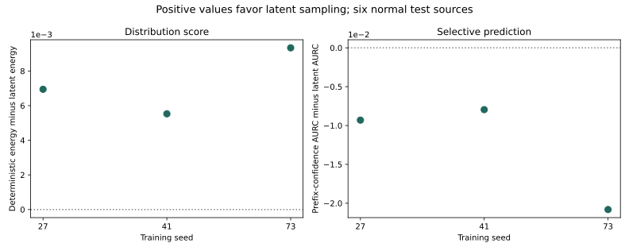

# Complete result tables

Generated from `research_results.json` and the frozen source CSVs. Values are exploratory source-level estimates. Classification uses 17 test sources; prediction/anomaly scores use 19, including six normal sources. No score direction or primary model was selected from test results.

## Direct binary and five-class classification

| Model | Binary balanced accuracy | Binary AUROC | Five-class balanced accuracy | Five-class macro-F1 |
|---|---:|---:|---:|---:|
| rf | 0.7879 | 0.8939 | 0.4000 | 0.3105 |
| untrained_probe | 0.8182 | 0.7879 | 0.5667 | 0.5200 |
| jepa_normal | 0.7803 | 0.7424 | 0.5667 | 0.5200 |
| jepa_adapted | 0.9091 | 0.9091 | 0.4333 | 0.3136 |
| jepa_mixed | 0.8182 | 0.8485 | 0.4667 | 0.3262 |

## Forecast accuracy by seed

| Seed | Arm | Normal MSE | Normal energy | Persistence minus model MSE |
|---|---|---:|---:|---:|
| 27 | direct_det | 0.074278 | 0.269955 | -0.019162 |
| 27 | residual_det | 0.054642 | 0.223114 | +0.000474 |
| 27 | residual_slv | 0.055575 | 0.216171 | -0.000458 |
| 41 | direct_det | 0.071690 | 0.264716 | -0.016574 |
| 41 | residual_det | 0.054046 | 0.221491 | +0.001070 |
| 41 | residual_slv | 0.054759 | 0.215962 | +0.000357 |
| 73 | direct_det | 0.080599 | 0.277536 | -0.025482 |
| 73 | residual_det | 0.055124 | 0.224333 | -0.000007 |
| 73 | residual_slv | 0.054778 | 0.214995 | +0.000338 |

## Every prespecified anomaly score

Mean scores across the three training seeds are formed per source before evaluation. These are nine secondary comparisons. The source bootstrap has 2,000 paired replicates. Higher score always means abnormal; the direction is not reversed when AUROC is below 0.5.

| Arm | Score | AUROC [95% interval] | AP | AUROC gain over persistence [95% interval] |
|---|---|---|---:|---|
| direct_det | raw_mse | 0.744 [0.487, 0.962] | 0.866 | +0.577 [+0.282, +0.846] |
| direct_det | energy | 0.705 [0.423, 0.949] | 0.836 | +0.538 [+0.218, +0.833] |
| direct_det | excess_mse | 0.923 [0.744, 1.000] | 0.959 | +0.756 [+0.385, +1.000] |
| residual_det | raw_mse | 0.167 [0.000, 0.385] | 0.544 | +0.000 [+0.000, +0.000] |
| residual_det | energy | 0.167 [0.000, 0.385] | 0.544 | +0.000 [-0.000, +0.000] |
| residual_det | excess_mse | 0.654 [0.308, 0.962] | 0.768 | +0.487 [+0.077, +0.846] |
| residual_slv | raw_mse | 0.167 [0.000, 0.385] | 0.544 | +0.000 [+0.000, +0.000] |
| residual_slv | energy | 0.167 [0.000, 0.385] | 0.544 | +0.000 [-0.000, +0.000] |
| residual_slv | excess_mse | 0.615 [0.269, 0.936] | 0.746 | +0.449 [+0.026, +0.821] |

## Additional fixed forecast baselines

| Baseline | Normal-source MSE | All-source MSE |
|---|---:|---:|
| persistence | 0.055116 | 0.032291 |
| velocity | 3.703764 | 1.562068 |
| population_static | 0.058918 | 0.066216 |
| untrained_direct | 0.504937 | 0.563310 |
| untrained_residual | 0.055116 | 0.032291 |

## Temporal controls

| Arm/control | Controlled minus original normal MSE [95% interval] |
|---|---|
| direct_det_shuffled | +0.000306 [-0.000432, +0.001106] |
| direct_det_static | +0.004683 [+0.000973, +0.006900] |
| residual_det_shuffled | +0.000040 [-0.000072, +0.000207] |
| residual_det_static | -0.000962 [-0.001604, -0.000325] |
| residual_slv_shuffled | -0.000055 [-0.000295, +0.000160] |
| residual_slv_static | -0.001082 [-0.001878, -0.000335] |

## Uncertainty and optimization sensitivity

The JSON report retains all source-level uncertainty/risk summaries, including unavailable partial-rank correlations when residual degrees of freedom are insufficient. AURC here is the declared mean of risk at the retained coverage grid, not a continuous integral.

Weight-ten minus weight-one benefit in normal MSE (positive favors weight ten): -0.00004846; 95% paired interval [-0.00021241836904327798, 8.955830667436757e-05].
