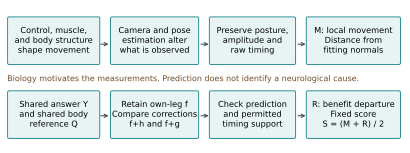
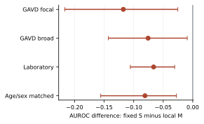

# Useful prediction does not automatically improve gait anomaly detection

This package now contains an executed study of a precise question: **after a leg's own visible movement is accounted for, does the opposite leg add useful prediction information, and does that information improve detection of unusual gait?** The new study preserves a local predictor, adds an own-leg capacity control, compares three motion-independent masking policies, and checks the observation support needed for a timing interpretation.

The answer is qualified. All three policies passed the planned internal normal-data prediction gate. The unchanged uniform task still has uncertain outer-normal gains for U and A. The fixed combined anomaly score performed worse than local movement alone. A separate laboratory study of 178 participants reproduced the detection loss despite clear held-out normal prediction improvement. The GAVD timing diagnostic failed its paired-support adequacy gate, so it cannot establish a reliable coordination measurement.

The [standalone manuscript in draft03](docs/draft03/README.md), **Controlled Cross-Leg Prediction for Gait Anomaly Detection**, presents the controlled prediction method, measured completion gains and independent participant evaluation. It explains how prediction adequacy, observation support and score integration determine the interpretation of relational gait evidence.

Start with [the six new notebooks](#tutorials), [verified results](docs/iteration02/results.md), [the draft02 manuscript](docs/draft02/manuscript.pdf), and [submission readiness](docs/draft02/submission_readiness.md). The [slides](slides/tutorial.pdf) and [offline viewer](slides/index.html) explain the complete study in plain language. Each slide has detailed [speaker notes](slides/tutorial.md), and the viewer provides individual light/dark controls with saved preferences. A [score guide](slides/score_guide.md) explains movement M, cross-leg R and their fixed average S. The [draft01 manuscript](docs/draft01/manuscript.pdf), historical runs, and [previous README snapshot](README.before_iteration02.md) remain preserved.



## What actually ran

| Evaluation | Independent evaluation unit | Local M AUROC | Fixed S AUROC | S minus M, conditional 95% interval |
| --- | --- | ---: | ---: | --- |
| GAVD focal primary |90 source recordings,28 normal |0.694|0.576|-0.118, [-0.217, -0.025]|
| GAVD broad secondary |304 source recordings,28 normal |0.707|0.631|-0.076, [-0.143, -0.009]|
| Independent laboratory replication |178 participants,128 healthy |0.958|0.892|-0.066, [-0.106, -0.031]|

These are weighted means of within-fold AUROCs, not pooled cross-model ranks. Intervals resample sources or participants while retaining fitted models, folds and the selected protocol. They do not account for training uncertainty or the prior exploratory redesign. The laboratory analysis uses simultaneous six-angle signals and independently fitted models. It is not transfer of video weights, a BlazePose mapping, or validation of all four condition families. The age and sex matched sensitivity also favors M over the fixed fusion.

The primary GAVD endpoint is normal versus Parkinsons, stroke, cerebral palsy and myopathic folders. Only `normal` is normal. Every other folder remains abnormal in the required broad secondary endpoint. Stroke is one category. The focal primary was frozen after draft01 exploration, so it is an explicitly exploratory redesign. It does not replace draft01's all-folder primary.



## Tutorials

Each notebook repeats its setup and loads an exact verified real-data run. A fresh kernel can execute it independently. It reports the producer command if an artifact is absent and never substitutes synthetic data for a result. Small software fixtures are explicitly labeled and excluded from efficacy tables.

| Notebook | Learning objective |
| --- | --- |
| [12](12_observation_population_and_video_context.ipynb) | Freeze the fresh population, inspect video and pose, and verify source roles. |
| [13](13_own_leg_and_opposite_leg_prediction.ipynb) | Understand matched masks, permitted inputs, retained prediction and normal-data adequacy. |
| [14](14_matched_distal_leg_timing_controls.ipynb) | Construct fixed-answer timing edits and see why sparse paired support limits interpretation. |
| [15](15_local_and_relational_anomaly_scores.ipynb) | Calculate M, R and S, preserve aggregation order, and inspect reference instability. |
| [16](16_baselines_and_source_level_evaluation.ipynb) | Compare frozen endpoints, controls and the separate five-class classifiers. |
| [17](17_failure_analysis_and_manuscript_decision.ipynb) | Inspect real failures, the independent replication, scientific gates and justified claims. |

Notebooks 00–07 teach the original ingestion, pose processing, Skeleton S-JEPA, VICReg, progressive adaptation, forecasting and Random Forest workflow. Notebooks 08–11 document the completed historical context study. Their original scientific outputs retain their historical identities. Navigation is updated; new execution reports distinguish an isolated historical replay from the new experiment.

## Local setup

From the repository root:

```bash
uv sync --project experiments/aaai
uv run --project experiments/aaai jupyter lab experiments/aaai
```

Use Python 3.12 and the existing [pyproject.toml](pyproject.toml). Install the optional raw laboratory parser with `uv sync --project experiments/aaai --extra external`. There is no competing requirements file. The repository-root `.env` contains `AAAI_ITERATION02_RUN_DIR=experiments/aaai/artifacts/iteration02/d66e1b126c9d9a9adf1b`. Existing API credentials are neither copied nor printed. Gait training and scoring require no language-model API call.

Before running the adapted STG-NF comparison, retrieve its pinned upstream code from the repository root:

```bash
git submodule update --init -- experiments/aaai/vendor/STG-NF
```

The submodule is fixed at `edb5f3220332e160e4d20ce258787d5e2d7e0200`, the revision verified by the baseline loader. Videos, model weights and run artifacts remain local and are excluded from Git. Reports and notebooks identify their producer commands and required run identities; a fresh clone must prepare or restore those local inputs before replaying the experiments.

Every notebook finds the repository root, changes to it, and loads:

```python
from dotenv import load_dotenv as load_env, find_dotenv as find_env
load_env(find_env())
```

`load_env` and `find_env` are aliases for python-dotenv's actual function names. The run records the interpreter and package versions. The default execution uses CPU; the compact ridge study and separately supervised probes fit on the laptop.

## Data, provenance and generalization

The fresh inventory has 1,874 sequences,458,116 annotation rows and 348 source IDs. The source distribution folder is excluded from counting. The new primary cohort retains 9,442 windows,1,381 sequences and 304 source recordings, including 28 normals. Its focal membership counts are 28 normal,10 Parkinsons,15 stroke,10 cerebral palsy and 27 myopathic. One source belongs to both `abnormal` and `cerebral palsy`; it counts once in binary endpoints and is excluded from the separate five-class task under the frozen conflict rule. That task therefore has 89 sources. Category memberships are not independent people.

The [fresh inventory authority](../../data/gavd/README.md), [preparation ledger](artifacts/iteration02/preparation/cohort_v2/provenance.json), and [source registry](artifacts/iteration02/d66e1b126c9d9a9adf1b/source_registry.csv) explain counts and exclusions. A byte-different duplicate was confirmed by decoded frames in the full inventory. Both copies already failed pose-window quality checks, so none of the retained 304 sources share that confirmed duplicate footage. Unknown repeated people cannot be resolved from upload IDs.

GAVD supports an internal study of observable movement across heterogeneous web recordings. **It does not by itself establish generalization to independent patients, new clinics or neurological causes.** All 28 normal recordings appeared in earlier exploration. The normal sample is small; folder labels have not been independently clinically revalidated; view, activity, assistance, camera motion and pose quality differ. More windows and abnormal videos do not replace independent normal participants. No complete four-fold view-matched analysis resolves all these alternatives, and the small camera review is descriptive.

The ingestion wrappers reuse `ambient.utils.youtube_cache.download_youtube_urls` and `SequenceKeypointExtractor`. They restore full-frame coordinates after per-frame GAVD box cropping. The image detector returns the first pose in its crop and is not a validated identity tracker. The study uses `raw_xy`, confidence 0.5, adjacent-valid resampling at 15 Hz, and the declared shared pelvis/first-half torso reference. It preserves projected posture, excursion and raw timing. Torso-scaled image motion is not physical walking speed or a measured 3D joint angle.

All GAVD recordings and generated previews remain under `data/videos-gavd`. New source-organized recordings use `<source_id>/`, with previews in `<source_id>/previews/`. Existing root-level cached videos remain at their recorded paths. Videos are not duplicated into condition folders. The notebooks display local videos and labeled pose overlays. Source video rights have not been cleared for manuscript redistribution; the paper's failure illustrations use measured skeleton traces instead of photographs.

## Models and fair masking comparisons

The new core is a coordinate estimator, not a claim that a JEPA encoder learned a disease mechanism. The retained baseline is a shared 77-feature ridge predictor. Own-leg and both-leg residual branches each use 154 features and 1,240 coefficients including intercepts. Their numerical feature ranks and inductive biases are reported. A zero multiplier returns the saved baseline exactly. Three grouped internal folds select regularization and correction multipliers using fitting normals only. Every outer fit has 16 fitting normals, five separate reference normals and seven test normals.

U chooses 64 of 128 joint-patch tokens uniformly. J first hides one joint for all eight patches, then uniformly fills 56 tokens. A hides an eight-token anatomical core, then fills 56. Every policy hides half of the tokens and gives each token marginal probability 0.5, without consulting motion, labels or attention. Each policy retains the same U-trained baseline. All are evaluated on the identical 16-mask U bank with seed 17 and the separately defined E_leg challenge with seed 117. The [implemented protocol](docs/iteration02/protocol.md) states the exact anatomy, permitted-input rules and aggregation.

These are controlled adaptations of existing masking ideas. Skeleton S-JEPA and MAMP originally use motion-aware masking. VideoMAE and SLiM already motivate tube masks. Stochastic positional embeddings change positional queries; they are not mask selection or physiological uncertainty. New encoder-mask, positional-noise and latent-variable ablations are deferred. The fresh learned/random JEPA probes are a separate supervised five-class comparison with normal-only encoder pretraining, EMA and VICReg. VICReg discourages collapse and redundancy; it does not force disease labels apart.

## Reproduce the scientific runs

```bash
uv run --project experiments/aaai python -m aaai_gait.iteration_runner --cohort experiments/aaai/artifacts/iteration02/preparation/cohort_v2 --mode development
uv run --project experiments/aaai python -m aaai_gait.iteration_runner --cohort experiments/aaai/artifacts/iteration02/preparation/cohort_v2 --mode full --resume
uv run --project experiments/aaai python experiments/aaai/scripts/run_iteration02_auxiliary.py --run experiments/aaai/artifacts/iteration02/d66e1b126c9d9a9adf1b
uv run --project experiments/aaai python experiments/aaai/scripts/run_iteration02_timing.py --run experiments/aaai/artifacts/iteration02/d66e1b126c9d9a9adf1b
```

Development mode has a separate identity, uses real normal data, and is incomplete for efficacy. Full mode freezes the current cohort, code, source roles, masks and configuration before fitting. A changed scientific configuration creates a new identity. Read [the reproduction guide](docs/iteration02/protocol.md) for preparation, external replication, verification and report commands. Historical latest-result pointers are unchanged.

The raw-prediction verifier reconstructed 16,801,488 core mask-target records and the timing verifier reconstructed 5,870,520 diagnostic records. These are repeated measurements, not millions of independent samples. [Readiness](docs/draft02/submission_readiness.md) distinguishes an executable package and valid format from the scientific strength of an exploratory negative-result manuscript. The [official workshop](https://ismart.ece.mcgill.ca/astad4/) allows seven content pages plus two reference pages in anonymous AAAI-27 format and lists November 20, 2026 as the deadline.
