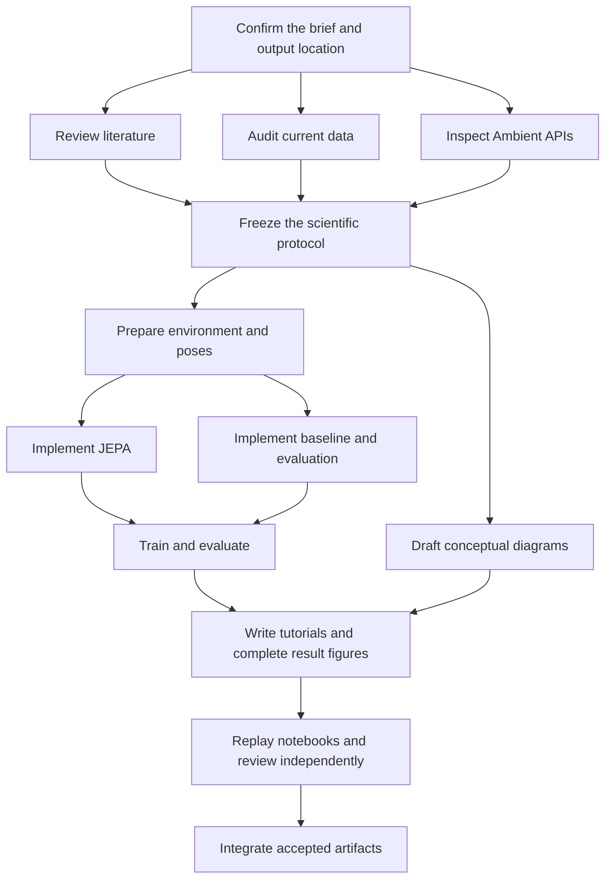

# Research team for the S-JEPA tutorials

This directory defines a reusable research team for the user-confirmed [ASTAD tutorial brief](../../../notes/aaai-astad/02-create-initial-tutorials.md). The team is saved separately from existing experiment code and historical results. It is ready to plan and carry out a later authorized tutorial run; creating these definitions has not trained a model or generated a new tutorial course.

The design uses a coordinator and specialists with explicit responsibilities. The coordinator schedules up to three workers alongside itself, subject to the actual host's capacity. Ten saved roles provide the expertise needed over the project without requiring ten agents to run at once. Research and independent implementation can proceed together, while shared files, training and final acceptance receive coordinated attention.

## The team

| Agent | Responsibility |
| --- | --- |
| [sjepa_coordinator](../../../.codex/agents/sjepa_coordinator.toml) | Maintains the scope, decisions, dependencies, file ownership and final acceptance. The main agent normally takes this role. |
| [sjepa_literature](../../../.codex/agents/sjepa_literature.toml) | Checks the papers and official implementations, explains the architecture, and distinguishes published methods from proposed adaptations. |
| [sjepa_data](../../../.codex/agents/sjepa_data.toml) | Recounts the current data, preserves exclusions and provenance, and prepares source groups and splits. |
| [sjepa_pose](../../../.codex/agents/sjepa_pose.toml) | Reuses Ambient pose and feature interfaces and defines frame mappings, quality checks and the permitted joint table. |
| [sjepa_model](../../../.codex/agents/sjepa_model.toml) | Implements normal-only JEPA training, uniform masking, anti-collapse checks and separately identified adaptation experiments. |
| [sjepa_evaluation](../../../.codex/agents/sjepa_evaluation.toml) | Freezes the evaluation protocol and compares Random Forest and JEPA fairly, with uncertainty and leakage checks. |
| [sjepa_reproducibility](../../../.codex/agents/sjepa_reproducibility.toml) | Prepares the laptop environment and verifies independent notebook execution and artifact identities. |
| [sjepa_tutorials](../../../.codex/agents/sjepa_tutorials.toml) | Writes progressive notebooks with explicit prerequisites, natural explanations and local video context. |
| [sjepa_visuals](../../../.codex/agents/sjepa_visuals.toml) | Produces editable vector diagrams and explanatory slides, then renders them for visual inspection. |
| [sjepa_reviewer](../../../.codex/agents/sjepa_reviewer.toml) | Independently challenges the science, code, evidence, notebooks and rendered figures. |

Each definition includes its duties, boundaries and expected evidence. Agents inherit the parent model and permissions. There are no model overrides, new credentials, permission changes or background services in this package.

## Where the definitions belong

The ten role definitions live in the repository's `.codex/agents/` directory. This is the project location specified by the current [OpenAI subagent documentation](https://learn.chatgpt.com/docs/agent-configuration/subagents), checked on November 16, 2026 UTC. Each TOML file defines a specialist that the coordinator can assign work to.

The shared [agent library](../../../.agents/README.md) now maintains their canonical instructions under `.agents/teams/sjepa/roles/` and generates the native Codex profiles. It also generates Claude Code and OpenCode adapters with hyphenated names, while preserving the original Codex IDs and instruction bodies. Edit the canonical sources and run `.agents/scripts/sync_agents.py --write`; direct edits to generated profiles are detected as conflicts. This team retains its confirmed ASTAD brief and task graph independently of the general research roles.

The top-level `.agents/skills/` directory serves a different purpose. The [OpenAI skills documentation](https://learn.chatgpt.com/docs/build-skills) uses it for reusable workflows packaged with a `SKILL.md` file. A skill supplies a capability or procedure; it does not by itself register one of these named subagents. If a future reusable workflow warrants a skill, its instructions can refer to this team without duplicating its role definitions.

The research, requirements, coordination protocol and templates stay together in `experiments/agents/sjepa-tutorials/`, separate from the existing studies. This supporting directory is an organizational choice for this project. Codex discovers the actual profiles through `.codex/agents/`. The repository's root `AGENTS.md` continues to provide shared project instructions.

## Start a later run

Open this repository in a fresh local Codex session and use this prompt:

```text
Use the research team in experiments/agents/sjepa-tutorials/README.md.
Act as sjepa_coordinator. Read the confirmed ASTAD brief, requirements.md,
protocol.md and team.json. Begin T00 by reconciling the tutorial output
location with the existing historical experiments. Then give me the
execution plan, proposed file ownership and laptop resource budget.
Do not begin tutorial implementation in this planning pass.
```

When the execution scope and output location are established, a follow-up can authorize the ready tasks from that run record. This first prompt deliberately starts with planning because the brief's `experiments/aaai` path is stale in this working tree. Existing `experiments/aaai-astad` material contains frozen research that must be preserved. An empty file with the same brief name exists under `notes/aaai-worldmodels`; the user explicitly selected the populated ASTAD brief for this team.

The profiles use the current documented standalone `.codex/agents/*.toml` format with `name`, `description` and `developer_instructions`. Codex CLI 0.169.0 listed all ten profiles in the available-role section of its local `debug prompt-input` output. This checked discovery without starting a model run. [OpenAI's subagent documentation](https://learn.chatgpt.com/docs/agent-configuration/subagents) describes project-scoped definitions and inherited permissions. Saved definitions do not guarantee that an already-running host reloads them. This conversation's collaboration tool accepts task prompts rather than a custom-agent selector, so it uses the following portable approach when necessary.

From the repository root, use a Python 3.11 or newer interpreter to validate the team and print the desired role:

```bash
.venv/bin/python experiments/agents/sjepa-tutorials/validate_team.py --self-test
.venv/bin/python experiments/agents/sjepa-tutorials/validate_team.py --prompt sjepa_pose
```

The coordinator can pass the printed instructions, the shared protocol and a completed task packet to its available spawn tool. It should not claim that a native named profile was selected when it merely supplied the same instructions in a prompt. If delegation is unavailable, the coordinator can execute the ready work sequentially and record that independent review has not yet occurred. The validator checks files and dependencies; it does not launch agents or enforce operating-system permissions.

## Workflow and evidence

[team.json](team.json) defines sixteen tasks with owners, dependencies and acceptance criteria. The workflow first resolves scope, then gathers literature, data and API evidence. It freezes the scientific protocol before fitting, establishes the environment and pose interfaces, and implements model and baseline work in parallel where they are independent. Training precedes final evaluation. The course and visual materials then undergo execution checks and independent review before integration.



The [protocol](protocol.md) explains scheduling, exact file leases, task states, recovery and review. It limits heavy local computation to one job and requires a measured smoke run before a larger job. These are project-specific operating choices. The [research review](research.md) explains how published guidance informed them and where the evidence does not establish a universal best approach.

Use [task.md](templates/task.md) for assignments, [handoff.md](templates/handoff.md) for results and [review.md](templates/review.md) for independent findings. The [run template](templates/run.json) records decisions and progress across sessions. No runtime ledger has been filled with fictitious completed tutorial work. The [requirements map](requirements.md) connects the brief's obligations to owners and acceptance evidence.

## Decisions the agents must preserve

The requested categories contain `stroke` twice; the team uses five unique labels. Uniform motion-independent masking is a requested adaptation that must be distinguished from the original methods. VICReg discourages representation collapse but does not guarantee separation between health conditions. Stochastic positions, stochastic latent variables and mask selection need separate explanations and controls.

The brief omits a complete feature-to-joint list, so the pose and evaluation roles must derive and review the permitted joint table before model work. The current media collection has explicit missing sources and content warnings that must survive cohort construction. Exact clip-frame checks alone do not establish useful poses, annotation accuracy or generalization to new patients. The environment instructions conflict about `.env` location; the protocol favors the later repository-root instruction, with a recorded decision and correct python-dotenv function names.

For planning, the [official ASTAD page](https://ismart.ece.mcgill.ca/astad4/) was checked on November 16, 2026 UTC and listed November 20, 2026 as the submission deadline. It listed seven content pages plus two reference pages and double-blind review. Recheck these details before a submission. The team is intended to produce sound, reproducible tutorials and research evidence; it cannot guarantee a paper outcome.

## Validation and limits

The local validator checks TOML fields, unique role identities, brief integrity, task owners, independent review assignments, dependencies, cycles, acceptance contracts and the declared concurrency limits. Its deliberate-invalid-input checks challenge duplicate roles, nonexistent owners/dependencies, cyclic tasks, excessive concurrency, false completion states and self-review. These checks establish that the saved package is internally consistent, not that a training method works or that a particular host has executed every native profile.

Keep study-specific planning files in this directory and role sources in `.agents/teams/sjepa/`. Regenerate native profiles through the shared library. Existing settings, experiments and unrelated repository changes are outside this setup. Read [validation.md](validation.md) for what was actually checked during creation and the independent review outcome.
