# Learning gait with JEPA: an illustrated research FAQ

**A reader’s guide to the GAVD3 experiments**  
Evidence checked against the notebooks and retained real-data artifacts on 4 October 2026.

[Download the Word document](faq.docx). The illustrations are original vector graphics; their editable SVG files are in [the figure folder](faq/figures/).

Walking combines timing, coordination, joint motion, and balance. This project asks whether a model trained to predict hidden parts of a skeleton representation can preserve movement information that helps distinguish annotated gait conditions. The experiments make that question progressively harder: first demonstrate that training works, then check classification, investigate recording shortcuts, measure readable gait quantities, change the masking rule, and finally attempt future prediction.

The results are mixed. Frozen S-JEPA features support classification within this small corpus, but the learned representation also preserves source-video identity. Readable gait parameters are weak, the anatomy-guided mask has no demonstrated advantage, and low future-prediction loss does not produce a reliable gait phase forecast. Those failures help identify which claims the next experiment must test more carefully.

## How to use this FAQ

The questions follow the research logic, with definitions introduced before their results. Readers new to machine learning can start at Question 1; readers checking the evidence can go directly to Questions 24–42.

| Reading route | Questions | Main question |
|---|---|---|
| Motivation and hypotheses | 1–5 | What would count as useful physical information? |
| JEPA and the learning machinery | 6–15 | What is learned, and how is it learned? |
| Data, anatomy, and measurement | 16–23 | What information reaches the model? |
| Evaluation and observed results | 24–32 | Which comparisons support which claims? |
| Testing alternative explanations | 33–39 | Does the representation preserve gait, source identity, or both? |
| Future prediction and the next iteration | 40–45 | What remains necessary for a physical world model? |

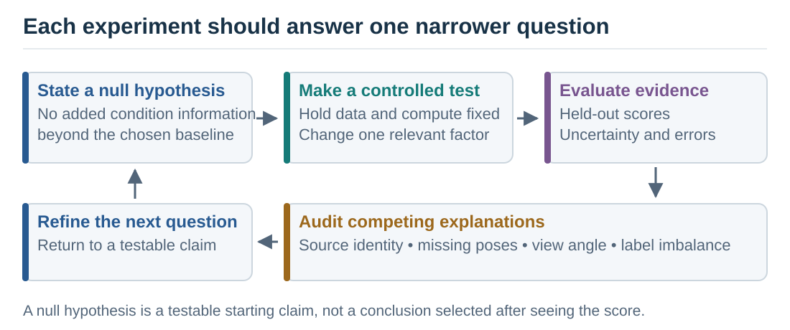

*Figure 1. Each experiment narrows a claim and opens the next question. A failed comparison can improve the research design even when it does not improve the model score.*

## Motivation and hypotheses

### 1. Why study walking with machine learning?

Walking produces a repeated movement pattern that can be observed in ordinary video. Changes in rhythm, joint excursion, and left–right coordination may be associated with different health conditions, making gait an interesting setting for studying how machine learning represents physical movement.

The practical question is whether a compact representation retains useful information despite camera differences and imperfect pose estimates. A useful research result would show which movement properties can be recovered, how well they generalize, and which recording artifacts still influence the output. Recognizing a dataset label is one measurement of that representation; it does not by itself establish a clinical mechanism or a diagnosis.

### 2. What does “physical AI” mean in this project?

Here, physical AI means learning from observations of a moving body and evaluating whether the learned representation reflects its observable dynamics. A convincing demonstration would preserve measurable properties such as movement timing or coordination, predict future movement under a stated protocol, and work across independent recordings.

The present model receives estimated joint coordinates. It has no direct measurement of force, muscle activation, ground contact, or a person’s intended action. Calling the work physical AI therefore describes its subject and research direction; the term does not certify that the model has learned biomechanics or the causes of a health condition.

### 3. What was the initial null hypothesis?

For this FAQ, a useful starting null hypothesis is: **self-supervised pretraining does not improve recovery of gait quantities or health-label prediction over an untrained encoder and simple input summaries when evaluated on independent sources.** Pretraining may reorganize input information so a readout can use it more easily. A null hypothesis states the absence of the effect being tested, so an appealing explanation must earn support through a comparison.

This is a retrospective working hypothesis that organizes the notebooks. We found no preregistered null or fixed statistical decision rule in the notebook series. The retained experiments are descriptive, and their scores do not justify a formal claim that this broad null has been rejected.

### 4. How does that broad question become testable?

The notebooks separate it into narrower questions. Does masked prediction train without producing constant features? Can a classifier use frozen features? Are the features informative about the source video? Can a simple readout recover a gait parameter? Does the proposed anatomical mask outperform alternatives? Does future prediction retain movement timing?

Each question requires its own control. An untrained encoder helps test the contribution of pretraining, raw-coordinate summaries show how much information was already present, and missingness features test whether pose-detector failures predict labels. A classification advantage over one control cannot answer every other question.

### 5. How do the notebooks form an intellectual journey?

The early notebooks establish the input and learning rule; the later notebooks ask whether the resulting features support the interpretation initially hoped for. The table names the question each stage addresses. The result files for the later experiments are retained separately from their notebooks, whose embedded outputs are empty.

| Notebook | Question and contribution |
|---|---|
| [00: first principles](../gavd3/00_sjepa_from_first_principles.ipynb) | Define the architecture and work through latent prediction. |
| [01: manifest and videos](../gavd3/01_gavd_manifest_and_youtube.ipynb) | Establish the cohort and count distinct source videos. |
| [02: skeleton extraction](../gavd3/02_extract_and_watch_skeletons.ipynb) | Check that the intended walker and annotated frames become the pose input. |
| [03: landmark masking](../gavd3/03_neurologic_keypoint_masking.ipynb) | Verify which landmarks may become prediction targets. |
| [04: normal-only pretraining](../gavd3/04_pretrain_sjepa_on_normal.ipynb) | Test training behavior and feature collapse. |
| [05: latent inspection](../gavd3/05_inspect_latent_motion.ipynb) | Provide retrieval and normal-reference diagnostics; these qualitative outcomes were not independently verified here. |
| [06: classifiers](../gavd3/06_capstone_health_condition_classifiers.ipynb) | Measure label prediction and expose source overlap and missingness. |
| [07: source identity](../gavd3/07_source_video_identity_audit.ipynb) | Compare recording identity and sequence versus video grouping. |
| [08: gait probes](../gavd3/08_gait_parameter_probing.ipynb) | Test which pose-derived quantities are readable from frozen features. |
| [09: masking ablation](../gavd3/09_mask_geometry_ablation.ipynb) | Change mask geometry under a shared training procedure. |
| [10: future prediction](../gavd3/10_latent_world_model_forward_prediction.ipynb) | Forecast hidden future tokens and test forecast timing. |

## JEPA and the learning machinery

### 6. What is JEPA?

JEPA stands for **Joint-Embedding Predictive Architecture**. An embedding is a vector of numbers computed from an input; “joint” refers to compatible learned representation spaces for context and targets. A predictor takes the context representation and estimates the target representation. Training measures how well those representations agree.

The target may be a hidden region of an image, a hidden part of a skeleton sequence, or a future observation. The defining idea is prediction in a learned representation space. The original image JEPA paper provides one influential example of this approach. [Assran et al., CVPR 2023](https://openaccess.thecvf.com/content/CVPR2023/html/Assran_Self-Supervised_Learning_From_Images_With_a_Joint-Embedding_Predictive_Architecture_CVPR_2023_paper.html).

### 7. What is S-JEPA, and what changes in this gait adaptation?

S-JEPA means **Skeleton Joint-Embedding Predictive Architecture** in this project. The ECCV 2024 method predicts representations of hidden joints in a skeleton sequence, using a view encoder, a target encoder, and a predictor. Its original benchmarks concern general action recognition. [Abdelfattah and Alahi, ECCV 2024](https://www.ecva.net/papers/eccv_2024/papers_ECCV/papers/04755.pdf).

GAVD3 adapts that learning graph to 33-landmark monocular poses and normal-only pretraining. The main experiment samples targets uniformly from ten anatomy-linked landmarks; the original S-JEPA uses motion-aware masking. The adaptation also disables left–right flipping and defines its own downstream pooling. Notebook 09 subsequently tests a motion-aware alternative. These choices make GAVD3 an adapted implementation whose gait claims require their own evidence.

### 8. What is an encoder?

An encoder is a trainable function that converts input measurements into feature vectors. Here, each input piece contains one landmark’s coordinates across four adjacent frames. A linear projection first maps those coordinates into a feature vector, and transformer layers update that vector using information from other pieces of the sequence.

The resulting numbers depend on both the local joint measurements and the available context. A dimension need not correspond to a named physical quantity such as knee angle. Whether a quantity is recoverable from the representation is a separate empirical question, addressed by the probes in notebook 08.

### 9. Why are there two encoders?

The **view encoder** processes the visible pieces after selected targets have been removed. The **target encoder** processes the complete sequence and provides feature vectors for the hidden locations. During training, the predictor must estimate those target vectors from the view encoder’s output.

The view encoder receives gradient updates, which adjust its parameters to reduce the loss. The target encoder receives a gradual average of the view encoder’s parameters. After pretraining, the classifier uses the frozen target encoder on complete sequences. It uses neither the masked training view nor the predictor’s estimates as its input features.

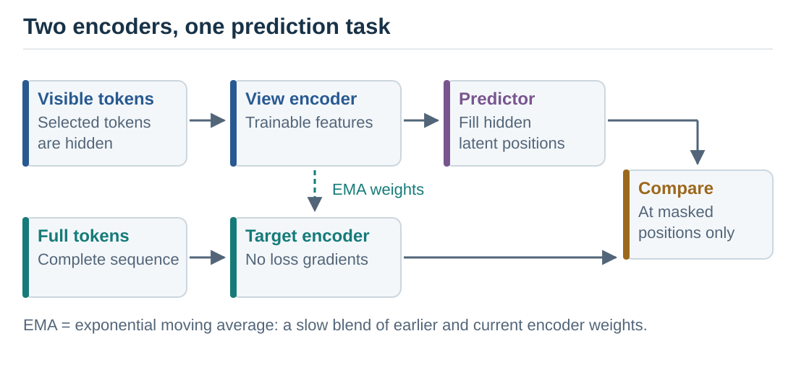

*Figure 2. Feature targets come from the complete sequence. The target branch has no gradient updates; the averaging update transfers parameters from the view encoder.*

### 10. What does the predictor do?

The predictor is a smaller transformer that takes encoded visible tokens and learned placeholders for the hidden positions. It produces a feature vector at each target location. Spatial and temporal position information identifies which landmark and time segment that location represents.

In the main experiment, prediction fills gaps within the same clip. Visible context may occur before or after a hidden segment. Notebook 10 changes the task so that the view encoder receives only the earlier tokens and predicts later ones. These tasks test different capabilities.

### 11. What are tokens, patches, attention, and position embeddings?

A **patch** here is four frames of one landmark, containing 12 coordinate values: x, y, and relative z at each frame. A **token** is the projected feature vector for that patch. Resizing a clip to 64 frames gives 16 temporal segments and 33 landmarks, or 528 tokens.

**Attention** is a learned weighting operation that combines information from other tokens. A **transformer** is the neural-network architecture that repeatedly applies these context-combining operations and transforms the resulting features. **Position embeddings** provide landmark and time identifiers, allowing otherwise similar vectors to occupy different positions in the sequence. Neither operation supplies a clinical label. They make relationships among input pieces available to the learning rule.

### 12. What are latent space and self-supervised learning?

The latent space is the model’s learned feature space. A latent vector is the encoder’s numerical description of an input token or, after pooling, a whole sequence. “Latent” describes where these features are represented; it does not mean they have been established as hidden physiological variables.

Self-supervised learning obtains a training signal from the input itself. GAVD3 uses complete-sequence representations as targets for masked prediction, without health-condition labels in that loss. The data selection still uses the normal category to choose the pretraining corpus. The later Random Forest uses condition labels in a supervised stage.

### 13. What are loss, softmax, cross-entropy, centering, and temperature?

A **loss** is the quantity minimized during training. In GAVD3, **softmax** converts a vector of feature scores into positive channel weights that sum to one. **Cross-entropy** penalizes disagreement between the target’s channel distribution and the predictor’s distribution, giving more weight to channels emphasized by the target.

**Centering** subtracts a running target-feature mean, reducing persistent channel bias. A **temperature** controls how concentrated the softmax distribution becomes: a lower positive temperature makes larger scores receive more of the weight. The main run uses target temperature 0.06 and predictor temperature 0.10.

There are 96 feature channels in this loss. Their weights are not probabilities of the five health categories. The category classifier is trained later. The loss is averaged across eligible hidden tokens, with target probabilities held fixed during each gradient update.

### 14. What is EMA, and why monitor collapse?

EMA means **exponential moving average**. At each update, the target parameters become a weighted average of their previous value and the updated view parameters. A momentum near one makes the target change slowly; the main run increases its momentum from 0.999 toward one.

**Representation collapse** occurs when different inputs produce effectively identical features, allowing a prediction task to become trivial. EMA, centering, and temperature choices support the training procedure, but diagnostics remain necessary. Feature standard deviation measures spread, cosine similarity measures vector alignment, and entropy measures how distributed the channel weights are. These summaries can warn about collapse; none proves that the remaining variation represents gait.

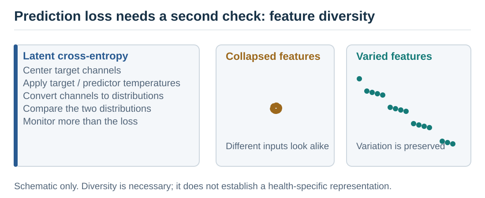

*Figure 3. Lower loss must be interpreted alongside feature variation. Healthy training diagnostics establish that the representation varies, while downstream controls test what that variation contains.*

### 15. What does “frozen” mean, and what is a probe?

A frozen encoder keeps its parameters fixed while another model is trained on its outputs. This separates representation learning from the downstream task. GAVD3’s five-class evaluation trains a Random Forest on frozen features. A Random Forest combines decision trees that split examples according to feature values, then aggregates their category estimates. This permits more complicated decision boundaries than a single linear readout.

A **linear probe** fits a weighted sum of feature values to predict a target, here with regularization that discourages large coefficients. It asks how easily a quantity can be recovered from the frozen representation. A failed linear probe means that the particular readout and protocol did not recover the quantity well. The quantity might still be accessible through another readout or representation.

## Data, anatomy, and measurement

### 16. What data are being studied?

The experiment locks a 96-sequence subset of the Gait Abnormality in Video Dataset, which provides annotated segments from online videos. A sequence is a frame span, and several sequences may come from the same source video. The subset contains 18 source videos; it does not establish 96 independent participants. [GAVD dataset paper](https://arxiv.org/abs/2407.04190).

| Dataset category | Sequences | Source videos |
|---|---:|---:|
| Normal | 12 | 1 |
| Parkinson’s | 9 | 2 |
| Stroke | 12 | 3 |
| Cerebral palsy | 16 | 2 |
| Myopathic | 47 | 10 |
| Total | 96 | 18 |

The categories are the dataset annotations used by the experiment. “Normal” refers to the annotated examples in this cohort, and “myopathic” is a broad category. The notebooks do not independently verify individual diagnoses or measure disease severity. [Retained source counts](faq/evidence/original/source_video_concentration.csv).

### 17. How does video become a skeleton?

Notebook 02 uses the annotated bounding box to isolate the intended walker and extracts 33 MediaPipe landmarks for each frame. It retains x and y image coordinates, model-estimated relative depth, and visibility information. Mandatory frame overlays check whether the annotation, crop, and extracted pose agree.

The extraction code remaps the cropped pose into full-frame normalized image coordinates and rescales relative depth accordingly. These remain estimated landmarks from a single camera: normalized image coordinates are not distances in meters, and depth is not calibrated motion-capture ground truth. Camera movement, perspective, clothing, and occlusion can affect the estimates. The input limitation must follow every later interpretation. [MediaPipe pose documentation](https://developers.google.com/edge/mediapipe/solutions/vision/pose_landmarker).

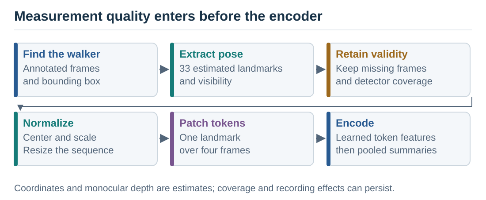

*Figure 4. The processing chain preserves checks at the video-to-pose boundary. Measurement errors introduced here can remain visible in learned features.*

### 18. How are missing joints handled?

The preparation code treats visibility below 0.45 as missing and interpolates only short internal gaps, up to four frames. Interpolation estimates values between available observations; it does not recover a measured trajectory. Ends and longer gaps remain invalid, with zero sentinels representing unavailable coordinates.

A prediction target must be valid across its four-frame patch. Downstream pooling also excludes invalid patches. However, invalid values can still influence transformer context, and the pattern of valid positions changes which tokens contribute to a summary. Excluding zeros from the final averages does not remove every route by which detector failures affect the representation.

### 19. Why center, scale, and resize the sequence?

Centering around the pelvis reduces dependence on image position, and scaling by body width reduces some differences in apparent size. Resizing every sequence to 64 frames makes inputs comparable in shape. These transformations simplify modeling but also change the physical information available.

Two clips with different durations can occupy the same 64-frame grid. Without retaining duration as an input, the representation need not distinguish their absolute cadence. Scaling likewise removes some size information while leaving perspective effects. Notebook 08 computes timing proxies from the original cached pose duration and frame rate, before temporal resizing.

### 20. Why choose ten landmarks?

The project maps reviewed gait features to both shoulders, hips, knees, ankles, and foot-index landmarks near the toes: MediaPipe indices 11, 12, 23–28, 31, and 32. These regions provide an anatomical prior, meaning a design assumption about where useful information may occur. The landmark set is derived from the project’s feature mappings, with some mappings explicitly treated as proxies—indirect approximations of the named quantity.

The reviewed motivations include timing and symmetry for Parkinson’s and stroke, increased bending of lower-limb joints for cerebral palsy, and weakness near the hips and trunk with compensating body movement for myopathic gait. These associations overlap across conditions. The ten landmarks are experimental prediction targets, and the project has not validated them as a diagnostic biomarker set. [Project landmark specification](../gavd3/03_neurologic_keypoint_masking.ipynb).

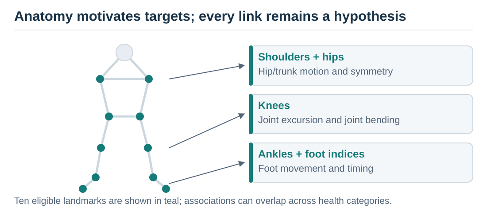

*Figure 5. Anatomy guides where the prediction task is applied. The links describe the project’s hypotheses and feature mappings; they do not assign a unique disorder to a landmark.*

### 21. Does “60% masking” mean most of the skeleton is hidden?

The 60% applies to valid tokens belonging to the ten eligible landmarks. With every patch valid, there are 160 eligible tokens, of which 96 are hidden. Relative to all 528 tokens, that is about 18.2%.

The implemented sampler uses the minimum eligible count within a batch and rounds its target count down so every sample has the same number of hidden tokens. Missing data therefore changes the realized fraction. The target encoder still receives the complete 33-landmark token grid, and the view encoder retains the unselected tokens, including landmarks outside the eligible set.

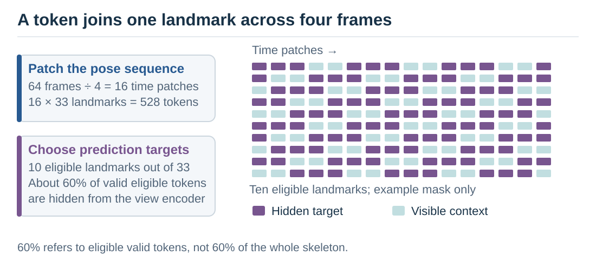

*Figure 6. The illustrative grid displays only the ten eligible landmarks. With full validity, 60% of that pool hides 96 of 528 total tokens; the other 23 landmarks remain visible.*

### 22. How does a sequence become a 384-number vector?

The target encoder outputs a 96-number vector at each token. Pooling summarizes those vectors using four blocks: the mean and standard deviation over all valid tokens, followed by the mean and standard deviation over valid tokens from the ten selected landmarks. Concatenating four 96-number blocks gives 384 numbers per sequence.

This summary preserves feature averages and variation, while compressing token-level detail. Time information may already be encoded in the features, but averaging does not retain a directly readable frame-by-frame trajectory. The 384 values are learned summaries, not 384 independently measured physical variables.

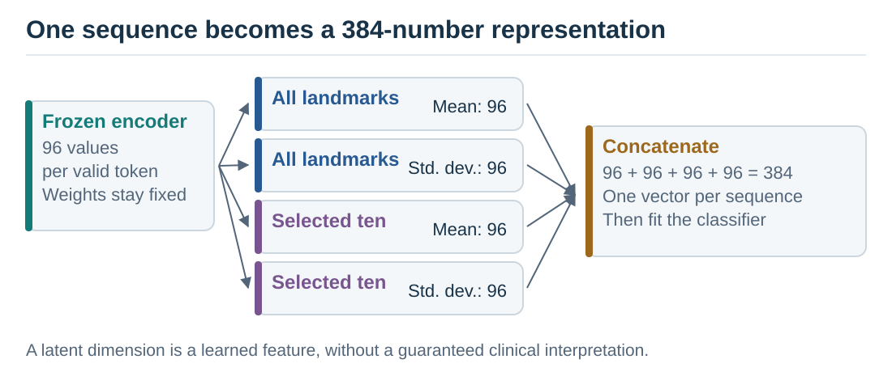

*Figure 7. Pooling makes sequence classification possible with a fixed-length input. Its effect on readable timing must be tested separately.*

### 23. What can anatomy and normalization explain about different conditions?

They identify plausible measurements to investigate. For example, left–right excursion differences may be relevant to an asymmetry hypothesis, while hip–knee–ankle angles can support a joint-excursion measurement. A learned vector might preserve these relations, their recording artifacts, or a mixture of both.

The research therefore proceeds through measured readouts and controls. A condition label associated with a feature does not identify which underlying mechanism caused the feature, and a low-dimensional visualization cannot establish a physiological explanation. Notebook 08 provides the direct test of whether selected pose-derived gait quantities can be recovered.

## Evaluation and observed results

### 24. What did the normal-only training achieve?

The retained main run used 12 normal sequences from one source video, batch size four, and 300 epochs. A batch is the group of examples used together for one parameter update, while an epoch is one pass through the training examples. Repeating those examples 300 times does not supply additional independent walkers. The trainable view encoder and predictor together have 700,800 parameters.

Cross-entropy decreased from 12.54 to 0.57. Feature standard deviation rose from 0.340 to 0.412, and mean pairwise cosine similarity fell from 0.636 to 0.535. These diagnostics show successful optimization with continuing feature variation and argue against complete constant-vector collapse. They leave the content and transferability of that variation unresolved. [Main training history](faq/evidence/original/training_history.csv).

### 25. What is the exact comparison with handcrafted features?

Notebook 06 reproduces a previously used 68-sequence subset and a fixed 47-training/21-test partition. The Random Forest on frozen S-JEPA summaries reaches 13 correct predictions out of 21, or 61.9% accuracy, with macro F1 of 0.613. The saved reference from a Random Forest using 82 handcrafted features reports 76.2% accuracy and macro F1 of 0.728 on those sequence identifiers. Handcrafted features are predefined calculations, such as a joint angle or a timing summary.

The difference is 14.3 percentage points, equivalent to three predictions on a 21-example test set. The reference is imported as a saved result, rather than rerun through the current pose pipeline. Extraction, preprocessing, and feature construction differ between the systems, so this comparison does not isolate the effect of learned versus handcrafted representation. [Saved comparison](faq/evidence/original/exp5_comparison.csv).

### 26. What are accuracy, balanced accuracy, and macro F1?

**Accuracy** is the fraction of test examples classified correctly. **Recall** for a category is the fraction of its true examples identified correctly, while **precision** is the fraction of predictions of that category that are correct. **Balanced accuracy** averages category recalls. **F1** combines precision and recall as 2 × precision × recall / (precision + recall), so a low value of either lowers the score. **Macro F1** averages the category F1 values, giving each category equal weight.

These metrics emphasize different failures when category sizes differ. The main exact-split S-JEPA result is 61.9% accuracy, 59.6% balanced accuracy, and 0.613 macro F1. A confusion matrix shows the actual errors behind those averages. None of these metrics corrects source overlap or makes a small test set independent.

### 27. What do the majority and missingness controls show?

A **majority control** always predicts the most frequent training category. On the exact test set, myopathic gait accounts for seven of 21 examples, giving that predictor 33.3% accuracy. A **missingness-only control** uses detector availability statistics instead of movement coordinates; it also reaches 7/21, with macro F1 of 0.336.

S-JEPA performs better on this split, but that difference does not prove that the extra information is physiological. Camera and person characteristics can affect coordinate features too. The 29.4% exact-split majority value in an earlier manuscript is inconsistent with the retained class counts; this FAQ uses the corrected 33.3%. [Confusion matrix](faq/evidence/original/five_class_confusion_matrix.csv), [missingness controls](faq/evidence/original/missingness_only_classifier_metrics.csv).

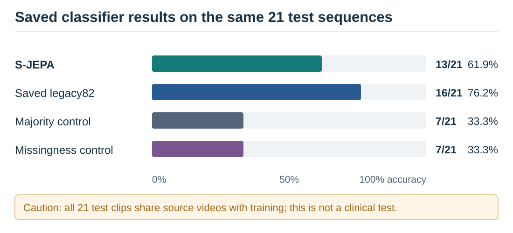

*Figure 8. Descriptive results on the same sequence split. All test source videos also occur in classifier training; the saved handcrafted reference uses a different feature pipeline.*

### 28. What happened when all 96 sequences were used?

The separate 67/29 sequence split gives 18/29 correct predictions, or 62.1% accuracy, and macro F1 of 0.594. Its training-majority control scores 14/29, or 48.3%, and its missingness control scores 13/29, or 44.8%. The majority denominator differs from the exact comparison and must be calculated for this split.

Four condition-versus-normal classifiers also produce descriptive results, including ROC AUC values of 1.0 for stroke and cerebral palsy. **ROC AUC** measures ranking of positives above negatives across thresholds; it can equal one even when a particular classification threshold makes an error. Here the binary tests contain only seven to 18 examples and share source videos with training. Perfect ranking on such a split supplies little evidence about a new recording. [Classifier metrics](faq/evidence/original/classifier_metrics.csv).

### 29. What does the confusion matrix reveal?

In the exact split, the model correctly identifies five of seven myopathic examples, three of five cerebral-palsy examples, and two of three examples in both the normal and Parkinson’s categories. It correctly identifies only one of three stroke examples; the other two are assigned to cerebral palsy.

That pattern motivates inspection of the poses and sources. It could reflect shared movement characteristics, pose errors, or similarities among recordings. With only three stroke examples, the matrix cannot identify a reliable clinical explanation for the confusion. Each additional correct prediction would change total test accuracy by about 4.8 percentage points.

### 30. Why does splitting by sequence create a problem?

Sequences from the same video can share a walker, framing, camera angle, and detector behavior. A classifier may exploit those stable characteristics when different segments of the source appear on both sides of a split. After conversion to poses, some recording information remains in the coordinate trajectories and missing-data patterns.

All nine test source videos in the exact split also occur in classifier training. All 16 test source videos in the 96-sequence split do too. These scores therefore describe classification within shared recordings. Participant independence is a further question, because different videos might still show the same person. [Leakage audit](faq/evidence/original/leakage_audit.csv).

### 31. What is transductive exposure, and why does pretraining belong inside the split?

**Transductive exposure** means training uses unlabeled inputs that later appear in evaluation. The normal-only encoder was pretrained on all 12 normal sequences before the classifier partition was applied. The exact test contains three of those same sequences; the all-sequence test contains four.

Removing health labels from pretraining does not remove this exposure. For a test of unseen-source generalization, each outer evaluation fold must exclude held-out sources from encoder pretraining as well as classifier fitting. **Inductive evaluation** then asks about genuinely new inputs. Grouping only the classifier leaves the pretrained representation exposed to its normal test examples.

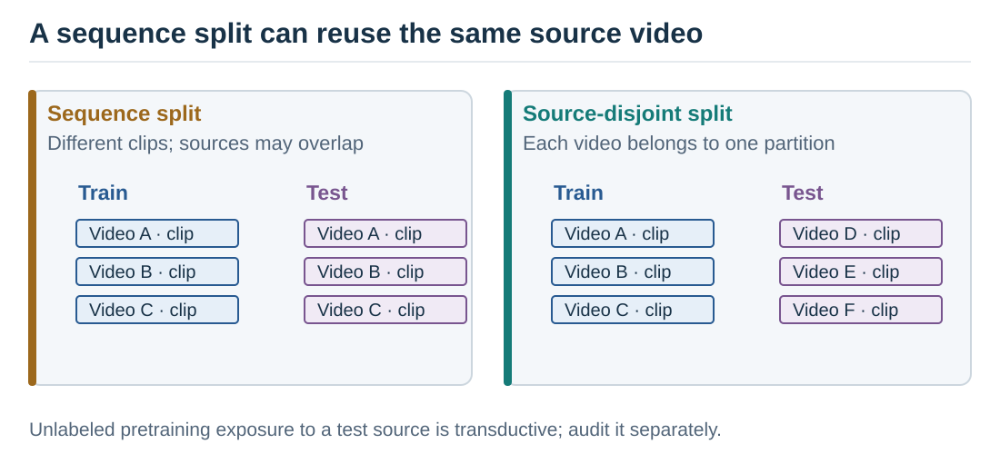

*Figure 9. Independence must cover every learned stage. The current corpus has only one normal source, so it cannot support normal-only pretraining on independent normal sources while testing a held-out normal source.*

### 32. What uncertainty can these results support?

The exact comparison is one small split, and the mask experiment uses one real-data seed. A seed fixes the starting state of random number generation, allowing the sampling and initialization to be repeated. These experiments provide observed outcomes, without a reliable estimate of variation across new participants or recording sites. Multiple evaluation folds or random seeds reuse the corpus and should not be counted as additional independent people.

When this FAQ reports a standard deviation, it identifies whether that spread is across split seeds or evaluation folds. Those quantities are not confidence intervals for clinical performance. A stronger study would collect additional independent sources, repeat an appropriately grouped protocol, and report uncertainty at the source or participant level.

## Testing alternative explanations

### 33. Can the features identify the source video?

Notebook 07 trains a separate classifier to predict which of 18 source videos produced a sequence. Across three repeated sequence splits, frozen S-JEPA features achieve mean video-ID accuracy of 49.4%, with a standard deviation of 12.1 percentage points. Uniform guessing across 18 videos would give 5.6%; source imbalance means that is only a nominal reference.

An untrained encoder achieves 51.7% ± 15.8 points, raw pose pooling 46.0% ± 4.0 points, and missingness features 42.5% ± 2.0 points. Source information is accessible in every representation tested. These results do not show that pretraining increases identity information, and successful video identification alone cannot quantify how much the health classifier relies on it. [Identity probe results](faq/evidence/later/07_video_identity_probe.csv).

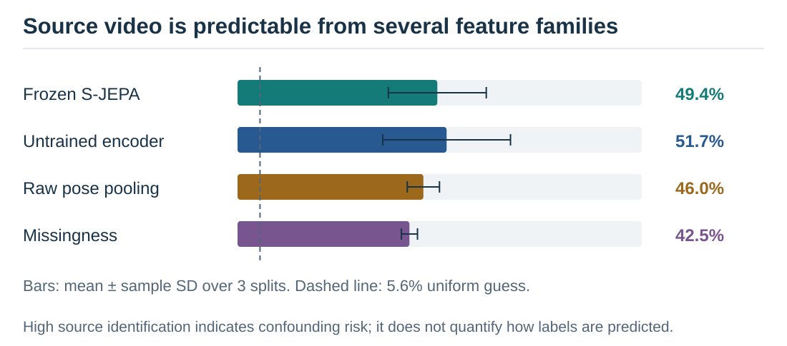

*Figure 10. Error bars show standard deviation across three repeated splits, not independent-source uncertainty. Identity-related information is available before as well as after pretraining.*

### 34. What happens when whole videos are held out?

Across six source-video-grouped classifier folds, the mean accuracy falls to 24.0%, with a fold standard deviation of 16.5 percentage points. Each fold contains 16 test sequences, so the mean corresponds to 23 correct out-of-fold predictions out of 96. The training-majority comparator obtains 49.0%, or 47/96.

That is a negative result for this grouped classifier protocol. Interpretation needs two qualifications: the encoder was not retrained within folds, and one fold holds out the sole normal source, leaving no normal examples for supervised classifier training. The same normal examples were already used for encoder pretraining. This grouping diagnostic exposes severe source and class-support limits; it is not a valid estimate of a fully inductive five-class clinical model. [Grouped folds](faq/evidence/later/07_video_grouped_five_class_folds.csv).

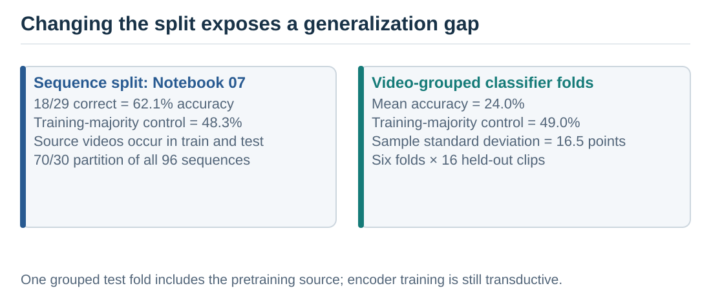

*Figure 11. The source-grouped result is a diagnostic of the present cohort and frozen encoder. Class support changes across folds, and representation pretraining includes held-out normal examples.*

### 35. Can the fall in accuracy be attributed entirely to source memorization?

The fixed 70/30 sequence score is 62.1%, giving a descriptive gap of 38.1 percentage points relative to video-grouped evaluation. A six-fold sequence-grouped comparator reaches 65.6%, producing a 41.7-point gap against the six-fold video result. Matching the number of folds improves the comparison, but class support and which examples are held out still differ.

The gaps are consistent with strong dependence on the source structure and show that favorable sequence scores fail to transfer under the tested grouping. They do not measure a pure causal effect of memorization. The next experiment needs multiple normal sources and encoder retraining inside each split. [Grouping summary](faq/evidence/later/07_generalization_gap.json).

### 36. What are cadence, gait phase, asymmetry, and joint excursion?

In gait analysis, **cadence** is the number of steps per unit time, commonly reported as steps per minute. Notebook 08 instead estimates a left-ankle oscillation rate in cycles per second. Converting that signal into step cadence requires checking what one detected cycle represents. **Gait phase** describes progress around a repeating cycle, represented by an angle. **Asymmetry** describes a defined difference between left and right motion, and **joint excursion** is the range through which a measured joint angle varies.

The notebook’s targets are computed from estimated poses. Its excursion-asymmetry proxy uses ankle horizontal ranges, its speed proxy uses full-frame pelvis displacement, and its sway proxy uses detrended pelvis movement. Detrending removes a fitted overall movement trend before measuring the residual variation. Camera motion and perspective affect these signals; cropping also affects the pose estimates, though cached positions are remapped to the full frame. Knee excursion uses the 95th-minus-5th percentile span of a two-dimensional angle, reducing sensitivity to extreme values. The angle uses separately normalized image axes, so uncorrected image aspect ratio can distort it. Timing, angles, and normalized displacement have different units; these measurements are not all dimensionless or calibrated clinical quantities. [Proxy construction](../gavd3/08_gait_parameter_probing.ipynb).

### 37. What did the gait-parameter probes find?

The probe score **R²** compares squared prediction error with the variation around the target’s overall mean. Zero matches that mean-only reference under the reported score; negative values perform worse, and one indicates perfect predictions. The scalar probes leave out one sequence at a time, while fitting scaling and regularization inside the training procedure. Sources still overlap across folds.

| Pose-derived target | Frozen S-JEPA R² | Raw-coordinate summary R² | Missingness R² |
|---|---:|---:|---:|
| Ankle cycle rate | 0.020 | −0.051 | 0.118 |
| Ankle excursion asymmetry | 0.024 | 0.057 | −0.128 |
| Knee excursion | 0.086 | −0.470 | 0.174 |
| Pelvis sway proxy | 0.037 | −0.029 | −0.012 |
| Pelvis speed proxy | 0.054 | −0.131 | 0.029 |
| Stance/swing proxy | 0.022 | −0.022 | −0.026 |

Most targets use 96 sequences; the stance/swing proxy uses 95. The retained results show weak linear recovery, with no broad advantage over the controls. The separate phase probe uses temporal-segment features, repeating each segment’s vector across its four frames, and keeps complete sequences together in five evaluation folds. Its mean cosine/sine R² is −0.127. These findings constrain the claim that frozen features preserve readily readable gait timing under the tested summaries. They do not prove that the model contains no movement information. [Scalar probes](faq/evidence/later/08_gait_parameter_probe_scores.csv), [phase probe](faq/evidence/later/08_phase_probe_metrics.csv).

Target quality also limits the interpretation. Short clips, detection gaps, and walking toward the camera can make an ankle-derived timing signal unreliable. A weak probe may reflect limitations of its target measurement as well as the representation or readout.

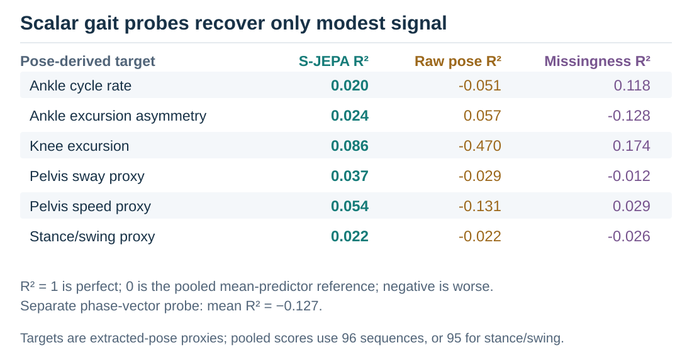

*Figure 12. The target construction uses the same estimated poses that feed the encoder, and evaluation leaves out sequences rather than sources. These are exploratory readability tests.*

### 38. What is an ablation, and what did changing the mask reveal?

An **ablation** changes a component under a shared experimental procedure to investigate its contribution. Notebook 09 trains four mask rules using the same normal corpus, architecture, epoch count, seed, and hidden-token budget. It compares the ten-landmark uniform rule with uniform sampling across all landmarks, motion-weighted sampling within the ten-landmark set, and sampling spread across the full body and time segments.

The anatomy-guided and motion-weighted rules each score 12/21, or 57.1%, on the exact split. The two full-grid alternatives score 13/21, or 61.9%. This one-prediction difference supplies no evidence that the anatomical restriction improves the classifier. All four cadence probe R² values are negative; this ablation uses cycles per resized frame, a different timing target from notebook 08’s original-duration cycle rate. The real experiment has one seed, so there is no measured seed spread with which to judge reproducibility. Some pairwise comparisons also change more than one property: the full-body rule changes both the eligible landmarks and the allocation across time, whereas the motion-weighted rule changes sampling weights within the same ten-landmark pool. [Mask comparison](faq/evidence/later/09_ablation_split_metrics.csv), [cadence comparison](faq/evidence/later/09_ablation_cadence.csv).

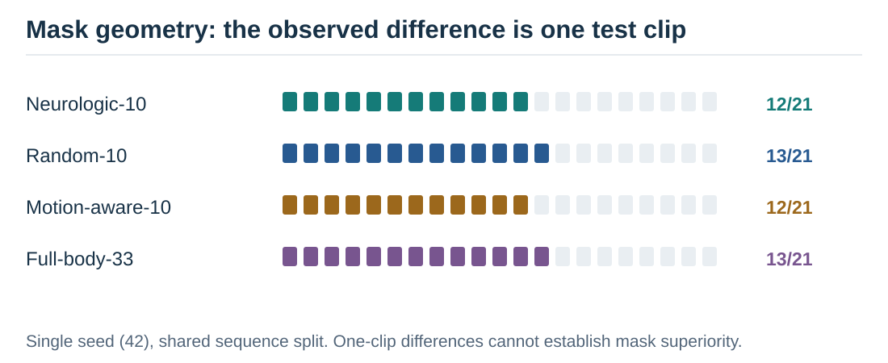

*Figure 13. The restricted mask remains a scientifically motivated design choice whose benefit was not demonstrated. The ablation retrains its reference arm, so its 57.1% score is a separate run from the main 61.9% result.*

### 39. Why are these negative results useful?

They prevent the classifier score from being used to support a broader physical interpretation than the measurements allow. Source identification shows that recording information is accessible. Weak probes show that selected gait quantities are difficult to recover with the tested linear readouts. The mask comparison shows that anatomical motivation has not translated into a measured advantage.

Those conclusions suggest concrete changes: diversify the normal sources, preserve timing where the task needs it, compare trained and untrained features on the health task, and evaluate every learned stage under source separation. The failures also warn against solving a measurement or cohort problem simply by increasing model size.

## Future prediction and the next iteration

### 40. How does future prediction differ from filling a hidden gap?

The main mask hides selected joint-time tokens within a clip while other tokens may remain visible on both sides. Notebook 10 hides the last four temporal segments for all 33 landmarks. The view encoder receives 48 resized frames and predicts representations for the remaining 16, divided into four four-frame horizons.

This is a past-only token view. The current preparation still interpolates, scales, and resizes using the complete clip before it is divided. For example, body width is summarized across the clip before normalization, so changing later frames can change the prepared earlier coordinates. The target encoder also receives the complete clip and supplies the future latent targets. These choices do not demonstrate a strictly causal pipeline from raw observations.

The four future segments are predicted together; no predicted segment is fed back to generate a longer rollout. Moreover, 16 resized frames are a fraction of a clip’s duration, with no universal conversion to milliseconds. A deployment-style forecast would prepare the context using only information available at prediction time.

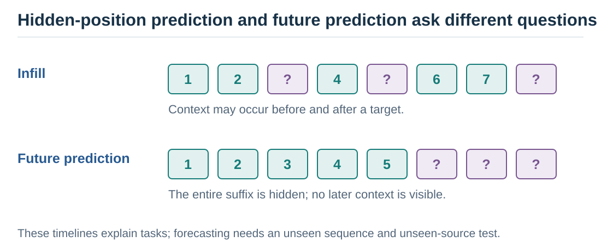

*Figure 14. The time boundary applies to encoder tokens. Full-clip preprocessing and training exposure remain limitations of the present future-prediction evaluation.*

### 41. Did the future predictor succeed?

On the 12 normal sequences used to train it, the retained horizon cross-entropies are 0.353, 0.354, 0.341, and 0.376. A phase-bin mean-latent baseline gives values from 12.12 to 12.60. The large numerical difference is an observed comparison, with an unequal evaluation boundary: the trained predictor is scored on its training clips, while the baseline excludes the evaluated clip from its averaging set.

The latent target space was also learned using all 12 clips. Thus, these losses demonstrate fit in that space; they do not establish a fair held-out forecasting advantage. The baseline additionally broadcasts a joint-pooled mean target, making it a coarse comparator. A stronger test would retrain both the encoder and forecaster without the held-out source and compare predictors with the same access to training data. [Horizon losses](faq/evidence/later/10_horizon_prediction.csv).

### 42. Does low latent loss imply physically meaningful future motion?

The phase readout supplies a direct counterexample to that inference. Predicted future features have mean angular error of 1.531 radians, about 87.7 degrees. Repeating the observed context phase gives 1.372 radians, about 78.6 degrees. The forecast’s mean cosine phase alignment is 0.030, while the persistence reference gives 0.146. This alignment is one for matching phases, zero for a quarter-cycle difference, and minus one for opposite phases, averaged across predictions. The artifact labels it “circular_correlation,” but that name differs from the statistic computed by the code.

The predictor’s low latent loss therefore does not translate into a better phase estimate under this readout. The phase target is itself an ankle-signal proxy, and the test remains small and source-confounded. Nevertheless, the failed timing check is consequential: a model can match learned channel distributions while failing a physical property that motivated the forecasting task. [Future phase results](faq/evidence/later/10_phase_probe.csv).

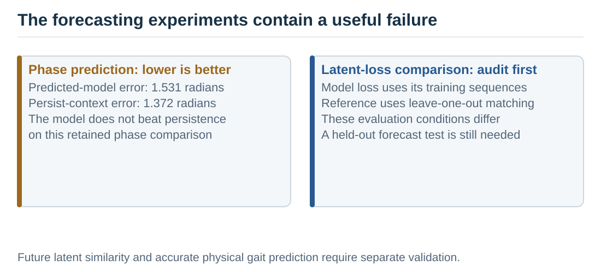

*Figure 15. Lower phase error is better. The phase readout evaluates a movement property distinct from the loss used to train the forecaster.*

### 43. Can higher error on abnormal clips detect a health condition?

Mean forecast cross-entropy is 0.362 on normal clips, compared with 2.541 for Parkinson’s, 3.113 for stroke, 2.965 for cerebral palsy, and 3.038 for myopathic clips. The normal clips were training examples from one source video; the abnormal clips were unseen during forecasting training and came from different sources.

The contrast combines condition differences with familiarity, person, camera, and extraction differences. It supplies an exploratory **out-of-distribution** result, meaning the inputs differ from the training population. It does not establish that error specifically detects pathology, distinguishes diagnoses, or supports a usable threshold. A new independent normal cohort is essential before that interpretation can be tested. [Condition-level errors](faq/evidence/later/10_ood_prediction_errors.csv).

### 44. What should the next cycle of experiments test?

The next cycle should start with multiple independent normal sources and enough condition sources to maintain class support. Each outer source or participant split should exclude held-out examples from pretraining, preprocessing decisions fitted across examples, and supervised fitting. Model selection belongs inside the training portion.

Then compare the pretrained encoder with the same untrained architecture, raw poses, missingness features, and a recomputed handcrafted pipeline on matched inputs. Preserve measured duration when testing cadence, and use independently measured gait targets where possible. Repeat the mask comparison across seeds with the same budget and evaluate forecasting with past-only preprocessing and matched held-out controls.

A future world-model study could subsequently investigate longer rollouts and action-conditioned prediction. Those extensions need their own tests; the current passive-video experiment has no action input or planning evaluation.

### 45. What can a reader confidently take away?

GAVD3 implements normal-only latent skeleton prediction and produces varying frozen features that support within-corpus label classification. The recorded comparisons also expose source dependence, weak linear gait readouts, no demonstrated benefit from the anatomical mask, and a future phase forecast that fails to beat persistence.

The resulting research contribution is an inspectable series of questions and experiments about gait representations. It identifies useful implementation behavior while showing where the hoped-for physical interpretation fails its current tests. Generalization across independent walkers and recordings remains the central unresolved question.

## Evidence and reproducibility notes

This FAQ was written from notebook code and retained real-data artifacts, including the later results in the ignored `gavd3/work/artifacts/real` directory. Notebook outputs alone would miss those runs. Small result files are preserved in [the evidence folder](faq/evidence/), with original locations and SHA-256 fingerprints in [the provenance manifest](faq/evidence/provenance-manifest.json). A fingerprint records which file was inspected; it does not independently reproduce the experiment.

The review checked numeric denominators, category counts, split boundaries, feature construction, and the interpretation of comparisons. It did not rerun model training, pose extraction, or independently validate clinical measurements. Some older manuscript and notebook prose disagrees with retained metrics; the FAQ uses retained values and records those discrepancies in [the evidence review](faq/reviews/current-evidence.md).

An adversarial review challenged the methods, inference, and explanations. Its findings and their dispositions are recorded in [the review record](faq/reviews/revision-record.md). Both document formats are generated from this Markdown source, and the Word file embeds the original SVG illustrations with fallback images for compatible rendering.

For background, the principal method sources are [I-JEPA, CVPR 2023](https://openaccess.thecvf.com/content/CVPR2023/html/Assran_Self-Supervised_Learning_From_Images_With_a_Joint-Embedding_Predictive_Architecture_CVPR_2023_paper.html) and [Skeleton JEPA, ECCV 2024](https://www.ecva.net/papers/eccv_2024/papers_ECCV/papers/04755.pdf). Dataset and landmark details are documented in [the GAVD paper](https://arxiv.org/abs/2407.04190) and [MediaPipe’s pose guide](https://developers.google.com/edge/mediapipe/solutions/vision/pose_landmarker).
