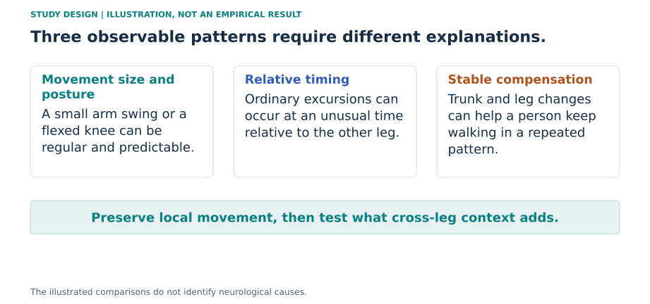
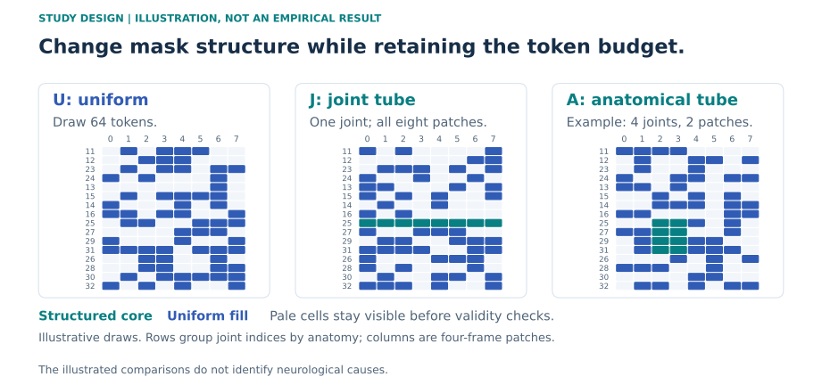
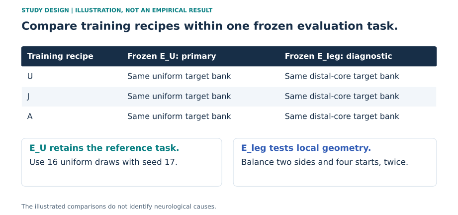
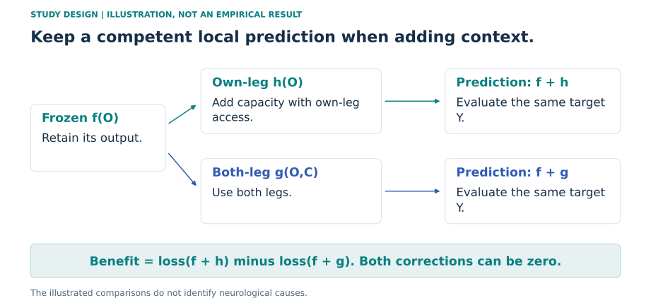
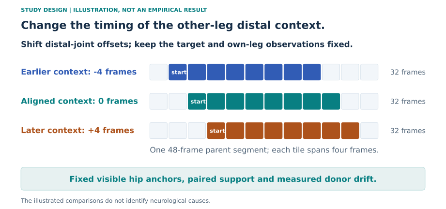
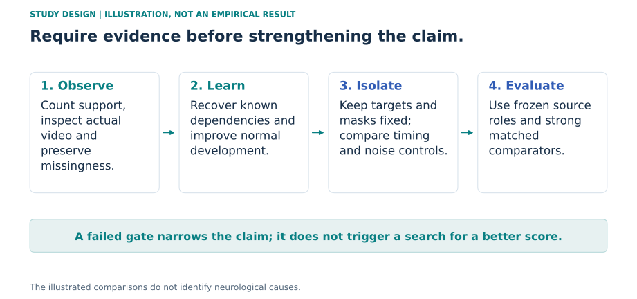

# Role

You are a world-class AI/ML researcher specializing in gait analysis, neurological movement disorders, skeleton representation learning, Joint Embedding Predictive Architectures and rigorous anomaly-detection experiments. Work as both an inventive researcher and a skeptical reviewer. Use primary research, repository evidence and actual executions to distinguish promising ideas from supported findings.

# Goal

Develop the strongest feasible, novel and scientifically defensible contribution for the fourth Workshop on Automated Spatial and Temporal Anomaly Detection. Test whether opposite-leg observations add useful predictive information beyond a leg's own movement, local geometry, extra model capacity and pose artifacts. Compare uniform masking with controlled structured alternatives that remove easy reconstruction shortcuts. Preserve posture, movement amplitude and raw timing as separate evidence. Establish what the predictor measures before making a detection or neurological claim.

# Tasks

1. Review `experiments/aaai/docs/draft01`, the completed notebook outputs, their underlying artifacts and the `ambient` ingestion code. Verify reported facts before using them.
2. Freeze the fresh GAVD cohort, source roles, hypotheses, masking comparisons and evaluation endpoints. Document the exploratory redesign and its generalization limits.
3. Implement the smallest adequate predictors and the specified masking ablations, then create six independently runnable tutorial notebooks with real-video context and vector illustrations.
4. Execute the experiments on real data, verify saved predictions and uncertainty, and use the scientific gates to decide which interpretations are justified.
5. Update `experiments/aaai/README.md`, supporting documentation and slides from verified artifacts. Write the evidence-backed manuscript and readiness assessment in `experiments/aaai/docs/draft02`.
6. Obtain independent adversarial reviews, check every material criticism against evidence, fix supported issues and record unresolved limitations.

# Constraints

Work in `/Users/pmui/dev/alexpose`. Preserve the completed draft01 manuscript and artifacts. Treat every new model, score and masking alternative as untested until its execution is recorded. Store the new study under a separate protocol identity. Use the current CSVs in `data/gavd`, keep all GAVD video downloads under `data/videos-gavd`, and mask only the 16 permitted joints. Retain uniform motion-independent masking as the reference condition. Keep proposed structured alternatives motion-independent, and distinguish them from motion-guided prior art.

Use `uv`, the existing experiment `pyproject.toml`, and the repository-root `.env`. Never invent model calls, executions, results or clinical labels. Use plain, direct sentences without em dashes. Delegate independent work with clear file ownership, then integrate and verify the complete result.

# Research and implementation requirements

## 1. Commit to one scientific question

**After accounting for a leg's own visible movement, does the other leg provide useful predictive information that improves detection of unusual gait?** Test whether the fitted predictor actually uses the other leg's timing. Preserve a separate channel for movement amplitude and posture, because abnormal gait can remain regular and predictable.

For example, hide a short part of the left ankle trajectory. First predict it from visible left-hip, knee, ankle, heel and foot observations. Next retain that prediction and allow a correction using the visible right leg. Finally keep the left leg and hidden answer fixed, but supply the right-leg observations from a slightly earlier or later interval. The first comparison asks whether contralateral observations help. The second asks whether their alignment matters to this predictor.

This is more specific than asking whether “other joints help.” A knee or heel may reconstruct an ankle through local limb geometry. That is different from information shared between the legs. Keep own-joint to own-leg prediction as a geometry control and make own-leg to both-legs prediction the main information comparison.



The prospective contribution is a coordinate-based, retained-baseline estimator with a controlled test of its use of contralateral context under incomplete observations. A residual connection, a phase measure or a second anomaly score is not sufficient novelty. The stronger paper requires an observed consequence beyond elementary motion, calibrated error and timing baselines.

### What the completed evidence already says

| Completed draft01 result | Consequence for this iteration |
| --- | --- |
| Latent profile AUROC 0.641; raw full error 0.541; paired difference 0.101, conditional 95% interval −0.035 to 0.224. | A favorable raw-error point estimate does not establish an improvement. |
| Calibrated full-error distance reaches 0.673. | Hold calibration and aggregation constant when testing an information contribution. |
| Learned coordinate profile reaches 0.686; random encoder with fitted coordinate heads reaches 0.701. | A learned JEPA representation must earn its role in the new method. |
| Longer head training gives latent 0.667 versus random-encoder 0.714. | Scaling the existing recipe is not the best first experiment. |
| Full-context coordinate MSE exceeds own-context MSE in all four primary normal-development folds and three longer-run folds. | Explicitly preserve a competent local solution and test learning adequacy. |
| Only five fitting-normal sources retain profiles across every earlier timing/noise/dropout edit. | Do not let an unnecessary all-controls intersection determine every diagnostic's population. |

These values come from the [verified results](../../experiments/aaai/docs/context_study_results.md), [sensitivity results](../../experiments/aaai/docs/context_study_sensitivity.md), and [draft01 evidence](../../experiments/aaai/docs/draft01/evidence.json). They are not scores for the proposed method.

### Choose this route over the alternatives

The scores below are research judgments from 1 to 5, not acceptance probabilities or predicted AUROCs.

| Route | Novelty potential if successful | Feasibility before the deadline | Decision |
| --- | ---: | ---: | --- |
| Retained own-leg prediction, opposite-leg correction and timing controls. | 3.5 | 4 | Main route, with explicit scientific gates. |
| A larger JEPA or stochastic latent predictor on the same cohort. | 2 | 2 | Defer until the observable-coordinate estimator works. |
| Phase-conditioned whole-cycle modeling. | 3 | 2.5 | Optional subset analysis; the duration census is unfavorable. |
| Symmetry-equivariant encoding. | 2.5 | 4 | A consistency or efficiency control, not the central novelty claim. |
| A biomechanical simulator with multiple compatible impairment explanations. | 4 | 1 | Longer-term world-model program requiring external measurements. |

## 2. Ground the design in physiology without inventing a diagnosis

Use the following reasoning to choose measurements and counterexamples. Do not train disease mechanisms from folder names or label an edited sequence as a virtual patient.

| Condition family | Clinically motivated distinction | What the video study can test | A necessary counterexample |
| --- | --- | --- | --- |
| Stroke | Impaired selective control, weakness and compensation can affect the two sides differently. | Whether visible side asymmetry and added opposite-leg information differ from the normal reference. | A stable compensation can be highly predictable. More predictive help need not mean healthier walking. |
| Parkinsons | Movement size, rhythm and arm coordination can change differently and can depend on medication and task. | Preserve excursion and raw timing; test whether contralateral information adds anything beyond them. | Small but regularly timed steps may have unusual amplitude and ordinary relational timing. |
| Cerebral palsy | Motor-control limitations coexist with altered muscle growth and musculoskeletal constraints. | Preserve projected knee-flexion/posture proxies and sided relationships. | Bilateral crouch may be regular. A low anomaly score for timing cannot establish normal gait. |
| Myopathic | Muscle weakness can lead to trunk, pelvis and limb adaptations. This is not one brain disease. | Preserve projected trunk inclination, excursion and compensation patterns when observable. | Bilateral weakness can produce repeatable movement without a large timing anomaly. |

Primary evidence includes [post-stroke motor modules](https://pubmed.ncbi.nlm.nih.gov/20007501/), [stroke coordination and symmetry](https://pubmed.ncbi.nlm.nih.gov/38709654/), [Parkinsonian hypokinesia](https://pubmed.ncbi.nlm.nih.gov/7953597/), [dopaminergic arm-swing findings](https://pubmed.ncbi.nlm.nih.gov/25502948/), [CP muscle synergies](https://pubmed.ncbi.nlm.nih.gov/26084733/), and [longitudinal Duchenne gait observations](https://link.springer.com/article/10.1186/s12984-025-01718-5). The [clinical advice](../../experiments/aaai/docs/iteration02/advice_neuro.md) explains their boundaries.

The CP growth statement has separate support from a [primary muscle-growth study](https://pubmed.ncbi.nlm.nih.gov/26510820/). A contribution to later contracture is a proposed interpretation, not a causal pathway established by the synergy findings or by these videos.

Do not rotate every trunk upright, standardize each joint to unit excursion, or independently align each leg to its own cycle. Those transformations can remove the posture, amplitude or asymmetry being investigated. Keep a raw-clock view beside any phase view. A projected angle is not a measured three-dimensional clinical angle, and pelvis-relative image motion is not walking speed or ground clearance in physical units.

A future world model would separate control, body mechanics, ground contact and observation, and retain multiple explanations compatible with the video. This iteration tests one observable prediction component. It cannot identify dopamine state, lesion location, muscle force or an individual's disease cause.

## 3. Establish the novelty boundary before coding

| Existing work | What it already covers | Evidence the new paper must add |
| --- | --- | --- |
| [S-JEPA](https://www.ecva.net/papers/eccv_2024/papers_ECCV/papers/04755.pdf) and [MAMP](https://arxiv.org/abs/2308.07092) | Skeleton representation learning through masked latent or motion prediction. | A tested gait-specific information contrast, not another masking diagram. |
| [FSGait](https://openaccess.thecvf.com/content/ACCV2024/html/Duan_FSGait_Fine_Grained_Self-Supervised_Gait_Abnormality_Detection_ACCV_2024_paper.html) | Normal-only posture and temporal anomaly modeling. | An advantage or interpretation beyond splitting posture and timing into two channels. |
| [GenGait](https://arxiv.org/abs/2604.01997v2) | Normal-only masked reconstruction, joint inconsistency and normative reconstructions. | A supported use of matched context controls on heterogeneous real-source video. |
| [SeeKer](https://arxiv.org/abs/2506.18368) | Conditional keypoint densities and detector-confidence-weighted scores. | Value beyond conditional surprise alone. |
| [Beyond Marginals](https://arxiv.org/abs/2509.15033) | Marginal, temporal and cross-variable anomaly structure. | A specific observable estimator and valid gait measurement procedure. |
| [Phase coordination index](https://pubmed.ncbi.nlm.nih.gov/17503027/) and [four-limb Q-PCI](https://pmc.ncbi.nlm.nih.gov/articles/PMC11435969/) | Established interlimb timing descriptors. Q-PCI's cited study uses healthy adults. | A comparison against these ideas where measurements are valid; no claim that coordination measurement itself is new. |
| [Intersegmental LTI asymmetry model](https://arxiv.org/abs/2505.10869) | Linear/convolutional intersegmental relationships for gait asymmetry. | Source-separated abnormality evidence and controls beyond linear filtering. |
| [Typical-cycle subtraction and lightweight ST-GCN](https://homepages.inf.ed.ac.uk/rbf/PAPERS/lochheadcbm24.pdf) | A compact normative gait representation and classifier. | More than a smaller model or subtracting a normal trajectory. |
| [Confidence filtering and selection shift](https://arxiv.org/abs/2610.39704) | Filtering can change the movement population being assessed. | A demonstrated contribution beyond warning that pose confidence can bias selection. |

This is a targeted review, not an exhaustive priority search. Make no “first” claim. A strong result would show that the new predictor passes known-dependency and normal-data checks, responds to controlled alignment changes on valid support, and contributes beyond marginal movement on real held-out sources. If only the first two succeed, write an estimator/measurement paper with a narrower claim.

## 4. Freeze the observation population and research endpoints

Read the current `data/gavd/<condition>/*.csv` files through `build_study_manifest`. Exclude the `source/` distribution folder from counting. The [dataset README](../../data/gavd/README.md) remains the inventory authority. Use hashes to verify pose-cache compatibility with current annotations, video bytes and extraction configuration. A cached old label manifest must never replace a fresh inventory.

The fresh census contains 1,874 sequences, 458,116 rows and 348 source IDs. There are 332 decodable videos. The historical profile cohort has 251 sources, including 23 normal sources. A read-only availability calculation found a useful alternative: all five otherwise usable normals excluded by the current profile gate fail only elbow/wrist support, while all eight lower-limb readouts remain supported.

| Population | Sources | Normal sources | Sequences | Windows | Evidence status |
| --- | ---: | ---: | ---: | ---: | --- |
| Completed draft01 profile | 251 | 23 | 1,303 | 8,950 | Models fitted and scored. |
| Candidate lower-limb readout | 304 | 28 | 1,381 | 9,442 | Availability measured; new models not fitted. |
| Candidate focal five-label subset | 90 | 28 | Report when implemented. | Report when implemented. | Counts by source only. |

The candidate focal counts are normal 28, Parkinsons 10, stroke 15, cerebral palsy 10 and myopathic 27. Count stroke once as a category in the requested label list; it has 15 candidate source recordings. The broader union has one source with two abnormal category memberships, so category counts must not be summed as independent people. All 28 normal sources appear in earlier project exploration. Five newly eligible sources are not five fresh validation participants.

**Freeze two endpoint definitions now.** Use normal versus the pooled four requested condition families as the new primary detection endpoint, because the task concerns these neurological and neuromuscular labels. Evaluate the same frozen scores across all 12 folders as a required broad non-normal secondary endpoint. The separate supervised task has five classes. Only `normal` is normal; no other category is reclassified as healthy.

This focal primary is an explicit exploratory redesign after the earlier all-folder results were seen. It does not replace draft01's primary analysis or create a confirmatory test. Fix it before new scores, publish both endpoint results, and do not choose which one to headline because of its performance. All eligible normal sources can support normal-only fitting; abnormal labels enter fitting only in the separately supervised task.

### Generalizability statement required in the README and paper

GAVD can support an internal study of observable movement across diverse web recordings. It does not, by itself, establish generalization to independent patients, new clinics or neurological causes. Source IDs are uploads, not verified people. The normal sample is small and previously explored; clinical labels are not independently revalidated; view, activity, assistance and quality differ. More windows and abnormal videos do not replace independent normal participants.

### Duration and observation limits

The read-only probe retained the existing confidence and validity rules. These are pre-profile counts and upper bounds for any cycle-specific analysis.

| Samples at 15 Hz | First-to-last span | Sources | Normal sources |
| --- | ---: | ---: | ---: |
| 32 | 2.07 seconds | 311 | 28 |
| 48 | 3.13 seconds | 303 | 27 |
| 64 | 4.20 seconds | 284 | 23 |
| 96 | 6.33 seconds | 231 | 12 |
| 128 | 8.47 seconds | 162 | 9 |

Keep 32 samples as the main prediction window. Longer parent intervals may support timing controls, but must not silently replace the main cohort. Duration does not prove complete cycles. Do not estimate stride-to-stride variability from one or two short cycles, splice annotations, repeat edges, or bridge missing detections to manufacture longer walking.

The [read-only probe and hashes](../../experiments/aaai/docs/iteration02/data_feasibility_probe.json) and [pipeline advice](../../experiments/aaai/docs/iteration02/advice_data.md) support these counts. Recompute them if annotations or poses change; do not treat 304 as a hard-coded quota.

## 5. Reuse the actual Ambient pipeline and preserve measurements

Use the study wrappers around `ambient`; do not introduce a second downloader or pose convention. `ingest_study.py` calls `ambient.utils.youtube_cache.download_youtube_urls`. `batch_extract` uses process-local `SequenceKeypointExtractor` instances and cache provenance. `extract_sequence` reads the GAVD per-frame box, rescales it to decoded dimensions, adds the existing 5% crop margin, reads one-based source frame minus one, and restores full-frame coordinates.

The current extractor runs image pose detection and returns the first detected pose in the crop. It is not a validated temporal identity tracker. Review first, middle and last annotated frames, person selection and continuity. Eleven sequences contain multiple frame-level view labels; join those labels to actual window times before a view-specific analysis. The current sequence-level view-list field is not an exact window viewpoint.

Use raw pose coordinates (`raw_xy`) with confidence and decoded-frame flags. Do not accidentally switch to the older sequence-normalized `xy` array. Preserve confidence below 0.5 as missing, interpolation only between adjacent valid source observations, the existing 15 Hz resampling policy, and the declared pelvis/first-half torso reference. Both prediction conditions share that body reference. It already uses body measurements, so “own leg” means the learned input restriction conditional on that reference.

Keep one source recording under `data/videos-gavd/<source_id>/`, with previews under its `previews/` directory. Put additional review clips and download logs under `data/videos-gavd` as well. Do not duplicate the same video into disease folders. Retain source ID, annotation sequence, original frame, decoded time, view, crop, pose-model version and all content hashes in the derived metadata.

A bounded recovery pass may retry the one missing normal source and inspect the two poor-validity normal sources. Fix a demonstrated crop or person-selection defect through one declared policy across affected categories. Do not choose sources by their anomaly score, lower confidence to reach a desired sample count, or manufacture frames for the too-short normal source. Any changed extraction policy requires a separate cache identity and a new eligibility census.

The CSVs also contain 751 initial-contact annotations across 11 sources, with **none in normal**. They can check a frozen contact estimator as an auxiliary measurement study. They are not 751 independent participants, and unlabeled frames are not verified non-contact negatives. If these abnormal-source events tune any component, give that component a source-disjoint auxiliary development set and disclose the supervision. Do not claim an entirely normal-only pipeline after tuning on them.

### The joint allowlist is fixed

Mask only the following 16 joints. Use uniform joint-time selection for the reference condition and the explicitly defined motion-independent structured alternatives in Sections 5.1–5.4. Retain the existing four-frame patches: a 32-frame window has eight temporal patches and 128 joint-patch tokens. Retain a 0.5 mask ratio and 16 fixed evaluation mask draws with seed 17 for the first implementation. Draw the mask first; then remove invalid inputs and targets without preferential redrawing. Use indices 25–32 for the new primary source readout. This readout decision does not change the training/masking allowlist. Optional arm analysis must report its own measurable population.

| BLAZEPOSE_33 index | Keypoint name | Features involved |
| --- | --- | --- |
| 11 | Left shoulder | Torso scale and projected trunk orientation; optional upper-body context. |
| 12 | Right shoulder | Torso scale and projected trunk orientation; optional upper-body context. |
| 13 | Left elbow | Optional arm excursion and arm-leg relation analysis. |
| 14 | Right elbow | Optional arm excursion and arm-leg relation analysis. |
| 15 | Left wrist | Optional arm excursion and arm-leg relation analysis. |
| 16 | Right wrist | Optional arm excursion and arm-leg relation analysis. |
| 23 | Left hip | Shared pelvis reference and left-leg context. |
| 24 | Right hip | Shared pelvis reference and right-leg context. |
| 25 | Left knee | Primary lower-limb target and projected knee-geometry proxy. |
| 26 | Right knee | Primary lower-limb target and projected knee-geometry proxy. |
| 27 | Left ankle | Primary target, relative trajectory and validated timing proxy if available. |
| 28 | Right ankle | Primary target, relative trajectory and validated timing proxy if available. |
| 29 | Left heel | Primary target and local foot configuration. |
| 30 | Right heel | Primary target and local foot configuration. |
| 31 | Left foot index | Primary target and local foot configuration. |
| 32 | Right foot index | Primary target and local foot configuration. |

A derived knee angle uses hip, knee and ankle coordinates. If any of those values is hidden from a predictor, the angle cannot be computed from the complete pose and then supplied as an input. Apply information restrictions before derived-feature construction. Targets may use withheld ground truth for scoring; predictors may not.

### 5.1 Use the masking literature to define a controlled experiment

Test **whether mask structure improves the learning of useful cross-leg information when the masking rate, marginal token probabilities and evaluation task are held fixed**. Distinguish a better learning procedure from an easier or different test. Read the primary sources below before implementing their ideas, and record the paper version and code revision used. Treat reported action-recognition improvements as motivation, not evidence of state-of-the-art performance on GAVD.

| Primary source | Relevant finding | Instruction for this experiment |
| --- | --- | --- |
| [MAMP, ICCV 2023](https://arxiv.org/abs/2308.07092) and [skeleton S-JEPA, ECCV 2024](https://www.ecva.net/papers/eccv_2024/papers_ECCV/papers/04755.pdf). | Their published recipes use motion-aware masking; S-JEPA inherits that choice. Random sampling noise does not make the final distribution uniform. | Name the present uniform policy an intentional adaptation. Preserve movement-independent selection in the main comparison. |
| [I-JEPA, CVPR 2023](https://openaccess.thecvf.com/content/CVPR2023/papers/Assran_Self-Supervised_Learning_From_Images_With_a_Joint-Embedding_Predictive_Architecture_CVPR_2023_paper.pdf), [V-JEPA](https://arxiv.org/abs/2404.08471), and [V-JEPA 2](https://arxiv.org/abs/2506.09985). | Coherent target blocks and informative remaining context support representation prediction. | Transfer the principle of removing local shortcuts. Define skeleton groups anatomically rather than drawing rectangles across arbitrary joint numbers. |
| [VideoMAE, NeurIPS 2022](https://arxiv.org/abs/2203.12602). | Repeated spatial masks remove the same region throughout time. | Test a joint tube, but audit loss of same-joint history. Do not import its 90–95% video masking ratio into a sparse 128-token skeleton. |
| [SLiM, version 4](https://arxiv.org/html/2603.10648v4), whose author record lists NeurIPS 2026. | Semantic tubes hide connected anatomical groups across time to reduce interpolation shortcuts. | Treat anatomical tubes as close prior art. Use a controlled adaptation with matched mask budgets and marginal probabilities; do not claim to invent the mask family. |
| [ASMa, TMLR 2026](https://23wm13.github.io/ASMa/) and [motion topology masking, Scientific Reports 2026](https://www.nature.com/articles/s41598-026-39330-9). | Combine structural selection with motion-dependent masking or complementary views. | Separate anatomy from movement weighting. The main alternatives below read no velocity, label or attention score. A binary complement is not an ASMa reproduction. |
| [GFP, ICCV 2025](https://arxiv.org/abs/2509.03609), [AMR, CVPR 2026](https://arxiv.org/abs/2606.11450), and [V-JEPA 2.1](https://arxiv.org/abs/2603.14482). | Improve feature targets, reconstruction granularity or supervision; these changes are not interchangeable with a new input mask. | Keep the target, decoder and loss fixed in the first mask comparison. Study these changes separately if justified. |
| [AdaMAE, CVPR 2023](https://openaccess.thecvf.com/content/CVPR2023/html/Bandara_AdaMAE_Adaptive_Masking_for_Efficient_Spatiotemporal_Learning_With_Masked_Autoencoders_CVPR_2023_paper.html) and [CL-MAE, WACV 2024](https://openaccess.thecvf.com/content/WACV2024/html/Madan_CL-MAE_Curriculum-Learned_Masked_Autoencoders_WACV_2024_paper.html). | Add learned mask selection or a learned masking curriculum. | Defer the extra selector and optimization burden. A selector may learn pose defects, and its mask can reveal information about hidden motion. |
| [StoP, ICML 2024](https://proceedings.mlr.press/v235/bar24a.html). | Perturbs masked-token positional queries. | Keep positional noise separate from mask selection. It does not move joints or supply calibrated physiological uncertainty. |
| [UNIMASK-M, AAAI 2024](https://arxiv.org/abs/2308.07301). | Uses task-dependent masks for completion, inbetweening and forecasting. | Keep a future-suffix experiment separate; it needs causal preprocessing and a prefix-only reference. |

Use the [skeleton-method review](../../experiments/aaai/docs/iteration02/masking_method_review.md), [video/JEPA transfer review](../../experiments/aaai/docs/iteration02/masking_transfer_review.md), and [neurological masking review](../../experiments/aaai/docs/iteration02/masking_neuro_review.md) for implementation details and source boundaries. The possible contribution is a demonstrated benefit of a controlled information test on real gait, not a new name for a standard mask.

### 5.2 Implement three precisely matched training policies

Represent a mask as Boolean `[8, 16]`, where true means hidden. Draw it before looking at measurement validity. Every primary policy must hide exactly 64 of 128 tokens and give each token a marginal hiding probability of 0.5. Keep all 16 permitted joints, four-frame tokenization and the same normal fitting sources.

| Policy | Exact construction | Hypothesis |
| --- | --- | --- |
| U: uniform reference. | Choose 64 distinct tokens uniformly from all 128. | Establish the original scattered-mask baseline. |
| J: joint tube. | Choose one of the 16 joints uniformly; hide its eight time tokens. Choose 56 more tokens uniformly without replacement from the remaining 120. | Prevent same-joint temporal interpolation without necessarily removing neighboring-joint geometry. |
| A: anatomical tube. | Draw the eight-token anatomical core below, then choose 56 more tokens uniformly without replacement from the remaining 120. | Test whether jointly hiding a local anatomical region helps beyond hiding one joint. |

Use this disjoint anatomical partition for A. Select a group with probability `width / 16`, then choose one listed temporal start uniformly. Time indexes refer to four-frame patches, not video frames.

| Anatomical group | BLAZEPOSE_33 indices | Width | Consecutive time patches | Permitted starts |
| --- | --- | ---: | ---: | --- |
| Torso reference joints | 11, 12, 23, 24 | 4 | 2 | 0, 2, 4, 6 |
| Left elbow and wrist | 13, 15 | 2 | 4 | 0, 4 |
| Right elbow and wrist | 14, 16 | 2 | 4 | 0, 4 |
| Left distal leg | 25, 27, 29, 31 | 4 | 2 | 0, 2, 4, 6 |
| Right distal leg | 26, 28, 30, 32 | 4 | 2 | 0, 2, 4, 6 |

Each core has eight tokens. For every joint-time token, `P(core) = 1/16`, so after uniform fill:

```text
P(hidden) = 1/16 + (15/16)*(56/120) = 1/2.
```

Verify this by enumerating core choices and auditing generated masks. Matching the total count and individual-token probabilities isolates which observations disappear together more cleanly than comparing different masking rates. It does not equalize difficulty, higher-order dependence or usable context after confidence filtering.

For a concrete A draw, hide the left knee, ankle, heel and foot index across eight consecutive frames. The own-leg model loses simultaneous distal geometry but may retain movement elsewhere in the interval. Do not promise retained history: a boundary block has no earlier samples, and the random fill can remove other useful observations. Audit actual own-leg history and opposite-leg support. The forced distal block excludes hips; the random fill may still hide hip tokens.

Avoid a leg-only primary training policy unless adding a frequency-matched control. Such a policy changes how often distal joints are selected. Likewise, sampling every possible nonwrapping block start can hide central times more often than endpoints. The width-weighted groups and aligned blocks above deliberately avoid those two confounds. Keep a stronger full-trajectory missing-leg test as a separate robustness task, since it can remove the local evidence needed by the scientific comparison.



### 5.3 Separate correction training, encoder training and evaluation

Run the inexpensive correction-training experiment first. Fit a competent U-trained local baseline `f`, freeze it, and reuse those exact weights across U, J and A. Within each internal validation fold, fit that shared baseline only on the internal training sources. After recipe selection, refit it on all outer-fitting normals for final correction training. Train each policy's `h` and `g` with that policy, matched sources, initializations, optimization budgets and source/joint loss weighting. Compare both-leg prediction with both the shared baseline and the corresponding own-capacity correction. A larger benefit caused only by a degraded own branch is insufficient; show the constituent errors and both-leg error against the U-trained model.

Keep the uniform evaluation bank unchanged: 16 masks, seed 17, identical stored Boolean arrays across all training arms. Use it for the primary source scores and masking comparison. Preserve its source/target eligibility. Report all three predeclared arms, including failures. If one deployable recipe must be selected, select it inside fitting-normal folds only. Do not choose a masking policy, gap size, endpoint or evaluation bank from abnormal results.

Declare A versus U on this fixed U bank as the primary masking-policy contrast. Use A versus J to test whether anatomical co-masking adds value beyond the matched joint tube, and J versus U as a secondary explanation. Preserve the original S-versus-M detection contrast and report these distinct questions separately. Do not call the largest observed difference a prespecified winner; report all paired intervals as exploratory, conditional comparisons.

Add one named distal-leg challenge bank, E_leg, as a required feasibility diagnostic. Enumerate the two distal sides and starts `{0, 2, 4, 6}` twice, giving 16 masks. Force each eight-token distal core, fill to 64 with uniform sampling using a dedicated seed of 117, and score only valid core targets. Save the exact bank and its hash before scoring. This is a different, deliberately focused evaluation task; its token frequencies need not equal U. Recompute its support and fit bank-specific normal reference parameters using the same five reserved reference-source identities. If a required reference lacks support, report the diagnostic unavailable rather than replacing it with a test source. The 304-source availability estimate does not establish its coverage.

| Correction-training policy | Fixed U evaluation | Fixed E_leg evaluation |
| --- | --- | --- |
| U | Primary reference and detection results. | Diagnostic baseline. |
| J | Required primary comparison with U. | Matched diagnostic comparison with U. |
| A | Required primary comparison with U and J. | Matched diagnostic comparison with U and J. |

Compare training policies within each column on identical target keys and support. Do not compare U/U with A/E_leg as an isolated training effect, subtract incompatible column losses, or choose the favorable column afterward. If a structured policy helps only E_leg, describe task specialization and show its unchanged-U performance. Interpret an E_leg null only after verifying adequate context and normal prediction on that bank.

The existing own-joint selector requires visible patches of the target joint. It cannot support the selected J tube. Preserve that selector for the historical U evaluation; implement and document a separate own-leg context rule for new training and structured diagnostics. Audit empty-context cases, visible-time coverage and source attrition before fitting. Apply the same declared support rule to every arm within a bank, without redrawing masks to rescue difficult cases.

For the new own-leg rule, require a valid four-frame target patch, at least two permitted valid own-leg tokens at distinct temporal positions, and at least two permitted valid opposite-leg tokens at distinct temporal positions for the paired information comparison. Use the existing token-validity definition; do not weaken confidence thresholds. This operational minimum does not guarantee an adequately supported history, so report counts before, within and after the target interval. Preserve the four-distinct-target-patches-per-readout source gate. Audit coverage before training and document any necessary revision as a new protocol, never a score-driven exclusion.

If JEPA passes the coordinate-estimator gates, run a separate U/J/A **encoder-pretraining** ablation while fixing downstream head-training masks to U. Do not change encoder and head masks simultaneously and attribute the result solely to representation learning. Keep the coordinate target as the interpretable measurement; contextual teacher losses from different encoders are not a common physical target. Retain EMA, VICReg diagnostics and the random-encoder control.



### 5.4 Control exposure, randomness and hidden information

Add an explicit policy interface in `aaai_gait/masking.py`, preserving the historical `uniform_mask` default. Store separate `pretrain_mask_policy`, `vicreg_view_policy`, `head_mask_policy` and `evaluation_bank_hash` fields. Apply the selected pretraining policy to both the main view and the second VICReg view. Replacing only the first mask leaves an undeclared mixed intervention.

Use separate RNG streams for source order, artificial masks, target-joint choice, coordinate noise, positional noise and model initialization. The current code shares some streams, so a sampler that consumes more random numbers can otherwise change later target selection or noise. Keep those unrelated choices paired across arms. Match actual student/teacher presentations, optimizer and EMA updates, and nominal target budgets; record wall time, memory, valid loss terms and unique targets as well. Normalize loss equally by source and readout joint so a prolific source cannot dominate. Equal nominal masks do not guarantee equal usable supervision.

Keep measurement validity, artificial input hiding and loss-target selection as separate arrays. Never treat a naturally missing coordinate as an observed answer. Apply restrictions before angles, velocities, embeddings and attention. Define the permitted predictions explicitly as `f(O; Q)`, `h(O; Q)` and `g(O, C; Q)`, where Q is the identical declared body reference. Hold Q fixed in hidden-input invariance tests. Because Q contains body measurements, this checks access conditional on Q, not independence from all masked hip or shoulder measurements. A strict future forecast needs a separately verified prefix-only Q and no future-dependent interpolation.

Run cardinality, allowlist, bilateral symmetry, core-probability, reproducibility, zero-gate, hidden-input and source-separation checks for every policy. Repeat positive/negative dependency fixtures and normal-development adequacy. Report both available own-leg and opposite-leg context. Keep the existing 48-frame uniform-parent timing diagnostic fixed across training policies; changing its mask at the same time would add another factor.

Test complementary scheduling only as a bounded secondary experiment. Compare two independently drawn U views with one U view and its complement, using two student passes in both cases and no cross-view information leakage. Two complementary masks request all 128 unique tokens, whereas two independent half-masks request 96 on average. Record this coverage difference and the repeated valid-target counts; equal compute does not isolate a benefit beyond coverage. Do not silently replace the historical evaluation bank with complements.

Defer motion-aware masks, learned adversarial selection, dense auxiliary objectives, ratio curricula and StoP until the U/J/A comparison is complete. If later testing a learned selector, train it only on fitting-normal data and retain a data-independent common evaluation bank. A mask chosen using a hidden answer can itself convey that answer. Keep near-static movement and small excursions available to the anomaly task rather than assuming that high motion is always more clinically informative.

Judge success by a coherent chain: the mask policy passes exposure and access checks, the predictor learns the intended dependency, the gain survives the own-capacity control, and performance improves or remains useful on the unchanged observation task and real sources. A harder reconstruction loss or a favorable action-recognition precedent is not evidence of a better gait world model.

## 6. Freeze source roles before any new comparison

Build one new source registry for the candidate lower-limb cohort. Keep every sequence, overlapping window, mask, timing edit and view from a source in the same outer role. Check exact or near-duplicate footage and overlapping source segments before splitting. Group confirmed duplicates together. Similar pose trajectories do not establish that two videos show the same person, and face recognition must not be used to invent identity labels.

Use four outer source folds. If the candidate remains 28 normal sources with no further grouping restrictions, aim for seven outer-test normals per fold, five separate normal-reference sources, and 16 fitting normals. These are planned counts, not a guarantee after duplicate grouping or updated eligibility. Publish the actual counts. If grouping leaves too few normals, reduce the claim and redesign openly rather than splitting one person or duplicate recording across roles.

Within the fitting-normal pool, use three source-grouped internal folds to choose the small declared model/regularization grid. The five reference normals must not select architecture, stopping time, perturbation settings, score direction or fusion weights. After selection, refit the recipe on all fitting normals, freeze it, estimate the reference parameters, and evaluate outer sources. The old reference set was also used for development diagnostics; the new separation is deliberately stricter.

Apply that separation to every learned component, including the local baseline, imputation/scaling and any pretrained encoder used in an internal adequacy test. An encoder fitted on an internal validation source makes that check transductive. Refit within the proper role or disclose and exclude that check from the source-held-out adequacy gate. Defer an expensive encoder ablation rather than disguising source reuse.

Do not reuse an old checkpoint just because the source IDs look familiar. Require a recorded proof that every source used to fit it belongs to the new fitting role and that preprocessing agrees. Otherwise refit it. Refit every comparator under the new roles. A 304-source result and an old 251-source result are not a paired method comparison. Report a refitted common-source sensitivity as well as the broader new population.

The folds reuse fitting and reference sources across models. They are not four independent replications. All normal sources were previously explored, so even correct new role separation yields an exploratory internal study. Write this near the headline results, not only in a distant limitation paragraph.

## 7. Implement the smallest predictor that can answer the question

Let `O` be the permitted visible observations from the target leg, `C` the permitted visible observations from the other leg, and `Y` the hidden four-frame XY patch. Left-leg membership is 23, 25, 27, 29, 31; right-leg membership is 24, 26, 28, 30, 32. A target has the same ground-truth coordinates, weight and eligibility in every compared branch.

Visible context can occur before and after the hidden patch, so this task is masked completion. A future-only forecast would require a separate causal input restriction and evaluation; the current score must not be described as forecasting a future fall or disease event.

Start with a shared, regularized coordinate predictor rather than hundreds of nearly unsupported joint/time regressions. Fit a competent local baseline `f(O)` using normal fitting sources. A coordinate-interpolation reference and shared ridge provide inspectable starting points. A small temporal MLP or convolutional model is an additional candidate only if the simple models cannot recover known dependencies or normal-development prediction. Use relative time and target identity explicitly; record how positions and sides share parameters.

Freeze `f`, then compare these two corrections:

```text
local_prediction       = f(O)
local_capacity_control = f(O) + alpha_own  * h(O)
both_leg_prediction   = f(O) + alpha_both * g(O, C)
```

The zero-correction option must return exactly the saved local prediction. A zero-initialized final layer and explicit zero gate make that software property testable. Fit a ridge residual first; retain zero if the declared training objective is worse. For a neural residual, checkpoint zero and the selected trained correction. Do not describe a function-class inclusion or training-loss check as a guarantee about held-out prediction.

The extra own-leg correction is essential. Without it, an improvement could come from additional fitting capacity. Match residual feature budgets, output dimensions, parameter counts where possible, normal-source weights, target/mask draws and optimizer budgets. Report differences in effective basis rank and inductive bias. Zero-padding an input to match its dimension does not prove equal effective capacity.

Keep model selection small. A proposed first grid is residual regularization `{0.1, 1, 10}` and a residual multiplier `{0, 0.5, 1}`. These are engineering defaults to freeze before the new test, not values selected by a published result. Choose on grouped fitting-normal validation. The chosen nonzero correction should improve held-out normal error over the retained baseline and the own-capacity control. If it does not, retain the zero correction and stop the relational claim for that model. Never choose a branch per test target by comparing its prediction with the known answer.



### Prove adequacy before attaching a clinical interpretation

Create two clearly labeled software fixtures with the same observation dimension, marginal scales and noise: one where visible opposite-leg variables contain a known target innovation, and one where they are conditionally independent of the hidden target given own-leg observations. Use separate generated training and test realizations. The oracle relation and noise distribution must be available to the test author, never passed into the model.

Require recovery of the known added-context benefit, no systematic spurious benefit under conditional independence, exact zero-gate identity, and invariance to changing a masked input value that is inaccessible to the branch. These tests verify an estimator, not a neurological simulator. A second articulated toy can check that limb blocks preserve bone geometry; do not name toy perturbations after diseases.

Then measure normal-development MSE, residual magnitude, learning curves and remaining error. Own-leg geometry may almost solve ankle completion, leaving little headroom. A zero gain can reflect a ceiling as well as underfitting. Include a separately declared contiguous temporal-gap **evaluation** diagnostic if needed to assess that ceiling. Preserve the U reference and report the declared J/A training ablations separately. Do not silently promote a successful structured or whole-body-gap result to the original target protocol.

Only after these gates should JEPA enter as a residual-feature candidate. Keep the coordinate target and retained `f(O)` unchanged. Encode allowed tokens before attention; do not pass full-context cached embeddings to a restricted branch. Compare learned and random encoders with fitted coordinate heads and identical access. Use EMA and VICReg in normal-only pretraining, with variance/rank diagnostics. VICReg discourages collapse and redundancy; it does not force disease classes apart. Stochastic positional embeddings and stochastic latent variables remain deferred ablations unless the core result is already complete.

## 8. Test timing use with a fixed predictor and answer

Do this first on fitting-normal held-out development predictions. The experiment asks whether a frozen predictor uses the alignment of visible context. It is not a simulation of a stroke, a physical intervention or a causal test of the nervous system.

For each eligible 48-frame parent interval, use frames `8:40` as the original 32-frame target interval. A proposed first diagnostic uses distal-leg context from offsets `−4` and `+4` frames, or about 0.267 seconds, without circular wrap or edge padding. These offsets are declared engineering choices, not verified physiological phase shifts. Store the parent source frames and decoded times. Never cross a recording gap or annotation boundary to construct a donor.

Moving already pelvis-centered coordinates can inadvertently move the shared reference. Instead, construct each permitted donor distal-joint vector relative to its permitted donor hip, divide by the original fixed scale, and attach it to the permitted opposite hip at the original time. Keep that hip attachment, the shared body reference, target-leg observations and hidden target unchanged. This changes **distal-leg timing**, not the entire pelvis trajectory. It preserves donor within-leg geometry before attachment, but does not create a dynamically feasible walking body.

Apply masking and validity checks before this transformation. Every donor joint, donor hip and original attachment hip must be valid and permitted in that comparison. Use the same uniform patch-masking rule on the parent's 12-by-16 grid of 192 tokens and move each donor value with its original visibility flag. A value hidden in the original source-time grid must not reappear through a shifted input or derived feature. If the necessary hip is unavailable, omit that comparison and record why. Do not obtain a hidden hip from the full pose merely to complete the edit.

Within each original-versus-shifted pair, score exactly the same target coordinates and weights. Restrict the original prediction to that pair's common permitted context support as well. Keep `f`, `h`, `g`, their gates and all score references frozen. Evaluate the two offsets separately. A symmetric average over sources eligible for both is a secondary analysis; do not force every noise, dropout and timing variant onto one tiny intersection.

This visibility intersection can be substantially sparser than the training inputs. Recheck normal-development prediction adequacy and remaining headroom on the exact paired-support original inputs. Report available context-token counts. A null timing response with almost no permitted other-leg context does not establish timing independence; label that diagnostic uninformative without relaxing its visibility rules.

The primary timing effect is the source-aggregated squared error of the frozen both-leg prediction with shifted context minus its error with aligned context, using that pair's identical targets and support. A positive effect means the aligned context was more useful to this predictor. Changes in calibrated R or S are secondary and must not replace this raw prediction estimand.



| Diagnostic | Purpose and interpretation |
| --- | --- |
| Original versus shifted distal-leg context. | Test how an already fitted predictor uses alignment on matched targets. |
| Offset zero through the same code path. | Require exact identity up to declared numerical tolerance. |
| Own-capacity predictor on the same target keys. | Its predictions must remain unchanged when only opposite-leg inputs change. |
| Whole-body temporal crop shift. | Check sensitivity to interval choice. This changes the target and is not the same fixed-answer comparison. |
| Small measurement noise. | Compare timing response with a declared image-coordinate perturbation, reporting its size. |
| Missing-observation control. | Check response to reduced evidence with aligned target support. |

For each pair, report displacement, velocity and observation-support changes, not only a final anomaly score. Finite crops do not exactly preserve empirical marginal distributions. A shifted limb also changes its instantaneous configuration relative to the body. Thus this test measures sensitivity to time-aligned contralateral context; it does not isolate a pure timing or neurological coordination effect. Where support allows, compare with measurement perturbations matched to the displacement magnitude, using a matching rule fixed on fitting-normal development. A same-phase donor from another cycle is an optional stronger control only when those cycles and phase are independently supported. Do not manufacture them from short clips. No formal surrogate-test exchangeability has been established, so report paired effects and uncertainty without calling a rank a randomization p-value. Autocorrelation and shared source dependence remain relevant.

Before abnormal results, publish a timing eligibility census. A planning floor is 20 of the 28 candidate normal sources and at least four outer-test normals per fold for an across-fold timing claim. This is an operational floor, not a power calculation. If it fails, retain a smaller descriptive diagnostic, identify its population, and remove a population-level timing claim. Do not relax the main confidence rule or choose a favorable offset to pass the floor.

Phase estimation is optional. Require repeated, visible events and an uncertainty/abstention rule first. Low-amplitude or occluded movement can make phase undefined; it must not become phase zero or an automatic abnormal label. A predictor must not receive phase estimated from its hidden target or from forbidden other-leg observations. A shared-clock baseline is allowed only when named and supplied identically. Keep any phase-normalized analysis beside raw-clock posture and amplitude measurements.

## 9. Keep local movement and relational evidence distinct

The first new score should be simple enough to audit. The following is a frozen proposed recipe, not an empirically optimal choice.

**Local movement channel, M.** Build 16 visible-movement descriptors: for each leg, projected knee-angle median and interquartile range, ankle X/Y interquartile ranges, and X/Y velocity median absolute deviations, giving 12 values; add projected trunk-inclination median and interquartile range, left-minus-right knee-angle median, and left-minus-right ankle-X excursion, giving four more. Use the shared scale and raw clock. Units, signs, valid-frame support and view sensitivity must be explicit. Trunk inclination is a projected measurement, not a clinical diagnosis.

These descriptors may summarize the observed sequence for a detector. They must never be passed into a restricted prediction branch if they reveal hidden values. First aggregate descriptors equally from windows to sequences and sequences to one 16-vector per source. Then fit imputation, robust scaling and a shrinkage covariance on fitting-normal source rows only. Define `M` as the source vector's squared Mahalanobis distance divided by 16. Distance-before-aggregation is a different method and must not be silently substituted. Publish missing-feature counts, and compare with the existing richer 36-feature motion distance so a weak new baseline cannot manufacture an advantage.

**Relational channel, R.** On identical hidden patches define:

```text
benefit = squared_error(local_capacity_control, Y)
          - squared_error(both_leg_prediction, Y)
```

A positive value means the fitted both-leg branch predicted that patch better than the added-capacity own-leg branch. It is not mutual information or a causal effect. Also retain the two constituent losses and the base-versus-own-capacity benefit. The zero option for `g` preserves `f`; it does not automatically contain the separately fitted `h` solution.

Aggregate mask draws within each target, targets within windows, windows within sequences, and sequences within sources, retaining the joint axis at every stage. Only then average the four joint-specific source benefits equally on each side. Keep the historical requirement of at least four distinct eligible temporal patches per readout, count actual unique targets, and never let repeated masks inflate the sample count. This produces one left-target and one right-target benefit for each eligible source.

Estimate a two-dimensional normal reference using the five separate reference sources. For component `k`, use its reference mean and `v_k = 0.5*s_k^2 + 0.5*mean(s^2) + 1e-8` in squared normalized-coordinate-loss units. Define `R` as the mean of the two squared standardized departures. Report a sensitivity to the variance floor and leave-one-reference-out refits without choosing the best reference set. Both unusually high and unusually low benefit can be atypical; direction is not a health ranking.

**Fixed combined score.** Use `S = 0.5*(M + R)` for the first evaluation and show M and R separately. The dimension-normalized distances make the mixture inspectable, but do not make its terms equally calibrated probabilities. Keep this formula fixed before outer scoring. Report the reference distributions and sensitivity to their uncertainty. Do not select fusion weights from abnormal labels or outer AUROC.

If the inner normal gate cannot support a useful both-leg correction in a fold, mark that fold's relational component unavailable, set `R = 0` for every source in that fold and retain the local-motion fallback. Then `S = M/2` preserves its within-fold motion ranking. Keep the fold and sources in the analysis. Disclose the changing availability of the component and report how many folds support the intended mechanism. The method cannot claim successful relational learning merely because the fallback classifies well.

The **primary method contrast** is `S versus M` for normal versus the four focal condition families. Required secondary comparisons are S versus the existing 36-feature motion distance, S versus a fusion with the base-to-own-capacity sham benefit, and S versus equally calibrated constituent-error fusion. These distinguish useful context from a stronger motion baseline, extra fitting capacity and another calibrated score dimension. Use the same sources for each paired contrast.

Also show the raw left/right benefit distributions for held-out normal and abnormal sources within each fold. A normal-data prediction gain establishes useful context for that task; it does not establish diagnostic value. The group distributions and detection comparisons test whether the benefit differs usefully across source labels. A raw difference between S and M is not itself a performance improvement, because these scores have different constructions and scales.

## 10. Run comparisons that could overturn the hypothesis

| Required comparison | What it can reveal |
| --- | --- |
| Local interpolation and shared ridge, own-capacity correction, both-leg correction. | Whether added context works beyond local geometry and extra fitting. |
| Sixteen-feature and existing 36-feature motion distances. | Whether the new result depends on weakening a conventional baseline. |
| Base-to-own-capacity sham benefit, calibrated individual losses, and their fixed fusion. | Whether score construction alone explains the gain. |
| Lagged bilateral cross-correlation and waveform/asymmetry descriptors. | Whether a simple timing or asymmetry measure explains the result. Keep the lag range and missing-data policy fixed. |
| Random encoder with fitted coordinate heads versus learned JEPA, if JEPA is run. | Whether pretraining contributes beyond random features and the fitted head. |
| Observation-quality distance and a separately labeled supervised nuisance classifier. | Whether visibility, view, activity and recording properties predict the labels. Never reverse a nuisance score because its AUROC is below 0.5. |
| A credible published skeleton anomaly method, when valid input support exists. | Whether the new system compares with an established method rather than only its own ablations. |
| Source-separated exp5-style Random Forest and JEPA embedding probe for five classes. | A separate supervised classification comparison, not a normal-only anomaly baseline. |

A native complete-case STG-NF comparison is not currently representative: the read-only complete-case census retains 130 sources but only five normal sources. Zero-filling missing joints and calling the result a faithful reproduction is unacceptable. Give a published pose baseline a bounded implementation attempt with a declared missing-data adapter and matched-cohort result. Disclose any change from its paper. A published generic method such as Isolation Forest on the same descriptors is useful, but does not close the missing pose-method comparison.

Freeze one source-level out-of-fold score per method, with all windows and sequences kept inside source roles. Report AUROC and average precision for the focal primary and broad secondary, prevalence, per-condition counts and results, and the five-class confusion matrix separately. Sources with multiple abnormal folder labels count once in binary endpoints; a multiclass label-conflict rule must be fixed before fitting. Compare models on their common eligible population, then report coverage and unsupported sources separately. Do not silently remove difficult videos from one method's denominator.

Make the primary AUROC summary a weighted mean of within-fold AUROCs, with fixed weights proportional to each fold's normal-by-abnormal source-pair count. This compares scores produced by the same fitted model and reference. Show every fold and an equally weighted fold mean as a sensitivity. Report foldwise average precision and its equally weighted mean with each fold's prevalence. Pooled out-of-fold rankings are secondary and depend on the reference transform; do not assume five reference normals put scores from different folds on a common calibrated scale.

Use paired source-cluster bootstrap intervals for differences, retaining fold membership and resampling whole source records within each fold and binary-label stratum. Keep all method scores and variants together; confirmed duplicate-recording groups are the resampling cluster. Retain the original fold weights when aggregating replicates. Label these intervals conditional on the fitted models, split and selected protocol. They do not include training uncertainty, unknown repeated-person dependence or adaptive redesign. If budget allows, repeat the frozen fitting recipe with a second seed and report all outcomes; four folds are not four independent studies.

With five or seven normal test sources per fold, a claimed 95% specificity or a 5% conformal alarm threshold is not well resolved. Show source-level scores, counts and reference sensitivity. Do not report calibrated risk, clinical sensitivity or a deployment threshold from these data. A pooled AUROC can hide cross-fold score-scale differences, so show foldwise distributions and aggregate within-fold contrasts as well.

For error analysis, inspect prespecified high-error and low-error examples across all five focal labels, plus quality-matched examples. Show an original walking preview, pose overlay, missingness, local motion and the paired predictions. Human descriptions should concern visible movement. A language model may help draft a description, but its condition guess is not independent clinical truth or a replacement for source labels.

Make viewpoint and camera motion explicit in the nuisance audit. Use frame-aligned view labels and a recorded camera-motion indicator from reviewed clips or a validated background-motion measure; unknown is not stationary. Report S-versus-M and richer-baseline comparisons within supported shared-view strata, retaining only folds with both classes and disclosing all excluded strata. A small review sample must be labeled as such. If view/camera matching leaves inadequate normal support, the study cannot claim that these alternative explanations have been resolved by a single global nuisance AUROC.

## 11. Build six independently runnable teaching notebooks

Preserve the 12 completed notebooks and their execution records. Add the following notebooks only when their shared implementation is ready. They are proposed deliverables, not completed experiments. Each should begin with its question, assumptions, actual input population, local launch instructions and the distinction between a software demonstration and a real-data result.

| Proposed notebook | Step-by-step learning path | Required saved evidence |
| --- | --- | --- |
| `12_observation_population_and_video_context.ipynb` | Read the fresh manifest, show a walking clip and frame-aligned pose overlay, trace one sequence through cropping/resampling, compare 12-joint and lower-limb readouts, then freeze source roles. | Per-condition attrition, source ledger, duration/event/view census, duplicate review and provenance hashes. |
| `13_own_leg_and_opposite_leg_prediction.ipynb` | Visualize U/J/A, verify their matched probabilities, hide an ankle patch, fit `f`, add `h` and `g`, run dependency fixtures and the correction-training mask comparison, then inspect real normal predictions. | Mask census, RNG/policy manifest, fixture report, learning curves, access tests and adequacy by policy. |
| `14_matched_distal_leg_timing_controls.ipynb` | Freeze U and E_leg banks, inspect the training-by-evaluation matrix, then display original/donor frames, construct permitted offsets and quantify fixed-target responses and drift. | Bank hashes, matched targets, eligibility by bank, per-pair identity checks and effect plots with uncertainty. |
| `15_local_and_relational_anomaly_scores.ipynb` | Calculate one local descriptor and one prediction benefit by hand, aggregate to sources, fit separate normal references, form M/R/S, and show reference instability and sham comparators. | Reference parameters, constituent losses, left/right benefits, scores, unavailable-component flags and reference sensitivity. |
| `16_baselines_and_source_level_evaluation.ipynb` | Explain source separation, compare all required methods on the same sources, report both frozen endpoints, then run the separate five-class RF/probe comparison. | Foldwise and aggregate metrics, paired intervals, baseline provenance, exclusions and confusion matrices. |
| `17_failure_analysis_and_manuscript_decision.ipynb` | Inspect prespecified successes/failures with videos, audit view and quality, combine scientific gates, generate evidence tables and decide which claims the results support. | Claim-to-artifact ledger, limitations, figure exports, reproducibility report and manuscript readiness. |

Every notebook must work in a fresh kernel without running another notebook first. Put reusable logic in `aaai_gait`, not copied notebook cells or hidden kernel state. A notebook may load a verified shared artifact, but must identify the exact producer command and fail clearly if it is absent. Never substitute synthetic arrays for unavailable real data in a results cell.

Use the existing `experiments/aaai/pyproject.toml` and root `.env`. From the repository root:

```bash
uv sync --project experiments/aaai
uv run --project experiments/aaai jupyter lab experiments/aaai
```

Use a short independent bootstrap in each notebook:

```python
from pathlib import Path
import os
import sys
from dotenv import load_dotenv as load_env, find_dotenv as find_env

ROOT = next(
    p for p in (Path.cwd(), *Path.cwd().parents)
    if (p / "ambient").is_dir() and (p / "data/gavd").is_dir()
)
os.chdir(ROOT)
load_env(find_env())
sys.path.insert(0, str(ROOT / "experiments/aaai"))
```

Explain that `load_env` and `find_env` are aliases for python-dotenv's actual functions. Do not create a second environment file, print credentials, or add a competing requirements file. Record package versions and the Python interpreter used for execution. Provide explicit small development and full-study modes; a small mode must label its outputs as incomplete and write a different run identity.

Show local video with `IPython.display.Video` and a labeled overlay. Use a short preview under `data/videos-gavd/<source_id>/previews/` when the original codec is inconvenient. Record the preview's source interval and do not alter playback speed without labeling it. Provide a clickable local path if inline playback is unsupported. Do not redistribute source videos in the manuscript bundle without checking their permissions.

Use the four shared vector diagrams in `images/iteration02/`, and add real result figures only after execution. A prediction figure should show one target, a few visible context traces and uncertainty or error, rather than an unreadable full skeleton grid. Save SVG/PDF masters and optional PNG previews. Inspect every notebook figure and every slide at normal reading size for text overlap, tiny labels and ambiguous arrows. Diagram titles must say “proposed” until implemented; illustrative traces must not look like measured outcomes.

## 12. Implement auditable modules and artifact contracts

Keep changes additive until the new protocol is verified. Reuse `study_data.py`, `data.py`, `context_prediction.py`, `normal_distance.py`, `study_baselines.py` and existing video helpers where their assumptions match. Do not silently repurpose the historical profile selector or overwrite its latest-result pointer.

A practical implementation split is a source/target registry module, an explicit masking module, a retained-baseline predictor module, a matched-timing module, a score module and one study runner. Choose names that make their roles clear. The design needs these contracts:

| Contract | Required behavior |
| --- | --- |
| Source/target registry. | Preserve original frame/time keys, label memberships, split roles, eight-readout eligibility and distinct-patch counts. |
| Mask policy and evaluation bank. | Return exact-budget U/J/A masks, separate all RNG streams and VICReg views, preserve the historical bank and serialize policy and target-catalog identities. |
| Permitted-input builder. | Enforce branch access before any angle, normalization beyond the declared shared reference, embedding or timing transform. Keep validity and mask flags separate. |
| Residual predictor. | Save `f`, `h`, `g`, selected gates, feature definitions, inner-fold decisions and an exact zero-gate identity check. |
| Paired timing evaluator. | Freeze predictors, fixed targets and normalizers; intersect support within each pair; return both predictions and an exclusion ledger. |
| Source scorer. | Apply the frozen aggregation and M/R/S formulas; save losses, references and fallback flags, not just final AUROC. |
| Evidence verifier. | Recompute metrics from saved source records, confirm disjoint roles and hashes, reject synthetic or partial runs from paper tables. |

Create a new `artifacts/iteration02/<protocol_hash>/` directory. Store a manifest snapshot hash, video/pose/extraction hashes, source roles, code/config hashes, seeds, model selection records, fitted weights, target-level predictions, source-level scores, metrics, figures and executed notebook paths. The protocol identity must change when endpoints, masking, support, source roles or score definitions change. Record deviations after outcomes are viewed; do not relabel them as preregistered.

Test the scientifically consequential behavior: hidden-input noninterference, exact zero correction, same-target comparisons, source disjointness, duplicate grouping, no wraparound, donor visibility, unchanged normalizer, repeated-mask aggregation, normal-only fitting and reconstruction of metrics from saved scores. Add a tiny end-to-end real-data execution before the full run. A successful unit test is not a successful gait experiment.

Time one fold before scheduling all folds. Prefer CPU ridge first and the existing laptop acceleration only when needed. Avoid parallel GPU/MPS training jobs that compete for memory. Set a six-hour ceiling for the first full new core run and a one-working-day ceiling for a pose-baseline adapter. If a budget fails, reduce optional analyses through an explicitly revised protocol rather than quietly reporting an unfinished subset as complete. Remote language-model calls may critique text, but are not required to produce a gait score.

## 13. Use scientific gates to choose the next experiment



| Gate | Evidence needed to proceed | Response if it fails |
| --- | --- | --- |
| Observation and roles. | Fresh counts, valid source grouping, documented readout support and separate fitting/reference/test roles. | Fix demonstrable extraction or grouping errors. Report the attainable population without relaxing quality for a target count. |
| Software and known dependence. | Hidden-input invariance, zero-offset/zero-correction identity, known added-context recovery and a conditional-independence negative control. | Repair the estimator before using patient-related labels. A complex encoder is not a substitute for a failed fixture. |
| Normal prediction adequacy. | The selected both-leg correction improves source-weighted internal held-out error over both `f` and `f+h`, with positive gain in at least two of three internal folds. Report error/headroom and uncertainty. | Retain the local fallback and mark the relational mechanism unsupported for that outer fit. Check a prespecified temporal-gap diagnostic only as a separate analysis. |
| Timing interpretation. | Fixed-target paired responses on sufficient declared support, with drift/quality controls and unchanged own-branch predictions. | Limit the result to a context-prediction score. Even a passed gate supports use of time-aligned context, not an isolated neural coordination measurement. |
| Added detection value. | Consistent evidence against M, the richer motion baseline, own-capacity sham, calibrated constituent errors and simple timing descriptors, with paired uncertainty and coverage. | Report the negative or inconclusive comparison. Do not change the primary endpoint or pick a favorable seed. |
| Independent replication. | Participant-separated external data, verified signal semantics and the same frozen scientific contrast. | Keep the claim internal to GAVD and report the feasibility limits. |

The two-of-three internal-fold rule is an operational selection rule, not a significance test. A failed gate can mean estimation failure or an own-leg completion ceiling; it does not show an absence of physiological coupling. Keep fixture validity, real-data adequacy and detection value as distinct questions. An unexplained predictor response on abnormal sources cannot replace evidence that the intended normal relationship was learned. A synthetic fixture can verify information recovery, but cannot validate a disease mechanism. A response to a deliberately shifted context can show predictor sensitivity, but cannot by itself establish useful detection of real abnormal gait.

### The highest-value optional extension

The [external feasibility review](../../experiments/aaai/docs/iteration02/external_replication_feasibility.md) identifies a concrete independent dataset with 138 able-bodied participants and 50 people after stroke. Public metadata lists two common-clock C3D archives totaling about 780 MB. Reserve a two-hour parsing pilot and at most one working day. First verify participant identities, simultaneous signals, missingness and units. Prefer a separate six-angle method replication with participant-held-out normal fitting. Do not relabel laboratory markers or angles as BlazePose joints. [Primary dataset paper](https://www.nature.com/articles/s41597-023-02767-y), [versioned data collection](https://doi.org/10.6084/m9.figshare.c.6503791.v1).

The processed MAT schema can preserve bilateral timing when both limbs share the same stride anchor. Independently aligning each limb removes the relation being tested. The external analysis must remain separate from GAVD, retain age/sex sensitivity and acknowledge the different population and measurement system. It tests the frozen algorithmic idea, not automatic transfer of learned video weights or performance on the other conditions. No scientific files have been downloaded for this feasibility review. Normative deviations and asymmetry on these data already have prior work, so dataset reuse is not the novelty. [Author schema](https://doi.org/10.6084/m9.figshare.24192504.v1), [related dataset analysis](https://www.frontiersin.org/journals/medical-technology/articles/10.3389/fmedt.2026.1863908/full).

Start the parsing pilot in the first work block once the algorithmic contrast is fixed, rather than waiting for favorable GAVD results. If usable, it is the highest-priority independent test and may replace optional JEPA or phase ablations. Freeze an external representation-specific descriptor and aggregation mapping before external scoring, since six laboratory angles cannot supply the exact 16 video descriptors. If it cannot be completed rigorously within the available time, preserve it as feasibility work; do not rush an analysis merely to call the paper externally validated.

### A bounded implementation sequence

The workshop lists **November 20, 2026** as its deadline and permits seven content pages plus two reference pages in anonymous AAAI-27 format. Its public page does not state a cutoff timezone. Use the following schedule as a scope control; the scientific gates take priority over the calendar. [Official ASTAD instructions](https://ismart.ece.mcgill.ca/astad4/).

| Work block | Concrete output | Work to defer |
| --- | --- | --- |
| First block: observation and prediction. | Freeze the source registry and endpoints; implement access tests, fixtures, `f`, `h` and `g`; run normal-development adequacy. | New transformer architectures, stochastic latent variables and disease simulators. |
| Second block: measurement and comparisons. | Freeze timing controls and score formulas; run matched baselines and the new four-fold core study. | Whole-cycle modeling if duration/support gates fail. |
| Third block, by November 18: independent checks. | Verify source-level results, run the bounded external or pose-baseline branch, inspect errors and complete new notebook execution. | Any extension that would displace the core comparisons. |
| November 19: write and audit. | Produce the evidence-backed draft02, update slides from artifacts, run anonymous-format and claim checks, and obtain independent criticism. | Post hoc tuning to make the abstract more favorable. |

Parallel work should have separate file ownership: one worker handles inventory and provenance, one handles predictors and controls, one handles neurological interpretation and figures, and the coordinator owns score/evaluation integration. Keep data mutations and final protocol decisions serialized. Use a skeptical reviewer who did not implement the main method to challenge the final evidence and record both accepted and rejected criticisms with reasons.

## 14. Write the strongest paper that the results actually support

The manuscript should explain a concrete methodological problem: a difference between two prediction errors is difficult to interpret when context changes the target representation, adds fitting capacity, changes observation support or fails to improve normal prediction. The new experiment addresses those problems with an observable target, a retained local predictor, a matched own-capacity control and permitted-input timing tests. Its value must be demonstrated, not asserted from the architecture diagram.

| Observed outcome | Defensible manuscript direction |
| --- | --- |
| Adequate predictor, timing evidence and added real-source detection value, ideally with independent replication. | A gait-specific conditional-prediction method with a clear empirical contribution and bounded interpretation. |
| Adequate predictor and valid timing response, but little added detection value. | A measurement study showing when relational prediction is informative and when local gait phenotype is sufficient. |
| No reliable normal prediction improvement or inadequate timing support. | A careful negative-result/audit paper based on the completed evidence, with the proposed method explicitly described as unsuccessful or unresolved. |

Do not promote a single positive point estimate to a state-of-the-art claim. If confidence intervals remain wide or strong comparators match the method, say so. A well-supported negative result can be useful, but its acceptance and impact are uncertain. Do not assign numerical acceptance probabilities.

The eventual draft02 must include a source-level attrition table, physiology-to-observation diagram, input-access/target diagram, learner-adequacy plot, matched timing plot, baseline/uncertainty table and representative failure cases. All numerical claims must trace to saved real-data artifacts. Keep simulated fixtures visually distinct. Retain draft01 and its original results unchanged so readers can follow the exploratory redesign.

Before calling the next iteration complete, verify that all six new notebooks execute independently, every proposed result is either measured or explicitly unavailable, all required comparisons are accounted for, and README/slides/paper counts agree. Recompute tables from source scores, inspect every vector figure, check citations against primary sources, and run an adversarial review of leakage, capacity, timing semantics, selection bias, novelty and clinical overstatement. Save a concise readiness assessment that distinguishes submission formatting from scientific strength.

Demonstrate when another limb provides useful predictive information, whether that information survives realistic observation limits, and whether it helps identify unusual movement beyond simpler explanations.

## 15. Update documentation and slides systematically

Inventory every active document, notebook, figure generator and slide source affected by the experiment. Create `docs/draft02/documentation_manifest.json` with each path, its source artifacts, update status and verification result. Mark historical snapshots explicitly rather than silently converting old results into current ones. Complete the following updates as part of the research task.

| Output | Required update and consistency check |
| --- | --- |
| `experiments/aaai/README.md` | Explain the active research question, U/J/A policies, notebook order, uv setup, root `.env`, video locations, actual cohort counts, measured results, failures and generalization limits. Distinguish historical, completed-new and proposed work. |
| Existing notebooks 00–11 and new notebooks 12–17. | Update relevant setup, terminology, navigation and method explanations. Preserve the provenance of historical results. Add mask diagrams and policy/bank manifests to the new notebooks. Execute every affected notebook in a fresh kernel against its declared real-data artifacts and retain the execution report. |
| Notebook generators and shared scripts. | Update source generators before regenerating notebooks or reports. Prevent a later build from restoring stale masking claims, counts or links. Keep historical default behavior reproducible. |
| New protocol, results and review documents. | Write `docs/iteration02/protocol.md`, `results.md` and `limitations.md` from the frozen configuration and saved outputs. Include the complete training-policy by evaluation-bank table, all required baselines, adequacy failures, source attrition and conditional uncertainty. |
| Existing context-study documentation and draft00/draft01 landing pages. | Preserve their original scientific results. Repair navigation and add a clearly labeled link to the new study where relevant. Do not overwrite historical run IDs, conclusions or execution records. |
| Data and video documentation. | Reconcile counts with the fresh `data/gavd` manifest. Update ingestion/availability notes and any download index after retrieval or extraction changes. Record failures and changed extraction policies. Keep all GAVD video files and previews under `data/videos-gavd`. |
| `images/` and figure-generation scripts. | Regenerate diagrams when the method changes and result plots from saved scores. Store SVG/PDF masters, readable labels, captions, input hashes and any illustration-only designation. Remove stale images from active navigation without deleting historical evidence. |
| `slides/` and its builder. | Rebuild the full active PDF, HTML viewer, Markdown notes, SVG pages, source references and build manifest. Explain neurological motivation, data flow, mask alternatives, fair comparisons, measured findings, failures, limitations and manuscript readiness. Archive the prior completed-results deck with its exact PDF hash. |
| `docs/draft02/manuscript.md`, `.tex`, `.pdf` and references. | Generate every table and numerical claim from verified artifacts. Cite the closest masking and gait methods accurately, disclose adaptations and exploratory choices, and satisfy the live workshop format. Keep the manuscript's claim proportional to the evidence. |
| `docs/draft02/evidence.json`, `response_to_reviews.md` and `submission_readiness.md`. | Link claims to runs and figures, document review resolutions and unresolved risks, and separate formatting readiness, reproducibility and scientific strength. Do not label the paper ready merely because a PDF compiles. |

Use the evidence record as the shared source for repeated numbers. Check class/source/window counts, label spelling, mask budgets, joint indexes, train/reference/test roles, metric definitions, confidence intervals, policy names and run identities across all outputs. A result must not have different populations or score meanings in the notebook, README, slide and manuscript.

Validate local links, citations, equations and code snippets. Render every slide and manuscript page, inspect contact sheets and dense pages at reading size, and fix clipping, overlapping arrows, tiny text and ambiguous legends. Check PDF page limits, embedded fonts and anonymity. Verify that active links reach the active study and that historical links reach the preserved archive.

Assign a reviewer who did not write the corresponding section to compare the figures, captions and narrative against actual source records. Record both accepted and rejected criticisms with reasons. After revisions, regenerate affected outputs and rerun the relevant consistency checks. Save the final report in `docs/draft02/final_validation.json`.

# Completion criteria

Finish only when the following conditions are met, or explicitly report the concrete scientific or execution condition preventing an item.

- The fresh data census, source roles, observation rules, U/J/A policies and frozen evaluation banks are recorded and reproducible.
- The relevant models and notebooks have run on real data, with source-level predictions, artifacts, execution status and failures preserved. Synthetic fixtures are clearly identified and excluded from efficacy claims.
- Every required comparison is reported or has a documented feasibility failure. A failed adequacy gate produces the declared narrower analysis, not an omitted fold or invented positive result.
- All relevant README files, notebooks, generators, protocol/results documents, vector graphics, slides and manuscript files are updated coherently through the documentation manifest.
- Independent adversarial review and final artifact checks are complete, and all supported corrections have been applied.
- The manuscript readiness report states what is scientifically supported, what remains exploratory or unresolved, and what further experiment would most strengthen the work.

Return a concise handoff with links to the updated notebooks, verified results, slides, manuscript and readiness report. Report actual execution and remaining limitations without claiming acceptance, clinical validity or a detection advantage that the evidence does not establish.
